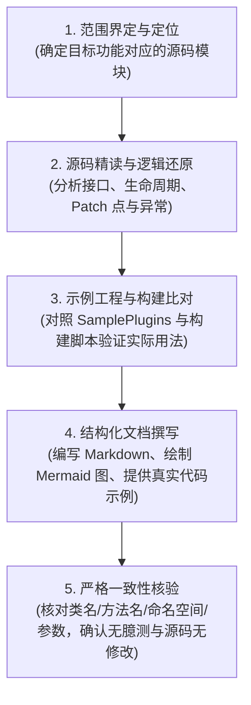

# AGENTS.md - BveEX 项目文档工作区规范与协作指南

本规范是指导所有 AI 协作智能体（Agents）在本工作区中进行代码分析与文档编写的最高准则。

---

## 1. 工作区定位与核心使命 (Mission & Scope)

### 1.1 项目背景
**BveEX**（曾用名 AtsEX）是一个面向 **BVE Trainsim 5 / 6** 的高性能扩展插件框架。它通过底层注入与 Hook（基于 Harmony、DllExport 等机制），突破传统 ATS 插件与输入设备插件的限制，允许开发者为 BVE 添加丰富的图形渲染、高级交互、复杂信号与控制逻辑等扩展能力。
由于该开源项目**缺少官方完备的技术文档与用户手册**，本工作区的主要任务是对其进行系统化的分析与文档梳理。

### 1.2 核心使命与交付目标
Agents 在本工作区的唯一核心任务是：**编写与维护高质量、权威、详实的 BveEX 用户手册与开发者文档**。
文档体系划分为三大板块：
1. **用户手册 (User Manual)**：面向终端玩家、路线/车辆配置作者，涵盖安装部署、依赖要求、插件加载、配置方式与故障诊断。
2. **插件开发者文档 (Plugin Developer Guide - “开发适配 BveEX 的列车/地图插件”)**：面向广大 BVE 插件开发者，系统性讲解如何利用 `BveEx.PluginHost`、`BveHacker`、`DXDynamicTexture` 等开发运行在 BveEX 之上的列车插件（Vehicle Plugin）与地图插件（Map Plugin）。
3. **核心开发者文档 (Core Contributor Guide - “基于 BveEX 继续开发”)**：面向 BveEX 框架本身的二次开发者与维护者，全面解析源码架构、启动与 Hook 注入机制、构建与打包流水线、本地依赖管理及内部扩展实现。

---

## 2. 核心红线与行为准则 (Strict Rules & Constraints)

在执行任何任务时，所有 Agents 必须无条件遵守以下三条核心铁律：

### 一：上游源代码严格只读 (Read-Only Upstream Codebase)
- **只读分析，绝不改动**：工作区内的所有上游源代码（包括但不限于 `BveEx/`、`BveEx.*/`、`Extensions/`、`Libs/`、`SamplePlugins/`、`*.sln`、`*.bat` 等）**仅用于只读分析**。
- **严禁修复缺陷**：**即便在深入分析源码时发现了代码缺陷、Bug、拼写错误、逻辑漏洞或不合理设计，也绝对不得修改上游代码！**
- **缺陷的处理方式**：若发现代码存在缺陷、未处理的边界异常或已知限制，应当将其**如实记录在文档的“已知缺陷”、“行为特性”或“开发注意事项”中**，告知读者实际运作行为及避坑建议。
- **写入权限隔离**：除根目录下的 `AGENTS.md`、文档输出目录（如 `docs/`）及文档工程必要的配置文件外，**严禁修改或新建任何上游源码文件**。

### 二：事实驱动与杜绝无据臆测 (Code-as-Truth & Zero Hallucination)
- **代码即事实**：文档中的所有概念、生命周期阶段、API 签名、事件触发时序、数据结构、配置文件格式，必须来自对工作区现有源代码及配置的真实分析，做到**字字有据、代码可溯**。
- **严禁无根据臆想**：严禁在未找到源码对应实现的情况下凭直觉、通用经验或臆想捏造 API、配置项或运作流程并写入文档。
- **闭源边界声明**：BveEX 深度依赖 BVE 主程序（`BveTs.exe`）。若某项机制涉及 BVE 闭源宿主的内部交互而在现有源码中无法彻底穷尽，应客观描述代码中的调用逻辑，并明确标注为“依赖 BVE 宿主实现”、“观察到的运行时行为”或“尚待实机测试验证”，切勿将推测包装为既成事实。

### 三：严密验证与交叉对照 (Cross-Verification)
- 在讲解 API 或开发插件时，必须优先对照 `SamplePlugins/`（包括 `VehiclePlugins/` 和 `MapPlugins/`）中的官方范例实现。
- 确保文档中给出的示例代码与当前版本的 `BveEx.PluginHost` 接口及命名空间完全匹配。
- 确保文档中没有漏掉当前代码中的某个功能或其它要素。

---

## 3. 文档规划与受众视角 (Documentation Architecture)

文档统一存放于 `docs/` 目录下，并按以下逻辑结构组织编写（部分文档和目录尚未创建）：

```
docs/
├── user-manual/                  # 1. 用户手册
│   ├── installation.md           # 安装、前置依赖环境与部署
│   ├── configuration.md          # 配置文件说明与加载方式
│   └── troubleshooting.md        # 故障排除、日志查看与常见错误
├── plugin-development/           # 2. 插件开发者文档 (开发适配 BveEX 的插件)
│   ├── getting-started.md        # 插件开发快速入门 (开发环境、NuGet 配置)
│   ├── architecture-lifecycle.md # 插件生命周期与执行时机 (Tick、加载与卸载)
│   ├── vehicle-plugins.md        # 列车插件开发指南与 API 详解
│   ├── map-plugins.md            # 地图插件开发指南与 API 详解
│   ├── bve-hacker.md             # BveHacker 深入解析 (访问与修改 BVE 内部状态)
│   ├── extensions/               # 官方核心扩展模块使用
│   │   ├── ats-array-extender.md # AtsArrayExtender (ATS 变量数组扩展)
│   │   └── dynamic-texture.md    # DXDynamicTexture (动态贴图与绘图上下文)
│   └── samples-walkthrough.md    # 官方示例项目 (SamplePlugins) 深度逐行拆解
└── core-development/             # 3. 核心开发者文档 (基于 BveEX 本身继续开发)
    ├── architecture-overview.md  # 框架整体设计与分层架构
    ├── injection-mechanism.md    # 启动链与注入 Hook 原理 (Caller.InputDevice, Harmony)
    ├── build-guide.md            # 完整编译、本地引用与构建流水线解析
    ├── plugin-host-internals.md  # 插件加载器与隔离机制实现
    ├── scripting-runtime.md      # 脚本引擎集成与运行时设计
    └── known-issues.md           # 源码已知缺陷与架构局限性备忘
```

---

## 4. 源码分析与文档编写标准化工作流 (Agent Workflow)

当 Agent 承担某一部分文档的编写或补充任务时，必须严格执行以下五步工作法：



### 步骤 1：定位关联源码
在动笔前，利用代码搜索与文件阅读工具精准定位相关模块：
- 核心接口与插件宿主：`BveEx.PluginHost/`
- 注入与底层 Hook：`BveEx.Launcher/`、`BveEx.Caller.InputDevice/`、`BveEx/BveHacker/`、`BveEx/Native/`
- 扩展库：`Extensions/`
- 官方示例：`SamplePlugins/`
- 构建配置：`BveEx.sln`、`HowToBuild.md`、`DllExport.bat`、`package.bat`

### 步骤 2：逻辑推导与代码走查
- 仔细阅读类、接口定义、XML 注释、成员属性以及修饰符。
- 跟踪关键方法的调用链、异常抛出分支（`throw`）、空引用防御以及互操作逻辑。
- 重点关注生命周期函数的调用时序（例如初始化、每帧 Tick、场景重载、销毁）。

### 步骤 3：验证与提取实践范式
- 查看 `SamplePlugins/` 是如何引用和调用该模块的。
- 确认对外暴露的公共 API（Public API）与内部实现细节（Internal / Private）的区别，避免在插件开发文档中推荐使用内部隐藏 API。

### 步骤 4：撰写清晰且专业的文档
- 使用标准技术中文撰写，结构严谨、层次分明。
- 复杂流程与生命周期必须附带 **Mermaid 流程图或时序图**。
- 提供完整、可编译级别的代码片段，并显式标注所需的命名空间（`using ...;`）。

### 步骤 5：终审核查
- **代码核对**：检查文档中的类名、方法签名、事件名称是否与 C# 源码一字不差。
- **边界核查**：确认文档中提及的限制是否与源码逻辑一致。
- **工作区状态检查**：确认未对任何上游源码进行修改或暂存变更。

---

## 5. 工作区核心模块架构速查 (Repository Map)

为了方便 Agents 快速定位分析目标，以下为主要项目模块的功能映射：

| 模块 / 路径 | 核心职责与关键分析点 |
| :--- | :--- |
| **`BveEx/`** | BveEX 核心实现库。包含主控制器、`BveHacker` 实体实现、`Native` 原生内存操作、版本窗体及诊断故障排除工具。 |
| **`BveEx.PluginHost/`** | 插件开发的核心抽象层与契约库。定义了所有插件基类（`AssemblyPluginBase` 等）、`IBveHacker` 接口、输入事件参数等，是**插件开发者最直接接触的库**。 |
| **`BveEx.Caller.InputDevice/`** | 作为 BVE 的 InputDevice 插件入口点，利用 `DllExport` 导出标准接口，负责被 BVE 宿主加载并触发 BveEX 运行环境。 |
| **`BveEx.Launcher/`** | 引导加载器，负责注入环境准备、程序集重定向解析及初始化主进程。 |
| **`BveEx.Launcher.SplashScreen/`** | 启动画面与加载动画展示逻辑。 |
| **`BveEx.Diagnostics/`** | 运行期诊断与日志追踪系统。 |
| **`BveEx.DummyAts/`** | 虚拟 ATS 插件实现，用于在特定加载模式下兼容或欺骗 BVE 内部状态。 |
| **`BveEx.Scripting/`** | 脚本引擎集成模块（支持 IronPython / Roslyn 等动态脚本能力）。 |
| **`Extensions/`** | 官方核心扩展插件集合（如 `AtsArrayExtender` 数组扩容、`DXDynamicTexture` 动态贴图渲染）。 |
| **`SamplePlugins/`** | 官方示例插件源码（包含地图插件与列车插件范例），是编写插件开发指南的**第一真理对照源**。 |
| **`LocalReferences/`** | 本地依赖程序集（如 BVE 原生依赖 `Mackoy.IInputDevice.DLL`、`Mackoy.XmlInterfaces.DLL`）。 |
| **`docs/`** | 文档根目录，所有文档产出物的唯一保存位置。 |

---

## 6. 文档书写与格式规范 (Style Guidelines)

1. **语言风格**：使用严谨、清晰、客观的技术文档语言，采用规范的简体中文。
2. **符号与类型标记**：
   - 所有的代码符号（类型、接口、方法、属性、字段）必须用行内代码块包裹，如 `IBveHacker`、`AssemblyPluginBase`、`Tick()`。
   - 文件路径与配置项采用代码块标注，如 `BveEx.PluginHost.dll`、`[Plugin]`。
3. **图表规范**：
   - 交互时序使用 `mermaid` 的 `sequenceDiagram`。
   - 架构与状态流转使用 `mermaid` 的 `flowchart TD` 或 `stateDiagram-v2`。
4. **已知缺陷与注意提示**：
   - 发现代码缺陷或边界行为时，使用 GitHub 风格警告块突出显示：
     ```markdown
     > [!WARNING]
     > 此处为上游代码已知缺陷：在 ... 情况下可能抛出 NullReferenceException，编写插件时请务必自行增加空值校验。
     ```
     ```markdown
     > [!NOTE]
     > 该接口的行为受 BVE 宿主底层时序约束，仅在特定场景模式下触发。
     ```

---
*本规范文件由工作区初始化生成。所有协助编写文档的 Agent 请严格依照本指引展开工作。*
