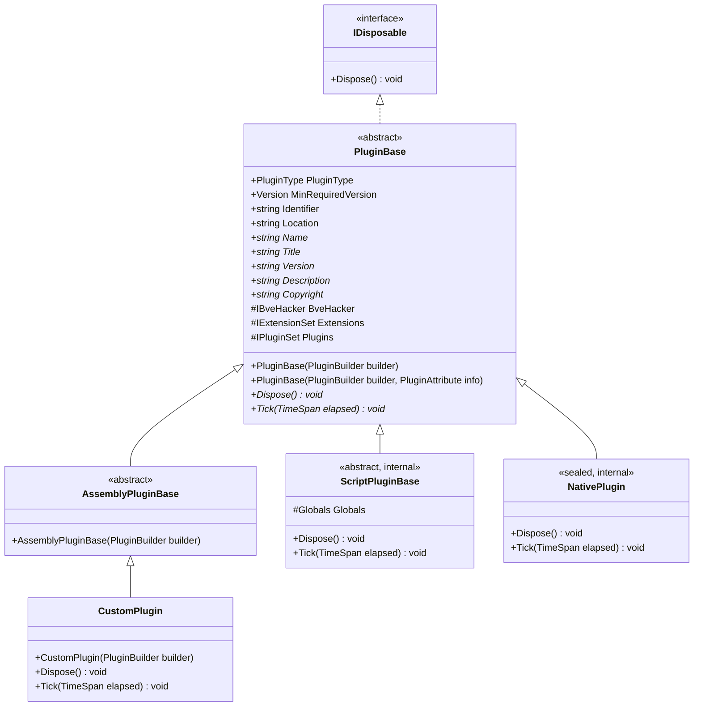
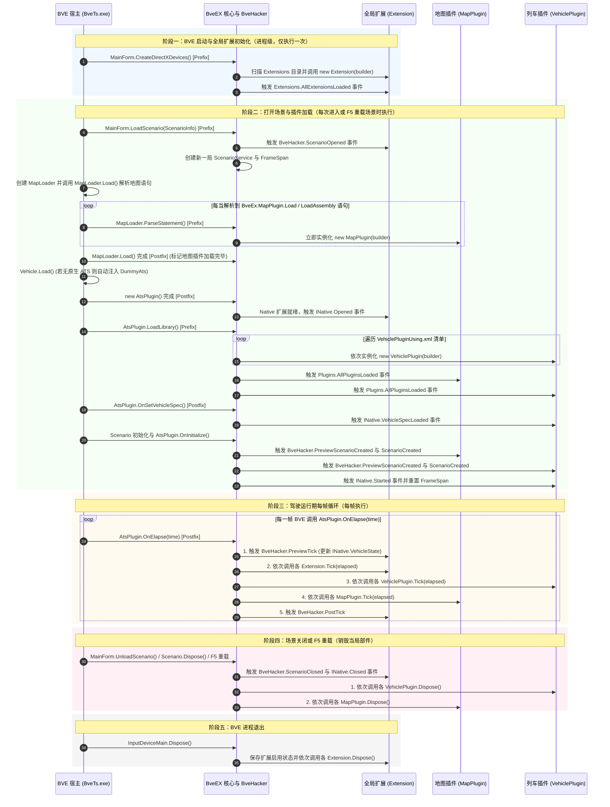
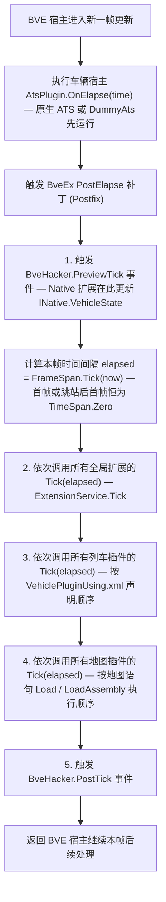

# 插件生命周期与执行时机

在开发 BveEX 插件时，最常见的问题莫过于：**“我应该在什么时候读取车辆或地图对象？”**、**“为什么在构造函数里访问 `BveHacker.Scenario` 或 `INative.AtsKeys` 会报错？”** 以及 **“多个插件的 `Tick` 究竟谁先执行？”**。

本文将深入 BveEX 核心与扩展源码（`BveEx`、`BveEx.PluginHost`、`BveEx.CoreExtensions`），全面拆解插件的继承架构、三种插件类型的生命周期跨度、从 BVE 启动到场景卸载的完整事件触发顺序，以及每帧 `Tick` 的底层执行流水线。

---

## 1. 插件架构总览

### 1.1 核心基类层级与多载体统一模型

在 BveEX 中，无论是全局扩展、列车插件还是地图插件，也无论其开发载体是预编译的 C# 程序集（`.dll`）、动态脚本（`.cs` / `.py`）还是传统的 Win32 原生 ATS 插件（`.dll`），在运行期都会被包装为抽象基类 `BveEx.PluginHost.Plugins.PluginBase` 的派生实例，由框架统一调度。



各层级的职责分工如下：

- **`PluginBase`**（位于 `BveEx.PluginHost.Plugins`）：
  所有插件与扩展的根基类。定义了插件类型检验、最低 BveEX 版本校验（`Validate()`）、宿主上下文注入（通过 `PluginBuilder`）以及两个核心生命周期抽象方法——每帧执行的 `Tick(TimeSpan elapsed)` 与卸载时执行的 `Dispose()`。
- **`AssemblyPluginBase`**（位于 `BveEx.PluginHost.Plugins`）：
  **开发常规 `.dll` 程序集插件（含扩展）时应当直接继承的基类**。它在 `PluginBase` 的基础上，通过反射自动读取插件所在程序集的特性（`AssemblyTitleAttribute`、`AssemblyDescriptionAttribute`、`AssemblyCopyrightAttribute` 及程序集版本号），自动填充 `Name`、`Title`、`Version`、`Description`、`Copyright` 五个元数据属性，用于“版本信息・插件一览”窗口展示。
- **`ScriptPluginBase` 与 `NativePlugin`**（位于 `BveEx` 核心内部）：
  当清单中声明 `<CSharpScript>`、`<IronPython2>` 或 `<Native>` 时，BveEX 会在内部生成对应的包装类实例，将脚本文件（如 `Constructor.cs`、`OnScenarioCreated.cs`、`OnStarted.cs`、`Tick.cs`、`Dispose.cs`）或原生 Win32 ATS 导出函数（`Load`、`SetVehicleSpec`、`Initialize`、`Elapse`、`Dispose` 等）桥接到统一的 `PluginBase` 生命周期中。

> [!NOTE]
> **从 AtsEX 1.x 迁移提示**：在早期 AtsEX 1.x 版本中，`Tick(TimeSpan elapsed)` 方法具有返回值（如 `VehiclePluginTickResult`、`MapPluginTickResult`）。而在当前 BveEX 2.0 架构中，`Tick(TimeSpan elapsed)` 的返回值已统一简化为 `void`；若需在列车插件中干预电门、制动或方向手柄，直接修改 `BveHacker.Scenario.Vehicle.Instruments.AtsPlugin.AtsHandles` 即可。

---

### 1.2 基类的三大核心入口属性与元数据属性

继承 `AssemblyPluginBase`（或 `PluginBase`）后，你的插件类可以直接使用以下由 `PluginBuilder` 在构造阶段注入的成员：

#### 三大受保护核心入口（`protected`）

| 属性名 | 类型 | 命名空间 | 核心用途与可用范围 |
| :--- | :--- | :--- | :--- |
| **`BveHacker`** | `IBveHacker` | `BveEx.PluginHost` | 访问与操作 BVE 宿主内部状态（如主窗口 `MainForm`、场景 `Scenario`、地图加载器 `MapLoader`、音频设备 `DirectSound`）并订阅场景级与帧级生命周期事件 |
| **`Extensions`** | `IExtensionSet` | `BveEx.PluginHost.Plugins.Extensions` | 通过 `Extensions.GetExtension<T>()` 获取全局扩展功能实例（如 `INative`、`ISignalPatchFactory`、`IStatementSet`、`IContextMenuHacker` 等） |
| **`Plugins`** | `IPluginSet` | `BveEx.PluginHost.Plugins` | 通过 `Plugins.VehiclePlugins` 与 `Plugins.MapPlugins` 只读字典查找当前场景中的其它插件实例，或订阅 `Plugins.AllPluginsLoaded` 事件。<br/>⚠️ **注意**：对于全局扩展（`PluginType.Extension`），该属性恒为 `null` |

#### 公共标识与元数据属性（`public`）

| 属性名 | 类型 | 值来源说明 |
| :--- | :--- | :--- |
| **`PluginType`** | `PluginType` | 来自类上方标注的 `[Plugin(PluginType.xxx)]` 特性（`Extension` / `VehiclePlugin` / `MapPlugin`） |
| **`MinRequiredVersion`** | `Version` | 来自 `[Plugin(PluginType.xxx, "版本号")]` 的第二参数；未指定时为 `null` |
| **`Identifier`** | `string` | 插件在当前运行环境中的唯一标识符（来自 `PluginUsing.xml` 的 `Identifier` 属性、`LoadAssembly` 第二参数，或自动生成的随机 GUID 字符串） |
| **`Location`** | `string` | 插件文件（`.dll` 或脚本包 `Package.xml`）在磁盘上的完整绝对路径。常通过 `Path.GetDirectoryName(Location)` 定位插件同目录下的外部配置文件或音频资源 |
| **`Name`** | `string` | `AssemblyPluginBase` 默认返回 `Path.GetFileName(Location)`（如 `MyPlugin.dll`） |
| **`Title` / `Version` / `Description` / `Copyright`** | `string` | `AssemblyPluginBase` 默认从 `Properties/AssemblyInfo.cs` 中的对应程序集特性自动读取 |

---

### 1.3 单 DLL 多插件类与 `Identifier` 分配规则

根据 `BveEx.Plugins.PluginLoader.LoadFromAssembly` 的源码实现，BveEX 在加载一个程序集（`.dll`）时，会扫描其中所有满足 **`public`、非抽象（`!IsAbstract`）、继承自 `PluginBase` 且包含 `public 类名(PluginBuilder)` 构造函数** 的类型：

1. **单插件类程序集（主流推荐）**：
   - 若 `.dll` 中仅找到 **1 个** 符合条件的插件类，`PluginLoader` 会使用你在 `PluginUsing.xml` 的 `<Assembly Identifier="..." />` 或地图语句 `BveEx.MapPlugin.LoadAssembly('...', 'Identifier')` 中指定的字符串作为该实例的 `Identifier`。
   - 若未显式指定 `Identifier`，框架会通过 `RandomIdentifier` 自动分配一个 `Guid.NewGuid().ToString()`。
2. **多插件类程序集**：
   - 若一个 `.dll` 中定义了 **2 个或更多** 符合条件的插件类（且它们的 `PluginType` 均与当前加载清单类型一致），`PluginLoader` 会将它们**全部实例化**。
   - **限制规则**：当单 `.dll` 包含多个插件类时，**严禁在 `PluginUsing.xml` 或 `LoadAssembly` 中指定自定义 `Identifier`**，否则加载器会直接抛出 `BveFileLoadException`（无法为包含多个插件的程序集设置固定标识符）；此时每个插件类实例都会被强制分配独立的随机 GUID。

---

### 1.4 三种插件类型的生命周期跨度对比

在深入具体方法时序前，必须先明确 `Extension`、`MapPlugin` 与 `VehiclePlugin` 三者在存活周期上的本质区别：

| 对比维度 | 扩展功能 (`PluginType.Extension`) | 地图插件 (`PluginType.MapPlugin`) | 列车插件 (`PluginType.VehiclePlugin`) |
| :--- | :--- | :--- | :--- |
| **生命周期跨度** | **进程级（全局单例）**<br/>随 BVE 启动创建，伴随整个 `BveTs.exe` 进程，直到关闭 BVE 时才销毁 | **场景级（单局实例）**<br/>每次打开场景或按 `F5` 重载场景时重新创建；关闭或重载场景时销毁 | **场景级（单局实例）**<br/>每次打开场景或按 `F5` 重载场景时重新创建；关闭或重载场景时销毁 |
| **实例化（构造函数）时机** | BVE 启动并首次初始化 DirectX 设备（`MainForm.CreateDirectXDevices` Prefix）时 | 场景加载期间，BVE 解析地图文件遇到 `BveEx.MapPlugin.Load` / `LoadAssembly` 语句的瞬间 | 地图解析完毕后，BVE 准备加载车辆 ATS 库（`AtsPlugin.LoadLibrary` Prefix）的瞬间 |
| **加载完成通知事件** | `Extensions.AllExtensionsLoaded` | （内部标记 `AreMapPluginsLoaded = true`，随后等待列车插件加载完毕） | `Plugins.AllPluginsLoaded`（此时地图插件与列车插件均已全部就绪） |
| **每帧 `Tick` 执行顺位** | **第 1 顺位**（最先执行） | **第 3 顺位**（最后执行） | **第 2 顺位**（在扩展之后、地图插件之前） |
| **`Dispose()` 销毁顺位** | BVE 进程退出时销毁 | 场景关闭或按 `F5` 重载时销毁（在列车插件 `Dispose()` **之后**执行） | 场景关闭或按 `F5` 重载时销毁（在地图插件 `Dispose()` **之前**执行） |

---

## 2. 全生命周期全景时序

### 2.1 从 BVE 启动到退出的完整生命周期总图

BveEX 通过 Harmony 对 BVE 主程序（`BveTs.exe`）的关键内部方法挂载前置（Prefix）或后置（Postfix）补丁，从而驱动整个插件生命周期。以下时序图展示了从进程启动、打开场景、每帧驾驶循环到关闭场景的完整调用链：



---

### 2.2 阶段一：BVE 启动与全局扩展（`Extension`）加载

当 BVE 进程启动并加载输入设备插件 `BveEx.Caller.InputDevice.dll` 后，BveEX 引导器并不会立刻实例化插件，而是由 `InputDeviceMain` 在 `MainForm.CreateDirectXDevices` 方法上挂载一个一次性 Prefix 补丁。

当 BVE 主窗口完成基础构建并准备创建 DirectX 设备时，BveEX 核心正式启动（`new BveEx(bveTypes)`）：

1. **初始化 `BveHacker`**：捕获主窗口 `MainForm`、`ScenarioSelectionForm`、`LoadingProgressForm`、`TimePosForm`、`ChartForm`、`DirectSound`、`InputManager`、`Preferences` 等全局宿主对象。
2. **扫描并加载所有全局扩展（`ExtensionSetFactory.Load`）**：
   - 先读取 `Extensions\PluginUsing.xml`（若存在）中声明的扩展；
   - 再递归扫描 `Extensions\` 目录及其子目录下的全部 `*.dll` 文件，自动过滤掉未引用 `BveEx.PluginHost` 的普通依赖库（`allowNonPluginAssembly: true`），并实例化所有标注了 `[Plugin(PluginType.Extension)]` 且实现 `IExtension` 接口的扩展类。
   - 读取 `LoadedExtensions.xml` 配置文件，恢复实现了 `ITogglableExtension` 接口的可切换扩展的启用状态（`IsEnabled`）。
3. **触发 `Extensions.AllExtensionsLoaded` 事件**：通知所有全局扩展“扩展集合已组装完毕”。

> [!WARNING]
> **开发全局扩展（`PluginType.Extension`）时的两项特殊限制**：
> 1. **构造函数内禁止调用 `Extensions.GetExtension<T>()`**：在所有扩展全部完成实例化之前，`ExtensionSet` 内部的字典尚未赋值，此时在扩展的构造函数中调用 `Extensions.GetExtension<T>()` 会直接抛出 `MemberNotInitializedException`。若扩展 A 需要获取扩展 B，必须在构造函数中订阅 `Extensions.AllExtensionsLoaded`（或在 `BveHacker.ScenarioOpened` 回调中）再调用 `GetExtension<T>()`。
> 2. **扩展的 `Plugins` 属性恒为 `null`**：由于全局扩展在场景打开前就已经存在，而 `PluginSet` 是随每个场景动态创建的，`ExtensionSetFactory` 在构造扩展时传入的 `plugins` 参数为 `null`。但对于**列车插件**与**地图插件**而言，它们加载时所有全局扩展早已就绪，因此**在列车插件和地图插件的构造函数中可以直接安全调用 `Extensions.GetExtension<T>()`**。

---

## 3. 场景加载期：插件实例化与初始化阶段详解

当玩家在“选择场景”窗口选中路线并点击开始（或按 `F5` 重新加载）时，BVE 调用 `MainForm.LoadScenario(ScenarioInfo)`，由此进入场景加载期的四个子阶段。

### 3.1 场景打开与地图插件（`MapPlugin`）加载

1. **触发 `BveHacker.ScenarioOpened`**：
   - `ScenarioHacker` 拦截 `MainForm.LoadScenario` 的 Prefix，触发 `BveHacker.ScenarioOpened` 事件（参数 `ScenarioOpenedEventArgs` 包含当前场景文件信息 `ScenarioInfo` 以及表示是否为 `F5` 重载的布尔属性 `IsReload`）。
   - 注意：此时地图插件与列车插件尚未加载，因此**只有全局扩展（`Extension`）能够监听并收到 `ScenarioOpened` 事件**。
2. **创建场景级容器 `ScenarioService`**：
   - `InputDeviceMain` 创建当前场次的 `ScenarioService` 与 `PluginSet`，并通过 `MapListener` 监听内置扩展 `IStatementSet` 的地图语句解析事件。
3. **地图解析期间即时实例化 `MapPlugin`**：
   - BVE 创建 `MapLoader` 并调用 `MapLoader.Load()` 逐行解析地图文件（含 `include` 引入的子地图文件）。
   - 每当 `MapLoader.ParseStatement` 解析到 `BveEx.MapPlugin.Load('...')` 或 `BveEx.MapPlugin.LoadAssembly('...')` 语句时，`ScenarioService` **立即加载对应的地图插件并调用其构造函数 `new MyMapPlugin(PluginBuilder)`**。
   - 这种“边解析地图边实例化插件”的设计，使得地图插件能够在构造函数中通过 `IStatementSet` 注册自定义地图语法解析器，或读取写在插件加载语句之后的自定义地图指令（参见官方示例 `SamplePlugins/MapPlugins/MapStatementTest`）。
4. **完成地图插件加载**：
   - 当 `MapLoader.Load()` 执行结束（Postfix）时，触发 `IStatementSet.LoadingCompleted`，`PluginSet` 将 `AreMapPluginsLoaded` 标记为 `true`，此后不再允许向当前场景追加地图插件。

---

### 3.2 车辆加载与列车插件（`VehiclePlugin`）加载

地图文件解析完成后，BVE 开始根据场景选定的车辆文件加载列车数据（`Vehicle.Load`）：

1. **无 ATS 车辆的 `DummyAts` 自动兜底（`AtsPluginOverrider`）**：
   - BveEX 的许多核心机制（如列车插件加载钩子、`INative` 事件、每帧 `Tick` 驱动）均挂载在 BVE 的 `AtsPlugin` 类方法上。
   - 如果某辆列车未配置原生 Win32 ATS 插件（`vehicleFile.AtsPluginPath == null`），或者配置的原生 ATS `.dll` 加载失败，`AtsPluginOverrider` 会自动将路径重定向至 BveEX 内置的空壳插件 `BveEx.DummyAts.x86.dll`（32 位）或 `BveEx.DummyAts.x64.dll`（64 位），从而保证任何车辆下 BveEX 插件都能正常运转。
2. **`AtsPlugin` 构造与 `INative.Opened` 事件**：
   - BVE 实例化内部的 `AtsPlugin` 对象。
   - `BveEx.CoreExtensions` 中的 `Native` 扩展拦截 `AtsPlugin` 构造函数的 Postfix，初始化 `AtsPanelArray`、`AtsSoundArray` 与 `AtsKeys`，将 `INative.IsAvailable` 置为 `true`，并立即触发 **`INative.Opened`** 事件。
3. **实例化所有 `VehiclePlugin`（`AtsPlugin.LoadLibrary` Prefix）**：
   - 当 BVE 调用 `AtsPlugin.LoadLibrary` 准备载入车辆的原生 ATS `.dll` 时，BveEX 的 `OnLoadPatch`（Prefix）抢先介入，调用 `ScenarioService.LoadVehiclePlugins()`。
   - 框架在车辆文件同目录下查找 `<车辆文件名>.VehiclePluginUsing.xml`（若不存在则回退查找 `VehiclePluginUsing.xml`），**按照 XML 清单从上到下的声明顺序，依次加载并执行所有列车插件的构造函数 `new MyVehiclePlugin(PluginBuilder)`**。
4. **触发 `Plugins.AllPluginsLoaded` 事件**：
   - 所有列车插件实例化并加入 `Plugins.VehiclePlugins` 字典后，`PluginSet` 立即触发 **`Plugins.AllPluginsLoaded`** 事件。
   - 此时，当前场景的**全部地图插件**与**全部列车插件**均已完成构造，是跨插件互相查找引用的标准时机。

---

### 3.3 车辆规格就绪、场景构建完成与开始驾驶

列车插件加载完毕后，BVE 继续完成最后的场景组装与初始化：

1. **触发 `INative.VehicleSpecLoaded` 事件（`AtsPlugin.OnSetVehicleSpec` Postfix）**：
   - BVE 读取车辆的段位信息（`NotchInfo`）与编组辆数，调用 `AtsPlugin.OnSetVehicleSpec`。
   - `Native` 扩展在此方法的 Postfix 中生成 `INative.VehicleSpec`（包含 `BrakeNotches`、`PowerNotches`、`AtsNotch`、`B67Notch`、`Cars`），并触发 **`INative.VehicleSpecLoaded`** 事件（相当于传统 ATS 插件的 `SetVehicleSpec` 函数）。
   - 若清单中包含 `<Native>` 挂载的传统 ATS `.dll`，其包装类 `NativePlugin` 会在该事件回调中依次调用原生 DLL 的 `Load()` 与 `SetVehicleSpec()`。
2. **触发 `BveHacker.PreviewScenarioCreated` 与 `BveHacker.ScenarioCreated` 事件**：
   - BVE 组装好 `Scenario` 实例，并调用 `Scenario.InitializeTimeAndLocation` 或 `Scenario.Initialize` 初始化列车位置与时刻。
   - `ScenarioHacker` 在这两个初始化方法首次执行完毕（Postfix）时捕获该 `Scenario` 实例（并立即解绑补丁，确保单次场景加载**只触发一次**），随后由 `BveHacker` 依次触发：
     1. **`BveHacker.PreviewScenarioCreated`**：供框架内部服务（如 `StructureSetLifeProlonger` 在 `ObjectDrawer.Build` 清空模型字典后重新写回 `e.Scenario.Map.Structures`）在普通插件介入前完成数据修复。常规插件开发无需使用此事件。
     2. **`BveHacker.ScenarioCreated`**：**插件初始化场景对象引用的最重要事件**。此时通过事件参数 **`e.Scenario`** 可以完整访问路线中的闭塞分区（`SectionManager`）、车站列表（`Map.Stations`）、3D 模型（`Map.StructureModels`）、他车列表（`Trains`）以及本车对象（`Vehicle`、驾驶台 `Panel`、车掌 `Conductor`、保安装置 `Instruments.AtsPlugin` 等）。
3. **触发 `INative.Started` 事件（`AtsPlugin.OnInitialize` Prefix）**：
   - BVE 调用 `AtsPlugin.OnInitialize(BrakePosition)` 通知保安装置初始化（相当于传统 ATS 插件的 `Initialize(int brake)` 函数）。
   - BveEX 核心在此处调用 `FrameSpan.Initialize()` 重置帧计时器；`Native` 扩展同时触发 **`INative.Started`** 事件（参数 `StartedEventArgs.DefaultBrakePosition` 表示初始制动阀位置）。

---

### 3.4 关键速查：各初始化阶段的对象可用性矩阵

由于不同阶段 BVE 内部对象的创建进度不同，在错误的时机访问属性会导致空引用（`NullReferenceException`）或状态异常（`InvalidOperationException`）。请对照下表安排你的初始化代码：

| 想要访问的目标或执行的操作 | 地图插件构造函数<br/>`MapPlugin()` | 列车插件构造函数<br/>`VehiclePlugin()` | 全部插件就绪回调<br/>`AllPluginsLoaded` | 场景创建完成回调<br/>`ScenarioCreated` | 开始/跳站回调<br/>`INative.Started` | 每帧循环<br/>`Tick()` |
| :--- | :---: | :---: | :---: | :---: | :---: | :---: |
| **`BveHacker.MainForm` / `DirectSound` / `ScenarioInfo`** | ✅ 可用 | ✅ 可用 | ✅ 可用 | ✅ 可用 | ✅ 可用 | ✅ 可用 |
| **`Extensions.GetExtension<T>()`**（获取扩展实例） | ✅ 可用 | ✅ 可用 | ✅ 可用 | ✅ 可用 | ✅ 可用 | ✅ 可用 |
| **`BveHacker.MapLoader`**（地图加载器） | ✅ 可用 | ✅ 可用 | ✅ 可用 | ✅ 可用 | ✅ 可用 | ✅ 可用 |
| **`Plugins.MapPlugins`**（获取所有地图插件） | ⚠️ 仅含已解析语句前的插件 | ✅ 全部可用 | ✅ 全部可用 | ✅ 全部可用 | ✅ 全部可用 | ✅ 全部可用 |
| **`Plugins.VehiclePlugins`**（获取所有列车插件） | ❌ 为空（尚未加载） | ⚠️ 仅含清单排在前面的插件 | ✅ 全部可用 | ✅ 全部可用 | ✅ 全部可用 | ✅ 全部可用 |
| **`INative.AtsPanelArray` / `AtsSoundArray` / `AtsKeys`** | ❌ 为 `null`<br/>(`IsAvailable == false`) | ✅ 可用<br/>(`IsAvailable == true`) | ✅ 可用 | ✅ 可用 | ✅ 可用 | ✅ 可用 |
| **`INative.VehicleSpec`**（车辆段位与编组规格） | ❌ 为 `null` | ❌ 为 `null` | ❌ 为 `null` | ✅ 可用 | ✅ 可用 | ✅ 可用 |
| **`e.Scenario`**（从 `ScenarioCreatedEventArgs` 获取场景） | — | — | — | ✅ **必须用它** | — | — |
| **`BveHacker.Scenario`**（从 `BveHacker` 属性获取场景） | ❌ 抛异常 | ❌ 抛异常 | ❌ 抛异常 | ❌ **不可用（抛异常或旧实例）** | ⚠️ 仅跳站时可用 | ✅ 可用 |
| **`INative.VehicleState`**（速度、风压、电流快照） | ❌ 为 `null` | ❌ 为 `null` | ❌ 为 `null` | ❌ 为 `null` | ❌ 首次为 `null` | ✅ 可用（由 `PreviewTick` 更新） |

---

### 3.5 核心避坑指南与闭源边界说明

#### 避坑 1：在 `ScenarioCreated` 事件回调中，必须使用 `e.Scenario` 而非 `BveHacker.Scenario`！

这是初学者乃至熟练开发者最容易踩中的陷阱。查看 `BveEx/BveHacker/Services/ScenarioHacker.cs` 的源码实现：

```csharp
// BveHacker.Scenario 底层读取的是 MainForm.CurrentScenario 字段：
public Scenario CurrentScenario
{
    get => MainForm.CurrentScenario;
    set => MainForm.CurrentScenario = value;
}

// 而 ScenarioCreated 是在 Scenario.InitializeTimeAndLocation / Scenario.Initialize 的 Postfix 中触发的：
Scenario scenario = Scenario.FromSource(e.Instance);
ScenarioCreatedEventArgs scenarioCreatedEventArgs = new ScenarioCreatedEventArgs(scenario);
ScenarioCreated?.Invoke(scenarioCreatedEventArgs);
```

在 BVE 宿主（`BveTs.exe`）的 `MainForm.LoadScenario` 方法内部，BVE 会先在局部变量中实例化 `Scenario` 并调用其初始化方法（此时触发 `ScenarioCreated`），**直到 `LoadScenario` 方法快结束时，才会将该局部变量赋值给 `MainForm.CurrentScenario` 字段**。

这意味着**在 `ScenarioCreated` 事件触发的瞬间，`MainForm.CurrentScenario` 尚未被赋值为新场景**（首次打开场景时为 `null`，会导致读取 `BveHacker.Scenario` 直接抛出 `InvalidOperationException`；按 `F5` 重载场景时甚至可能还残留着上一局的旧实例）。

**正确写法**（对照官方全部 `SamplePlugins` 示例）：
```csharp
private void OnScenarioCreated(ScenarioCreatedEventArgs e)
{
    // ✅ 正确：始终通过事件参数 e.Scenario 访问新生成的场景对象
    SectionManager sectionManager = e.Scenario.SectionManager;
    Vehicle vehicle = e.Scenario.Vehicle;

    // ❌ 错误：此时 BveHacker.IsScenarioCreated 仍为 false，直接读取 BveHacker.Scenario 会抛出异常！
    // Vehicle vehicle = BveHacker.Scenario.Vehicle;

    // ⚠️ 同理：若在 ScenarioCreated 内调用 IDiagramUpdater 更新时刻表，必须使用传入 e.Scenario 的重载：
    // Extensions.GetExtension<IDiagramUpdater>().UpdateDiagram(e.Scenario);
}
```

#### 避坑 2：地图插件构造函数中不能直接访问 `INative.AtsKeys` 或 `AtsPanelArray`

如第 3.1 与 3.2 节所述，**地图插件**是在解析地图语句时实例化的，此时 BVE 尚未加载车辆，也尚未创建 `AtsPlugin` 对象，因此 `INative.IsAvailable` 为 `false`，`native.AtsKeys`、`native.AtsPanelArray`、`native.AtsSoundArray` 全部为 `null`。

- 在**列车插件**的构造函数中，`AtsPlugin` 已经创建完成，因此可以直接编写 `native.AtsKeys.GetKey(AtsKeyName.D).Pressed += ...`（如官方示例 `SamplePlugins/VehiclePlugins/ConductorPatchTest`）。
- 而在**地图插件**中，若需要绑定 ATS 按键或访问面板数组，必须订阅 `INative.Opened` 或 `INative.VehicleSpecLoaded` 事件，待车辆加载后再访问（参考官方示例 `SamplePlugins/MapPlugins/SignalController`）：

```csharp
[Plugin(PluginType.MapPlugin)]
public class MyMapPlugin : AssemblyPluginBase
{
    public MyMapPlugin(PluginBuilder builder) : base(builder)
    {
        INative native = Extensions.GetExtension<INative>();

        // ❌ 错误：地图插件构造时车辆尚未加载，native.AtsKeys 为 null，会抛出 NullReferenceException
        // native.AtsKeys.GetKey(AtsKeyName.D).Pressed += OnDPressed;

        // ✅ 正确：等待车辆规格加载完毕（或订阅 native.Opened）后再绑定按键
        native.VehicleSpecLoaded += (sender, e) =>
        {
            native.AtsKeys.GetKey(AtsKeyName.D).Pressed += OnDPressed;
        };
    }

    private void OnDPressed(object sender, EventArgs e)
    {
        // 处理按键逻辑
    }
    // ...
}
```

#### 避坑 3：`BveHacker.ScenarioCreated` 与 `INative.Started` 的职责区别

| 对比项 | `BveHacker.ScenarioCreated` | `INative.Started` |
| :--- | :--- | :--- |
| **底层 Hook 点** | `Scenario.InitializeTimeAndLocation` 与 `Scenario.Initialize` 的 **Postfix**（触发一次后立即自动解绑） | `AtsPlugin.OnInitialize(BrakePosition)` 的 **Prefix**（持续监听） |
| **单局触发次数** | **仅 1 次**（仅在场景加载完成时触发，跳站时**不会**再次触发） | **1 次或多次**（场景首次开始时触发 1 次；此后玩家每次在“时刻与位置”窗口执行**跳站 / 駅ジャンプ**时都会再次触发） |
| **典型用途** | 获取 `e.Scenario` 下的闭塞、他车、车站、驾驶台、车掌等对象引用；注册信号机补丁（`SignalPatch`）、先行列车补丁（`PreTrainPatch`）、车掌补丁（`ConductorPatch`）或动态贴图句柄 | 重置保安装置内部状态机、根据 `e.DefaultBrakePosition` 初始化制动状态、为 `AtsPanelArray` 赋予初始显示值（如官方示例 `AtsPanelValueTest`） |

> [!NOTE]
> **关于闭源宿主内部顺序的说明**：
> 在 BveEX 源码中，`INative.Started` 挂载于 `AtsPlugin.OnInitialize` 的 **Prefix**，而 `BveHacker.ScenarioCreated` 挂载于 `Scenario.InitializeTimeAndLocation` 与 `Scenario.Initialize` 的 **Postfix**。在首次加载场景时，这两者谁先触发取决于闭源宿主 `BveTs.exe` 内部在初始化场景时调用 `InitializeTimeAndLocation` 与 `AtsPlugin.OnInitialize` 的具体顺序（该逻辑位于 `BveTs.exe` 闭源代码中，无法仅凭本仓库源码定论；尽管脚本插件清单 Schema `BveExScriptPluginPackageManifestXmlSchema.xsd` 将 `<OnScenarioCreated>` 排在 `<OnStarted>` 之前，但那仅代表 XML 标签书写顺序）。因此，**请勿在 `INative.Started` 回调中假设 `OnScenarioCreated` 已经执行完毕（或反之）**；两个事件应当各司其职，互不依赖执行先后。

---

## 4. 运行期：每帧 `Tick` 执行时机与调用链

### 4.1 单帧 `Tick` 的触发源头与执行顺序

进入驾驶界面后，BVE 主循环每一帧都会调用 `AtsPlugin.OnElapse(int time)` 来更新原生保安装置状态。BveEX 在 `AtsPlugin.OnElapse` 上挂载了 **Postfix（后置）** 补丁（见 `BveEx/Main/PatchSet.cs` 与 `BveEx/Native/InputDevices/InputDeviceMain.cs`）。

这意味着在每一帧中，**BVE 会先执行车辆自带原生 ATS 插件（或 `DummyAts`）的 `Elapse` 函数，紧接着在同一帧的 `OnElapse` Postfix 中同步执行 BveEX 的整套 `Tick` 流水线**：



从上述流水线可以得出三个对开发至关重要的结论：

1. **`INative.VehicleState` 在 `Tick` 开始前已自动刷新**：
   `Native` 扩展订阅了 `BveHacker.PreviewTick`，会在所有插件的 `Tick` 执行前，从 `AtsPlugin.StateStore` 读取本帧最新的列车位置（`Location`）、速度（`Speed`）、当前时刻（`Time`）以及各风缸压力（`BcPressure`、`MrPressure`、`ErPressure`、`BpPressure`、`SapPressure`）与电流（`Current`），生成新的 `INative.VehicleState` 快照。
2. **列车插件拥有对原生 ATS 手柄输出的覆盖权**：
   因为车辆自带的原生 ATS（在 `AtsPlugin.OnElapse` 原方法中）先于 BveEX 的 `VehiclePlugin.Tick` 执行，且同一清单中的多个列车插件按 `VehiclePluginUsing.xml` 从上到下的顺序依次调用 `Tick`，所以**排在后面的列车插件在 `Tick` 中修改 `AtsPlugin.AtsHandles`（电门、制动、方向、定速）或 `AtsPanelArray` / `AtsSoundArray` 时，会自然覆盖原生 ATS 或前序插件在同一帧中写入的值**。
3. **地图插件的 `Tick` 在所有列车插件之后执行**：
   `ScenarioService.Tick` 严格先遍历 `Plugins.VehiclePlugins.Values`，再遍历 `Plugins.MapPlugins.Values`。如果地图插件需要在每帧读取列车插件计算出的某个公开状态属性，在同一帧的 `MapPlugin.Tick` 中读取到的永远是列车插件在本帧刚刚更新完毕的最新值。

> [!NOTE]
> **关于闭源宿主单帧渲染与物理时序的说明**：
> 上述 1～5 步在 `AtsPlugin.OnElapse` 的 Postfix 内严格按源码顺序同步执行。至于 `BveTs.exe` 主循环在一帧内部何时调用 `AtsPlugin.OnElapse`、何时推进车辆动力学物理演算、以及何时调用 `MainForm.Draw` / `Scenario.Draw` 进行 DirectX 3D 画面渲染，属于 `BveTs.exe` 闭源宿主内部实现，无法直接从本仓库源码中确认。

---

### 4.2 帧间隔参数 `elapsed`（`TimeSpan`）的计算规则

`Tick(TimeSpan elapsed)` 的参数 `elapsed` 由 `BveEx.Native.FrameSpan` 类负责计算（见 `BveEx/Native/FrameSpan.cs`）：

```csharp
internal class FrameSpan
{
    private bool IsFirstFrame = false;
    private TimeSpan Time = TimeSpan.Zero;

    public void Initialize()
    {
        IsFirstFrame = true;
    }

    public TimeSpan Tick(TimeSpan now)
    {
        TimeSpan span = IsFirstFrame ? TimeSpan.Zero : now - Time;

        Time = now;
        IsFirstFrame = false;

        return span;
    }
}
```

请特别留意 `elapsed` 的以下行为特征：

1. **首帧与跳站后的第一帧恒为 `TimeSpan.Zero`**：
   每当 `AtsPlugin.OnInitialize` 被调用（即首次进入场景或玩家执行跳站重置）时，`FrameSpan.Initialize()` 会将 `IsFirstFrame` 设为 `true`。因此紧随其后的第一帧 `Tick` 收到的 `elapsed` 必定是 `TimeSpan.Zero`（`0` 毫秒）。
   > [!CAUTION]
   > **切勿在 `Tick` 中无条件将 `elapsed.TotalSeconds` 或 `elapsed.Ticks` 作为除法分母！**
   > 例如计算加速度 `(currentSpeed - lastSpeed) / elapsed.TotalSeconds` 时，在首帧或跳站后的第一帧由于 `elapsed == TimeSpan.Zero`，直接相除会产生 `double.NaN` 或 `Infinity` 并污染后续物理状态。在进行除法运算前，请务必判断 `if (elapsed <= TimeSpan.Zero) return;`。
2. **基于 BVE 仿真内部时钟（而非现实挂钟时间）**：
   传入 `FrameSpan.Tick(now)` 的 `now` 来自 `AtsPlugin.OnElapse(int time)` 的参数（即 BVE 内部仿真时刻 `TimeSpan.FromMilliseconds((int)e.Args[0])`）。如果玩家在游戏中使用了快进功能，或因特殊操作修改了场景时间（如调用 `TimeManager.SetTime`），`elapsed` 反映的是仿真时钟的跨度，甚至在把时间往前拨时可能出现负值。

---

### 4.3 `Tick` 编写准则：性能与异常安全

- **框架未对 `Tick` 包裹 `try-catch`**：
  查看 `ScenarioService.Tick` 与 `ExtensionService.Tick` 源码可知，为了避免每帧异常捕获带来的性能开销，BveEX 直接在 `foreach` 循环中裸调 `plugin.Tick(elapsed)`。如果插件在 `Tick` 中抛出了未捕获的异常（如 `NullReferenceException`、`IndexOutOfRangeException`），异常会直接穿透回 BVE 宿主主循环，导致 BVE 弹窗崩溃退出。
- **严禁在 `Tick` 中执行重度阻塞操作**：
  `Tick` 在 BVE 主线程（UI 与渲染同一线程）中每帧同步调用（60 FPS 下每帧预算仅约 $16.6\text{ ms}$）。
  - **推荐做法**：文件读取、XML/JSON 解析、音频加载（`ISoundFactory`）、动态贴图注册（`TextureManager.Register`）、Harmony/扩展补丁挂载、复杂集合查找等耗时操作，**一律放在构造函数或 `ScenarioCreated` 事件中一次性完成**，并将结果缓存到类的私有字段中（参考官方示例 `PreTrainController`、`PanelController`、`DXDynamicTextureTest`）。
  - 在 `Tick` 中只做轻量的数值计算、状态判断与属性赋值。

---

## 5. 卸载期：场景重载（`F5`）、关闭与资源释放（`Dispose`）

### 5.1 正常关闭场景 vs 按 `F5` 重载场景的底层差异

在 BVE 中，退出当前驾驶场景有两种途径，BveEX 对这两种途径都做了妥善拦截以确保插件的 `Dispose()` 被可靠调用：

| 玩家操作 | BVE 宿主行为 | BveEX 内部处理流程（见 `ScenarioHacker.cs` 与 `InputDeviceMain.cs`） |
| :--- | :--- | :--- |
| **返回主菜单 / 切换其它场景** | 调用 `MainForm.UnloadScenario()` 与 `Scenario.Dispose()` | 1. `MainForm.UnloadScenario` Prefix 触发 `BveHacker.ScenarioClosed`（同时触发 `INative.Closed`）；<br/>2. `Scenario.Dispose` Prefix 触发 `BveEx.ScenarioClosed` → 调用 `ScenarioService.Dispose()` 销毁所有列车插件与地图插件。 |
| **驾驶途中按 `F5` 重新加载当前场景** | **不调用** `MainForm.UnloadScenario()`，直接再次调用 `MainForm.LoadScenario()` | 1. `ScenarioHacker.OnLoaded` 检测到 `CurrentScenario != null`，主动补发一次 **`BveHacker.ScenarioClosed`**（同时触发 `INative.Closed`），紧接着触发 `BveHacker.ScenarioOpened(isReload: true)`；<br/>2. `InputDeviceMain.OnScenarioOpened` 在创建新 `ScenarioService` 之前，先调用旧 **`ScenarioService.Dispose()`**，确保上一局的所有列车插件与地图插件在新一局插件加载前彻底完成 `Dispose()`！ |

### 5.2 插件 `Dispose()` 的调用顺序

当 `ScenarioService.Dispose()` 执行时（见 `BveEx/Main/ScenarioService.cs` 第 89–92 行与 `BveEx/Plugins/PluginSet.cs` 第 67–73 行），框架会遍历 `PluginSet` 枚举器：

```csharp
public IEnumerator<KeyValuePair<string, PluginBase>> GetEnumerator()
{
    IEnumerable<KeyValuePair<string, PluginBase>> vehiclePlugins = VehiclePlugins ?? Enumerable.Empty<KeyValuePair<string, PluginBase>>();
    IEnumerable<KeyValuePair<string, PluginBase>> mapPlugins = MapPlugins ?? Enumerable.Empty<KeyValuePair<string, PluginBase>>();

    return vehiclePlugins.Concat(mapPlugins).GetEnumerator();
}
```

因此，销毁顺序严格固定为：
1. **先依次调用所有列车插件（`VehiclePlugin`）的 `Dispose()`**；
2. **再依次调用所有地图插件（`MapPlugin`）的 `Dispose()`**。

（全局扩展 `Extension` 的 `Dispose()` 在此期间**不会**被调用，它们会一直存活到 BVE 进程关闭时才由 `ExtensionService.Dispose()` 统一销毁。）

---

### 5.3 `Dispose()` 资源释放必查清单

由于列车插件与地图插件会在每次重载场景时销毁重建，而 **`BveHacker` 与所有全局扩展（`Extensions`）的生命周期贯穿整个 BVE 进程**，在编写插件的 `Dispose()` 方法时，请务必逐项核对以下四类资源的清理：

#### 1. 解绑 `BveHacker` 与全局扩展上的事件委托（`-=`）
只要你在插件中用 `+=` 订阅了 `BveHacker`（如 `ScenarioCreated`、`PreviewScenarioCreated`、`ScenarioClosed`、`PreviewTick`、`PostTick`）、`Plugins.AllPluginsLoaded` 或全局扩展上的事件，就必须在 `Dispose()` 中用 `-=` 取消订阅。
否则，长生命周期的事件源会一直持有已卸载插件实例的引用，不仅造成内存泄漏，更会导致下次加载场景时**旧插件实例的回调与新插件实例的回调同时被触发**！

> [!WARNING]
> **上游代码已知行为提示：`INative` 事件的自动清空与遗漏**
> 在 `BveEx.CoreExtensions` 的 `Native.OnScenarioClosed`（`Native.cs` 第 192–205 行）中，当场景关闭时，框架会将 `VehicleSpecLoaded`、`Started`、`HornBlown`、`DoorOpened`、`DoorClosed`、`SignalUpdated`、`BeaconPassed` 这 7 个事件直接重置为 `null`，但**并未清空 `INative.Opened` 与 `INative.Closed` 事件**！
> - 官方示例 `SamplePlugins/MapPlugins/TrainController/TrainController.cs` 在构造函数中订阅了 `native.Opened += OnNativeOpened;`，却在 `Dispose()` 中漏掉了 `native.Opened -= OnNativeOpened;`，这会导致每次按 `F5` 重载场景时残留旧委托。
> - **最佳实践**：请不要依赖框架内部的重置逻辑，凡是在插件中使用具名方法订阅的扩展事件（尤其是 `INative.Opened`、`INative.Closed`、`INative.Started` 等），一律养成在 `Dispose()` 中显式编写 `-=` 解绑的习惯。

#### 2. 释放或注销通过 `CoreExtensions` 创建的补丁（Patch）
如果你在插件中使用了信号机补丁（`SignalPatch`）、先行列车补丁（`PreTrainPatch`）、列车绘制补丁（`TrainDrawPatch`）或车掌补丁（`ConductorPatch`），必须在 `Dispose()` 中将其释放，否则补丁会继续拦截后续场景的方法调用：
- `SignalPatch`、`PreTrainPatch`、`TrainDrawPatch` 实现 `IDisposable`，在 `Dispose()` 中调用 `patch?.Dispose();`（注意判空，防止场景尚未走到 `ScenarioCreated` 就中途失败退出时抛出空引用异常）。
- `ConductorPatch` 需通过工厂注销：调用 `Extensions.GetExtension<IConductorPatchFactory>().Unpatch(patch);`（参见官方示例 `ConductorPatchTest`）。

#### 3. 释放声音资源、WinForms 窗体与右键菜单项
- 通过 `ISoundFactory` 加载的音频（`Sound`）：调用 `sound?.Dispose();`。
- 插件自建的 WinForms 窗口（`Form`）与向 `IContextMenuHacker` 添加的菜单项（`ToolStripMenuItem`）：调用 `form?.Close();` 与 `menuItem?.Dispose();`（`ContextMenuHacker` 会在下次添加菜单项时自动清理 `IsDisposed == true` 的菜单项，见 `SamplePlugins/VehiclePlugins/StateViewer`）。

**标准的 `Dispose()` 编写模板**：
```csharp
public override void Dispose()
{
    // 1. 解绑长生命周期对象上的事件
    BveHacker.ScenarioCreated -= OnScenarioCreated;
    Plugins.AllPluginsLoaded -= OnAllPluginsLoaded;
    Native.Opened -= OnNativeOpened;
    Native.Started -= OnStarted;

    // 2. 释放扩展补丁（务必使用 ?. 判空，以防 ScenarioCreated 尚未触发即卸载）
    SignalPatch?.Dispose();
    PreTrainPatch?.Dispose();

    // 3. 释放自定义窗口、菜单项与音频资源
    CustomForm?.Close();
    CustomMenuItem?.Dispose();
    CustomSound?.Dispose();
}
```

---

## 6. 跨插件与扩展协同模式（实战范式）

### 6.1 列车插件与地图插件互相通信（`Plugins.AllPluginsLoaded`）

在复杂场景中，经常需要让地图插件与列车插件交换数据（例如：地图插件向车载 ATO/信号插件发送地面移动闭塞授权，或读取车载插件的特殊开关状态）。

由于**地图插件先加载，列车插件后加载**：
- 地图插件在构造函数执行时，`Plugins.VehiclePlugins` 还是空的；
- 列车插件在构造函数执行时，排在它后面的其它列车插件也尚未加载。

因此，跨插件获取对方实例的标准做法是**在构造函数中订阅 `Plugins.AllPluginsLoaded` 事件**（或在 `BveHacker.ScenarioCreated` 事件中），通过清单中声明的 `Identifier` 查找目标插件并转型（完整代码源自官方示例 `SamplePlugins/MapPlugins/CooperatingWithVehiclePlugin` 与 `SamplePlugins/VehiclePlugins/CooperatingWithMapPlugin`）：

#### 第一步：在被调用方（如列车插件）中暴露公共属性或接口
在 `VehiclePluginUsing.xml` 中为该列车插件指定固定标识符 `Identifier="TestPlugin"`：
```xml
<?xml version="1.0" encoding="utf-8" ?>
<BveExPluginUsing>
    <Assembly Identifier="TestPlugin" Path="CooperatingWithMapPlugin.dll" />
</BveExPluginUsing>
```
并在列车插件类中定义需要共享的 `public` 成员：
```csharp
using System;
using BveEx.PluginHost.Plugins;

namespace BveEx.Samples.VehiclePlugins.CooperatingWithMapPlugin
{
    [Plugin(PluginType.VehiclePlugin)]
    public class PluginMain : AssemblyPluginBase
    {
        // 对外暴露的共享属性或方法
        public int SharedValue { get; } = 123;

        public PluginMain(PluginBuilder builder) : base(builder)
        {
        }

        public override void Dispose() { }
        public override void Tick(TimeSpan elapsed) { }
    }
}
```

#### 第二步：在调用方（如地图插件）中等待 `AllPluginsLoaded` 并获取实例
```csharp
using System;
using System.Windows.Forms;
using BveEx.PluginHost.Plugins;

using VehiclePlugin = BveEx.Samples.VehiclePlugins.CooperatingWithMapPlugin.PluginMain;

namespace BveEx.Samples.MapPlugins.CooperatingWithVehiclePlugin
{
    [Plugin(PluginType.MapPlugin)]
    public class PluginMain : AssemblyPluginBase
    {
        private VehiclePlugin TargetVehiclePlugin;

        public PluginMain(PluginBuilder builder) : base(builder)
        {
            // 订阅全部插件加载完成事件
            Plugins.AllPluginsLoaded += OnAllPluginsLoaded;
        }

        private void OnAllPluginsLoaded(object sender, EventArgs e)
        {
            // 先使用 TryGetValue 检查目标插件是否存在，避免搭配其它未挂载该插件的车辆运行时报错
            if (Plugins.VehiclePlugins.TryGetValue("TestPlugin", out PluginBase plugin)
                && plugin is VehiclePlugin vehiclePlugin)
            {
                TargetVehiclePlugin = vehiclePlugin;
                MessageBox.Show($"成功从列车插件读取数值: {TargetVehiclePlugin.SharedValue}");
            }
        }

        public override void Dispose()
        {
            Plugins.AllPluginsLoaded -= OnAllPluginsLoaded;
        }

        public override void Tick(TimeSpan elapsed)
        {
            // 也可在每帧 Tick 中实时读写 TargetVehiclePlugin 的公开成员
        }
    }
}
```

> [!TIP]
> **解耦建议**：如果地图插件项目直接引用了某个列车插件的 `.dll`，在把该地图搭配其它车辆运行时，若找不到那个列车插件 `.dll` 会引发 `FileNotFoundException`。若希望实现松耦合，可以：
> 1. 将共享的接口定义抽取到一个独立的公共契约 `.dll`（或自定义 `Extension`）中；
> 2. 或者在获取 `PluginBase` 实例后通过反射 / `dynamic` 访问其公共属性，并用 `TryGetValue` 做好防御判断。

---

### 6.2 在插件中获取并使用全局扩展（`Extensions.GetExtension<T>()`）

`Extensions` 集合采用按**公开接口类型**（由扩展类上的 `[ExtensionMainDisplayType(typeof(接口))]` 指定）索引的设计。在列车插件与地图插件的任何生命周期阶段（包括构造函数），均可通过 `Extensions.GetExtension<TExtension>()` 直接获取官方或第三方扩展实例：

| 常用扩展接口 (`TExtension`) | 所在命名空间 | 核心职责 |
| :--- | :--- | :--- |
| **`INative`** | `BveEx.Extensions.Native` | 读写 `AtsPanelArray`、`AtsSoundArray`，监听 `AtsKeys` 按键、警笛、车门、信号、地上子及 `Started` / `VehicleSpecLoaded` 事件 |
| **`ISignalPatchFactory`** | `BveEx.Extensions.SignalPatch` | 对指定闭塞分区（`Section`）注册自定义信号现示控制补丁 |
| **`IPreTrainPatchFactory`** | `BveEx.Extensions.PreTrainPatch` | 对 `SectionManager` 注册先行列车位置覆盖补丁 |
| **`ITrainDrawPatchFactory`** | `BveEx.Extensions.TrainDrawPatch` | 拦截他车（`Train`）的 3D 模型绘制并自定义变换矩阵 |
| **`IConductorPatchFactory`** | `BveEx.Extensions.ConductorPatch` | 替换或接管本车车掌（`Conductor`）的开关门、发车铃与停车位置判定逻辑 |
| **`IStatementSet`** | `BveEx.Extensions.MapStatements` | 查询地图文件中的自定义语句（`FindUserStatements`）或注册自定义语法解析器 |
| **`ISoundFactory`** | `BveEx.Extensions.SoundFactory` | 从外部 `.wav` 文件加载可在车内（`Cab`）或 3D 空间播放的 `Sound` 对象 |
| **`IDiagramUpdater`** | `BveEx.Extensions.DiagramUpdater` | 当插件动态增删改车站列表（`Stations`）后，刷新时刻表与“时刻与位置”窗口的运行图 |
| **`IContextMenuHacker`** | `BveEx.Extensions.ContextMenuHacker` | 向 BVE 主窗口的鼠标右键菜单中添加自定义按钮或复选菜单项 |
| **`ILoadErrorManager`** | `BveEx.Extensions.LoadErrorManager` | 向 BVE 场景加载进度窗体的错误列表中追加自定义警告/错误记录 |

> [!NOTE]
> 部分无对外 API 的纯后台扩展（如自动将 ATS 面板与音效数组扩容至 1024 长度的 `AtsArrayExtender`，以及后台初始化动态贴图管理器的 `DXDynamicTexture` 扩展入口类）标注了 `[HideExtensionMain]` 特性，无法也不需要通过 `Extensions.GetExtension<T>()` 获取（其中 `DXDynamicTexture` 直接通过其公开静态类 `Zbx1425.DXDynamicTexture.TextureManager` 等调用）。

---

## 7. 源码已知行为特性与踩坑备忘

通过对 BveEX 上游源码的逐行审查，以下列出几处容易引起开发者困惑的源码级行为特性，供开发与排错时参考：

1. **`AllPluginsLoadedEventArgs` 与 `AllExtensionsLoadedEventArgs` 实际上未被使用**：
   - 在 `BveEx.PluginHost` 程序集中，虽然定义了 `AllPluginsLoadedEventHandler` / `AllPluginsLoadedEventArgs` 以及 `AllExtensionsLoadedEventHandler` / `AllExtensionsLoadedEventArgs`，但在 `IPluginSet` 与 `IExtensionSet` 接口中，`AllPluginsLoaded` 和 `AllExtensionsLoaded` 两个事件的实际声明类型均为标准的 **`System.EventHandler`**（触发时传入 `EventArgs.Empty`）。
   - 因此，订阅这两个事件时，回调函数签名应写为 `void OnAllPluginsLoaded(object sender, EventArgs e)`，然后直接使用基类的 `this.Plugins` 或 `this.Extensions` 属性即可。
2. **`[Plugin(PluginType, "最低版本号")]` 仅弹窗警告，不会中止插件加载**：
   - 当插件标注了 `minRequiredVersion`（例如 `[Plugin(PluginType.VehiclePlugin, "2.1.0")]`），而玩家运行的 BveEX 版本低于该版本时，`PluginBase.Validate()` 会调用 `ErrorDialog.Show(...)` 弹出版本过旧提示框，但**并未抛出异常中断构造函数**。插件的后续代码依然会继续执行，若调用了高版本才新增的 API，随后仍会触发 `MissingMethodException` 或 `TypeLoadException`。
3. **全局扩展若订阅 `INative.Started` / `BeaconPassed` 等事件，会在首次关闭场景时被清空**：
   - 如第 5.3 节所述，`Native.OnScenarioClosed` 在每次场景关闭时会将 `VehicleSpecLoaded`、`Started`、`HornBlown`、`DoorOpened`、`DoorClosed`、`SignalUpdated`、`BeaconPassed` 直接赋值为 `null`。
   - 如果你正在开发一个**全局扩展（`PluginType.Extension`）**并需要监听这些事件，**不能**只在扩展构造函数中订阅一次（否则玩家退回主菜单再进第二个场景时就会失效），而应当订阅 `INative.Opened`（或 `BveHacker.ScenarioOpened`），在每次新场景打开时重新绑定这些事件。
4. **`StructureSetLifeProlonger` 的内部事件累加**：
   - `BveHacker` 内部的 `StructureSetLifeProlonger` 服务在每次触发 `ObjectDrawer.Build` 时都会执行 `BveHacker.PreviewScenarioCreated += e2 => e2.Scenario.Map.Structures = structures;`，且未在触发后解绑该匿名委托。这对常规插件开发无直接功能影响，但再次印证了插件应使用 `ScenarioCreated` 而非 `PreviewScenarioCreated`。

---

## 相关文档

- 《[插件开发快速入门](getting-started.md)》——项目创建、NuGet 引用配置、调试方法与第一个插件示例
- 《[列车插件开发指南与 API 详解](vehicle-plugins.md)》——深入掌握列车控制、`INative` 保安装置接口与车掌逻辑补丁
- 《[地图插件开发指南与 API 详解](map-plugins.md)》——深入掌握信号机、先行列车、他车控制与自定义地图语法
- 《[BveHacker 深入解析](bve-hacker.md)》——`IBveHacker` 与 `BveTypes.ClassWrappers` 的完整对象树参考
- 《[官方示例项目深度解析](samples-walkthrough.md)》——对照 `SamplePlugins/` 全部 14 个官方示例学习实战写法
