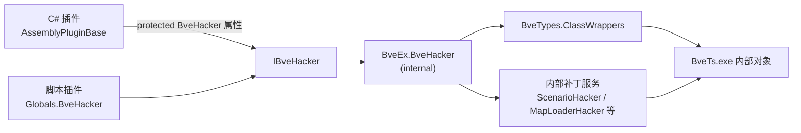
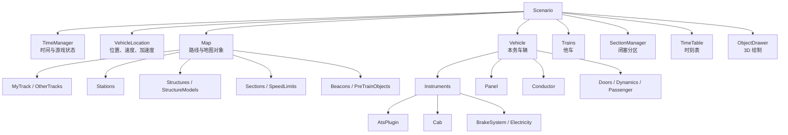
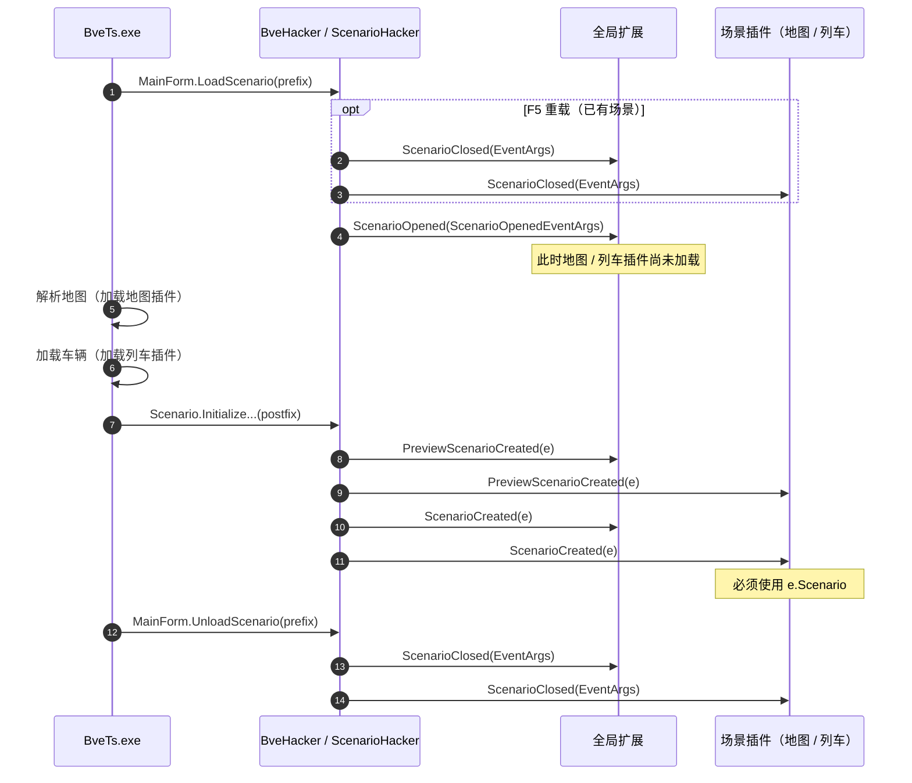
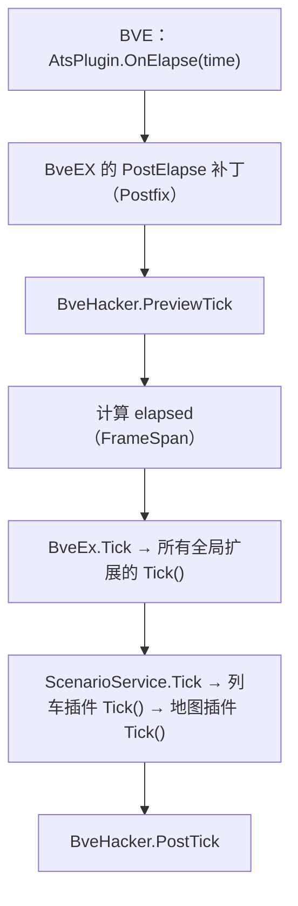

# BveHacker 深入解析：访问与修改 BVE 内部状态

传统 BVE 插件（ATS 插件、输入设备插件）只能看到 BVE 开放给原生 DLL 的少量结构体，例如 `ATS_VEHICLESTATE`、`ATS_HANDLES`。一旦需要读取当前场景、车辆、地图、闭塞分区、主窗体或音频设备，传统插件就无能为力了。

BveEX 的 `IBveHacker` 正是为了解决这个问题而存在的：它把 BVE 主程序内部的窗体、场景、车辆、地图等对象，以 `BveTypes.ClassWrappers` 包装器的形式开放给插件，并在 BVE 的关键方法上挂载 Harmony 补丁，向插件转发场景与帧级事件。本文将系统讲解 `IBveHacker` 的获取方式、成员含义、事件时序、典型用法，以及使用过程中必须注意的边界与已知缺陷。

> [!TIP]
> 阅读本文前，建议先了解：
> - 插件的基本编写方式：[插件开发快速入门](./getting-started.md)
> - 插件的加载顺序与生命周期：[插件生命周期与执行时机](./architecture-lifecycle.md)
> - 列车侧的具体控制方式：[列车插件开发指南与 API 详解](./vehicle-plugins.md)
> - 地图侧的具体控制方式：[地图插件开发指南与 API 详解](./map-plugins.md)

本文的主要事实来源：

| 源码位置 | 内容 |
| :--- | :--- |
| `BveEx.PluginHost/BveHacker/IBveHacker.cs` | 插件可见的 `IBveHacker` 契约 |
| `BveEx/BveHacker/BveHacker.cs` | `IBveHacker` 的内部实现 |
| `BveEx/BveHacker/Services/` | `MainFormHacker`、`ConfigFormHacker`、`ScenarioHacker`、`MapLoaderHacker`、`StructureSetLifeProlonger` |
| `Libs/BveTypes/ClassWrappers/Public/` | `Scenario`、`Vehicle`、`Map`、`MainForm` 等包装器 |
| `SamplePlugins/` | `StationController`、`StateViewer`、`PanelController` 等官方用法 |
| `Extensions/BveEx.CoreExtensions/` | `Native`、`SignalPatch`、`SoundFactory` 等对 `BveHacker` 的实际使用 |

---

## 1. BveHacker 的定位与获取方式

### 1.1 `IBveHacker` 与内部实现

插件开发者接触到的只有接口 `BveEx.PluginHost.IBveHacker`。它的真正实现是 BveEX 核心程序集内的 `BveEx.BveHacker`（`internal sealed`），插件无法直接 `new`，也无法把它强制转换为实现类型。



`BveHacker` 内部由若干个“Hacker 服务”协作完成工作。了解它们有助于理解后文的事件时序：

| 内部服务 | 主要职责 |
| :--- | :--- |
| `MainFormHacker` | 启动时从 `Process.MainWindowHandle` 捕获 BVE 主窗体，生成 `MainFormSource` / `MainForm` |
| `ConfigFormHacker` | 拦截 BVE“设置”窗体的构造函数与 `Dispose()`，维护 `ConfigForm` / `IsConfigFormReady` |
| `ScenarioHacker` | 拦截 `MainForm.LoadScenario` / `MainForm.UnloadScenario`、`Scenario.Initialize` 等，触发场景事件 |
| `MapLoaderHacker` | 拦截 `MapLoader` 构造函数与地图解析方法，维护 `MapLoader` 属性 |
| `StructureSetLifeProlonger` | 在 `ObjectDrawer.Build` 时延长 `StructureSet` 的生命周期，并通过 `PreviewScenarioCreated` 写回场景 |

> [!NOTE]
> `BveHacker` 不是通过静态单例暴露的，也没有公开的全局访问入口。BveEX 在启动时创建一个实例，然后通过 `PluginBuilder` 注入到每个插件的基类中。插件拿到的始终是同一个 `IBveHacker` 实例。

### 1.2 在插件中获取 `BveHacker`

**C# 程序集插件**：直接使用 `PluginBase` 的受保护属性 `BveHacker`。它在插件构造函数执行时就已经可用。

```csharp
using System;
using BveEx.PluginHost;
using BveEx.PluginHost.Plugins;

[Plugin(PluginType.VehiclePlugin)]
public class MyPlugin : AssemblyPluginBase
{
    public MyPlugin(PluginBuilder builder) : base(builder)
    {
        // 构造函数中即可使用，不需要等待任何事件
        IntPtr handle = BveHacker.MainFormHandle;
        Console.WriteLine($"BVE 主窗体句柄：0x{handle.ToInt64():X}");
    }

    public override void Dispose() { }

    public override void Tick(TimeSpan elapsed) { }
}
```

**脚本插件**：通过全局上下文 `Globals.BveHacker` 访问（IronPython 2 脚本使用 `g.BveHacker`）。

**辅助类**：`BveHacker` 是 `protected` 的，不能从普通辅助类中直接访问。官方示例的做法是把 `IBveHacker` 显式传给辅助类或静态存储：

```csharp
using BveEx.PluginHost;
using BveEx.PluginHost.Plugins;

// 简化示意：参考 SamplePlugins/MapPlugins/StationController/InstanceStore.cs
public static class InstanceStore
{
    public static IBveHacker BveHacker { get; private set; }

    public static void Initialize(IBveHacker bveHacker)
    {
        BveHacker = bveHacker;
    }
}

// 在插件构造函数中
public MyPlugin(PluginBuilder builder) : base(builder)
{
    InstanceStore.Initialize(BveHacker);
}
```

### 1.3 生命周期与线程模型

`BveHacker` 的生命周期贯穿整个 BVE 进程：

1. BVE 启动并加载输入设备插件 `BveEx.Caller.InputDevice.dll`；
2. BVE 主窗体准备创建 DirectX 设备时，`InputDeviceMain` 抢在 `MainForm.CreateDirectXDevices` 之前初始化 BveEX；
3. `new BveEx(bveTypes)` 中创建 `BveHacker`；
4. BVE 退出时，`InputDeviceMain.Dispose()` 先释放 `ScenarioService`（场景插件），再调用 `BveEx.Dispose()`，最后由 `BveHacker.Dispose()` 释放内部补丁。

因此要区分两类成员：

| 成员类型 | 生命周期 | 典型成员 |
| :--- | :--- | :--- |
| **进程级** | 从 BVE 启动到退出，始终是同一个对象 | `MainForm`、`MainFormSource`、`DirectSound`、`Assistants`、`InputManager`、`Preferences`、`BveTypes`、所有事件 |
| **场景级** | 每次加载 / 关闭场景时变化 | `Scenario`、`ScenarioInfo`、`MapLoader` |
| **按需创建** | 每次打开“设置”时创建，关闭时释放 | `ConfigForm`、`ConfigFormSource`、`IsConfigFormReady` |

> [!NOTE]
> “进程级”只表示对象与 BVE 进程同生命周期，**不保证在全局扩展的构造函数中已经完成初始化**。例如 BveEX 在 `MainForm.CreateDirectXDevices` 的 Prefix 中启动，此时 `DirectSound` 可能仍为 `null`；场景插件加载时这些设备已经就绪。

`BveHacker` 内部没有任何线程切换或 `Control.Invoke` 封送。所有属性访问和事件回调都在触发补丁的那个线程上同步执行；在实际使用中，这些调用通常发生在 BVE 主线程（UI 线程）上。

> [!WARNING]
> 不要把 `BveHacker` 的事件回调当作线程安全的异步回调。如果在自己的后台线程中访问 `BveHacker` 或 WinForms 控件，必须自行 `Invoke` 回 UI 线程。

> [!WARNING]
> `IBveHacker` 继承了 `IDisposable`，但**插件绝对不要调用 `BveHacker.Dispose()`**。该方法会释放 `ScenarioHacker`、`MapLoaderHacker` 等内部补丁，是 BVE 退出时由框架调用的。插件中调用它会直接破坏整个场景的事件与地图加载机制。

### 1.4 成员总览

下表按用途列出 `IBveHacker` 的全部成员。后文会逐组展开。

| 分组 | 成员 | 类型 | 说明 |
| :--- | :--- | :--- | :--- |
| **元数据** | `BveTypes` | `BveTypeSet` | 包装器对应的 BVE 类型 / 成员定义，见第 8 节 |
| **主窗体** | `MainFormHandle` | `IntPtr` | BVE 主窗口句柄（启动时捕获一次） |
| | `MainFormSource` | `Form` | 主窗口的原始 WinForms 对象 |
| | `MainForm` | `MainForm` | 主窗口包装器 |
| **设置窗体** | `IsConfigFormReady` | `bool` | 设置窗体是否已创建且未释放 |
| | `ConfigFormSource` | `Form` | 设置窗体的原始 `Form`；未显示时为 `null` |
| | `ConfigForm` | `ConfigForm` | 设置窗体包装器；未显示时为 `null` |
| **场景选择窗体** | `ScenarioSelectionFormSource` | `Form` | 原始 `Form` |
| | `ScenarioSelectionForm` | `ScenarioSelectionForm` | 包装器 |
| **加载进度窗体** | `LoadingProgressFormSource` | `Form` | 原始 `Form` |
| | `LoadingProgressForm` | `LoadingProgressForm` | 包装器，可报错 / 设置进度 |
| **时刻与位置窗体** | `TimePosFormSource` | `Form` | 原始 `Form` |
| | `TimePosForm` | `TimePosForm` | 包装器，可刷新运行图 |
| **车辆物理量窗体** | `ChartFormSource` | `Form` | 原始 `Form` |
| | `ChartForm` | `ChartForm` | 包装器（无额外公开成员） |
| **场景** | `ScenarioInfo` | `ScenarioInfo` | 当前场景的元数据 |
| | `Scenario` | `Scenario` | 当前运行中的场景对象 |
| | `IsScenarioCreated` | `bool` | `Scenario` 当前是否可读 |
| | `MapLoader` | `MapLoader` | 当前场景的地图加载器 |
| **宿主服务** | `DirectSound` | `SlimDX.DirectSound.DirectSound` | BVE 使用的 DirectSound 设备 |
| | `Assistants` | `AssistantSet` | BVE 的辅助显示集合 |
| | `InputManager` | `InputManager` | BVE 的输入管理器 |
| | `Preferences` | `Mackoy.Bvets.Preferences` | BVE 的设置对象 |
| **场景事件** | `ScenarioOpened` | `ScenarioOpenedEventHandler` | 场景开始加载 |
| | `ScenarioClosed` | `ScenarioClosedEventHandler` | 场景关闭 / 重载前 |
| | `PreviewScenarioCreated` | `ScenarioCreatedEventHandler` | `Scenario` 实例生成前（框架内部用） |
| | `ScenarioCreated` | `ScenarioCreatedEventHandler` | `Scenario` 实例已生成 |
| **帧事件** | `PreviewTick` | `EventHandler` | 每帧插件 `Tick` 之前 |
| | `PostTick` | `EventHandler` | 每次插件 `Tick` 之后 |

---

## 2. 窗体与 UI 对象访问

### 2.1 三层访问模型：句柄、原始窗体、包装器

以主窗体为例，`BveHacker` 同时提供了三种层次的访问方式：

| 层次 | 成员 | 适用场景 | 注意事项 |
| :--- | :--- | :--- | :--- |
| Win32 句柄 | `MainFormHandle` | 调用原生 API、设置窗口样式、嵌入其他窗口 | 启动时捕获一次，不随窗口重建而更新 |
| 原始 WinForms 对象 | `MainFormSource` | 作为子窗体的 `Owner`、调用 `Focus()`、访问原生控件树 | 直接修改 BVE 窗体布局可能破坏界面 |
| 包装器 | `MainForm` | 访问 BVE 自己的字段与方法，如 `CurrentScenario`、`ContextMenu` | 只能使用包装器已映射的成员 |

`MainFormSource` 的获取方式是：

```csharp
// BveEx/BveHacker/Services/MainFormHacker.cs
TargetFormHandle = targetProcess.MainWindowHandle;
TargetFormSource = (Form)Control.FromHandle(TargetFormHandle);
TargetForm = MainForm.FromSource(TargetFormSource);
```

其余子窗体的 `...Source` 属性都是 `包装器.Src as Form`。`Src` 是包装器内部保存的原始 BVE 对象，详见 8.1 节。

**最常见的用途：把自己创建的 WinForms 窗口挂到 BVE 主窗体上。**

```csharp
// 假设 MyForm 是你的 WinForms 窗体
private readonly MyForm Form = new MyForm();

private void ShowForm()
{
    Form.Show(BveHacker.MainFormSource);   // 以 BVE 主窗体为 Owner
    BveHacker.MainFormSource.Focus();      // 把焦点还给 BVE，避免抢走驾驶输入
}
```

官方示例 `SamplePlugins/MapPlugins/StationController` 与 `SamplePlugins/VehiclePlugins/StateViewer` 都使用了这一模式。

### 2.2 各窗体的包装器能力

| 窗体 | 包装器可用成员 | 典型用途 |
| :--- | :--- | :--- |
| `MainForm` | `DirectSound`、`ScenarioSelectForm`、`TimePosForm`、`ChartForm`、`LoadingProgressForm`、`Assistants`、`InputManager`、`CurrentScenario`、`CurrentScenarioInfo`、`Preferences`、`ContextMenu`；`OpenScenario`、`LoadScenario`、`UnloadScenario`、`Draw`、`OnDeviceLost`、`OnDeviceReset` | 访问 BVE 主窗体内部状态 |
| `ScenarioSelectionForm` | `SaveSettings()` | 保存“选择场景”窗体的设置 |
| `LoadingProgressForm` | `IsAborted`、`ErrorCount`、`Panel`、`ProgressBar`、`ErrorListView`、`ThrowError(...)`、`ThrowErrors(...)`、`SetProgress(...)` | 在加载期报告错误或进度 |
| `TimePosForm` | `SetScenario(Scenario)`、`Draw()` | 刷新“时刻与位置”窗口中的运行图 |
| `ChartForm` | 没有额外的公开成员 | 通过 `ChartFormSource` 操作原始 `Form` |
| `ConfigForm` | `Dispose()`（包装器本身） | 一般只读，见 2.3 节 |

> [!TIP]
> 如果你的目的只是“在右键菜单里加一项”，不要直接改 `MainForm.ContextMenu`，优先使用核心扩展 `IContextMenuHacker`。它会按插件类型维护菜单项顺序，并在插件释放时自动清理。参考 `SamplePlugins/MapPlugins/StationController`。

### 2.3 “设置”窗体 `ConfigForm` 的特殊行为

`ConfigForm` 与其它窗体不同：它并不是在 BVE 启动时就创建好的，而是每次打开“设置”时才由 BVE 创建，关闭时释放。

`ConfigFormHacker` 通过两个 Harmony 补丁维护它：

```csharp
ConstructorPatch = HarmonyPatch.Patch(nameof(ConfigFormHacker), constructor.Source, PatchType.Prefix);
DisposePatch = HarmonyPatch.Patch(nameof(ConfigFormHacker), disposeMethod.Source.GetBaseDefinition(), PatchType.Prefix);

ConstructorPatch.Invoked += (sender, e) =>
{
    Form = ConfigForm.FromSource(e.Instance);
    return PatchInvokationResult.DoNothing(e);
};

DisposePatch.Invoked += (sender, e) =>
{
    Form = null;
    return PatchInvokationResult.DoNothing(e);
};
```

因此：

- `IsConfigFormReady` 等价于“`ConfigForm` 实例存在且尚未 `Dispose()`”；
- `ConfigFormSource` / `ConfigForm` 在未显示时为 `null`；
- 每次重新打开设置，都会得到一个**全新的实例**，不能缓存上一次的对象；
- BVE 在退出时也会用 `IsConfigFormReady` 判断是否还存在尚未释放的“设置”窗体，用于提示玩家手动关闭（见 `BveEx/Main/BveEx.cs` 的 `Dispose()`）。

如果确实需要观察设置窗体的打开 / 关闭，可以在每帧 `Tick()` 中轮询状态：

```csharp
private bool WasConfigFormOpen;

public override void Tick(TimeSpan elapsed)
{
    bool isOpen = BveHacker.IsConfigFormReady;

    if (WasConfigFormOpen && !isOpen)
    {
        // 设置窗体刚刚关闭
    }

    WasConfigFormOpen = isOpen;
}
```

> [!NOTE]
> 上面的轮询只在插件 `Tick()` 被调用期间有效，也就是场景运行期间。如果设置窗体只能在主菜单打开，场景插件无法通过 `Tick()` 观察到它。`IsConfigFormReady` 更适合进程级扩展或退出诊断使用。

> [!NOTE]
> `IsConfigFormReady` 只表示“实例已创建且未 Dispose”，是否等同于“窗口当前可见”取决于 BVE 是否在隐藏窗口时调用 `Dispose()`。该行为位于闭源宿主中，无法仅凭本仓库源码确定。

> [!WARNING]
> `ConfigForm.Dispose()` 会释放 BVE 的设置窗体，插件不应主动调用。需要观察设置窗体时，请只读取 `IsConfigFormReady` / `ConfigForm` / `ConfigFormSource`。

### 2.4 操作窗体的注意事项

1. **不要关闭、释放 BVE 自己的窗体。** `MainFormSource`、`ScenarioSelectionFormSource` 等对象归 BVE 所有，插件只应读取或作为 `Owner` 使用。
2. **不要替换 `MainForm.CurrentScenario` / `CurrentScenarioInfo`。** 这两个包装器属性有公开 setter，但直接赋值会让 BVE 内部状态与 `ScenarioService`、其他插件已持有的场景引用脱节。需要切换场景时，请让 BVE 自己走正常的加载流程，而不是直接替换字段。
3. **不要从事件回调里递归调用 `MainForm.LoadScenario` / `UnloadScenario`。** 例如在 `ScenarioClosed` 中立即重新加载场景，可能造成重入和插件生命周期混乱。`MainForm.CreateDirectXDevices`、`OpenScenario`、`LoadScenario`、`UnloadScenario` 都会改变 BVE 的运行状态，除非你在实现启动器或诊断工具，否则不要调用。
4. **添加控件后要恢复焦点。** 显示自己的窗口后调用 `BveHacker.MainFormSource.Focus()`，否则玩家可能无法用键盘操作列车。
5. **窗体关闭时解除事件。** 如果插件窗体订阅了全局事件，务必在 `Dispose()` 中退订，避免窗体被 `BveHacker` 的事件委托长期持有。

---

## 3. 场景对象：`ScenarioInfo` 与 `Scenario`

### 3.1 `ScenarioInfo`：场景的“元数据”

`ScenarioInfo` 描述“这个场景是什么”，不包含运行期状态。它的常用成员如下：

| 成员 | 类型 | 含义 |
| :--- | :--- | :--- |
| `Path` | `string` | 场景文件的完整路径 |
| `FileName` | `string` | 场景文件名 |
| `DirectoryName` | `string` | 场景文件所在目录 |
| `Title` | `string` | 场景标题 |
| `ImagePath` | `string` | 场景缩略图路径 |
| `Author` | `string` | 场景作者 |
| `Comment` | `string` | 场景说明 |
| `RouteFiles` | `RandomFileList` | 可选的路线（地图）文件列表 |
| `VehicleFiles` | `RandomFileList` | 可选的车辆文件列表 |
| `RouteTitle` | `string` | 路线名 |
| `VehicleTitle` | `string` | 车辆名 |
| `ScenarioFileLoadErrors` | `WrappedList<LoadError>` | 场景文件加载时的严重错误 |

`RandomFileList` 继承自 `WrappedList<BveFile>`，并通过 `SelectedFile` 暴露当前选中的文件；`BveFile.Path` 是文件路径。

```csharp
using System;
using BveTypes.ClassWrappers;
using BveEx.PluginHost.Plugins;

[Plugin(PluginType.VehiclePlugin)]
public class MyPlugin : AssemblyPluginBase
{
    public MyPlugin(PluginBuilder builder) : base(builder)
    {
        ScenarioInfo info = BveHacker.ScenarioInfo;
        if (info is null) return;

        string scenarioPath = info.Path;
        string routeTitle = info.RouteTitle;
        string vehiclePath = info.VehicleFiles?.SelectedFile?.Path;

        // 官方示例 PanelController 的写法：
        // string panelDirectory = Path.Combine(Path.GetDirectoryName(vehiclePath), "Panel");
    }

    public override void Dispose() { }
    public override void Tick(TimeSpan elapsed) { }
}
```

> [!WARNING]
> `RandomFileList.SelectedFile` 在极端情况下可能为 `null`（例如场景尚未选定车辆）。访问 `.Path` 前请使用 `?.` 或显式判空。
>
> 该属性的 setter 还存在上游实现缺陷：它误调用了 getter 方法 `SelectedFileGetMethod`，而不是 `SelectedFileSetMethod`（见 `Libs/BveTypes/ClassWrappers/Public/RandomFileList.cs`）。**不要给 `SelectedFile` 赋值**，只读取它即可。

`ScenarioInfo` 还有一个静态方法 `FromFile(string path)`，可以让 BVE 解析指定的场景文件并返回元数据：

```csharp
ScenarioInfo another = ScenarioInfo.FromFile(@"C:\BveScenarios\Another\scenario.txt");
```

> [!NOTE]
> `FromFile` 调用的是 BVE 自己的场景解析逻辑，可能会读取相对路径下的地图、车辆等依赖，也可能因文件不存在或依赖缺失而抛出异常。它适合做轻量的场景信息预览；请自行捕获异常，不要在驾驶过程中频繁调用。

`IBveHacker.ScenarioInfo` 本身只有 getter（内部实现虽然提供了 setter，但没有暴露在接口上），因此插件不能整体替换这个对象；能修改的是 `ScenarioInfo` 各属性的值。修改会写回 BVE 内存中的 `MainForm.CurrentScenarioInfo` 对象，但**不会重命名文件，也不会自动持久化**。除非你清楚 BVE 会如何使用这些字段，否则建议只读。

### 3.2 `Scenario`：运行中的场景对象树

`Scenario` 是 BVE 当前加载的场景实例，也是插件最常访问的对象。它的主要分支如下：



常用分支的入口与单位：

| 目标 | 入口 | 常用成员 / 说明 |
| :--- | :--- | :--- |
| 时间 | `Scenario.TimeManager` | `Time`（`TimeSpan`）、`TimeMilliseconds`（`int`）、`SetTime(...)`、`State`（`Forward` / `Paused` / `FastForward`） |
| 位置与速度 | `Scenario.VehicleLocation` | `Location`（`double`，米）、`Speed`（`double`，米/秒）、`Acceleration`、`BlockIndex`、`SetLocation(...)`、`SetSpeed(...)` |
| 地图 | `Scenario.Map` | `MyTrack`、`OtherTracks`、`Stations`、`Structures`、`StructureModels`、`Sections`、`SpeedLimits`、`Beacons`、`PreTrainObjects` |
| 本务车辆 | `Scenario.Vehicle` | `Instruments`（含 `AtsPlugin`、`Cab`、`BrakeSystem` 等）、`Panel`、`Conductor`、`Doors`、`Dynamics`、`Passenger` |
| 他车 | `Scenario.Trains` | `WrappedSortedList<string, Train>` |
| 闭塞 | `Scenario.SectionManager` | `Sections`、`CurrentSectionSignalIndex`、`CurrentSectionSpeedLimit`、`ForwardSectionSpeedLimit`、`LastSection` |
| 时刻表 | `Scenario.TimeTable` | `TimeTable` 本身继承自 `AssistantText`；可修改各站显示文本并调用 `Update()` |
| 3D 绘制 | `Scenario.ObjectDrawer` | BVE 的 3D 对象绘制器；一般不需要直接操作 |

> [!IMPORTANT]
> `BveTypes.ClassWrappers` 中的包装器不是“快照”，而是对 BVE 内部对象的**实时视图**。读取属性会调用 BVE 的 getter，写入属性会调用 BVE 的 setter；对列表包装器（如 `Stations`、`Panel.Elements`）的增删也会直接作用于底层列表。

### 3.3 安全访问 `Scenario`

`BveHacker.Scenario` 的实现非常简单：

```csharp
public Scenario Scenario
    => ScenarioHacker.CurrentScenario
       ?? throw new InvalidOperationException(string.Format(Resources.Value.CannotGetScenario.Value, nameof(Scenario)));
```

当场景尚未加载完成时，读取 `BveHacker.Scenario` 会抛出 `InvalidOperationException`。因此推荐先判断 `IsScenarioCreated`：

```csharp
private bool TryGetScenario(out Scenario scenario)
{
    if (!BveHacker.IsScenarioCreated)
    {
        scenario = null;
        return false;
    }

    scenario = BveHacker.Scenario;
    return true;
}
```

> [!NOTE]
> 这个辅助方法只能避免 `InvalidOperationException`，不能保证拿到的一定是“当前这一局”的场景：在 F5 重载的 `ScenarioCreated` 阶段，`IsScenarioCreated` 仍可能为 `true`，而 `BveHacker.Scenario` 返回旧场景。事件回调中仍应优先使用 `e.Scenario`。

不同时机的可用性如下：

| 时机 | `IsScenarioCreated` | `BveHacker.Scenario` 的行为 |
| :--- | :--- | :--- |
| 插件构造函数 | `false`（首次加载） | 抛 `InvalidOperationException` |
| `ScenarioOpened` 回调 | 首次为 `false`；重载时通常为 `true` | 首次抛异常；重载时通常返回**旧场景** |
| `PreviewScenarioCreated` / `ScenarioCreated` 回调 | 首次为 `false`；重载时通常为 `true` | 首次抛异常；重载时通常返回**旧场景** |
| `ScenarioClosed` 回调 | 通常为 `true` | 通常返回即将关闭的旧场景 |
| 插件 `Tick()` | `true` | 当前场景 |
| 场景关闭完成后 | 通常为 `false` | 抛 `InvalidOperationException` |

> [!WARNING]
> 在 `PreviewScenarioCreated` / `ScenarioCreated` 回调中**必须使用事件参数 `e.Scenario`**，不要使用 `BveHacker.Scenario`。在 F5 重载时，`BveHacker.Scenario` 很可能仍然指向上一局的旧场景，直接使用会读到过期对象。`BveHacker.Scenario` 依赖 `MainForm.CurrentScenario` 字段，而该字段由闭源宿主在 `LoadScenario` 内部赋值；具体赋值时机无法仅凭本仓库源码确定。

### 3.4 修改场景状态的典型示例

#### 3.4.1 修改时间、位置与速度

官方示例 `StateViewer` 演示了如何直接改写场景时间与车辆位置 / 速度：

```csharp
using System;
using BveTypes.ClassWrappers;

Scenario scenario = BveHacker.Scenario;

// 将游戏时间设置为 12:00:00
scenario.TimeManager.SetTime(TimeSpan.FromHours(12));

// 将列车瞬移到 1000 m 处（第二个参数 true 表示位置未变化时跳过）
scenario.VehicleLocation.SetLocation(1000.0, true);

// 设置速度为 25 m/s（注意不是 km/h）
scenario.VehicleLocation.SetSpeed(25.0);
```

> [!WARNING]
> 这些修改只是改写了当前状态，BVE 的物理引擎与时间推进会在后续帧继续改变它们。如果希望“持续生效”，应在每帧 `Tick()` 中重新写入；同时要注意瞬移可能造成闭塞、先行列车、停车位置判定等状态不一致。

#### 3.4.2 增删车站并刷新时刻表

官方示例 `StationController` 演示了如何直接编辑车站列表，并在修改后刷新运行图：

```csharp
using BveTypes.ClassWrappers;
using BveEx.Extensions.DiagramUpdater;

// 以下代码位于某个插件类内部（BveHacker / Extensions 来自 PluginBase）
private void AddStation()
{
    StationList stations = BveHacker.Scenario.Map.Stations;

    Station newStation = new Station("新车站")
    {
        Location = 2500.0,
        DefaultTimeMilliseconds = 12 * 60 * 60 * 1000,
        ArrivalTimeMilliseconds = 12 * 60 * 60 * 1000,
        DepartureTimeMilliseconds = 12 * 60 * 30 * 1000,
        IsTerminal = false,
    };

    stations.Add(newStation);

    // 车站列表变了，BVE 不会自动重绘时刻表 / 运行图，需要手动通知
    IDiagramUpdater diagramUpdater = Extensions.GetExtension<IDiagramUpdater>();
    diagramUpdater.UpdateDiagram();
}
```

> [!NOTE]
> 修改车站后如果不调用 `IDiagramUpdater.UpdateDiagram()`，“时刻与位置”窗口和车载时刻表可能仍显示旧数据。`StationList.Insert` 会在“新插入车站的距离与列表首站相同”时抛出 `NotSupportedException`（源码的 XML 注释描述为禁止首末站同距离，但实际检查的是 `this[0].Location == item.Location`）；增删车站时请避免产生这种布局。

> [!WARNING]
> 如果在 `ScenarioCreated` 回调中刷新时刻表，请使用 `diagramUpdater.UpdateDiagram(e.Scenario)`，不要调用无参重载 `UpdateDiagram()`；无参重载内部访问 `BveHacker.Scenario`，在 `ScenarioCreated` 阶段并不可靠。

#### 3.4.3 其他常见修改入口

| 想修改的内容 | 推荐入口 | 说明 |
| :--- | :--- | :--- |
| 驾驶台手柄 | `Scenario.Vehicle.Instruments.AtsPlugin.AtsHandles` | 只改 ATS 层输出，不改变玩家看到的物理手柄 |
| 玩家物理手柄 / 模拟按键 | `BveHacker.InputManager` + `InputEventArgsFactory` | 见 6.3 节与《列车插件开发指南》4.2 节 |
| 驾驶台面板 | `Scenario.Vehicle.Panel` | 参考《列车插件开发指南》第 5 节 |
| 地面信号 | `ISignalPatchFactory` | 推荐用扩展，而不是直接改 `Section` |
| 先行列车 / 他车 | `IPreTrainPatchFactory` / `Scenario.Trains` | 参考《地图插件开发指南》第 5 节 |
| 3D 模型 | `Scenario.Map.Structures` / `StructureModels` | 修改后可能需要重新构建 / 绘制，风险较高 |
| 音效 | `ISoundFactory` | 推荐用扩展，而不是直接操作 `DirectSound` |

---

## 4. 场景生命周期事件

### 4.1 事件总览

| 事件 | 委托 / 参数 | 触发点 | 单次场景加载的触发次数 |
| :--- | :--- | :--- | :---: |
| `ScenarioOpened` | `ScenarioOpenedEventHandler(ScenarioOpenedEventArgs e)` | `MainForm.LoadScenario` 的 **Prefix** | 1 次（重载时先补发一次 `ScenarioClosed`） |
| `ScenarioClosed` | `ScenarioClosedEventHandler(EventArgs e)` | `MainForm.UnloadScenario` 的 **Prefix**；F5 重载时由 `LoadScenario` 的 Prefix 补发 | 1 次 |
| `PreviewScenarioCreated` | `ScenarioCreatedEventHandler(ScenarioCreatedEventArgs e)` | `Scenario.InitializeTimeAndLocation` 或 `Scenario.Initialize` 首次执行的 **Postfix** | 1 次 |
| `ScenarioCreated` | `ScenarioCreatedEventHandler(ScenarioCreatedEventArgs e)` | 同上，紧跟在 `PreviewScenarioCreated` 之后 | 1 次 |
| `PreviewTick` | `EventHandler(object sender, EventArgs e)` | `AtsPlugin.OnElapse` 的 Postfix 补丁内部、插件 `Tick` 之前 | 每帧 1 次 |
| `PostTick` | `EventHandler(object sender, EventArgs e)` | 所有扩展与插件 `Tick` 之后 | 每帧 1 次 |

> [!NOTE]
> 上表的“1 次”是正常成功加载路径下的行为。如果加载在场景初始化前失败，`ScenarioHacker` 的初始化订阅可能残留，导致后续 `ScenarioCreated` 重复触发，详见 9.1 第 16 条。

注意事件委托的签名：`ScenarioOpened` / `ScenarioClosed` / `PreviewScenarioCreated` / `ScenarioCreated` 都**没有 `object sender` 参数**，处理函数的写法是：

```csharp
private void OnScenarioCreated(ScenarioCreatedEventArgs e) { }
private void OnScenarioClosed(EventArgs e) { }
```

而 `PreviewTick` / `PostTick` 是标准的 `EventHandler`：

```csharp
private void OnPreviewTick(object sender, EventArgs e) { }
```

### 4.2 `ScenarioOpened` 与 `ScenarioClosed`

`ScenarioHacker` 在 `MainForm.LoadScenario` 的 Prefix 中判断是否为重载，并触发事件：

```csharp
private PatchInvokationResult OnLoaded(object sender, PatchInvokedEventArgs e)
{
    // 重载场景时，MainForm.UnloadScenario 不会被调用，因此需要主动补发一次关闭事件
    bool isReload = !(CurrentScenario is null);
    if (isReload) ScenarioClosed?.Invoke(EventArgs.Empty);

    ScenarioInfo scenarioInfo = ScenarioInfo.FromSource(e.Args[0]);
    ScenarioOpened?.Invoke(new ScenarioOpenedEventArgs(scenarioInfo, isReload));

    return PatchInvokationResult.DoNothing(e);
}
```

因此：

- **`ScenarioOpened` 在场景开始加载时触发**，此时地图尚未解析、车辆尚未加载，地图插件与列车插件都还没有实例化。只有进程级的全局扩展（`PluginType.Extension`）能收到它。
- `ScenarioOpenedEventArgs.ScenarioInfo` 是本次 `LoadScenario` 的实参，代表**新场景**的信息；`IsReload` 表示是否为 F5 重载。不要用 `BveHacker.ScenarioInfo` 代替它，后者可能尚未更新。
- **`ScenarioClosed` 在 `MainForm.UnloadScenario` 的 Prefix 中触发**，此时旧场景还未被真正卸载。F5 重载时不会调用 `UnloadScenario`，所以 `OnLoaded` 会先补发一次 `ScenarioClosed`。
- `ScenarioClosed` 的参数只有 `EventArgs`，没有场景对象。如果需要保存旧场景引用，请在 `ScenarioCreated` 时自行保存。
- 触发 `ScenarioClosed` 之前，`BveHacker` 已经把 `MapLoader` 置为 `null`：

```csharp
ScenarioHacker.ScenarioClosed += e =>
{
    MapLoaderHacker.Clear();   // 先清空 MapLoader
    ScenarioClosed?.Invoke(e); // 再通知插件
};
```

> [!WARNING]
> 在 `ScenarioClosed` 回调中访问 `BveHacker.MapLoader` 一定是 `null`。同时，`BveHacker.Scenario` 通常仍返回即将关闭的旧场景（因为 `UnloadScenario` 的方法体尚未执行），但不要依赖这一点做资源释放的先后判断。

> [!NOTE]
> 在 F5 重载时，`BveHacker.ScenarioClosed` 由 `ScenarioHacker` 的 `LoadScenario` Prefix 补发，而旧插件的 `Dispose()` 由 `InputDeviceMain` 在 `BveEx.ScenarioOpened` 回调中执行。两者都挂在同一个 `MainForm.LoadScenario` 上，本仓库没有显式指定 Harmony 补丁的优先级，因此**无法从源码确定 `ScenarioClosed` 与旧插件 `Dispose()` 的绝对先后**。不要在 `ScenarioClosed` 中假设其他插件仍然存活。

场景加载 / 关闭的整体时序如下：



### 4.3 `PreviewScenarioCreated` 与 `ScenarioCreated`

`ScenarioHacker` 同时拦截 `Scenario.InitializeTimeAndLocation` 与 `Scenario.Initialize` 的 Postfix。**两者中先执行的那一个**会触发事件，随后立即解绑两个补丁，确保每次场景加载只触发一次：

```csharp
private void BeginObserveInitialization()
{
    InitializeTimeAndLocationMethodPatch.Invoked += OnPatchInvoked;
    InitializeMethodPatch.Invoked += OnPatchInvoked;

    PatchInvokationResult OnPatchInvoked(object sender, PatchInvokedEventArgs e)
    {
        InitializeTimeAndLocationMethodPatch.Invoked -= OnPatchInvoked;
        InitializeMethodPatch.Invoked -= OnPatchInvoked;

        Scenario scenario = Scenario.FromSource(e.Instance);
        ScenarioCreated?.Invoke(new ScenarioCreatedEventArgs(scenario));

        return PatchInvokationResult.DoNothing(e);
    }
}
```

而 `BveHacker` 在 `ScenarioHacker.ScenarioCreated` 中依次触发两个事件：

```csharp
ScenarioHacker.ScenarioCreated += e =>
{
    try
    {
        PreviewScenarioCreated?.Invoke(e);
        ScenarioCreated?.Invoke(e);
    }
    catch (BveFileLoadException ex)
    {
        LoadingProgressForm.ThrowError(ex.Message, ex.SenderFileName, ex.LineIndex, ex.CharIndex);
    }
};
```

因此：

- `PreviewScenarioCreated` 先于 `ScenarioCreated` 触发；
- 两个事件共享同一个 `ScenarioCreatedEventArgs`，其中只有 `Scenario` 属性；
- 即使之后玩家跳站、BVE 再次调用 `Scenario.Initialize`，也不会再次触发；
- 普通插件应使用 `ScenarioCreated`，`PreviewScenarioCreated` 主要供框架内部（`StructureSetLifeProlonger`）使用。

> [!NOTE]
> 上面的“只触发一次”是正常加载路径下的行为。如果某次加载在 `Scenario.Initialize...` 之前就失败，`ScenarioHacker` 的初始化订阅可能残留，下一次加载时可能叠加并重复触发 `ScenarioCreated`，详见 9.1 第 16 条。

**推荐写法：**

```csharp
using System;
using BveTypes.ClassWrappers;
using BveEx.PluginHost;
using BveEx.PluginHost.Plugins;

[Plugin(PluginType.MapPlugin)]
public class MyMapPlugin : AssemblyPluginBase
{
    private Section TargetSection;

    public MyMapPlugin(PluginBuilder builder) : base(builder)
    {
        BveHacker.ScenarioCreated += OnScenarioCreated;
    }

    private void OnScenarioCreated(ScenarioCreatedEventArgs e)
    {
        // 必须使用 e.Scenario，而不是 BveHacker.Scenario
        Scenario scenario = e.Scenario;

        TargetSection = scenario.SectionManager.Sections[0] as Section;
    }

    public override void Dispose()
    {
        BveHacker.ScenarioCreated -= OnScenarioCreated;
    }

    public override void Tick(TimeSpan elapsed) { }
}
```

> [!WARNING]
> `BveHacker` 只在包裹 `PreviewScenarioCreated` 与 `ScenarioCreated` 的 `try/catch` 中捕获 `BveFileLoadException`；其它异常会继续向上抛到 BVE 的场景加载流程。更严重的是：如果 `PreviewScenarioCreated` 的处理函数抛出 `BveFileLoadException`，后面的 `ScenarioCreated` 处理函数就不会执行；即使异常最终被外层捕获，同一个多播委托中排在后面的处理函数也不会执行。请在自己的回调中做好异常处理，避免让加载流程中断。

> [!NOTE]
> `ScenarioCreated` 与核心扩展的 `INative.Started` 谁先触发，取决于闭源宿主的内部调用顺序；不要在一个事件中假设另一个事件已经执行。两个事件的职责区别见《[插件生命周期与执行时机](architecture-lifecycle.md)》3.5 节。

### 4.4 订阅与退订规则

`BveHacker` 是进程级对象，事件委托会一直持有订阅者。因此：

- **全局扩展**：可以只在构造函数中订阅一次；扩展本身与进程同生命周期。
- **地图插件 / 列车插件**：必须在 `Dispose()` 中退订。否则旧插件实例会被 `BveHacker` 持有，无法回收；下次加载场景时还可能收到重复回调。
- **脚本插件**：同样需要在 `Dispose` 脚本中退订（如果脚本语言支持）。

```csharp
public MyPlugin(PluginBuilder builder) : base(builder)
{
    BveHacker.ScenarioCreated += OnScenarioCreated;
    BveHacker.ScenarioClosed += OnScenarioClosed;
}

public override void Dispose()
{
    BveHacker.ScenarioCreated -= OnScenarioCreated;
    BveHacker.ScenarioClosed -= OnScenarioClosed;
}
```

> [!TIP]
> 如果你在 `ScenarioCreated` 中动态订阅了其他对象的事件（例如 `SectionManager`、`Vehicle` 上的事件），也要在 `ScenarioClosed` 或 `Dispose()` 中退订，因为场景对象每次都是新的。

---

## 5. 帧级事件：`PreviewTick` 与 `PostTick`

### 5.1 单帧执行顺序

BveEX 在 `AtsPlugin.OnElapse` 的 Postfix 中驱动整套帧循环。`BveHacker` 的两个帧事件位于这条流水线的首尾：



对应源码（`BveEx/Native/InputDevices/InputDeviceMain.cs`）：

```csharp
private void PostElapse(object sender, BveEx.ValueEventArgs<TimeSpan> e)
{
    ScenarioService?.PreviewTick();

    TimeSpan now = e.Value;
    TimeSpan elapsed = FrameSpan.Tick(now);

    BveEx.Tick(elapsed);          // 扩展
    ScenarioService?.Tick(elapsed); // 插件
    ScenarioService?.PostTick();
}
```

### 5.2 两个事件各自适合做什么

| 事件 | 适合的用途 | 注意事项 |
| :--- | :--- | :--- |
| `PreviewTick` | 在所有插件 `Tick()` 之前读取 / 修正本帧状态；`BveEx.CoreExtensions` 的 `Native` 扩展就在此更新 `INative.VehicleState` | `Native.VehicleState` 是否为本帧最新值取决于订阅顺序：只有排在 `Native` 扩展之后的订阅者才能看到本帧刚更新的值 |
| `PostTick` | 在所有插件处理完之后做汇总、记录、清理 | 如果前面的 `Tick()` 抛出异常，`PostTick` 不会执行 |

`PreviewTick` 的一个官方用例是 `Native` 扩展（摘自 `Extensions/BveEx.CoreExtensions/Native/Native.cs`）：

```csharp
private void OnPreviewTick(object sender, EventArgs e)
{
    AtsPlugin atsPlugin = BveHacker.Scenario.Vehicle.Instruments.AtsPlugin;

    ScenarioService.VehicleState = new VehicleState(
        atsPlugin.Location.Location,
        (float)atsPlugin.StateStore.Speed[0],
        BveHacker.Scenario.TimeManager.Time,
        (float)atsPlugin.StateStore.BcPressure[0],
        /* ... */);
}
```

因此，普通插件在自己的 `Tick()` 中读取 `INative.VehicleState` 时，拿到的是本帧最新值。

### 5.3 使用帧事件时的注意事项

1. **不要手动触发。** `IBveHacker` 只公开了事件；`InvokePreviewTick()` / `InvokePostTick()` 是内部实现类的方法，不属于接口。插件无法也不应该主动调用它们。
2. **必须退订。** 和 `ScenarioCreated` 一样，场景插件要在 `Dispose()` 中 `-=`，否则重载场景后会重复执行。
3. **异常会打断流水线。** `PreviewTick` / `PostTick` 的调用没有 `try/catch`。如果某个订阅者抛出异常，异常会继续抛给 BVE，后面的插件 `Tick()` 或 `PostTick` 可能不会执行。请在回调内部自行捕获异常。
4. **不要做重活。** 两个事件每帧都会执行。避免在回调中做文件 I/O、复杂 LINQ、创建大量对象或显示对话框。
5. **不要依赖订阅顺序。** 多个订阅者按订阅顺序（通常就是插件加载顺序）执行，但本仓库没有对插件 `Tick` 顺序做额外保证。不要假设某个插件已经在本帧处理过数据。
6. **`PreviewTick` 只在场景运行期间触发。** 它由 `ScenarioService` 驱动；场景关闭后 `ScenarioService` 为 `null`，不会再有帧事件。

---

## 6. 音频、辅助显示、输入与设置

### 6.1 `DirectSound`：BVE 的音频设备

`BveHacker.DirectSound` 是 `MainForm.DirectSound` 的快捷方式，类型为 `SlimDX.DirectSound.DirectSound`。核心扩展 `SoundFactory` 就是用它来创建 `SecondarySoundBuffer` 的：

```csharp
using SlimDX.DirectSound;

DirectSound device = BveHacker.DirectSound;
// description 的构造略，详见 BveEx.CoreExtensions 的 SoundFactory
SecondarySoundBuffer buffer = new SecondarySoundBuffer(device, description);
```

但直接操作 `DirectSound` 需要自己处理以下问题：

- 音频缓冲区格式、声道、采样率；
- 缓冲区数量与循环播放；
- 设备丢失 / 重置后的重建；
- 场景关闭时的资源释放。

因此，除非你要实现 `ISoundFactory` 不支持的特殊效果，否则**优先使用核心扩展 `ISoundFactory`**：

```csharp
using BveEx.Extensions.SoundFactory;
using BveTypes.ClassWrappers;

ISoundFactory soundFactory = Extensions.GetExtension<ISoundFactory>();
Sound sound = soundFactory.LoadFrom(path, 10.0, Sound.SoundPosition.Cab, 4);
```

> [!NOTE]
> BveEX 是在 `MainForm.CreateDirectXDevices` 的 Prefix 中启动的，此时原方法体尚未执行，因此**全局扩展的构造函数中 `BveHacker.DirectSound` 可能仍为 `null`**。地图插件与列车插件加载时 DirectX 设备已经创建，可以正常读取。

> [!NOTE]
> `ISoundFactory.IsAvailable` 与 `AtsPlugin` 的生存期一致（构造函数执行后到 `Dispose()` 前）。在地图插件的构造函数中它通常还不可用；请参考《地图插件开发指南》与官方示例 `SoundFactoryTest`。

> [!WARNING]
> `MainForm.DirectSound` 是一个可写字段，BVE 主窗体还提供 `OnDeviceLost()` / `OnDeviceReset()`。不要把 `DirectSound` 长期缓存在字段里；每次使用时重新读取 `BveHacker.DirectSound`，以避免设备重建后拿到失效对象。设备丢失 / 重置的具体时机位于闭源宿主中，本仓库无法确定。

> [!NOTE]
> `SlimDX` 不在 `BveEx.PluginHost` NuGet 包内。需要操作 `DirectSound` 或 `Matrix` / `Vector3` 时，请按《插件开发快速入门》的说明单独引用 `SlimDX`（仓库统一使用 `4.0.13.44`）。

### 6.2 `Assistants`：BVE 的辅助显示集合

`BveHacker.Assistants` 返回 BVE 主窗体的 `AssistantSet`。它提供：

| 成员 | 说明 |
| :--- | :--- |
| `Items` | `WrappedList<AssistantBase>`，BVE 当前的辅助显示列表 |
| `Draw()` | 绘制全部辅助显示 |
| `OnDeviceLost()` / `OnDeviceReset()` | 设备丢失 / 重置通知 |

`AssistantBase` 的派生类包括 `AssistantText`、`StopPositionGauge`、`SwayGauge`，以及 BVE 的 `TimeTable`（时刻表本身就是一种辅助显示）。

如果要在屏幕上追加一行自定义文字，可以使用 `AssistantText.Create`：

```csharp
using System.Drawing;
using BveTypes.ClassWrappers;

AssistantText text = AssistantText.Create("自定义提示");
text.Color = Color.Yellow;

BveHacker.Assistants.Items.Add(text);

// 插件释放时移除并释放
BveHacker.Assistants.Items.Remove(text);
text.Dispose();
```

> [!NOTE]
> 本仓库的 `Extensions/` 与 `SamplePlugins/` 中没有任何使用 `BveHacker.Assistants` 的示例。BVE 在什么时机调用 `AssistantSet.Draw()`、向 `Items` 添加项后是否立即显示，取决于闭源宿主，无法仅凭本仓库源码确认。上面的代码仅按包装器 API 推导，实际效果请实机验证。对于 2D 仪表 / 文字显示，更推荐使用《列车插件开发指南》中的 `VehiclePanel` 或 `DXDynamicTexture`。

### 6.3 `InputManager`：BVE 的输入管理器

`BveHacker.InputManager` 返回 `BveTypes.ClassWrappers.InputManager`，它包装了 BVE 的输入管理器，提供：

| 成员 | 说明 |
| :--- | :--- |
| `InputDevices` | 已加载的输入设备插件字典（`Dictionary<string, IInputDevice>`） |
| `LeverMoved` / `KeyDown` / `KeyUp` | BVE 的输入事件 |
| `LeverMoved_Invoke(...)` / `KeyDown_Invoke(...)` / `KeyUp_Invoke(...)` | 主动向 BVE 注入输入事件 |

> [!NOTE]
> `InputEventArgs`、`IInputDevice`、`Preferences`、`AssistantSettings` 等类型来自 BVE 自带的 `Mackoy.IInputDevice.dll` / `Mackoy.XmlInterfaces.dll`。这两个程序集不在 `BveEx.PluginHost` NuGet 包内，需要在项目中从 BVE 安装目录引用，并保持 `Copy Local = False`。

最常见的用法是配合 `BveEx.PluginHost.Input.InputEventArgsFactory` 模拟玩家操作：

```csharp
using BveEx.PluginHost.Input;

// 将单手柄列车的制动手柄扳到 5 段
BveHacker.InputManager.LeverMoved_Invoke(InputEventArgsFactory.OneLeverBrake(5));

// 模拟按下 / 松开“时刻表显示”系统键
var key = InputEventArgsFactory.SystemKey(SystemKeyName.TimeTable);
BveHacker.InputManager.KeyDown_Invoke(key);
BveHacker.InputManager.KeyUp_Invoke(key);
```

完整的工厂方法列表与手柄 / 按键枚举，请参考《[列车插件开发指南与 API 详解](./vehicle-plugins.md)》4.2 节。

> [!WARNING]
> `InputManager` 是 BVE 的真实输入管线，不是“只读查询接口”。注入事件会像玩家真的操作一样影响列车、其他插件与 BVE 自身状态。不要在每帧无条件注入按键，否则可能造成手柄抖动、按键重复触发或与其他输入设备冲突。

> [!NOTE]
> `InputManager` 包装器暴露了 `LeverMoved_Invoke` 等“主动触发事件”的方法，但 BVE 在什么线程、什么时机处理这些事件，取决于闭源宿主。请始终在 BVE 主线程（例如插件 `Tick()`）中调用。

### 6.4 `Preferences`：BVE 的设置对象

`BveHacker.Preferences` 返回 `Mackoy.Bvets.Preferences`，即 BVE 的设置对象。BveEX 自身在 `LaunchModeManager` 中以如下方式使用它（摘自 `BveEx/Launching/LaunchModeManager.cs`）：

```csharp
MainForm.Preferences.SaveToXml();
MainForm.Preferences = null;
```

这段代码用于在切换到旧版（Legacy）模式前保存设置并清空引用，属于框架内部行为。

> [!NOTE]
> `Mackoy.Bvets.Preferences` 来自 BVE 自带的 `Mackoy.XmlInterfaces.dll`，其具体属性、默认值与保存时机不在本仓库中。本仓库只能确认 `SaveToXml()` 方法存在。**缺少 `Preferences` 各设置项的完整成员清单与持久化规则信息**；如果你的插件需要读写具体设置项，请自行查阅 BVE 的对应接口，或通过实机验证。不要假设修改属性后 BVE 会自动写回配置文件。

> [!WARNING]
> 不要把 `MainForm.Preferences` 设为 `null` 或替换为新的 `Preferences` 对象。BVE 在多处依赖该对象；BveEX 只在“重启为 Legacy 模式并退出”这一特殊路径中清空它。

---

## 7. `MapLoader`：地图加载器

### 7.1 可用时机

`MapLoaderHacker` 在 `MapLoader` 构造函数执行后（Postfix）保存包装器：

```csharp
MapLoaderCtorPatch.Invoked += (sender, e) =>
{
    MapLoader = MapLoader.FromSource(e.Instance);
    return PatchInvokationResult.DoNothing(e);
};
```

并在场景关闭时清空：

```csharp
ScenarioHacker.ScenarioClosed += e =>
{
    MapLoaderHacker.Clear();
    ScenarioClosed?.Invoke(e);
};
```

因此：

| 时机 | `BveHacker.MapLoader` |
| :--- | :--- |
| BVE 启动、尚未加载场景 | `null` |
| 地图解析期间（地图插件构造函数、`IStatementSet` 解析回调） | 当前 `MapLoader` 实例 |
| 驾驶过程中 | 仍然是当前场景的 `MapLoader` 实例（框架持有引用，不会自动置空） |
| `ScenarioClosed` 回调 | **已为 `null`**（先清空再触发事件） |
| 场景关闭后 | `null` |

> [!NOTE]
> `MapLoader` 在整个场景运行期间都保持非 `null`，但它代表的是“地图加载器”，不是运行期场景。运行期的实时状态请读取 `BveHacker.Scenario.Map` 等对象。`MapLoader.Map` 与 `Scenario.Map` 是否始终是同一个实例，本仓库源码无法完全确认；不要依赖二者的引用相等性。

### 7.2 常用成员

| 成员 | 类型 | 说明 |
| :--- | :--- | :--- |
| `Map` | `Map` | 正在构建的地图对象 |
| `Stations` | `WrappedSortedList<string, Station>` | 地图中定义的车站 |
| `Variables` | `SortedList<string, object>` | 地图变量表 |
| `CurrentLocation` | `double` | 当前解析到的距离程 [m] |
| `FilePath` | `string` | 当前地图文件路径 |
| `Directory` | `string` | 当前地图文件所在目录 |
| `Statements` | `MapStatementList` | 已解析的地图语句 |
| `TimeManager` | `TimeManager` | 场景的时间管理器 |
| `CameraLocation` | `CameraLocation` | 摄像机位置 |
| `LoadingProgressForm` | `LoadingProgressForm` | 加载进度窗体 |
| `DirectSound` | `DirectSound` | 音频设备 |
| `Load()` / `RegisterFile()` / `ParseStatement()` / `Include()` 等 | — | BVE 的地图加载方法，插件一般不需要调用 |

地图插件在构造函数中可以读取当前已经解析到的内容：

```csharp
using System;
using BveTypes.ClassWrappers;
using BveEx.PluginHost.Plugins;

[Plugin(PluginType.MapPlugin)]
public class MyMapPlugin : AssemblyPluginBase
{
    public MyMapPlugin(PluginBuilder builder) : base(builder)
    {
        MapLoader loader = BveHacker.MapLoader;
        if (loader != null)
        {
            string mapPath = loader.FilePath;
            double currentLocation = loader.CurrentLocation;

            object variable = null;
            if (loader.Variables != null && loader.Variables.TryGetValue("myVariable", out object value))
            {
                variable = value;
            }
        }
    }

    public override void Dispose() { }
    public override void Tick(TimeSpan elapsed) { }
}
```

> [!NOTE]
> 地图插件在解析过程中被实例化，此时只能看到**当前位置之前**已经解析的语句与变量。需要读取整张地图的完整内容时，请等待 `IStatementSet.LoadingCompleted` 或 `BveHacker.ScenarioCreated`。

> [!WARNING]
> `MapLoader.Stations` 的 setter 存在上游实现缺陷：它把值写到了 `Variables` 字段，而不是 `Stations` 字段（见 `Libs/BveTypes/ClassWrappers/Public/MapLoader.cs`）。**不要给 `MapLoader.Stations` 赋值**；运行期修改车站请使用 `BveHacker.Scenario.Map.Stations`。

> [!NOTE]
> `MapLoaderHacker` 还负责处理 BveEX 的旧版兼容逻辑：遇到 `atsex` 地图语句或 `[[atsex::...]]` / `<atsex::...>` 标头时会触发 `LaunchModeException`，遇到 `[[bveex::nompi]]` 时会跳过地图插件加载。这些是框架内部行为，普通插件不需要直接使用。

---

## 8. `BveTypes`：包装器与底层反射

### 8.1 包装器的本质

`BveTypes.ClassWrappers` 中的每个包装器都继承自 `ClassWrapperBase`，并持有 BVE 原始对象：

```csharp
public abstract class ClassWrapperBase
{
    public object Src { get; }
    // ...
}
```

常用操作：

| 操作 | 写法 | 说明 |
| :--- | :--- | :--- |
| 取得原始对象 | `wrapper.Src` | 用于调用 `FastMethod`、打 Harmony 补丁 |
| 从原始对象生成包装器 | `Section.FromSource(obj)` | 每个包装器都提供静态 `FromSource` |
| 自动推断包装器类型 | `ClassWrapperBase.CreateFromSource(obj)` | 根据原始对象类型查找对应包装器 |
| 比较两个包装器 | `wrapper1 == wrapper2` | 比较的是底层 `Src`，不是包装器实例本身 |

包装器是**实时视图**，不是深拷贝。例如：

```csharp
Station station = scenario.Map.Stations[0] as Station;
station.Name = "新站名";   // 直接写回 BVE 内部的 Station 对象
```

### 8.2 `BveTypeSet` 与 `GetClassInfoOf`

`BveHacker.BveTypes` 的类型是 `BveTypes.BveTypeSet`，它保存了“包装器成员 → BVE 原始成员”的映射。`GetClassInfoOf<T>()` 返回 `TypeWrapping.ClassMemberSet`，可以进一步取得原始构造函数、方法、属性访问器、字段和事件：

```csharp
using BveTypes.ClassWrappers;
using TypeWrapping;
using FastMember;

// 假设 section / station 已从场景中取得
ClassMemberSet members = BveHacker.BveTypes.GetClassInfoOf<Section>();

FastMethod getter = members.GetSourcePropertyGetterOf(nameof(Section.CurrentSignalIndex));
int currentSignalIndex = (int)getter.Invoke(section.Src, null);

// 需要写入时，请确认包装器确实映射了 setter；例如 Station.Name 同时有 getter 和 setter
ClassMemberSet stationMembers = BveHacker.BveTypes.GetClassInfoOf<Station>();
FastMethod nameSetter = stationMembers.GetSourcePropertySetterOf(nameof(Station.Name));
nameSetter.Invoke(station.Src, new object[] { "新站名" });
```

`ClassMemberSet` 的常用方法：

| 方法 | 返回类型 | 用途 |
| :--- | :--- | :--- |
| `GetSourceConstructor(Type[] parameters = null)` | `FastConstructor` | 取得原始构造函数 |
| `GetSourceMethodOf(string wrapperName, Type[] parameters = null)` | `FastMethod` | 取得原始方法 |
| `GetSourcePropertyGetterOf(string wrapperName)` | `FastMethod` | 取得属性 getter |
| `GetSourcePropertySetterOf(string wrapperName)` | `FastMethod` | 取得属性 setter |
| `GetSourceFieldOf(string wrapperName)` | `FastField` | 取得字段 |
| `GetSourceEventOf(string wrapperName)` | `FastEvent` | 取得事件 |

> [!IMPORTANT]
> `GetClassInfoOf<T>()` 只能访问 `BveTypes` 的版本配置文件中**已经映射**的成员。它不是通用的反射 API；配置文件里没有的原始成员，无法通过 `GetSourceMethodOf("某个名字")` 凭空查到。若成员不存在，`TypeWrapping` 内部会抛出 `SourceNotFoundException`；该类型是 `internal`，插件实际能捕获的是它的基类 `KeyNotFoundException`。
>
> 版本配置文件中保存的是“包装器成员名 → BVE 原始成员名”的映射，BVE 原始成员名通常是被混淆的短名（如 `a`、`bz`）。因此 `GetSourceMethodOf` 等方法的参数应使用包装器成员名（如 `nameof(Section.CurrentSignalIndex)`），而不是原始短名。
>
> 映射是按声明类型组织的：如果成员定义在基类包装器上（例如 `MapObjectBase.Location`），请使用基类的 `GetClassInfoOf<MapObjectBase>()` 查询；子类的 `ClassMemberSet` 不一定包含继承成员。

> [!TIP]
> `BveHacker.BveTypes.ProfileVersion` 表示当前加载的**包装器配置版本**（本仓库提供 `5.8.7554.391` 与 `6.0.7554.619` 两套）。如果需要精确的 BVE 主程序版本，请使用 `BveEx.PluginHost.App.Instance.BveVersion`。

### 8.3 用 `BveTypes` 打补丁（高级）

BveEX 内部与核心扩展大量使用以下模式：

```csharp
using BveTypes.ClassWrappers;
using FastMember;
using ObjectiveHarmonyPatch;
using TypeWrapping;

ClassMemberSet members = BveHacker.BveTypes.GetClassInfoOf<Vehicle>();
FastConstructor constructor = members.GetSourceConstructor();

HarmonyPatch patch = HarmonyPatch.Patch("MyPlugin", constructor.Source, PatchType.Postfix);
patch.Invoked += (sender, e) =>
{
    Vehicle vehicle = Vehicle.FromSource(e.Instance);
    // 在这里做自己的处理

    return PatchInvokationResult.DoNothing(e);
};

// 插件释放时一定要释放补丁
patch.Dispose();
```

参考 `Extensions/BveEx.CoreExtensions/SignalPatch`：`SignalPatchFactory` 先取得 `Section.CurrentSignalIndex` 的原始 getter，`SignalPatch` 再把它交给 `HarmonyPatch` 做拦截。

> [!WARNING]
> 直接给 BVE 内部方法打补丁属于**高级用法**，风险远高于使用包装器：
> - 补丁会影响所有插件与 BVE 自身，冲突时很难排查；
> - BVE 版本变化可能导致方法签名、语义变化；
> - 忘记 `Dispose()` 会导致补丁在场景重载后重复叠加；
> - `ObjectiveHarmonyPatch` 与 `0Harmony` 不在 `BveEx.PluginHost` NuGet 包内，需要自行从 BveEX 安装目录引用，并保持 `Copy Local = False`。
>
> 能用包装器属性、核心扩展接口或 `BveHacker` 事件解决的问题，就不要打补丁。

### 8.4 版本适配与防御性写法

- 本仓库的 `BveTypes` 只为 `5.8.7554.391` 与 `6.0.7554.619` 两个版本提供了配置文件。`BveTypeSetFactory.AllowProfileForDifferentBveVersion` 默认为 `false`，BveEX 也没有把它打开，因此不在支持列表中的 BVE 版本会在启动阶段报错，而不是“近似兼容”运行。
- 升级 BVE 后，某些原始成员可能改名、增删或改变语义。包装器代码本身不会报编译错误，但运行期可能表现为 `KeyNotFoundException`、空引用或行为异常。
- 建议在插件启动时记录 `App.Instance.BveVersion` 与 `BveHacker.BveTypes.ProfileVersion`，便于排查版本相关问题。
- 对包装器返回值做空值检查，尤其是 `ConfigForm`、`MapLoader`、`RandomFileList.SelectedFile` 等可能为 `null` 的成员。

```csharp
using System;
using BveEx.PluginHost;

Version bveVersion = App.Instance.BveVersion;
Version profileVersion = BveHacker.BveTypes.ProfileVersion;
```

---

## 9. 已知缺陷、实现限制与无法确定的信息

### 9.1 已知缺陷与实现限制

| 序号 | 涉及成员 / 模块 | 现象与源码依据 | 建议 |
| :---: | :--- | :--- | :--- |
| **1** | `BveHacker.Dispose()` | `BveHacker.Dispose()` 只释放了 `StructureSetLifeProlonger`、`MapLoaderHacker`、`ScenarioHacker`，没有释放 `ConfigFormHacker`。后者持有两个 Harmony 补丁，会一直保留到进程退出。 | 不要手动调用 `BveHacker.Dispose()`；该缺陷的影响仅限于进程退出前的补丁残留。 |
| **2** | `StructureSetLifeProlonger` | 每次 `ObjectDrawer.Build` 都会执行 `PreviewScenarioCreated += e2 => ...`，且从不退订。多次构建 / 多次加载后，订阅者会不断累积，并持有旧的 `StructureSet`。 | 普通插件不要使用 `PreviewScenarioCreated`；使用 `ScenarioCreated`。 |
| **3** | `ScenarioCreated` 的异常处理 | `BveHacker` 只在包裹 `PreviewScenarioCreated` 与 `ScenarioCreated` 的 `try/catch` 中捕获 `BveFileLoadException`；其它异常会继续抛给 BVE。若 `PreviewScenarioCreated` 的处理函数抛出 `BveFileLoadException`，`ScenarioCreated` 不会执行。 | 在事件回调内部自行 `try/catch`；不要把可能失败的业务逻辑直接放在回调里。 |
| **4** | `ScenarioOpened` / `ScenarioClosed` / `PreviewTick` / `PostTick` | 这些事件的调用没有 `try/catch` 隔离。异常会沿着 BVE 的 `LoadScenario` / `UnloadScenario` / `OnElapse` 调用栈向上抛；帧事件中抛异常还会导致后续插件 `Tick()` 与 `PostTick` 不执行。 | 每个事件处理函数都应自行捕获异常；不要依赖框架兜底。 |
| **5** | `ScenarioClosed` 中的 `MapLoader` | `BveHacker` 在触发 `ScenarioClosed` 之前先调用 `MapLoaderHacker.Clear()`，因此回调中 `BveHacker.MapLoader` 必为 `null`。 | 如需使用地图加载器，请在 `MapLoader` 仍可用的阶段保存所需数据。 |
| **6** | `ScenarioClosed` 中的 `Scenario` | `ScenarioClosed` 是 `MainForm.UnloadScenario` 的 Prefix，此时 `MainForm.CurrentScenario` 通常仍指向旧场景，`BveHacker.Scenario` 会返回这个即将关闭的对象。 | 不要把它当作“已释放”对象使用；需要保留的数据请提前复制。 |
| **7** | F5 重载时的 `ScenarioClosed` | 重载时 `ScenarioClosed` 由 `ScenarioHacker` 的 `LoadScenario` Prefix 补发，而旧插件 `Dispose()` 由 `InputDeviceMain` 在 `BveEx.ScenarioOpened` 回调中执行。两者都挂在 `MainForm.LoadScenario` 上，本仓库未指定 Harmony 优先级，无法确定绝对先后。 | 不要在 `ScenarioClosed` 中假设其他插件仍然存活或已经释放。 |
| **8** | `ScenarioOpened` 的可接收者 | 地图插件与列车插件都在 `MainForm.LoadScenario` 的方法体内部才加载，而 `ScenarioOpened` 在其 Prefix 触发，因此只有全局扩展能收到该事件。 | 场景插件不要订阅 `ScenarioOpened` 来初始化场景数据；使用 `ScenarioCreated`。 |
| **9** | `PreviewScenarioCreated` / `ScenarioCreated` 中的 `BveHacker.Scenario` | `ScenarioCreated` 触发时，`MainForm.CurrentScenario` 尚未可靠更新：首次加载时通常为 `null`，F5 重载时通常仍为旧场景。 | 必须使用 `e.Scenario`。 |
| **10** | `MainForm.CurrentScenario` / `CurrentScenarioInfo` | 这两个包装器属性有公开 setter，插件可以替换 BVE 的当前场景引用。 | 除非你明确知道后果，否则不要赋值；切换场景请使用 BVE 自己的方法。 |
| **11** | `MainForm.OpenScenario` / `LoadScenario` / `UnloadScenario` | 这些包装器方法也是公开的，可以从插件中调用。 | 不要在 `ScenarioOpened` / `ScenarioClosed` / `ScenarioCreated` 回调中递归调用，以免重入。 |
| **12** | `MainFormHandle` / `MainFormSource` | 两者在 `MainFormHacker` 构造时捕获一次，之后不会刷新。 | 如果 BVE 主窗口被重建，句柄与原始窗体引用可能失效。一般场景下不会发生。 |
| **13** | `MapLoader.Stations` | `Stations` 的 setter 误写 `VariablesField`（上游 BveTypes 缺陷）。 | 不要给 `MapLoader.Stations` 赋值；使用 `Scenario.Map.Stations`。 |
| **14** | `BveHacker.Dispose()` 的可见性 | `IBveHacker` 继承 `IDisposable`，插件代码可以调用 `BveHacker.Dispose()`。 | **绝对不要调用**；它只应由 BveEX 在进程退出时调用。 |
| **15** | `RandomFileList.SelectedFile` | setter 误调用了 getter 方法 `SelectedFileGetMethod`，而不是 `SelectedFileSetMethod`（见 `Libs/BveTypes/ClassWrappers/Public/RandomFileList.cs`）。 | 不要给 `SelectedFile` 赋值；只读取当前选中的文件。 |
| **16** | `ScenarioHacker.BeginObserveInitialization` | 每次 `ScenarioOpened` 都会向两个初始化补丁追加 `OnPatchInvoked`，而只有在首次初始化触发时才各自退订。如果某次场景加载在 `Scenario.Initialize...` 之前失败，这些订阅不会被清理；下一次加载会再追加一组，导致 `ScenarioCreated` 可能重复触发。 | 在 `ScenarioCreated` 中自行做幂等保护（例如只初始化一次），不要假设每次加载绝对只触发一次。 |

### 9.2 本仓库源码无法确定的事项

以下内容依赖 BVE 闭源宿主或外部程序集，本仓库只能确认“代码这样调用”，无法确认“宿主内部如何执行”。编写插件时请不要把推测当作保证：

| 序号 | 事项 | 已知信息 | 缺失的信息 |
| :---: | :--- | :--- | :--- |
| **1** | `MainForm.CurrentScenario` 的赋值时机 | `BveHacker.Scenario` 读取该字段；`ScenarioCreated` 挂在其初始化方法的 Postfix 上 | `LoadScenario` 内部究竟在何时、哪一行把新场景赋给该字段，无法从本仓库确定。**因此始终使用 `e.Scenario`。** |
| **2** | `ScenarioOpened` 时 `BveHacker.ScenarioInfo` 是否已更新 | 事件参数中的 `ScenarioInfo` 来自 `LoadScenario` 的实参 | `MainForm.CurrentScenarioInfo` 字段何时被赋值，取决于闭源宿主。请优先使用 `e.ScenarioInfo`。 |
| **3** | `ScenarioOpened` 与 `ScenarioService` 创建的先后 | 两者都挂在 `MainForm.LoadScenario` 的 Prefix 上 | 本仓库没有指定 Harmony 补丁优先级，无法保证 `BveHacker.ScenarioOpened` 与 BveEX 内部创建 `ScenarioService` 的绝对先后。不要在 `ScenarioOpened` 中假设插件集合已经建立。 |
| **4** | `ScenarioClosed` 与旧插件 `Dispose()` 的先后（F5 重载） | 见 9.1 第 7 条 | 无法从本仓库确定；不要依赖其他插件的存活状态。 |
| **5** | `DirectSound` 设备丢失 / 重建的时机 | `MainForm` 包装器提供 `OnDeviceLost()` / `OnDeviceReset()`；`DirectSound` 是可写字段 | BVE 何时调用这些方法、何时替换设备，位于闭源宿主中。请每次重新读取 `BveHacker.DirectSound`。 |
| **6** | `Assistants` 的绘制时机与动态添加效果 | `AssistantSet` 提供 `Items` / `Draw()`；`AssistantText.Create` 可创建文本 | BVE 何时调用 `Draw()`、向 `Items` 添加项后是否立即显示，无法从本仓库确定。请实机验证。 |
| **7** | `Preferences` 的完整成员与持久化规则 | 仓库中只出现 `Preferences.SaveToXml()` 与清空引用的用法 | `Mackoy.Bvets.Preferences` 来自外部 `Mackoy.XmlInterfaces.dll`，本仓库没有其源码 / 成员清单。**缺少各设置项的完整信息。** |
| **8** | `MapLoader.Map` 与 `Scenario.Map` 的引用关系 | `MapLoader` 持有 `Map`；`Scenario` 也提供 `Map` | 两者是否始终是同一实例，无法从本仓库确定。不要依赖引用相等性。 |
| **9** | 各事件的实际线程 | `BveHacker` 内部没有线程封送；补丁在 BVE 调用栈上同步执行 | BVE 是否始终在主线程调用这些方法，取决于闭源宿主。跨线程访问时请自行 `Invoke`。 |
| **10** | `IsConfigFormReady` 是否等价于“设置窗口可见” | `ConfigFormHacker` 在构造函数 / `Dispose()` 时置位或清空 | BVE 是否在隐藏窗口时调用 `Dispose()`，无法从本仓库确定。 |
| **11** | BVE 5 与 BVE 6 的行为差异 | 仓库提供两套包装器配置 | 配置文件只解决“成员映射”，不描述行为差异；具体运行效果需实机测试。 |
| **12** | BVE 退出时是否触发 `ScenarioClosed` | `InputDeviceMain.Dispose()` 直接调用 `ScenarioService.Dispose()` 释放插件，并没有显式触发 `BveHacker.ScenarioClosed` | BVE 在退出前是否会调用 `MainForm.UnloadScenario`，取决于闭源宿主。不要依赖 `ScenarioClosed` 完成插件资源的最终释放，应同时在 `Dispose()` 中处理。 |

> [!NOTE]
> 如果你在实机测试中发现了与上表不同的行为，请以实测结果为准，并在插件中增加防御性判断，而不要把某个版本的行为当作所有 BVE 版本的保证。

---

## 相关文档

- 《[插件生命周期与执行时机](architecture-lifecycle.md)》——场景加载、`ScenarioCreated`、`Tick` 流水线与 `Dispose()` 的完整时序
- 《[列车插件开发指南与 API 详解](vehicle-plugins.md)》——`INative`、手柄、面板、车辆物理量与输入模拟
- 《[地图插件开发指南与 API 详解](map-plugins.md)》——信号机、先行列车、车站、自定义地图语句与动态贴图
- 《[插件开发快速入门](getting-started.md)》——项目创建、NuGet 引用与第一个插件
- 《[配置说明与插件加载](../user-manual/configuration.md)》——`PluginUsing.xml` 与插件清单
- 《[故障排除](../user-manual/troubleshooting.md)》——加载失败、插件未生效与日志排查
