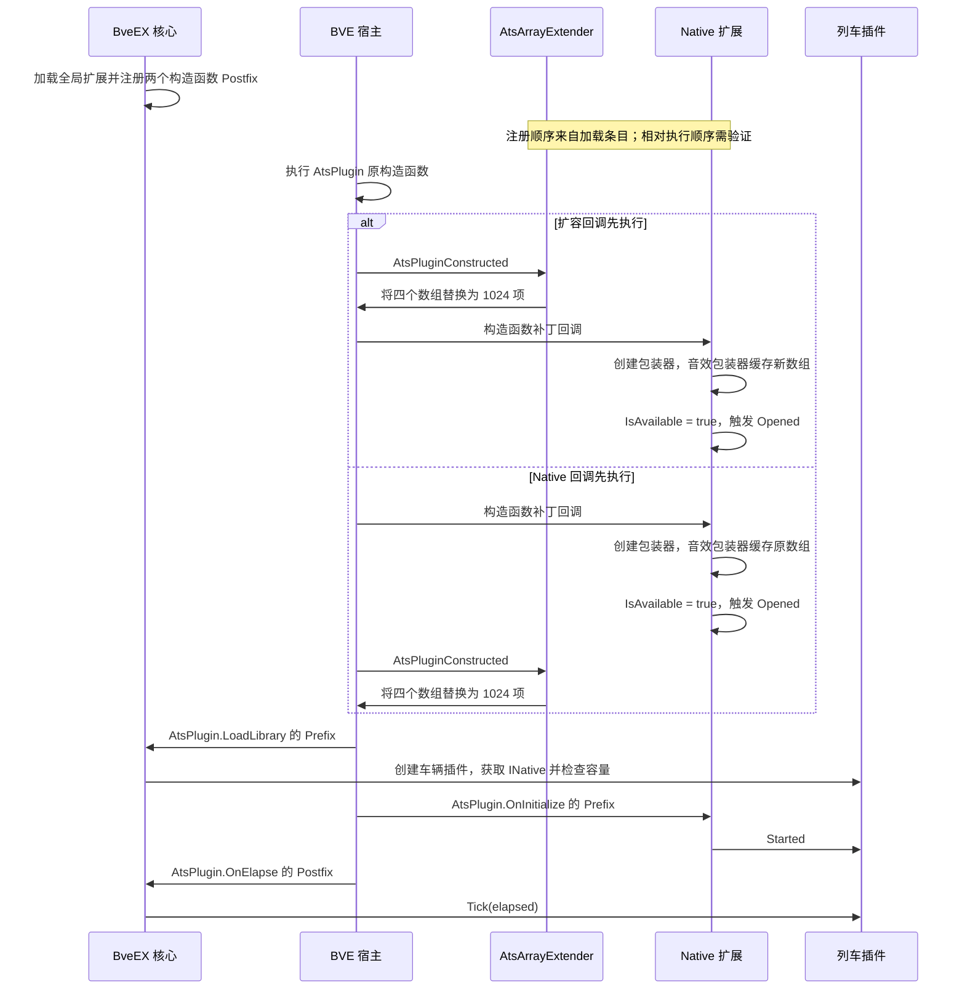
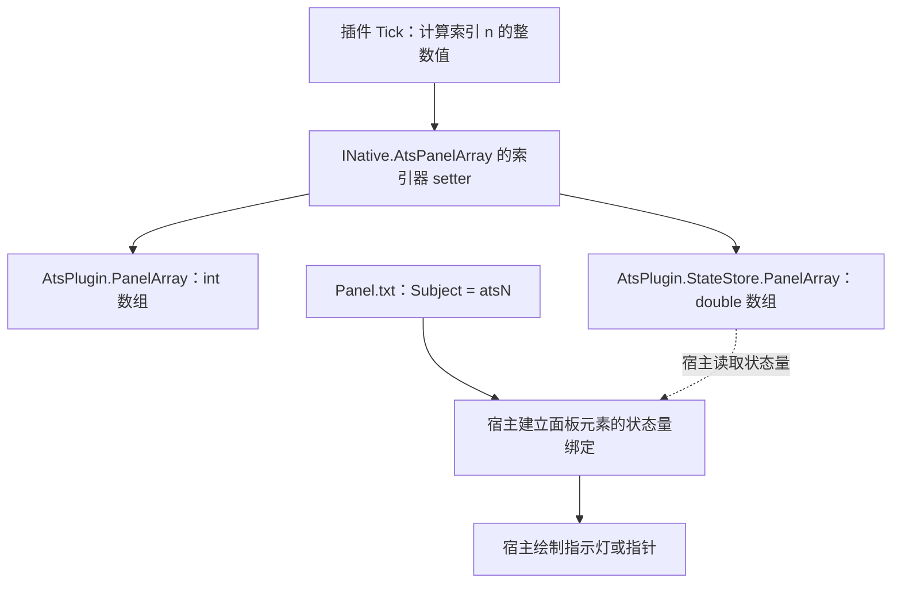

# AtsArrayExtender：ATS 面板与音效数组扩展

`AtsArrayExtender.dll` 是 BveEX 的全局扩展。它在 BVE 创建 `AtsPlugin` 后，将 ATS 面板、音效及其配套状态数组的长度设为 `1024`。列车插件和地图插件通过 `BveEx.CoreExtensions.dll` 中的 `INative` 读写这些数组。

本文面向使用 ATS 面板变量和 ATS 音效的插件开发者。开发环境和车辆插件基础分别见[插件开发快速入门](../getting-started.md)与[列车插件开发指南](../vehicle-plugins.md)。

主要源码与资源依据：

| 位置 | 核对内容 |
| --- | --- |
| [扩展入口](../../../Extensions/BveEx.Extensions.AtsArrayExtender/ExtensionMain.cs)、[工程文件](../../../Extensions/BveEx.Extensions.AtsArrayExtender/BveEx.Extensions.AtsArrayExtender.csproj) | 扩容目标、构造函数补丁、程序集名称、依赖与释放 |
| [`INative`](../../../Extensions/BveEx.CoreExtensions/Native/INative.cs)、[`Native`](../../../Extensions/BveEx.CoreExtensions/Native/Native.cs)、[`ScenarioService`](../../../Extensions/BveEx.CoreExtensions/Native/ScenarioService.cs) | 公开接口、数组可用性、事件与包装器创建 |
| [`PanelArray`](../../../Extensions/BveEx.CoreExtensions/Native/PanelArray.cs)、[`SoundArray`](../../../Extensions/BveEx.CoreExtensions/Native/SoundArray.cs) | 索引器、数组引用、命令处理和集合操作 |
| [`AtsPanelValueTest`](../../../SamplePlugins/VehiclePlugins/AtsPanelValueTest/PluginMain.cs) 及其[工程文件](../../../SamplePlugins/VehiclePlugins/AtsPanelValueTest/BveEx.Samples.VehiclePlugins.AtsPanelValueTest.csproj) | 插件结构、初始化、逐帧赋值和编译引用 |
| [官方车辆清单](../../../_out/Scenarios/BveEx.Samples/Vehicles/Basic/Vehicle_WithPanel.VehiclePluginUsing.xml)、[面板](../../../_out/Scenarios/BveEx.Samples/Vehicles/Basic/Panel/Panel.txt)、[音效](../../../_out/Scenarios/BveEx.Samples/Vehicles/Basic/Sound.txt) | 索引到车辆资源的对应关系 |

## 1. 定位、部署与引用

### 1.1 扩容扩展与访问接口

| 组件 | 职责与插件使用方式 |
| --- | --- |
| `AtsArrayExtender.dll` | 在 `AtsPlugin` 构造函数的 `Postfix` 中替换四个数组，扩容长度固定为 `1024`。 |
| `BveEx.CoreExtensions.dll` | 提供 `BveEx.Extensions.Native.INative`，将 ATS 数组包装为 `IList<int>`，并提供运行事件和音效命令辅助类型。 |
| `BveEx.PluginHost.dll` | 提供 `AssemblyPluginBase`、`PluginBuilder`、插件特性及扩展集合契约。 |

扩展入口为 `BveEx.Extensions.AtsArrayExtender.ExtensionMain`，声明为 `internal`，标记 `[Plugin(PluginType.Extension)]` 和 `[HideExtensionMain]`。`HideExtensionMainAttribute` 将入口的获取方式限制在框架内部；插件侧使用 `Extensions.GetExtension<INative>()`。入口实现 `IExtension`，其生命周期由 BveEX 管理。

入口类声明、获取规则分别见[扩展入口](../../../Extensions/BveEx.Extensions.AtsArrayExtender/ExtensionMain.cs)、[`HideExtensionMainAttribute`](../../../BveEx.PluginHost/Plugins/Extensions/HideExtensionMainAttribute.cs)和 [`ExtensionSet.GetExtension<T>()`](../../../BveEx/Plugins/Extensions/ExtensionSet.cs)。

### 1.2 运行部署

使用同一版本的 BveEX 配套程序集，保留安装包的依赖布局。以下为本专题涉及的文件：

```text
<BVE 数据目录>\Input Devices\BveEx\<版本目录>\
├── BveEx.dll
├── BveEx.PluginHost.dll
├── BveTypes.dll
├── FastMember.dll
├── TypeWrapping.dll
├── 0Harmony.dll
├── ObjectiveHarmonyPatch.dll
└── Extensions\
    ├── AtsArrayExtender.dll
    └── BveEx.CoreExtensions.dll
```

`AtsArrayExtender` 工程以 `.NET Framework 4.8`、`AnyCPU` 为目标，`AssemblyName` 为 `AtsArrayExtender`。工程引用 `BveEx.PluginHost`、`BveTypes`、`FastMember`、`TypeWrapping`、`Lib.Harmony 2.3.3` 和 `ObjectiveHarmonyPatch 1.1.0`，这些引用的 `Private` 均为 `False`。完整安装和宿主环境要求见[安装与部署](../../user-manual/installation.md)。

BveEX 核心初始化时加载全局扩展，递归扫描版本目录的 `Extensions\` 及其子目录中的 `.dll`。扩展入口在该阶段注册补丁；后续车辆加载时执行数组替换。部署完成后重启 BVE，再加载测试场景。

### 1.3 扩展清单与重复发现

[`ExtensionSetFactory.Load()`](../../../BveEx/Plugins/Extensions/ExtensionSetFactory.cs) 先取得可选的 `Extensions\PluginUsing.xml` 条目，再与目录扫描条目拼接，交给加载器依次处理。程序集路径以清单所在目录为基准，详见[配置说明与插件加载](../../user-manual/configuration.md)。

每份扩展程序集保留一个加载入口。放在 `Extensions\` 下的 `AtsArrayExtender.dll` 和 `BveEx.CoreExtensions.dll` 通过目录扫描加载即可。通过清单指定程序集时，将对应文件放在扫描目录之外，并以清单相对路径引用。

> [!WARNING]
> 上游加载器直接拼接清单和目录扫描条目，同一程序集可被重复实例化，造成补丁重复注册；扩展集合以显示类型建立字典时还可能出现重复键异常。依据见 [`PluginSourceSet.Concat()`](../../../BveEx/Plugins/PluginSourceSet.Concat.cs)、[`PluginLoader.Load()`](../../../BveEx/Plugins/PluginLoader.cs) 和 [`ExtensionSet.SetExtensions()`](../../../BveEx/Plugins/Extensions/ExtensionSet.cs)。

## 2. 扩容目标与容量

<a id="capacity"></a>

### 2.1 四个数组

扩展回调通过 `AtsPlugin.FromSource(e.Instance)` 包装本次构造的宿主对象，然后执行以下四次数组替换：

| 宿主成员 | 类型 | 扩容后长度 | 有效索引 | 用途 |
| --- | --- | ---: | --- | --- |
| `AtsPlugin.PanelArray` | `int[]` | `1024` | `0～1023` | ATS 插件输出的面板整数状态量。 |
| `AtsPlugin.SoundArray` | `int[]` | `1024` | `0～1023` | ATS 音效播放命令。 |
| `AtsPlugin.OldSoundArray` | `int[]` | `1024` | `0～1023` | 音效命令比较所用的历史值。 |
| `AtsPlugin.StateStore.PanelArray` | `double[]` | `1024` | `0～1023` | 驾驶台状态存储中的面板值。 |

四次赋值均使用 `new`，新数组的元素全部初始化为 `0`。原数组的内容保留在旧对象中，新数组从零开始。旧数组的存活时间取决于仍持有它的对象引用，第 7.1 节说明音效包装器缓存旧引用的影响。

四个新数组的元素存储合计 `20 KiB`：三个 `1024 × 4` 字节的整数数组，加上一个 `1024 × 8` 字节的浮点数组。该数值只计算数组元素，数组对象头、旧数组和车辆图像、音频资源另计。

赋值实现见[扩展回调](../../../Extensions/BveEx.Extensions.AtsArrayExtender/ExtensionMain.cs)，宿主字段包装见 [`AtsPlugin`](../../../Libs/BveTypes/ClassWrappers/Public/AtsPlugin.cs) 和 [`VehicleStateStore`](../../../Libs/BveTypes/ClassWrappers/Public/VehicleStateStore.cs)。

### 2.2 索引与资源的对应关系

面板索引 `n` 对应面板配置中的 `Subject = ats<n>`；音效索引 `n` 对应 `Sound.txt` 的 `[Ats]` 节中编号为 `n` 的音效。两类索引分别用于面板和音效，可以各自分配相同的整数编号。

| 索引 | 1024 项数组中的位置 | 使用检查 |
| ---: | --- | --- |
| `255` | 第 256 项 | 检查已有插件和资源的索引分配。 |
| `256` | 第 257 项，扩展区起点 | 检查实际 `Count`，并验证对应的宿主资源绑定。 |
| `1023` | 第 1024 项，末项 | 检查末项读写及面板显示。 |
| `1024` | 数组范围之外 | 索引条件为 `0 <= index && index < Count`。 |

BVE 官方[面板格式](https://bvets.net/jp/edit/formats/vehicle/panel.html)列出的 ATS 状态量为 `ats0～ats255`，官方[音效格式](https://bvets.net/jp/edit/formats/vehicle/sound.html)列出的 `[Ats]` 键为 `0～255`。本扩展源码确认四个数组被替换为 1024 项；高索引配置的解析、资源绑定、显示和播放依赖 BVE 宿主实现，验证项目见第 7.6 节。

## 3. 补丁与生效时机

### 3.1 补丁目标

`ExtensionMain(PluginBuilder builder)` 通过 `BveHacker.BveTypes.GetClassInfoOf<AtsPlugin>()` 取得成员映射，再用 `GetSourceConstructor(atsPluginConstructorParamTypes)` 定位构造函数。参数顺序如下，类型均属于 `BveTypes.ClassWrappers`：

| 顺序 | 参数类型 | 包装器构造函数参数名 |
| ---: | --- | --- |
| 1 | `VehicleLocation` | `location` |
| 2 | `InputManager` | `inputManager` |
| 3 | `HandleSet` | `handles` |
| 4 | `HandleSet` | `atsHandles` |
| 5 | `VehicleStateStore` | `vehicleStateStore` |
| 6 | `SectionManager` | `sectionManager` |
| 7 | `MapFunctionList` | `beacons` |
| 8 | `DoorSet` | `doors` |

补丁通过 `HarmonyPatch.Patch(nameof(AtsArrayExtender), atsPluginConstructor.Source, PatchType.Postfix)` 注册，其 `Invoked` 事件绑定 `AtsPluginConstructed`。回调在原构造函数执行后替换数组，并返回 `PatchInvokationResult.DoNothing(e)`。扩展的 `Tick(TimeSpan elapsed)` 方法体为空；每个命中该构造函数的 `AtsPlugin` 实例在构造阶段完成一次替换。

`Dispose()` 调用 `AtsPluginConstructorPatch?.Dispose()` 释放补丁。已替换的数组继续由宿主对象及相关引用持有，容量和内容的后续生命周期随这些对象管理。

依据见[扩展入口](../../../Extensions/BveEx.Extensions.AtsArrayExtender/ExtensionMain.cs)和 [`AtsPlugin` 构造函数](../../../Libs/BveTypes/ClassWrappers/Public/AtsPlugin.cs)。

### 3.2 加载与初始化时序

`Native` 在另一个 `AtsPlugin` 构造函数 `Postfix` 中创建 `ScenarioService`。该服务创建面板、音效包装器，随后 `Native` 触发 `Opened`，此时 `IsAvailable` 为 `true`。两个构造函数补丁在本仓库的注册调用中均采用默认参数，相对优先级由补丁运行库处理。



车辆插件在 `AtsPlugin.LoadLibrary` 的 `Prefix` 中创建，官方范例在构造函数中取得 `INative` 并订阅 `Started`。地图插件在地图解析阶段创建，数组访问以 `IsAvailable` 为条件，初始化可结合 `Opened` 或 `ScenarioCreated` 安排。`Opened` 回调中的数组容量也受上图两个补丁的执行顺序影响。

相关调用见 [`Native`](../../../Extensions/BveEx.CoreExtensions/Native/Native.cs)、[`Native.PatchSet`](../../../Extensions/BveEx.CoreExtensions/Native/PatchSet.cs)、[核心补丁定义](../../../BveEx/Main/PatchSet.cs)、[核心补丁事件](../../../BveEx/Main/BveEx.PatchEvents.cs)和 [`InputDeviceMain`](../../../BveEx/Native/InputDevices/InputDeviceMain.cs)。完整场景时序见[插件生命周期与执行时机](../architecture-lifecycle.md)。

## 4. 通过 `INative` 读写数组

### 4.1 可用性与固定长度集合

| 公开成员 | 类型 | 当前实现 |
| --- | --- | --- |
| `INative.IsAvailable` | `bool` | `ScenarioService` 已创建时为 `true`。 |
| `INative.AtsPanelArray` | `IList<int>` | 当前场景的 `PanelArray` 包装器；服务为空时返回 `null`。 |
| `INative.AtsSoundArray` | `IList<int>` | 当前场景的 `SoundArray` 包装器；服务为空时返回 `null`。 |

两种包装器的 `Count`、`IsReadOnly`、`Contains()`、`CopyTo()`、`IndexOf()` 和枚举操作均转发给各自引用的底层数组。`Add()`、`Insert()`、`Remove()`、`RemoveAt()` 和 `Clear()` 均直接抛出 `NotSupportedException`。批量重置元素时使用索引器逐项赋值。

底层数组作为 `IList<int>` 时，`IsReadOnly` 的值为 `true`；包装器的索引器仍提供已有元素的赋值入口。合法索引以实际 `Count` 为界。通过这两个包装器访问 `-1` 或 `Count` 时，数组的 `IList<int>` 实现抛出 `ArgumentOutOfRangeException`；直接访问宿主的 `int[]` 或 `double[]` 越界时抛出 `IndexOutOfRangeException`。

`Count` 表示包装器访问的数组长度。音效引用缓存的检查方法见第 7.1 节。接口与实现见 [`INative`](../../../Extensions/BveEx.CoreExtensions/Native/INative.cs)、[`PanelArray`](../../../Extensions/BveEx.CoreExtensions/Native/PanelArray.cs)和 [`SoundArray`](../../../Extensions/BveEx.CoreExtensions/Native/SoundArray.cs)。

### 4.2 面板索引器的双写

`PanelArray` 的 getter 从 `AtsPlugin.PanelArray[index]` 读取整数；setter 依次写入 `AtsPlugin.PanelArray[index]` 和 `AtsPlugin.StateStore.PanelArray[index]`，第二次赋值将整数转换为 `double`。其数组属性每次访问时都读取当前宿主字段。

通过 `Native.AtsPanelArray[index]` 赋值，可在同一 setter 调用中更新 ATS 输出和面板状态存储。BveEX 插件 `Tick()` 位于 `AtsPlugin.OnElapse` 的 `Postfix`，面板资源的后续读取与绘制时机由 BVE 宿主实现。

### 4.3 音效索引器的命令处理

`SoundArray` 的 setter 按以下顺序处理：

1. 将传入值写入创建包装器时缓存的音效数组。
2. 与当前 `AtsPlugin.OldSoundArray[index]` 比较；相等时结束本次调用。
3. 将本次命令写入 `OldSoundArray[index]`。
4. 命令为 `1` 时，触发 `PlaySoundRequested`，参数为索引和音量 `0`，再将缓存数组的本项改为 `2`。
5. 命令小于或等于 `0` 时，触发 `LoopSoundRequested`，将索引和命令值传给宿主。
6. 其它正值执行完历史值更新后结束本次调用。

这些分支说明的是托管包装器发出的请求。音效资源的查找、播放和停止由 BVE 宿主处理。相邻两次赋值之间，宿主也可能更新命令数组及历史值。

[`SoundPlayMode`](../../../Extensions/BveEx.CoreExtensions/Native/SoundPlayMode.cs) 和 [`SoundPlayCommands`](../../../Extensions/BveEx.CoreExtensions/Native/SoundPlayCommands.cs) 提供以下命令与转换规则：

| 项目 | 值或参数范围 | 行为 |
| --- | --- | --- |
| `SoundPlayMode.Stop` | `-10000` | 停止命令。 |
| `SoundPlayMode.PlayLooping` | `0` | 循环播放命令。 |
| `SoundPlayMode.Play` | `1` | 单次播放命令，进入播放分支后缓存值改为 `2`。 |
| `SoundPlayMode.Continue` | `2` | 保持状态的命令值。 |
| `mode.ToCommand()` | `SoundPlayMode` | 直接转换为 `int`。 |
| `SoundPlayCommands.PlayLooping(volume)` | 接受全部 `volume <= 0` 的整数 | 原样返回参数；正数抛出 `ArgumentOutOfRangeException`。 |
| `SoundPlayCommands.GetMode(command)` | 全部 `int` | `<= -10000` 为 `Stop`；`-9999～0` 为 `PlayLooping`；`1` 为 `Play`；其余正数为 `Continue`。 |

> [!NOTE]
> 扩容回调创建的 `SoundArray` 和 `OldSoundArray` 初值均为 `0`。两项仍为零时，首次写入循环命令 `0` 会命中相等分支。第 6 节在 `Started` 中先写入停止命令，再逐帧输出循环或停止命令。

一次单次播放分支完成后，缓存数组本项为 `2`，历史值为 `1`。同一调用栈内再次写入 `1` 会命中相等分支；连续触发单次播放时，可先通过索引器写入 `Continue`，再写入 `Play`，使历史值按命令更新。宿主跨帧处理结果列入实机验证。

## 5. 官方 `AtsPanelValueTest` 解析

### 5.1 插件与资源对应

官方车辆 [`Vehicle_WithPanel.txt`](../../../_out/Scenarios/BveEx.Samples/Vehicles/Basic/Vehicle_WithPanel.txt) 引用 `Panel\Panel.txt` 和 `Sound.txt`。同目录的[车辆插件清单](../../../_out/Scenarios/BveEx.Samples/Vehicles/Basic/Vehicle_WithPanel.VehiclePluginUsing.xml)加载 `BveExPlugins\AtsPanelValueTest.dll`，并包含 `PanelController`、`SimpleAts`、`StateViewer` 等示例。

[`AtsPanelValueTest.PluginMain`](../../../SamplePlugins/VehiclePlugins/AtsPanelValueTest/PluginMain.cs) 的操作与[面板配置](../../../_out/Scenarios/BveEx.Samples/Vehicles/Basic/Panel/Panel.txt)逐项对应：

| 阶段或索引 | 插件操作 | 资源及显示输入 |
| --- | --- | --- |
| 构造函数 | 获取 `INative`，订阅 `Native.Started`。 | 为场景开始时的状态初始化注册回调。 |
| `Started` | 将索引 `1` 设为 `50`。 | 首次开始和跳站时重置对应指针输入。 |
| `0` | `timeMilliseconds / 500 % 2 == 0 ? 1 : 0`。 | `[PilotLamp]` 使用 `Subject = ats0`、`ats0.png`。 |
| `1` | 每次 `Tick()` 增加 `1`，值等于 `200` 时归零。 | `[Needle]` 使用 `Subject = ats1`、`ats1.png`，配置范围为 `0～200`。 |
| `2` | `(int)(Math.Sin(timeMilliseconds / 400d) * 100)`。 | `[Needle]` 使用 `Subject = ats2`、`ats2.png`，配置范围为 `-100～100`。 |
| `Dispose()` | 退订 `Native.Started`。 | 释放插件对全局扩展事件的订阅。 |

闪烁与正弦输出使用 `BveHacker.Scenario.TimeManager.TimeMilliseconds`，时间基准为仿真时刻。索引 `1` 的增量按 `Tick()` 次数计算，变化速率随帧回调频率变化。`elapsed` 参数在该官方范例中保持空闲。

### 5.2 面板数据流



实线中的数组双写由 [`PanelArray`](../../../Extensions/BveEx.CoreExtensions/Native/PanelArray.cs) 直接实现。面板配置和宿主状态之间的绑定、读取及绘制由 BVE 实现；包装器暴露的 `Subject` 和 `SubjectIndex` 成员见 [`VehiclePanelElement`](../../../Libs/BveTypes/ClassWrappers/Public/VehiclePanelElement.cs)。

官方示例的三个索引均处于 `0～255` 范围。扩展区的容量检查和资源配置见下一节。

## 6. 完整高索引车辆插件示例

### 6.1 工程与索引分配

创建 `.NET Framework 4.8`、`AnyCPU` 类库，程序集名称设为 `ExtendedAtsArrays`。按[官方工程](../../../SamplePlugins/VehiclePlugins/AtsPanelValueTest/BveEx.Samples.VehiclePlugins.AtsPanelValueTest.csproj)引用配套的 `BveEx.PluginHost.dll`、`BveEx.CoreExtensions.dll` 和 `BveTypes.dll`，引用属性 `Copy Local` 设为 `False`。开发环境配置见[快速入门](../getting-started.md)。

| 类别 | 索引 | 用途 |
| --- | ---: | --- |
| 面板 | `256` | 半秒交替输出的指示灯。 |
| 面板 | `257` | 从 `50` 开始、逐帧递增的指针。 |
| 面板 | `1023` | 正弦变化的指针。 |
| 音效 | `0` | 复用官方 `Ats.wav`，随指示灯状态交替循环播放和停止。 |

### 6.2 完整 `PluginMain.cs`

```csharp
using System;
using BveEx.Extensions.Native;
using BveEx.PluginHost.Plugins;

namespace BveEx.Documentation.ExtendedAtsArrays
{
    [Plugin(PluginType.VehiclePlugin)]
    public sealed class PluginMain : AssemblyPluginBase
    {
        private const int ArrayLength = 1024;
        private const int BlinkIndex = 256;
        private const int CounterIndex = 257;
        private const int WaveIndex = 1023;
        private const int SoundIndex = 0;

        private readonly INative Native;

        public PluginMain(PluginBuilder builder) : base(builder)
        {
            Native = Extensions.GetExtension<INative>();
            ValidateArrayCapacity();
            Native.Started += OnStarted;
        }

        private void ValidateArrayCapacity()
        {
            bool available = Native.IsAvailable;
            int? panelCount = Native.AtsPanelArray?.Count;
            int? soundCount = Native.AtsSoundArray?.Count;

            if (!available || panelCount != ArrayLength || soundCount != ArrayLength)
            {
                throw new InvalidOperationException(string.Format(
                    "ATS 数组要求 1024 项：IsAvailable={0}, PanelCount={1}, SoundCount={2}。"
                    + "请检查 AtsArrayExtender 的加载及音效包装器的数组引用。",
                    available,
                    panelCount?.ToString() ?? "null",
                    soundCount?.ToString() ?? "null"));
            }
        }

        private void OnStarted(object sender, StartedEventArgs e)
        {
            ValidateArrayCapacity();
            Native.AtsPanelArray[BlinkIndex] = 0;
            Native.AtsPanelArray[CounterIndex] = 50;
            Native.AtsPanelArray[WaveIndex] = 0;
            Native.AtsSoundArray[SoundIndex] = SoundPlayMode.Stop.ToCommand();
        }

        public override void Tick(TimeSpan elapsed)
        {
            if (!Native.IsAvailable) return;

            int timeMilliseconds = BveHacker.Scenario.TimeManager.TimeMilliseconds;
            bool active = timeMilliseconds / 500 % 2 == 0;

            Native.AtsPanelArray[BlinkIndex] = active ? 1 : 0;
            Native.AtsPanelArray[CounterIndex] += 1;
            if (Native.AtsPanelArray[CounterIndex] == 200)
            {
                Native.AtsPanelArray[CounterIndex] = 0;
            }
            Native.AtsPanelArray[WaveIndex] =
                (int)(Math.Sin(timeMilliseconds / 400d) * 100);

            Native.AtsSoundArray[SoundIndex] =
                (active ? SoundPlayMode.PlayLooping : SoundPlayMode.Stop).ToCommand();
        }

        public override void Dispose()
        {
            Native.Started -= OnStarted;
        }
    }
}
```

容量检查在订阅事件之前执行，错误信息同时给出可用性和两个集合的实测长度。`Started` 再次检查后设置初值；每帧行为沿用官方示例的计算方式，并增加音效命令输出。

### 6.3 车辆清单与面板资源

将官方 [`Basic` 车辆目录](../../../_out/Scenarios/BveEx.Samples/Vehicles/Basic)复制到个人测试场景目录，保留性能、参数、图像和音频资源。将编译得到的 `ExtendedAtsArrays.dll` 放入副本的 `BveExPlugins\`。测试副本使用下列 `Vehicle_WithPanel.VehiclePluginUsing.xml`：

```xml
<?xml version="1.0" encoding="utf-8" ?>
<BveExPluginUsing>
    <Assembly Path="BveExPlugins\ExtendedAtsArrays.dll" />
</BveExPluginUsing>
```

该清单将本示例作为唯一车辆插件，便于核对索引和音效输出。清单路径基准及车辆文件匹配规则见[配置手册](../../user-manual/configuration.md)。

将副本的 `Panel\Panel.txt` 设为以下内容，三个图像均来自官方车辆的同名资源：

```ini
BveTs Instrument Panel 2.01

[This]
Resolution = 1280
Left = -640
Top = -400
Right = 640
Bottom = 400
Center = 0, 0
Origin = 0, 0

[PilotLamp]
Subject = ats256
Location = -560, -320
DaytimeImage = ats0.png

[Needle]
Subject = ats257
Location = -560, 0
DaytimeImage = ats1.png
Origin = 16, 240
Radius = 160
InitialAngle = 0
LastAngle = 135
Minimum = 0
Maximum = 200
NaturalFreq = 100

[Needle]
Subject = ats1023
Location = -360, 0
DaytimeImage = ats2.png
Origin = 16, 240
Radius = 160
InitialAngle = 0
LastAngle = 135
Minimum = -100
Maximum = 100
NaturalFreq = 100
```

副本的 `Sound.txt` 沿用官方配置：

```ini
BveTs Vehicle Sound 3.00

[Run]
0 = Null.wav

[Ats]
0 = Ats.wav
```

车辆文件继续使用 `Panel = Panel\Panel.txt` 和 `Sound = Sound.txt`，并保留其它车辆参数。场景引用测试副本的 `Vehicle_WithPanel.txt`。高索引面板的解析与显示效果按第 7.6 节记录宿主验证结果。

## 7. 资源、兼容限制与排查

<a id="sound-order"></a>

### 7.1 音效引用缓存与补丁顺序

[`SoundArray`](../../../Extensions/BveEx.CoreExtensions/Native/SoundArray.cs) 在构造时将 `atsPlugin.SoundArray` 保存到 `readonly IList<int> Array` 字段。若包装器先于扩容回调创建，它继续访问原数组；后续 setter 使用的 `AtsPlugin.OldSoundArray` 则从宿主当前字段读取。`PanelArray` 的两个数组属性每次动态取值，因此会访问替换后的面板数组。

> [!WARNING]
> 上游代码存在音效数组引用缓存的顺序依赖：`AtsPlugin.SoundArray.Length` 已为 `1024` 时，`INative.AtsSoundArray.Count` 仍可能是原数组长度。诊断时同时检查这两个长度及 `OldSoundArray.Length`；高索引访问受包装器实际 `Count` 约束。调整部署后重启 BVE，并重新加载场景建立新的包装器。

[`PluginSourceSet.FromDirectory()`](../../../BveEx/Plugins/PluginSourceSet.FromDirectory.cs) 使用 `Directory.GetFiles()` 的枚举结果；明确的条目顺序来自清单和拼接过程。`AtsArrayExtender` 与 [`Native.PatchSet`](../../../Extensions/BveEx.CoreExtensions/Native/PatchSet.cs) 的注册调用均使用 `HarmonyPatch.Patch()` 默认参数。验证时记录扩展加载条目和实际补丁顺序，以六项数组长度作为检查结果。

### 7.2 资源定义与高索引音效测试

数组项提供状态值或音效命令，图像和音频资源由车辆配置提供。面板核对 `Subject`、图像相对路径和元素参数；音效核对 `[Ats]` 编号、文件路径及命令变化。第 6 节引用的图片、`Null.wav`、`Ats.wav` 均位于官方车辆目录中。

测试高索引音效时，在测试副本 `Sound.txt` 的现有 `[Ats]` 节追加以下配置片段，并将示例类的 `SoundIndex` 常量改为 `256`：

```ini
256 = Ats.wav
```

该案例用于验证高索引音效资源的宿主解析和播放。先记录两个 `INative` 集合及四个底层数组的长度，再记录配置加载信息和音效事件的索引。源码中 `SoundArray` 将所写索引传入音效事件；宿主如何接受和绑定编号 `256` 由 BVE 实现。

### 7.3 多插件共享与原生 ATS

同一车辆的插件共享 ATS 数组。为各插件分配面板和音效索引，在车辆文档中保存分配表。官方计数示例的归零条件依赖本插件对该项的连续递增；其它插件写入同一索引会改变其数值轨迹。

[`NativePlugin.Tick()`](../../../BveEx/Plugins/Native/NativePlugin.cs) 将当前 `atsPlugin.PanelArray` 和 `atsPlugin.SoundArray` 直接传给原生 DLL 的 `Elapse`；[`ElapseDelegate`](../../../BveEx/Plugins/Native/Imports.cs) 参数为 `int[] panel` 和 `int[] sound`。底层数组扩容后，该调用继续传入当前数组。原生插件的索引使用和互操作回写效果取决于其实现及运行环境，验证时记录对应 DLL、进程位数和实际回写值。

原生 DLL 直接写底层数组时，同步到面板状态存储及发出音效请求的后续行为由宿主流程决定。托管插件通过 `INative` 索引器取得本专题第 4 节所述的同步行为。帧内回调位置见 [`InputDeviceMain.PostElapse()`](../../../BveEx/Native/InputDevices/InputDeviceMain.cs)，原生 ATS 混用说明见[车辆指南](../vehicle-plugins.md)。

### 7.4 宿主版本与其它数组替换

本仓库的 `BveTypes` 配置包括 [BVE 5.8.7554.391](../../../Libs/BveTypes/WrapTypes/5.8.7554.391.xml) 和 [BVE 6.0.7554.619](../../../Libs/BveTypes/WrapTypes/6.0.7554.619.xml)，两套映射均提供本专题使用的 ATS 数组字段。实际构造调用、面板资源读取和音效执行由 BVE 宿主提供。

其它扩展若替换同一数组，其赋值时机将影响最终引用与长度。诊断记录同时包含 `INative` 集合容量和四个底层数组容量，可用于定位引用差异。安装与版本要求见[安装手册](../../user-manual/installation.md)。

### 7.5 场景关闭与资源释放

[`Native.OnScenarioClosed()`](../../../Extensions/BveEx.CoreExtensions/Native/Native.cs) 先将 `ScenarioService` 设为 `null`，再清空包括 `Started` 在内的七个场景事件，最后触发 `Closed`。因此 `Closed` 回调中 `IsAvailable` 为 `false`，两个数组属性均为 `null`。

车辆插件在 `Dispose()` 中退订自己的事件。全局扩展或地图插件若订阅 `Opened`、`Closed`，在自身释放时退订，并在新场景可用后重新取得集合。新 `AtsPlugin` 构造时创建新包装器，旧集合引用继续关联旧对象；场景重载后重新取得当前集合。ATS 图像和音频资源的释放、场景切换时的声音状态由 BVE 宿主管理，观察项目列于下表。

### 7.6 验证记录与宿主测试清单

本文完成于 `2026-10-31`。验证状态如下：

| 检查层次 | 状态与范围 |
| --- | --- |
| 源码与官方范例 | 已交叉核对扩展入口、依赖、公开接口、包装器、加载器、车辆插件及资源配置。 |
| 集合边界 | 已在本机 .NET Framework 4 运行时验证数组经 `IList<int>` 的索引行为：`255`、`256`、`1023` 可读写，`1024` 越界抛出 `ArgumentOutOfRangeException`；包装器结构修改方法依据源码均抛出 `NotSupportedException`。 |
| 文档结构与配置 | 新增源码、资源链接和章节锚点已检查；专题与配置手册中的六个 `BveExPluginUsing` XML 示例通过仓库 XSD 校验。 |
| Mermaid 图 | 加载时序图和面板数据流图通过 Mermaid `11.12.0` 语法解析，图中调用顺序已与源码交叉核对。 |
| 示例编译 | 待验证。当前工作区缺少 `packages\`、`LocalReferences\BveTs\` 下的两项 Mackoy 引用程序集以及 BveEX 编译产物。完整示例已按当前接口与官方工程引用核对。 |
| BVE 实机行为 | 待验证。分别记录 BVE 5 / 6 的版本、位数、扩展部署、插件清单及下列观察结果。 |

| 场景或操作 | 记录项目 |
| --- | --- |
| 首次加载 | `AtsPlugin.PanelArray.Length`、`SoundArray.Length`、`OldSoundArray.Length`、`StateStore.PanelArray.Length`；`INative.AtsPanelArray.Count`、`AtsSoundArray.Count`。检查目标值均为 `1024`。 |
| 索引边界 | 记录 `255`、`256`、`1023` 的写入和读回，以及面板 setter 对状态存储的同步；在受控诊断中捕获索引 `1024` 的越界异常。 |
| 高索引面板 | 记录 `ats256`、`ats257`、`ats1023` 的配置解析、指示灯和指针显示。 |
| 音效 | 记录索引 `0` 的循环和停止；另行记录索引 `256` 的资源解析、事件与播放。观察重复命令及单次播放后命令值的变化。 |
| 跳站 | 记录 `Started` 回调、计数值重置为 `50`、音效停止命令及下一帧输出。 |
| 场景重载 | 记录新旧宿主对象与集合引用、六项容量、事件订阅和旧资源释放。 |
| 关闭与退出 | 记录数组可用性、`Closed` 与插件 `Dispose()`、图像和声音的释放及循环音停止情况。 |
| 原生 ATS 混用 | 记录 DLL、宿主位数、实际写入索引、数组回写和最终显示、音效表现。 |

### 7.7 故障定位

| 现象 | 检查位置 | 处理步骤 |
| --- | --- | --- |
| 插件报告数组容量异常 | 扩展加载结果、六项数组长度 | 检查 `AtsArrayExtender.dll` 部署和音效缓存引用，重启后重新记录。 |
| `GetExtension<INative>()` 失败 | `BveEx.CoreExtensions.dll`、加载错误信息 | 恢复配套核心扩展和依赖，按[故障排除](../../user-manual/troubleshooting.md)检查加载错误。 |
| 扩展加载出现重复键或重复实例 | 扩展清单和扫描目录 | 为每份扩展保留一个加载入口，重新启动并检查插件列表。 |
| 高索引读写成功，面板显示异常 | 面板 `Subject`、资源路径、宿主版本 | 以官方低索引示例建立对照，再记录高索引的解析和绑定结果。 |
| 音效命令写入后播放异常 | `[Ats]` 资源、缓存数组与历史值 | 核对音效编号和文件，按第 4.3 节检查命令比较分支及宿主播放结果。 |
| 跳站或重载后状态偏离示例 | `Started` 初始化、旧集合引用、索引分配 | 在当前场景重新初始化状态，使用当前集合，并核对其它插件写入。 |

## 相关文档

- [配置说明与插件加载](../../user-manual/configuration.md)：扩展目录、清单语法和车辆插件路径。
- [列车插件开发指南](../vehicle-plugins.md)：`INative`、面板、音效与原生 ATS 协作。
- [插件生命周期与执行时机](../architecture-lifecycle.md)：场景初始化、帧回调和释放。
- [BveHacker 深入解析](../bve-hacker.md)：宿主对象、包装器和版本映射。
- [故障排除](../../user-manual/troubleshooting.md)：加载失败与运行信息采集。
