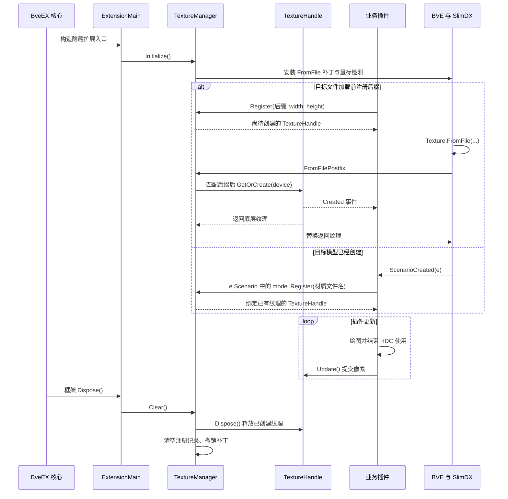
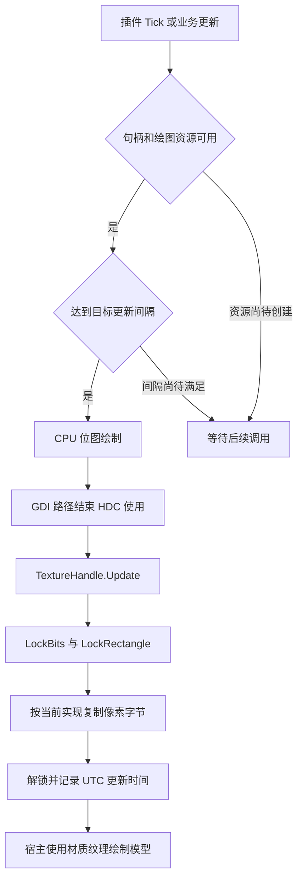
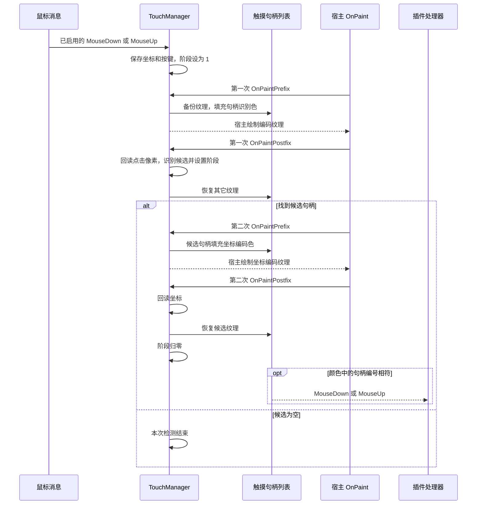

# DXDynamicTexture：动态贴图、绘图上下文与鼠标交互

`DXDynamicTexture.dll` 是 BveEX 的全局扩展。插件通过 `Zbx1425.DXDynamicTexture` 中的静态管理器取得纹理句柄，在 CPU 位图上绘图，再将像素提交到 SlimDX Direct3D 9 纹理。扩展还通过两次宿主绘制和颜色回读，将鼠标消息转换为纹理区域内的事件。

本文面向列车插件与地图插件开发者。开发环境见[插件开发快速入门](../getting-started.md)，场景事件见[插件生命周期与执行时机](../architecture-lifecycle.md)。第 6 节使用仓库自带地图资源，提供两份独立插件示例。

主要源码与资源依据：

| 位置 | 核对内容 |
| --- | --- |
| [扩展入口](../../../Extensions/BveEx.Extensions.DXDynamicTexture/ExtensionMain.cs)、[工程文件](../../../Extensions/BveEx.Extensions.DXDynamicTexture/BveEx.Extensions.DXDynamicTexture.csproj)、[包清单](../../../Extensions/BveEx.Extensions.DXDynamicTexture/packages.config) | 初始化、框架释放、程序集名称和依赖 |
| [`TextureManager`](../../../Extensions/BveEx.Extensions.DXDynamicTexture/TextureManager.cs)、[`TextureHandle`](../../../Extensions/BveEx.Extensions.DXDynamicTexture/TextureHandle.cs) | 注册、匹配、创建、更新、间隔和底层纹理释放 |
| [`GDIHelper`](../../../Extensions/BveEx.Extensions.DXDynamicTexture/GDIHelper.cs) | 位图、HDC、原生绘图、缓存与资源清理 |
| [`TouchManager`](../../../Extensions/BveEx.Extensions.DXDynamicTexture/TouchManager.cs)、[`TouchTextureHandle`](../../../Extensions/BveEx.Extensions.DXDynamicTexture/TouchTextureHandle.cs)、[`TouchEventArgs`](../../../Extensions/BveEx.Extensions.DXDynamicTexture/TouchEventArgs.cs) | 触摸注册、两阶段检测、坐标和事件 |
| [官方插件](../../../SamplePlugins/MapPlugins/DXDynamicTextureTest/DXDynamicTextureTest.cs)、[示例工程](../../../SamplePlugins/MapPlugins/DXDynamicTextureTest/BveEx.Samples.MapPlugins.DXDynamicTextureTest.csproj) | 地图生命周期、随机填色与工程引用 |
| [官方地图](../../../_out/Scenarios/BveEx.Samples/Maps/Basic/Samples/DXDynamicTexture/Map.txt)、[结构列表](../../../_out/Scenarios/BveEx.Samples/Maps/Basic/Samples/DXDynamicTexture/Structures.csv)、[模型](../../../_out/Scenarios/BveEx.Samples/Maps/Basic/Structures/Station/Stop6.x) | 模型键、材质文件名及场景部署 |

## 1. 定位、部署与公开入口

### 1.1 程序集与命名空间

| 项目 | 当前定义 |
| --- | --- |
| 输出文件 | `DXDynamicTexture.dll`；工程的 `AssemblyName` 为 `DXDynamicTexture`。 |
| 扩展入口 | `BveEx.Extensions.DXDynamicTexture.ExtensionMain`，继承 `AssemblyPluginBase`，实现 `IExtension`。 |
| 入口特性 | `[Plugin(PluginType.Extension)]`、`[HideExtensionMain]`。框架负责实例化和释放入口。 |
| 插件调用命名空间 | `Zbx1425.DXDynamicTexture`；通过 `TextureManager`、`TouchManager` 等公开类型调用。 |
| 目标框架与平台 | `.NET Framework 4.8`、`AnyCPU`；扩展工程启用 `AllowUnsafeBlocks`。 |

`HideExtensionMainAttribute` 对应的集合获取规则见 [`ExtensionSet.GetExtension<T>()`](../../../BveEx/Plugins/Extensions/ExtensionSet.cs)。插件侧直接使用静态管理器；内部的 `Initialize()`、`Clear()`、`GetOrCreate()` 由扩展和补丁调用。

### 1.2 依赖与部署

保留同一版本 BveEX 安装包的依赖布局。与本专题直接相关的组件如下：

| 引用 | 官方工程配置与用途 |
| --- | --- |
| `BveEx.PluginHost.dll` | 插件基类、构建参数、场景事件和扩展契约；`Private=False`。 |
| `BveTypes.dll` | `Model`、`MaterialInfo` 等宿主包装器；`Private=False`。 |
| `DXDynamicTexture.dll` | 业务插件引用的动态贴图库；官方示例的项目引用设为 `Private=False`。 |
| `SlimDX.dll` | 扩展引用包 `SlimDX 4.0.13.44`，程序集标识版本为 `4.0.13.43`；`Private=False`。直接使用 `Texture`、`Format`、`ExtendedMaterial` 的插件也添加此引用。 |
| `0Harmony.dll` | 扩展引用 `Lib.Harmony 2.3.3`，用于 `Texture.FromFile` 和窗体绘制补丁；`Private=False`。业务插件按自身用途添加引用。 |
| `System.Drawing` | 位图、`Graphics`、颜色、字体和画刷。 |
| `System.Windows.Forms` | `MouseButtons`、窗体消息与鼠标事件。 |

框架及包装器的其它依赖继续采用配套安装，完整要求见[安装与部署](../../user-manual/installation.md)。动态贴图扩展放置位置为：

```text
<BVE 数据目录>\Input Devices\BveEx\<版本目录>\
├── BveEx.PluginHost.dll
├── BveTypes.dll
└── Extensions\
    └── DXDynamicTexture.dll
```

[`ExtensionSetFactory.Load()`](../../../BveEx/Plugins/Extensions/ExtensionSetFactory.cs) 合并可选的 `Extensions\PluginUsing.xml` 与目录扫描条目；[`PluginSourceSet.FromDirectory()`](../../../BveEx/Plugins/PluginSourceSet.FromDirectory.cs) 递归发现 `.dll`。为该扩展保留一个加载入口，目录中的文件可直接交给扫描器加载。清单用法见[配置说明与插件加载](../../user-manual/configuration.md)。

> [!WARNING]
> `TextureManager.Initialize()` 在重复初始化时抛出 `InvalidOperationException`。清单和目录扫描同时发现同一扩展时，可触发重复实例化。检查扩展加载条目，保留单份部署和单一加载入口。

扩展和示例工程的目标平台均为 `AnyCPU`，SlimDX 引用标识含 `processorArchitecture=x86`。验证 BVE 5 / 6 时分别记录宿主进程位数、实际加载的 SlimDX 程序集及原生运行库；各组合的兼容结果按第 7 节记录。

### 1.3 公开 API 覆盖表

| 类型 | 本文覆盖的公开成员 |
| --- | --- |
| `BveEx.Extensions.DXDynamicTexture.ExtensionMain` | 构造函数、`Tick(TimeSpan)`、`Dispose()`；作为框架管理的隐藏扩展入口说明。 |
| `TextureManager` | 三种 `Register()`、`AppliedTextureFileNames`。 |
| `TextureHandle : IDisposable` | `IsCreated`、`Description`、`Width`、`Height`、`DXTexture`、`Created`、三种 `Update()`、`HasEnoughTimePassed()`、`Dispose()`。 |
| `GDIHelper : IDisposable` | 两个构造函数，`Graphics`、`Bitmap`，两项缓存容量，HDC 管理，两个 `DrawImage()`、`FillRect12()`、`FillRectWH()`、`Dispose()`。 |
| `TouchManager` | 两种 `Register()`、`EnableEvent()`、`DisableEvent()`。 |
| `TouchManager.EventType` | `Down = 0`、`Up = 1`。 |
| `TouchTextureHandle : TextureHandle` | `SetClickableArea()`、`MouseDown`、`MouseUp`，以及继承的句柄成员。 |
| `TouchEventArgs : EventArgs` | 构造函数，公开字段 `X`、`Y`、`Color`、`Button`、`PreventDefault`。 |

`TextureHandle` 和 `TouchTextureHandle` 的构造函数均为 `internal`；插件通过注册方法取得句柄。第 2～5 节列出成员签名和调用条件。

## 2. 注册入口、模型与贴图匹配

本节依据 [`TextureManager.cs`](../../../Extensions/BveEx.Extensions.DXDynamicTexture/TextureManager.cs)。三种入口对应两条数据路径：文件加载时替换返回纹理，或绑定已经存在的纹理。

| 签名 | 注册结果与使用时机 |
| --- | --- |
| `TextureHandle Register(string fileNameEnding, int width, int height)` | 建立文件后缀键和尺寸。后续匹配的 `Texture.FromFile` 调用触发底层纹理创建；在目标文件加载前完成注册。 |
| `TextureHandle Register(this Texture texture)` | 立即绑定传入的 SlimDX 纹理，并以新 GUID 字符串加入注册表。适用于已经加载的纹理。 |
| `TextureHandle Register(this Model model, string textureFileName)` | 按模型材质中的文件名查找已有纹理，再调用上一入口。官方示例在 `ScenarioCreated` 中调用。 |

### 2.1 文件后缀注册

`fileNameEnding` 先经 `Trim().Length` 检查空白，随后按以下表达式计算字典键：

```text
Path.GetFullPath(Path.Combine("a:", fileNameEnding.ToLowerInvariant())).Substring(3)
```

`Trim()` 仅参与空白检查，实际参与路径计算的是原字符串转小写后的值。使用包含目录段的相对后缀可缩小匹配范围；注册时核对路径分隔符及规范化结果。

初始化补丁通过反射查找名称为 `Texture.FromFile` 且含 11 个参数的首个方法。其 `Postfix` 按顺序执行：

1. 对本次文件名调用 `ToLowerInvariant()`、`Path.GetFullPath()`。
2. 将规范化后的完整路径追加到 `AppliedTextureFileNames`。
3. 遍历注册表，对满足 `normalizedName.EndsWith(key)` 的每个条目调用 `GetOrCreate(device)`，并覆盖返回纹理。
4. 保存本次 `Device`，供触摸检测回读画面。

同一规范化键再次注册时返回原句柄，尺寸沿用第一次注册值。一个键匹配多个文件时，这些加载调用共用同一句柄；一个文件匹配多个键时，返回值由遍历中最后匹配的条目覆盖。为每张目标贴图分配互相区分的目录后缀。

> [!WARNING]
> 尺寸校验使用 `(x & (x - 1)) == 0`，其中 `0` 和 `int.MinValue` 也能通过当前判断。插件先检查 `width > 0 && height > 0`，再选择符合设备能力的二次幂尺寸。`fileNameEnding == null` 会在 `Trim()` 处触发 `NullReferenceException`。

`AppliedTextureFileNames` 的公开类型是 `IReadOnlyList<string>`。它记录进入补丁的文件加载调用，允许重复路径，也包含普通贴图加载；可据此排查目标路径和加载时机。框架清理扩展时清空该列表。

### 2.2 已有纹理与模型注册

`Register(Texture)` 要求参数有效，并检查第 0 级纹理格式为 `Format.A8R8G8B8`。纹理格式不符时抛出 `NotSupportedException`；参数为 `null` 时抛出 `ArgumentNullException`。尺寸从 `GetLevelDescription(0)` 读取，该路径的尺寸检查由既有纹理及宿主创建过程决定。

每次调用 `TextureManager.Register(Texture)` 都创建新句柄和 GUID 条目。同一个纹理对象可因此对应多个句柄，各句柄的刷新时间各自记录；底层像素和释放对象仍然共享。

`Register(Model, string)` 从 `model.Mesh.GetMaterials()` 得到 `ExtendedMaterial[]`，逐项使用 `materials[i].TextureFileName == textureFileName` 比较，命中后取 `model.Materials[i].Texture`。这里采用区分大小写的字符串相等比较，参数填写模型材质保存的原始文件名，例如 `Stop6.png`。首个相等项决定返回值。

| 条件 | 当前结果 |
| --- | --- |
| `model` 或 `textureFileName` 为 `null` | `ArgumentNullException`。 |
| 材质文件名查找结束仍无匹配 | `FileNotFoundException`，异常携带所查文件名。 |
| 匹配的材质纹理为 `null` | 后续 `Register(Texture)` 抛出 `ArgumentNullException`。 |
| 网格、材质项或两组材质索引异常 | 访问结果取决于模型对象状态；调用前确认对象已完成创建。 |

模型及纹理包装器见 [`Model.Mesh`、`Model.Materials`](../../../Libs/BveTypes/ClassWrappers/Public/Model.cs) 与 [`MaterialInfo.Texture`](../../../Libs/BveTypes/ClassWrappers/Public/MaterialInfo.cs)。在 `ScenarioCreated` 回调中，从事件参数 `e.Scenario` 取得本次场景的模型。

### 2.3 加载、创建与框架释放时序



全局扩展的 `Tick()` 为空。像素更新由业务插件调用。框架释放链见 [`BveEx.Dispose()`](../../../BveEx/Main/BveEx.cs)、[`ExtensionService.Dispose()`](../../../BveEx/Main/ExtensionService.cs)；业务插件的场景释放链见 [`ScenarioService.Dispose()`](../../../BveEx/Main/ScenarioService.cs)。跨场景保留状态见第 7.1 节。

## 3. `TextureHandle` 的创建、更新与释放

本节依据 [`TextureHandle.cs`](../../../Extensions/BveEx.Extensions.DXDynamicTexture/TextureHandle.cs)。

### 3.1 状态、尺寸与创建事件

| 成员 | 当前行为 |
| --- | --- |
| `bool IsCreated { get; }` | 计算 `DXTexture != null`。该值反映句柄引用，底层设备与纹理的有效状态另行核验。 |
| `SurfaceDescription Description { get; private set; }` | 底层纹理第 0 级描述。延迟创建前为结构体默认值。 |
| `readonly int Width, Height` | 后缀注册取传入尺寸，已有纹理注册取实际尺寸。 |
| `Texture DXTexture { get; private set; }` | 当前 SlimDX 纹理对象；延迟创建前及句柄释放后为 `null`。 |
| `event EventHandler Created` | 延迟路径在创建纹理并设置描述后同步触发，发生在文件加载补丁的调用栈中。 |

延迟创建使用 `new Texture(device, Width, Height, 1, Usage.None, Format.A8R8G8B8, Pool.Managed)`，只有一个纹理级别。已有纹理注册在构造句柄时直接赋值，返回时 `IsCreated` 为 `true`；`Created` 由延迟创建路径的 `GetOrCreate()` 触发。需要首帧初始化时，先检查返回句柄的状态，再为尚待创建的句柄订阅 `Created`。

### 3.2 三种更新入口

| 签名 | 实现与调用条件 |
| --- | --- |
| `void Update(Bitmap bmp)` | 对整张位图以 `PixelFormat.Format32bppRgb` 调用 `LockBits()`，锁定纹理第 0 级并使用 `LockFlags.Discard`，从位图首地址复制 `rect.Pitch * Description.Height` 字节。 |
| `void Update(GDIHelper helper)` | 要求 `helper.Bitmap` 有效、`helper.HasAcquiredHDC()` 为 `false`，再调用位图重载。宽高构造的 `GDIHelper` 提供配套位图。 |
| `void Update(byte[] data)` | 锁定纹理后固定托管数组，从首地址写入 `data.Length` 字节，再释放固定句柄和纹理锁。 |

三个入口在 `DXTexture` 或传入参数为 `null` 时直接返回；此分支保留原刷新时间。`Update(GDIHelper)` 对缺少位图的上下文抛出 `ArgumentException`，对仍持有 HDC 的上下文抛出 `InvalidOperationException`。检查顺序以源码为准，前置的空纹理分支可先返回。

> [!WARNING]
> 位图重载按纹理行距连续复制，源码省略了位图尺寸、`BitmapData.Stride` 与目标 `Pitch` 的相互校验及逐行适配；数组重载按数组长度复制。调用方确认尺寸和可访问字节数与锁定区域布局相符，使用匹配纹理宽高的 32 位位图，并核验真实行距。尺寸错配、负 `Stride`、填充字节和超长数组均列入内存布局检查。

`Pitch` 表示相邻两行起点间的字节距离，设备可能加入填充。计算和排查依据见 Microsoft [Width vs. Pitch](https://learn.microsoft.com/en-us/windows/win32/direct3d9/width-vs--pitch)。位图入口采用的 `Format32bppRgb`、`GDIHelper` 创建的 `Format32bppArgb` 和纹理的 `A8R8G8B8` 分属三个环节，透明度最终效果列入实机验证。

> [!WARNING]
> 当前更新方法按顺序执行锁定、复制和解锁，异常清理缺少 `try/finally`。复制中抛出异常时，位图锁、纹理锁或固定数组句柄可能留在持有状态。先核对输入布局、HDC 状态和设备条件，再调用更新方法；异常发生后记录具体阶段与异常，按第 7 节恢复测试环境。



### 3.3 刷新间隔

`bool HasEnoughTimePassed(double intendedFPS)` 先计算 `intendedFPS == 0 ? 0 : Convert.ToInt32(1000.0 / intendedFPS)`，再以 UTC 毫秒时间进行判断。它在下列任一条件满足时返回 `true`：

- 计算出的间隔为 `0`。
- 上次更新时间晚于当前时间，覆盖墙钟回退情况。
- 距上次更新的毫秒数严格大于计算间隔。

例如 `10` 对应 `100 ms`，检查条件为间隔严格大于 `100 ms`；实际调用频率还取决于插件 `Tick()` 和绘图耗时。参数 `0` 每次放行。使用有限的正数或显式选择 `0`，`Convert.ToInt32()` 的舍入和数值溢出规则同样参与计算。

更新时间初值为 `0`，更新调用正常走完解锁流程后写入当前 UTC 毫秒值；即使数据流的 `CanWrite` 为 `false`，源码仍执行该时间赋值。触摸检测也通过 `Update(byte[])` 写入和恢复纹理，因此会推进同一句柄的更新时间。绘制可见性、模拟时间和暂停状态由插件及宿主各自决定，此方法只检查时间差。

### 3.4 释放与所有权

`Dispose()` 尝试释放 `_DXTexture`，捕获释放期间的异常，再将句柄中的引用设为 `null`。句柄仍保留宽高、最近描述、事件订阅和注册表条目；后缀条目在后续匹配文件加载时可再次进入创建路径。

> [!WARNING]
> 已有纹理注册直接持有宿主模型的纹理对象。释放这种句柄会释放模型和其它句柄共同引用的底层纹理。按所有权安排释放：业务插件释放自己创建的位图、`Graphics`、字体和事件订阅；宿主共享纹理的释放按场景生命周期与框架清理协调。第 6 节示例在退出时清理插件资源，并将共享纹理留给宿主及扩展释放链。

## 4. `GDIHelper` 绘图上下文

本节依据 [`GDIHelper.cs`](../../../Extensions/BveEx.Extensions.DXDynamicTexture/GDIHelper.cs)。该类将托管 `Graphics` 与 Win32 GDI 设备上下文放在同一绘图对象中管理。

### 4.1 构造函数和公开状态

| 成员 | 行为与资源归属 |
| --- | --- |
| `GDIHelper(int width, int height)` | 创建 `Format32bppArgb` 位图，创建对应的 `Graphics`，并以透明色清空。适用于 `TextureHandle.Update(GDIHelper)`。 |
| `GDIHelper(Graphics g)` | 保存调用方传入的 `Graphics`，`Bitmap` 保持 `null`。适用于在既有绘图目标上调用原生 GDI 辅助方法。 |
| `Graphics Graphics`、`Bitmap Bitmap` | 公开字段。由构造方式决定其初始引用，绘图和释放期间保持引用一致。 |
| `int ImageCacheCapacity { get; set; }` | 图像原生句柄缓存容量，默认 `16`。 |
| `int BrushCacheCapacity { get; set; }` | 颜色原生画刷缓存容量，默认 `16`。 |

`GDIHelper(Graphics)` 接收的 `Graphics` 由原持有者管理。宽高构造创建的位图与 `Graphics` 则由使用此上下文的插件管理，完整释放顺序见第 4.4 节。

### 4.2 GDI 与 Graphics 调用阶段

| 方法签名 | 前置条件与操作 |
| --- | --- |
| `void BeginGDI()` | `Graphics.GetHdc()` 获取 HDC，再创建兼容内存 DC；已有 HDC 时直接返回。 |
| `void EndGDI()` | 删除内存 DC，调用 `Graphics.ReleaseHdc()`，再清空 HDC 字段；HDC 为零时直接返回。 |
| `bool HasAcquiredHDC()` | 返回当前 HDC 字段是否非零。 |
| `void DrawImage(Bitmap img, int x, int y)` | HDC 已取得时，以 `BitBlt` 将源位图全尺寸复制到 `(x, y)`。 |
| `void DrawImage(Bitmap img, int x, int y, int sy, int h)` | 从源位图 `(0, sy)` 复制宽度 `img.Width`、高度 `h` 的条带到目标 `(x, y)`。 |
| `void FillRect12(Color color, int x1, int y1, int x2, int y2)` | 选择缓存画刷，调用原生 `Rectangle`，矩形参数为两个角点。 |
| `void FillRectWH(Color color, int x1, int y1, int w, int h)` | 同上，将右下角计算为 `(x1 + w, y1 + h)`。 |

四种辅助绘图入口在 HDC 尚未取得时抛出 `InvalidOperationException`。`DrawImage()` 使用 `SRCCOPY`，`FillRect12()` 和 `FillRectWH()` 使用原生 `Rectangle`，其轮廓、裁剪和像素表现按 GDI 绘制状态及宿主显示效果核验。

采用辅助方法时，将 `BeginGDI()` 放在绘图前，以 `try/finally` 保证 `EndGDI()` 执行；结束后调用 `Update()`。采用 GDI+ 文字、线条或透明画刷时，在 HDC 已释放的阶段调用 `helper.Graphics` 的方法，然后提交位图。两条路径可以按阶段组合。

Microsoft 的 [`Graphics.GetHdc` 文档](https://learn.microsoft.com/en-us/dotnet/api/system.drawing.graphics.gethdc?view=windowsdesktop-9.0)规定获取和释放 HDC 成对出现；持有 HDC 时，对产生该 HDC 的 `Graphics` 调用 GDI+ 方法会产生 `ObjectBusy` 错误。

### 4.3 缓存行为

`DrawImage()` 首次遇到某个 `Bitmap` 对象时调用 `GetHbitmap()`，以该对象为键缓存原生句柄。再次传入同一对象时读取缓存，因此原位修改位图像素后，已缓存的原生位图仍保存首次转换时的内容。动态绘制可直接通过 `helper.Graphics` 写目标位图；作为源图的缓存位图按静态图像管理。

画刷按 `Color` 缓存，创建时只组合 `R`、`G`、`B` 分量。两个缓存都通过队列和访问计数回收条目，超过容量时在新增条目的路径执行回收。外部传入的源 `Bitmap` 仍由调用方释放。

> [!WARNING]
> 两项缓存容量的 setter 直接保存数值。容量为 `0` 时，新增原生对象可能在首次使用前被回收；负容量还可能使回收循环在空队列上继续取项。两项容量均设置为正整数，使用默认值 `16` 可沿用官方实现的初始配置。

### 4.4 释放顺序

`GDIHelper.Dispose()` 调用 `EndGDI()`，释放自身 `Bitmap`，删除缓存的原生位图和画刷，并清空两个字典。宽高构造的上下文按以下顺序完成插件侧清理：

1. 结束绘图和提交，退订业务事件。
2. 调用 `EndGDI()`，释放当前 HDC。
3. 调用 `helper.Graphics.Dispose()`。
4. 调用 `helper.Dispose()`，释放位图和缓存。
5. 释放插件自行创建的字体、画刷和源图像。

> [!WARNING]
> 当前 `GDIHelper.Dispose()` 的实现省略了 `Graphics.Dispose()`。宽高构造会自行创建 `Graphics`，插件按上述顺序补充释放。第 6 节示例在插件释放时显式完成这一步。

## 5. `TouchManager` 与鼠标交互

本节依据 [`TouchManager.cs`](../../../Extensions/BveEx.Extensions.DXDynamicTexture/TouchManager.cs)、[`TouchTextureHandle.cs`](../../../Extensions/BveEx.Extensions.DXDynamicTexture/TouchTextureHandle.cs) 和 [`TouchEventArgs.cs`](../../../Extensions/BveEx.Extensions.DXDynamicTexture/TouchEventArgs.cs)。这里的鼠标事件通过宿主窗体与渲染回读产生。

### 5.1 注册与事件启用

| 签名 | 当前行为 |
| --- | --- |
| `TouchTextureHandle Register(string fileNameEnding, int width, int height)` | 与 `TextureManager` 共用后缀规范化及尺寸判断；新建触摸句柄时同时加入纹理注册表和触摸列表。 |
| `TouchTextureHandle Register(Texture texture)` | 在纹理注册表中按底层纹理查找，命中后转换为触摸句柄；无匹配时创建触摸句柄并加入两个集合。传入已创建且格式为 `A8R8G8B8` 的有效纹理。 |
| `void EnableEvent(MouseButtons button, TouchManager.EventType type)` | 将按键和事件类型的整数和加入全局集合。`Down = 0`，`Up = 1`。 |
| `void DisableEvent(MouseButtons button, TouchManager.EventType type)` | 从该集合移除对应事件编号。 |

按下与释放分别启用，例如 `MouseButtons.Left` 配合 `EventType.Down`、`EventType.Up`。全局集合保存每种事件的一份状态；多插件通过约定的共同持有者协调开关，单一使用者可在自身释放时关闭已启用的事件。

> [!WARNING]
> 后缀注册与已有纹理注册的查找分支都直接把已存句柄转换为 `TouchTextureHandle`。若先通过 `TextureManager` 为同一键或纹理注册了普通句柄，再通过 `TouchManager` 注册，会触发 `InvalidCastException`。需要鼠标交互的贴图从首次注册起使用 `TouchManager`。第 6.4 节直接从材质取纹理，按此顺序创建触摸句柄。

### 5.2 点击区域与事件参数

`TouchTextureHandle` 继承 `TextureHandle`，新增以下公开成员：

| 成员 | 用法与含义 |
| --- | --- |
| `void SetClickableArea(int x0, int y0, int width, int height)` | 设置纹理内检测矩形，并清零检测缓冲区。默认矩形为整张纹理。 |
| `event EventHandler<TouchEventArgs> MouseDown` | 第二阶段成功后派发的按下事件。 |
| `event EventHandler<TouchEventArgs> MouseUp` | 第二阶段成功后派发的释放事件。 |

点击区域满足 `x0 >= 0`、`y0 >= 0`、`width > 0`、`height > 0`，并完整落在纹理尺寸内。实现直接使用区域坐标写缓冲区，因此插件在调用前完成这些边界检查。

`TouchEventArgs(int x, int y, MouseButtons button)` 设置坐标和按键，检测器还会写入颜色。其公开字段如下：

| 字段 | 事件中的内容 |
| --- | --- |
| `int X, Y` | 相对于点击区域左上角的解码坐标。完整纹理坐标由插件计算为 `(x0 + X, y0 + Y)`。 |
| `MouseButtons Button` | 本次宿主鼠标消息的按键。 |
| `Color Color` | 第二次画面回读的编码颜色。 |
| `bool PreventDefault` | 初值为 `false`，`RaiseEvent()` 返回此字段值。 |

第二阶段先把区域内的横、纵位置分别压到红、蓝通道的 `0～255`，再按 `X = (int)(R / 255.0 * width)`、`Y = (int)(B / 255.0 * height)` 解码。坐标经过量化与宿主渲染，业务逻辑按区域边界再次检查或夹取坐标。

> [!WARNING]
> `OnPaintPostfix()` 调用 `RaiseEvent()` 后丢弃其返回值。`PreventDefault` 的赋值只改变事件参数字段；当前宿主鼠标处理继续按窗体原有消息链执行。

### 5.3 两次绘制的检测流程

初始化从 `Application.OpenForms[0]` 取得窗体，给其类型的 `OnPaint` 安装前后补丁，并订阅 `MouseDown`、`MouseUp`。该阶段异常被捕获后通过 `MessageBox` 展示。窗体选择和实际绘制时机依赖 BVE 宿主实现。

回读使用的设备来自最近一次 `FromFilePostfix()` 保存的 `Device`。已有纹理注册负责绑定纹理，设备字段由该文件加载补丁赋值；后缀加载记录可用于核对补丁的执行情况。后绘制补丁在设备引用为空时直接返回，当前检测阶段留待后续绘制处理。



第一阶段对每个句柄备份纹理，在点击区域写入随机红通道值、绿色句柄编号，以及与红通道之和为 `255` 的蓝通道值。检测器以 `R + B == 255` 和绿色通道的编号范围确定候选。第二阶段保留绿色编号，用红、蓝通道编码坐标，再恢复原纹理并派发事件。

每次回读都从 `TextureManager` 保存的设备取第 0 个渲染目标，新建整幅画面尺寸的 `X8R8G8B8` 系统内存表面，通过 `GetRenderTargetData()` 复制画面并读取鼠标位置。检测耗时由画面尺寸、句柄数量和设备决定。连续鼠标消息共享同一套阶段、坐标和按键字段，新消息可覆盖进行中的检测。

> [!WARNING]
> 句柄编号经 `(byte)i` 写入一个颜色通道，最多区分 `256` 个编号；触摸列表继续增长时编号会重复。检测过程还依赖纹理行距、屏幕回读行距、坐标范围和颜色保真。跨场景状态清理及设备约束见第 7 节，完整触摸效果尚待实机测试验证。

## 6. 官方示例与完整实践代码

### 6.1 官方 `DXDynamicTextureTest` 的资源与行为

官方实现见 [`DXDynamicTextureTest.cs`](../../../SamplePlugins/MapPlugins/DXDynamicTextureTest/DXDynamicTextureTest.cs)。资源和配置的对应关系如下：

| 入口 | 内容 |
| --- | --- |
| [场景文件](../../../_out/Scenarios/_BveExSamples.Basic.DXDynamicTexture.txt) | `Route` 指向 `BveEx.Samples\Maps\Basic\Samples\DXDynamicTexture\Map.txt`，车辆为 Basic 示例车辆。 |
| [地图](../../../_out/Scenarios/BveEx.Samples/Maps/Basic/Samples/DXDynamicTexture/Map.txt) | 加载 `MapPluginUsing.xml`、`Structures.csv`，在位置 `14` 放置 `dxdt-test`。 |
| [结构列表](../../../_out/Scenarios/BveEx.Samples/Maps/Basic/Samples/DXDynamicTexture/Structures.csv) | `dxdt-test` 对应 `..\..\Structures\Station\Stop6.x`。 |
| [模型](../../../_out/Scenarios/BveEx.Samples/Maps/Basic/Structures/Station/Stop6.x) | 材质中的纹理文件名为 `Stop6.png`。 |
| [插件清单](../../../_out/Scenarios/BveEx.Samples/Maps/Basic/Samples/DXDynamicTexture/MapPluginUsing.xml) | 加载 `MapPlugins\DXDynamicTextureTest.dll`。 |

官方插件在构造函数中订阅 `ScenarioCreated`，在回调中取 `e.Scenario.Map.StructureModels["dxdt-test"]` 并调用 `Register("Stop6.png")`。之后创建同尺寸 `GDIHelper`；每帧检查 `HasEnoughTimePassed(10)`，依次执行 `BeginGDI()`、随机颜色 `FillRectWH()`、`EndGDI()` 和 `Update()`。其释放函数只退订场景事件。

下方第一份示例沿用官方随机填色行为，并补充初始化检查、绘图异常路径中的 HDC 释放及插件绘图资源清理。第二份示例按公开 API 组合鼠标交互，属于本文补充示例。两份示例分别编译、分别运行，各自使用同一个官方模型作为测试目标。

### 6.2 示例工程和引用

在独立目录建立 `.NET Framework 4.8` 类库，将程序集名称分别设为 `DynamicTextureDrawingDemo` 或 `DynamicTextureTouchDemo`，只加入对应的完整 C# 文件。引用同版本安装环境中的 `BveEx.PluginHost.dll`、`BveTypes.dll`、`Extensions\DXDynamicTexture.dll`，并设置“复制本地”为 `False`。添加框架引用 `System`、`System.Drawing`、`System.Windows.Forms`。

鼠标示例使用 SlimDX 的材质与纹理类型，另加配套 `SlimDX.dll` 引用并设置“复制本地”为 `False`。常规绘制示例的引用方式与[官方示例工程](../../../SamplePlugins/MapPlugins/DXDynamicTextureTest/BveEx.Samples.MapPlugins.DXDynamicTextureTest.csproj)一致。示例中的 `PluginBuilder`、`AssemblyPluginBase` 和 `[Plugin]` 均来自 `BveEx.PluginHost.Plugins`，`ScenarioCreatedEventArgs` 来自 `BveEx.PluginHost`。

### 6.3 完整常规绘制插件

将以下内容保存为独立项目的 `PluginMain.cs`，程序集名称设为 `DynamicTextureDrawingDemo`：

```csharp
using System;
using System.Drawing;
using BveEx.PluginHost;
using BveEx.PluginHost.Plugins;
using BveTypes.ClassWrappers;
using Zbx1425.DXDynamicTexture;

namespace DynamicTextureDrawingDemo
{
    [Plugin(PluginType.MapPlugin)]
    public sealed class PluginMain : AssemblyPluginBase
    {
        private readonly Random random = new Random();
        private TextureHandle handle;
        private GDIHelper helper;

        public PluginMain(PluginBuilder builder) : base(builder)
        {
            BveHacker.ScenarioCreated += OnScenarioCreated;
        }

        private void OnScenarioCreated(ScenarioCreatedEventArgs e)
        {
            ReleaseDrawingResources();
            Model model = e.Scenario.Map.StructureModels["dxdt-test"];
            handle = model.Register("Stop6.png");
            helper = new GDIHelper(handle.Width, handle.Height);
        }

        public override void Tick(TimeSpan elapsed)
        {
            if (handle == null || helper == null || !handle.IsCreated) return;
            if (!handle.HasEnoughTimePassed(10)) return;

            helper.BeginGDI();
            try
            {
                Color color = Color.FromArgb(
                    random.Next(255), random.Next(255), random.Next(255));
                helper.FillRectWH(color, 0, 0, handle.Width, handle.Height);
            }
            finally
            {
                helper.EndGDI();
            }

            handle.Update(helper);
        }

        public override void Dispose()
        {
            BveHacker.ScenarioCreated -= OnScenarioCreated;
            ReleaseDrawingResources();
        }

        private void ReleaseDrawingResources()
        {
            if (helper != null)
            {
                helper.EndGDI();
                helper.Graphics.Dispose();
                helper.Dispose();
                helper = null;
            }

            // 该句柄绑定宿主模型共享的纹理，所有权说明见正文。
            handle = null;
        }
    }
}
```

该示例调用原生 GDI 填色。绘制时的轮廓、透明度和材质亮度效果按第 7.4 节核验。需要文字的插件可参考下一示例的 `Graphics.DrawString()`，在 HDC 已释放的阶段绘制。

### 6.4 完整鼠标交互插件

此示例假设自身是当前测试环境中鼠标事件开关的唯一使用者。它直接扫描模型材质取得纹理，交给 `TouchManager.Register(Texture)`；左键和右键分别改变颜色，松开时恢复深色背景，画面显示解码后的区域坐标。绘制采用 GDI+，并在内容发生变化时提交。

将以下内容保存为另一个独立项目的 `PluginMain.cs`，程序集名称设为 `DynamicTextureTouchDemo`：

```csharp
using System;
using System.Drawing;
using System.IO;
using System.Windows.Forms;
using BveEx.PluginHost;
using BveEx.PluginHost.Plugins;
using BveTypes.ClassWrappers;
using Zbx1425.DXDynamicTexture;
using ExtendedMaterial = SlimDX.Direct3D9.ExtendedMaterial;
using Texture = SlimDX.Direct3D9.Texture;

namespace DynamicTextureTouchDemo
{
    [Plugin(PluginType.MapPlugin)]
    public sealed class PluginMain : AssemblyPluginBase
    {
        private TouchTextureHandle handle;
        private GDIHelper helper;
        private Font font;
        private bool mouseEventsEnabled;
        private bool dirty;
        private Color background = Color.DarkSlateGray;
        private string label = "Click the board";

        public PluginMain(PluginBuilder builder) : base(builder)
        {
            BveHacker.ScenarioCreated += OnScenarioCreated;
        }

        private void OnScenarioCreated(ScenarioCreatedEventArgs e)
        {
            ReleaseLocalResources();
            Model model = e.Scenario.Map.StructureModels["dxdt-test"];
            Texture texture = FindTexture(model, "Stop6.png");
            handle = TouchManager.Register(texture);
            helper = new GDIHelper(handle.Width, handle.Height);
            font = new Font(FontFamily.GenericSansSerif,
                Math.Max(6.0f, Math.Min(handle.Width, handle.Height) / 12.0f));

            handle.SetClickableArea(0, 0, handle.Width, handle.Height);
            handle.MouseDown += OnMouseDown;
            handle.MouseUp += OnMouseUp;

            foreach (MouseButtons button in new[] { MouseButtons.Left, MouseButtons.Right })
            {
                TouchManager.EnableEvent(button, TouchManager.EventType.Down);
                TouchManager.EnableEvent(button, TouchManager.EventType.Up);
            }

            mouseEventsEnabled = true;
            dirty = true;
        }

        private static Texture FindTexture(Model model, string fileName)
        {
            ExtendedMaterial[] materials = model.Mesh.GetMaterials();
            for (int i = 0; i < materials.Length; i++)
            {
                if (materials[i].TextureFileName == fileName)
                {
                    Texture texture = model.Materials[i].Texture;
                    if (texture == null)
                        throw new InvalidOperationException("The material texture is unavailable.");
                    return texture;
                }
            }

            throw new FileNotFoundException("The material texture was not found.", fileName);
        }

        private void OnMouseDown(object sender, TouchEventArgs e)
        {
            background = e.Button == MouseButtons.Left
                ? Color.CornflowerBlue : Color.OrangeRed;
            label = string.Format("Down {0}: {1}, {2}", e.Button, e.X, e.Y);
            dirty = true;
        }

        private void OnMouseUp(object sender, TouchEventArgs e)
        {
            background = Color.DarkSlateGray;
            label = string.Format("Up {0}: {1}, {2}", e.Button, e.X, e.Y);
            dirty = true;
        }

        public override void Tick(TimeSpan elapsed)
        {
            if (!dirty || handle == null || helper == null || !handle.IsCreated) return;

            helper.Graphics.Clear(background);
            helper.Graphics.DrawString(label, font, Brushes.White, 2.0f, 2.0f);
            handle.Update(helper);
            dirty = false;
        }

        public override void Dispose()
        {
            BveHacker.ScenarioCreated -= OnScenarioCreated;
            ReleaseLocalResources();
        }

        private void ReleaseLocalResources()
        {
            dirty = false;
            if (handle != null)
            {
                handle.MouseDown -= OnMouseDown;
                handle.MouseUp -= OnMouseUp;
                handle = null;
            }

            if (mouseEventsEnabled)
            {
                foreach (MouseButtons button in new[] { MouseButtons.Left, MouseButtons.Right })
                {
                    TouchManager.DisableEvent(button, TouchManager.EventType.Down);
                    TouchManager.DisableEvent(button, TouchManager.EventType.Up);
                }
                mouseEventsEnabled = false;
            }

            if (helper != null)
            {
                helper.EndGDI();
                helper.Graphics.Dispose();
                helper.Dispose();
                helper = null;
            }

            if (font != null)
            {
                font.Dispose();
                font = null;
            }
        }
    }
}
```

`Brushes.White` 是框架提供的共享画刷，示例将其作为调用参数使用；`font`、`helper.Graphics`、`helper.Bitmap` 和 GDI 缓存由示例释放。触摸句柄继续持有宿主纹理，其全局注册状态按第 7.1 节处理。

### 6.5 清单与部署

复制整套已部署的官方示例资源作为测试副本，保留 `BveEx.Samples` 下的相对布局，并编辑副本中的 `Maps\Basic\Samples\DXDynamicTexture\MapPluginUsing.xml`。常规绘制示例使用：

```xml
<?xml version="1.0" encoding="utf-8"?>
<BveExPluginUsing>
  <Assembly Path="MapPlugins\DynamicTextureDrawingDemo.dll" />
</BveExPluginUsing>
```

鼠标示例使用：

```xml
<?xml version="1.0" encoding="utf-8"?>
<BveExPluginUsing>
  <Assembly Path="MapPlugins\DynamicTextureTouchDemo.dll" />
</BveExPluginUsing>
```

将对应 DLL 放入该清单同级的 `MapPlugins\`。两份清单分别只选择当前测试插件，模型和纹理的注册归当前插件使用。地图沿用第 6.1 节官方入口，清单路径以清单所在目录为基准，配置规则见[地图插件开发指南](../map-plugins.md)。

启动前确认版本目录中的 `Extensions\DXDynamicTexture.dll` 已部署。测试鼠标示例时从新启动的 BVE 进程开始，再加载测试副本；重载与关闭场景的状态保留单独按第 7 节验证。业务示例的输出目录保存各自的插件 DLL；框架和扩展依赖继续从配套安装环境加载。

## 7. 已知行为、排查与验证记录

### 7.1 全局状态与跨场景资源

业务插件在场景结束时由 [`ScenarioService.Dispose()`](../../../BveEx/Main/ScenarioService.cs) 释放。`TextureManager` 的注册字典属于全局扩展，直到 [`ExtensionMain.Dispose()`](../../../Extensions/BveEx.Extensions.DXDynamicTexture/ExtensionMain.cs) 调用 `Clear()` 才清空。反复通过模型或纹理注册会向字典加入新的 GUID 条目；插件持有的句柄引用与全局集合引用分属两处。

| 状态 | 当前清理路径 | 对测试与插件的影响 |
| --- | --- | --- |
| 业务插件的位图、`Graphics`、字体和事件订阅 | 插件自行释放 | 第 6 节示例在 `Dispose()` 中处理。 |
| 纹理注册字典、文件加载记录 | 扩展 `Clear()` 中清空 | 场景切换期间持续持有注册记录；记录重载次数及资源占用。 |
| 注册的底层纹理 | 句柄 `Dispose()`、扩展清理及宿主的场景资源释放 | 多句柄可能指向同一纹理，按第 3.4 节协调所有权。 |
| 触摸句柄列表、事件开关集合、检测阶段、保存的设备 | 保留在 `TouchManager` 或 `TextureManager` 的静态字段 | 框架的 `Clear()` 清理范围以纹理字典和补丁为主，以上状态持续保留。 |
| 窗体 `MouseDown`、`MouseUp` 订阅 | 初始化时建立，现有扩展释放链省略退订 | 同进程重新初始化时核对重复订阅和旧状态。 |

> [!WARNING]
> `TouchManager` 的静态句柄列表缺少公开移除入口，`TextureManager.Clear()` 也保留该列表。重载后旧触摸句柄可能继续参与备份、编码和恢复，并引用宿主已经释放的纹理。重载、关闭再开场景及扩展重新初始化均作为独立验证项目；复现后从新启动的 BVE 进程建立对照。

> [!WARNING]
> 文件后缀替换还涉及原 `Texture.FromFile` 返回对象：补丁将返回引用覆盖为注册纹理，替换过程对原返回对象的释放缺少显式处理。重复加载的纹理资源占用按实机结果记录。

### 7.2 纹理锁定与设备约束

延迟创建的纹理参数是 `Usage.None`、`Pool.Managed`，更新方法固定使用 `LockFlags.Discard`。Microsoft [D3DLOCK](https://learn.microsoft.com/en-us/windows/win32/direct3d9/d3dlock) 将 `D3DLOCK_DISCARD` 的适用条件定义为动态用途资源。当前参数组合与该原生要求存在差异，兼容结果按实际 SlimDX、宿主设备及驱动分别验证。

已有纹理注册检查 `A8R8G8B8` 格式，锁定能力还取决于它的用途和内存池。相关原生约束见 [`IDirect3DTexture9::LockRect`](https://learn.microsoft.com/en-us/windows/win32/api/d3d9/nf-d3d9-idirect3dtexture9-lockrect)。发生更新异常时记录 `Description` 中的尺寸、格式、用途和内存池，以及锁定调用的异常或返回错误。

### 7.3 触摸回读的宿主条件

[`TouchManager.OnPaintPostfix()`](../../../Extensions/BveEx.Extensions.DXDynamicTexture/TouchManager.cs) 将目标表面复制到固定格式的 `X8R8G8B8` 系统内存表面。Microsoft [`GetRenderTargetData`](https://learn.microsoft.com/en-us/windows/win32/api/d3d9/nf-d3d9-idirect3ddevice9-getrendertargetdata) 要求源、目标尺寸和格式相同，且源渲染目标采用单采样。实测时记录渲染目标的真实格式与多重采样配置。

当前屏幕取点偏移计算为 `(mouseY * targetWidth + mouseX) * 4`，触摸纹理缓冲区按 `Width * Height * 4` 分配；两处都按紧密排列的 32 位像素访问。设备真实行距的要求见第 3.2 节。鼠标坐标直接取窗体消息，插件测试同时核对客户区、渲染区域、窗口缩放和边缘位置。

> [!WARNING]
> 画面回读缺少鼠标坐标范围检查，表面锁定、临时表面和渲染目标引用的清理也按顺序执行。坐标超出目标范围或复制、读取阶段抛出异常时，后续恢复纹理和资源清理可能中断。记录坐标、目标尺寸和具体异常，再从新进程复核设备配置。

两次检测绘制会临时改写参与检测的纹理。绘图插件的持续写入、宿主光照和雾、过滤、透明混合、遮挡、同纹理的多处实例及画面呈现时机，都纳入颜色识别测试。源码能确定的是编码、回读和派发调用链；画面的临时颜色是否被呈现、命中稳定性及帧耗时依赖 BVE 宿主和设备实现。

### 7.4 验证状态与实机测试清单

本文对应仓库工作区核对日期为 `2026-10-31`。验证分层记录如下：

| 层次 | 状态与覆盖范围 |
| --- | --- |
| 源码与官方资源 | 已核对全部扩展类型、工程引用、加载与释放链、官方插件及其地图和模型。 |
| 公开 API 和文档代码 | 按当前签名、访问修饰符及官方用法核对；两份示例各自列出完整代码、引用和清单。 |
| 本地链接、XML 与文案 | 专题及指向专题的 53 处本地链接已检查，章节锚点和代码围栏已核对；两个插件清单通过仓库 `BveExPluginUsingXmlSchema.xsd` 校验；已完成新增及修改内容的文案检查。 |
| Mermaid 图 | 三张图通过 Mermaid `11.12.0` 解析和浏览器渲染，已查看渲染结果并与源码时序核对。 |
| `System.Drawing` 运行检查 | 已在本机验证：持有 HDC 时对同一 `Graphics` 调用 `Clear()` 抛出 `InvalidOperationException`，释放 HDC 后可继续绘图。该检查覆盖直接绘图 API 的状态约束。 |
| 两份示例的程序集编译 | 待验证。当前工作区缺少 `packages\`、`LocalReferences\BveTs\` 下的 `Mackoy.IInputDevice.DLL`、`Mackoy.XmlInterfaces.DLL` 及 BveEX 编译产物。补齐同版本引用和 .NET Framework 4.8 开发环境后，在独立目录编译示例并保存编译输出。 |
| BVE 5 / 6 实机行为 | 尚待实机测试验证。记录宿主版本、进程位数、SlimDX、显卡、驱动及下列结果。 |

| 测试场景 | 记录项目 |
| --- | --- |
| 扩展加载 | 单一加载入口、插件列表、初始化错误、窗体补丁安装情况。 |
| 首次加载与注册 | `dxdt-test`、`Stop6.png`、纹理实际格式和尺寸；后缀匹配记录；两种注册路径的 `IsCreated` 和 `Created` 时机。 |
| 刷新间隔 | 目标 `10 FPS` 的调用时间、实际更新间隔、暂停和墙钟变化；`0` 参数的放行行为。 |
| 像素与透明度 | RGB 顺序、位图 `Stride`、纹理 `Pitch`、缓冲区容量、边缘、透明区域及材质亮度。 |
| 左右键事件 | 分别核对按下与释放、快速连续操作、当前坐标、颜色及宿主原有鼠标行为。 |
| 点击区域偏移 | 设置非零 `(x0, y0)`，检查区域外命中、区域相对坐标、量化误差和边界处理。 |
| 检测渲染条件 | 遮挡、纹理多处实例、光照、雾、过滤与透明混合；临时识别色的画面呈现和回读耗时。 |
| 窗口与设备 | 窗口及全屏、分辨率、DPI 缩放、客户区边缘、多重采样、渲染目标格式和行距；切换窗口及设备丢失后的结果。 |
| 场景重载 | 新旧模型和纹理对象、触摸列表累积、过期引用、事件订阅、资源占用及首次点击。 |
| 关闭与退出 | 插件 `Dispose()`、位图与 `Graphics` 释放、扩展清理、宿主纹理释放；同进程再次加载与新进程的对照结果。 |
| 多插件协作 | 共用纹理、重叠后缀、鼠标开关持有者，以及业务写入与检测写入的交错。 |

### 7.5 故障定位

| 现象或异常 | 源码检查点 | 处理步骤 |
| --- | --- | --- |
| 初始化出现 `InvalidOperationException` | `TextureManager.Initialize()` | 核对扫描目录、清单和重复扩展实例。 |
| 句柄持续等待创建 | 文件后缀注册与 `FromFilePostfix()` | 检查规范化路径、11 参数补丁目标与目标文件加载时机。 |
| 模型注册抛出 `FileNotFoundException` | `Register(Model, string)` | 从网格材质读取真实 `TextureFileName`，逐字符核对。 |
| 已有纹理注册抛出 `NotSupportedException` | `TextureHandle(Texture)` | 记录第 0 级格式，确认目标为 `A8R8G8B8`。 |
| `Update(GDIHelper)` 抛出参数或状态异常 | `Bitmap`、`HasAcquiredHDC()` | 使用宽高构造的上下文，并在提交前结束 HDC 使用。 |
| `Graphics` 绘图出现 `ObjectBusy` | `BeginGDI()` 与 `EndGDI()` | 将 `Graphics` 绘图安排在 HDC 已释放阶段。 |
| 触摸注册抛出 `InvalidCastException` | 共享注册表中的普通句柄 | 从新进程开始测试，首次注册即选择触摸句柄。 |
| 点击未命中或坐标偏移 | 两阶段颜色回读 | 记录渲染目标格式、单采样条件、行距、坐标系及编码颜色。 |
| 重载后锁定异常或资源持续增加 | 全局注册表、触摸列表、旧纹理 | 对照首次加载与重载记录，重启 BVE 建立基线，并记录上游清理边界。 |

## 相关文档

- [插件开发快速入门](../getting-started.md)：程序集引用、插件项目和调试环境。
- [插件生命周期与执行时机](../architecture-lifecycle.md)：场景事件与插件释放。
- [地图插件开发指南](../map-plugins.md)：模型访问、清单挂载与地图加载。
- [列车插件开发指南](../vehicle-plugins.md)：面板模型和列车插件入口。
- [配置说明与插件加载](../../user-manual/configuration.md)：扩展发现与配置路径。
- [故障排除](../../user-manual/troubleshooting.md)：诊断信息和错误报告。
