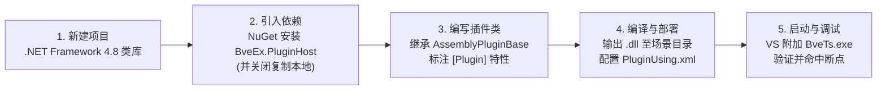
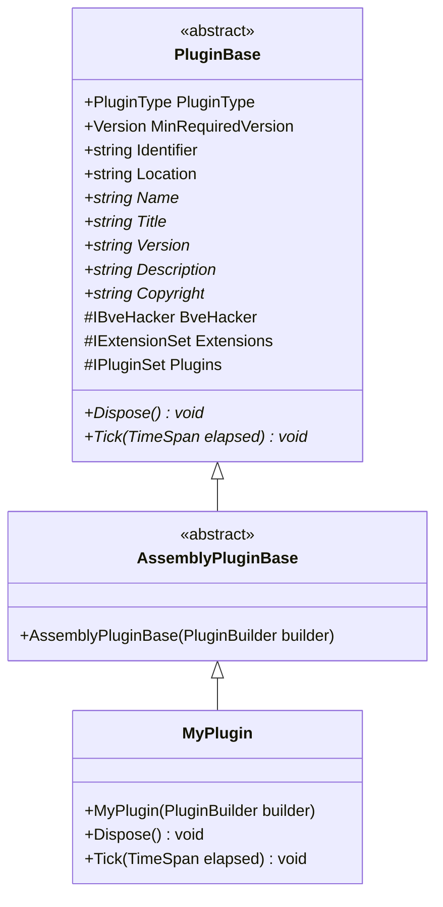

# 插件开发快速入门

本文面向希望为 BVE Trainsim 5 / 6 编写扩展逻辑的插件开发者，从零开始讲解如何搭建 BveEX 插件开发环境、配置 NuGet 包与程序集引用、编写并部署第一个列车插件与地图插件，以及如何使用 Visual Studio 对插件进行断点调试。

> [!IMPORTANT]
> **开发插件不需要克隆或编译 BveEX 本体源码！**
> 仓库根目录的 `HowToBuild.md` 仅面向修改 BveEX 框架本体的核心贡献者。作为插件开发者，你只需在测试用的 BVE 中按《[安装与部署](../user-manual/installation.md)》安装好官方发布的 BveEX Release 包，然后在自己的 C# 类库项目中通过 NuGet（或直接引用安装目录中的 DLL）引入开发库即可。

---

## 1. BveEX 插件开发概览

### 1.1 插件的三种类型

在 BveEX 中，所有插件均由 `BveEx.PluginHost.Plugins.PluginType` 枚举区分归属。不同类型插件的职责与加载方式如下：

| 插件类型 | 枚举值 (`PluginType`) | 适用场景与职责 | 部署与触发方式 |
| :--- | :--- | :--- | :--- |
| **列车插件**<br/>(Vehicle Plugin) | `PluginType.VehiclePlugin` | 绑定于特定车辆。用于实现保安装置（ATS/ATC/ATO）、驾驶台仪表与动画控制、列车物理与车掌逻辑定制等 | 在车辆文件同目录放置 `<车辆文件名>.VehiclePluginUsing.xml` 或 `VehiclePluginUsing.xml` |
| **地图插件**<br/>(Map Plugin) | `PluginType.MapPlugin` | 绑定于特定路线场景。用于实现地面信号机动态控制、先行列车（他车）位置与3D模型绘制、自定义地图语法、车站与时刻表交互等 | 在地图文件中编写 `BveEx.MapPlugin.Load('...')` 或 `BveEx.MapPlugin.LoadAssembly('...')` 语句 |
| **扩展功能**<br/>(Extension) | `PluginType.Extension` | 随 BveEX 核心启动的全局共享组件（需同时实现 `IExtension` 接口）。用于向列车插件与地图插件提供公共基础设施（如 `BveEx.CoreExtensions`、`DXDynamicTexture`） | 放入 BveEX 版本文件夹下的 `Extensions\` 目录，启动时自动扫描装载 |

对于绝大多数路线与车辆作者而言，日常开发的主要目标是**列车插件**与**地图插件**；两者还可以互相查找并协同工作。

### 1.2 开发载体选型：程序集插件 vs 脚本插件

BveEX 支持两种编写新插件的方式（另支持通过 `<Native>` 元素兼容传统 Win32 ATS `.dll`）：

| 对比维度 | 程序集插件（`.dll`，推荐） | 脚本插件（C# 脚本 `.cs` / IronPython 2 `.py`） |
| :--- | :--- | :--- |
| **清单声明元素** | `<Assembly Path="..." />` | `<CSharpScript PackageManifestPath="..." />` 或 `<IronPython2 ... />` |
| **编译方式** | 使用 Visual Studio 预先编译为 `.NET Framework 4.8` 类库（`.dll`） | 无需预先编译，场景加载时由 `BveEx.Scripting` 动态编译执行 |
| **功能完整度** | **完整**：可访问 `BveHacker`、所有已加载扩展（`Extensions`）与其它插件（`Plugins`） | **受限**：全局上下文 `Globals` 仅暴露 `BveHacker` 与变量字典，无法直接调用 `Extensions` 与 `Plugins` |
| **开发与调试体验** | 拥有完整的 IDE 代码补全、编译期类型检查、断点单步调试 | 适合几行代码的轻量实验；语法错误在 BVE 场景加载列表中按行号报告 |

本文重点讲解最主流、功能最完备的 **C# 程序集插件（`.dll`）** 开发流程，并在第 7 节简要介绍脚本插件的编写方式。

---

## 2. 开发环境准备

在开始编写代码前，请确认本地环境满足以下要求：

| 环境要素 | 要求与推荐配置 | 说明与源码依据 |
| :--- | :--- | :--- |
| **操作系统** | Windows 10 / 11 | 与 BVE Trainsim 运行环境一致 |
| **宿主环境** | BVE Trainsim **5.8** (`5.8.7554.391`) 或 **6.0** (`6.0.7554.619`) 正式版 | 需已按《[安装与部署](../user-manual/installation.md)》安装 BveEX。建议下载附带示例场景的 `BveEX_WithScenarios_...` 发布包，便于对照测试 |
| **开发工具 (IDE)** | **Visual Studio 2022**（或 2019） | 安装时勾选 **“.NET 桌面开发”** 工作负载（Community 社区版即可免费使用） |
| **目标框架** | **.NET Framework 4.8** (`net48`) | BveEX 全部核心程序集与官方示例工程均以 `<TargetFrameworkVersion>v4.8</TargetFrameworkVersion>` 构建 |

从新建项目到在 BVE 中运行插件的完整开发流向如下：



---

## 3. 创建项目与配置 NuGet / 程序集引用

### 3.1 新建 C# 类库项目

1. 打开 Visual Studio，选择 **“创建新项目”**。
2. 搜索并选择 **“类库 (.NET Framework)”**（`Class Library (.NET Framework)`，C# 语言）。
   > [!NOTE]
   > 请注意区分 **“类库 (.NET Framework)”** 与面向 .NET Core / .NET 6+ 的“类库”。如果使用的是新版 SDK 风格项目文件，请确保在 `.csproj` 中将目标框架显式指定为 `<TargetFramework>net48</TargetFramework>`。
3. 在项目配置界面中，将 **“框架 (Framework)”** 选择为 **`.NET Framework 4.8`**，点击创建。
4. **目标平台位数（Platform Target）**：保持默认的 **`AnyCPU`** 即可。
   - 编译为 `AnyCPU` 的纯托管插件 `.dll` 可以同时兼容 32 位的 BVE 5 与 64 位的 BVE 6（官方 `SamplePlugins` 下的所有示例均采用 `AnyCPU`）。
   - 若你的插件因调用特定位数的非托管 C/C++ 库而不得不指定为 `x86` 或 `x64`，则必须确保其与运行时的 BVE 进程位数一致（BVE 5 为 32 位，BVE 6 为 64 位），否则加载插件时会触发 `BadImageFormatException` 并在加载进度窗体中报错。

### 3.2 方式一：通过 NuGet 安装官方开发包（推荐）

BveEX 官方在 NuGet Gallery 上发布了插件开发所需的核心包。

1. 在 Visual Studio 的“解决方案资源管理器”中，右键点击你的项目，选择 **“管理 NuGet 程序包”**。
2. 切换到 **“浏览”** 选项卡，勾选搜索框右侧的 **“包括预发行版 (Include prerelease)”**（BveEX 的部分最新功能版本以预发布形式提供）。
3. 搜索并安装以下包（根据插件需求选择）：

| NuGet 包 ID | 是否必装 | 包含的程序集与核心用途（依据各项目 `.nuspec`） |
| :--- | :--- | :--- |
| **`BveEx.PluginHost`** | **必装** | **插件开发核心契约库**。包内含：<br/>• `BveEx.PluginHost.dll`：提供 `AssemblyPluginBase`、`PluginBase`、`PluginAttribute`、`IBveHacker`、`App` 等核心基类与接口；<br/>• `BveTypes.dll`：提供 `BveTypes.ClassWrappers` 命名空间下的全部 BVE 内部类型包装器（如 `Scenario`、`Vehicle`、`Section` 等）；<br/>• 底层反射与包装支撑库：`FastCaching.dll`、`FastMember.dll`、`TypeWrapping.dll`。 |
| **`BveEx.CoreExtensions`** | **强烈推荐** | **官方核心扩展功能集**（自动依赖 `BveEx.PluginHost`）。包内含 `BveEx.CoreExtensions.dll`，提供：<br/>• `INative`（`BveEx.Extensions.Native`）：读写 ATS 面板数组（`AtsPanelArray`）、音效数组（`AtsSoundArray`）、监听 ATS 按键与地上子事件；<br/>• 各类高级 Patch 与工具接口：信号机控制（`ISignalPatchFactory`）、先行列车控制（`IPreTrainPatchFactory`）、列车绘制（`ITrainDrawPatchFactory`）、车掌逻辑（`IConductorPatchFactory`）、声音工厂（`ISoundFactory`）、自定义地图语法（`IStatementSet`）、右键菜单扩展（`IContextMenuHacker`）等。 |
| **`BveEx.Diagnostics`** | 可选 | 提供 `BveEx.Diagnostics.dll`，仅在需要调用 BveEX 风格的错误对话框（`ErrorDialog`）或开发自定义诊断器（`ITroubleshooter`）时安装。 |
| **`SlimDX`** | 按需安装 | 第三方 DirectX 托管封装库（BveEX 仓库统一使用 `4.0.13.44` 版本）。当插件需要操作 3D 变换矩阵（`SlimDX.Matrix`）、向量（`SlimDX.Vector3`）或直接操作 `IBveHacker.DirectSound` 音频设备时安装。 |

### 3.3 方式二：直接引用本地 BveEX 目录中的 DLL（备选 / 扩展引用）

如果你处于离线环境，或者需要使用**尚未单独打包发布到 NuGet 的内置扩展**（例如动态贴图扩展 `DXDynamicTexture.dll`），可以直接从 BVE 安装目录中引用对应的本地 DLL：

1. 在“解决方案资源管理器”中右键点击项目下的 **“引用 (References)”** → **“添加引用...”** → 点击底部的 **“浏览”**。
2. 到 `<BVE 安装目录>\Input Devices\BveEx\<版本文件夹，如 2.0>\` 下选择所需文件：
   - 核心契约与类型库：`BveEx.PluginHost.dll`、`BveTypes.dll`（若需直接操作底层反射或打补丁，还可添加 `FastMember.dll`、`TypeWrapping.dll`）。
   - 官方扩展库：进入子目录 `Extensions\`，按需选择 `BveEx.CoreExtensions.dll` 或 `DXDynamicTexture.dll`（对应命名空间 `BveEx.Extensions.DXDynamicTexture`）。

### 3.4 ⚠️ 关键配置：将引用程序集的“复制本地”设为 `False`

无论你通过哪种方式添加了上述引用，都请务必检查一项关键设置：**不要把 BveEX 核心库与扩展库复制到你的插件输出目录中！**

> [!WARNING]
> **为什么要关闭“复制本地 (Copy Local)”？**
> 1. **自动解析机制**：BveEX 引导器（`BveEx.Launcher` 的 `VersionSelector`）在启动时注册了 `AppDomain.CurrentDomain.AssemblyResolve` 事件，会自动从 BveEX 版本文件夹（如 `Input Devices\BveEx\2.0\`）加载 `BveEx.PluginHost.dll`、`BveTypes.dll` 等核心程序集；同时 `Extensions\` 下的扩展程序集也会在核心初始化阶段载入内存。
> 2. **重复加载冲突（错误 `E-3`）**：`BveTypes` 在初始化时会扫描当前 `AppDomain` 中已加载的全部程序集（按文件名分组）。如果插件目录中残留了复制过来的 `BveEx.PluginHost.dll`、`BveTypes.dll` 等同名副本并被重复加载，不仅会导致跨程序集类型转换失败，还会触发 `DuplicatedLibraryException`（弹窗报错 `E-3`）。

**配置步骤**：
1. 在 Visual Studio“解决方案资源管理器”中展开项目的 **“引用”** 节点。
2. 选中 `BveEx.PluginHost`、`BveTypes`、`BveEx.CoreExtensions`、`DXDynamicTexture`、`SlimDX`、`FastMember`、`TypeWrapping` 等由 BVE / BveEX 宿主环境自带的引用。
3. 在右下角的 **“属性”** 窗口中，将 **“复制本地 (Copy Local)”** 改为 **`False`**。

在传统的 `.csproj` 文件中，关闭“复制本地”表现为 `<Private>False</Private>`（参考官方示例 `SamplePlugins/VehiclePlugins/SimpleAts/BveEx.Samples.VehiclePlugins.SimpleAts.csproj`）：

```xml
<ItemGroup>
  <Reference Include="BveEx.PluginHost">
    <HintPath>...\BveEx.PluginHost.dll</HintPath>
    <Private>False</Private>
  </Reference>
  <Reference Include="BveEx.CoreExtensions">
    <HintPath>...\BveEx.CoreExtensions.dll</HintPath>
    <Private>False</Private>
  </Reference>
  <Reference Include="BveTypes">
    <HintPath>...\BveTypes.dll</HintPath>
    <Private>False</Private>
  </Reference>
</ItemGroup>
```

> [!TIP]
> 如果你的插件引用了 BVE 与 BveEX **本身未自带**的第三方纯计算库或工具库（例如 `Newtonsoft.Json.dll`），则该第三方库应当保留“复制本地 = `True`”，并随你的插件 `.dll` 一同发布在同一文件夹下。

---

## 4. 编写第一个插件（最小完整示例）

### 4.1 程序集插件的四个核心要素

根据 `BveEx.Plugins.PluginLoader` 的加载与校验源码，一个合法的 BveEX 程序集插件类必须满足以下四项契约：



1. **继承 `AssemblyPluginBase`**：
   - 位于 `BveEx.PluginHost.Plugins` 命名空间。
   - 它继承自抽象基类 `PluginBase`，并会自动读取当前 DLL 的程序集特性（`AssemblyTitle`、`AssemblyVersion`、`AssemblyDescription`、`AssemblyCopyright`）作为插件的展示信息，无需手动重写这几个字符串属性。
2. **标注 `[Plugin(...)]` 特性**：
   - 在插件类上方添加 `[Plugin(PluginType.VehiclePlugin)]` 或 `[Plugin(PluginType.MapPlugin)]`。
   - 可选传入第二个参数指定要求的最低 BveEX 本体版本，如 `[Plugin(PluginType.VehiclePlugin, "2.0.0")]`——若玩家安装的 BveEX 版本低于该值，加载时会自动弹出版本过旧提示框。
3. **提供接收 `PluginBuilder` 的公共构造函数**：
   - 签名必须精确为：`public 类名(PluginBuilder builder) : base(builder)`。
   - `PluginLoader` 会通过反射查找参数类型为 `(PluginBuilder)` 的公共构造函数；若缺失该构造函数，加载时会报错。
4. **重写 `Tick(TimeSpan elapsed)` 与 `Dispose()` 方法**：
   - `Tick(TimeSpan elapsed)`：驾驶过程中每帧调用一次，`elapsed` 表示距离上一帧经过的时间间隔。
   - `Dispose()`：当场景关闭、重新加载或插件卸载时调用，用于解绑事件、释放补丁（Patch）与窗口资源。

在插件类内部，你可以直接使用基类提供的三个核心受保护属性（`protected`）：
- **`BveHacker`**（`IBveHacker`）：访问与修改 BVE 内部对象（如当前场景 `Scenario`、车辆 `Vehicle`、主窗口 `MainForm`、音效设备 `DirectSound` 等）。
- **`Extensions`**（`IExtensionSet`）：通过 `Extensions.GetExtension<T>()` 获取已加载的扩展功能实例（如 `INative`、`ISignalPatchFactory` 等）。
- **`Plugins`**（`IPluginSet`）：通过 `Plugins.VehiclePlugins` 或 `Plugins.MapPlugins` 字典访问当前场景中加载的其它列车插件或地图插件，实现跨插件通信。

---

### 4.2 示例一：编写列车插件（超速自动制动）

下面以官方示例项目 `SamplePlugins/VehiclePlugins/SimpleAts` 为蓝本，编写一个完整的列车插件：当列车行驶速度超过 $100\text{ km/h}$ 时，自动将电门归零、施加常用最大制动，并循环播放 0 号 ATS 提示音。

#### 1. 编写插件主类（`SimpleAts.cs`）

```csharp
using System;

using BveTypes.ClassWrappers;
using BveEx.PluginHost.Plugins;
using BveEx.Extensions.Native;

namespace MyFirstPlugin
{
    // 1. 声明这是一个列车插件
    [Plugin(PluginType.VehiclePlugin)]
    public class SimpleAts : AssemblyPluginBase
    {
        private readonly INative Native;

        // 2. 必须实现接收 PluginBuilder 的公共构造函数，并调用 base(builder)
        public SimpleAts(PluginBuilder builder) : base(builder)
        {
            // 从扩展集合中获取用于操作传统 ATS 接口（面板/音效/按键）的 INative 扩展
            Native = Extensions.GetExtension<INative>();
        }

        // 3. 场景卸载或关闭时释放资源
        public override void Dispose()
        {
        }

        // 4. 驾驶期间每帧调用一次
        public override void Tick(TimeSpan elapsed)
        {
            // 通过 BveHacker 读取当前列车速度（单位：米/秒 m/s）
            double speedMps = BveHacker.Scenario.VehicleLocation.Speed;
            SoundPlayMode soundPlayMode = SoundPlayCommands.GetMode(Native.AtsSoundArray[0]);

            // 若时速超过 100 km/h（即 100 / 3.6 m/s），强制施加常用最大制动并鸣响警报
            if (speedMps > 100 / 3.6)
            {
                if (soundPlayMode == SoundPlayMode.Stop)
                {
                    Native.AtsSoundArray[0] = SoundPlayMode.PlayLooping.ToCommand();
                }

                AtsPlugin atsPlugin = BveHacker.Scenario.Vehicle.Instruments.AtsPlugin;
                atsPlugin.AtsHandles.PowerNotch = 0;
                atsPlugin.AtsHandles.BrakeNotch = Math.Max(
                    atsPlugin.AtsHandles.NotchInfo.EmergencyBrakeNotch - 1,
                    atsPlugin.Handles.BrakeNotch);
                atsPlugin.AtsHandles.ConstantSpeedMode = ConstantSpeedMode.Disable;
            }
            else
            {
                if (soundPlayMode == SoundPlayMode.PlayLooping)
                {
                    Native.AtsSoundArray[0] = SoundPlayMode.Stop.ToCommand();
                }
            }
        }
    }
}
```

#### 2. 配置插件展示信息（`Properties/AssemblyInfo.cs`）

打开项目中的 `Properties/AssemblyInfo.cs`，修改以下特性。`AssemblyPluginBase` 会自动读取它们并显示在 BveEX 的“版本信息・插件一览”窗口中：

```csharp
using System.Reflection;

[assembly: AssemblyTitle("简易超速防护 ATS 插件")]
[assembly: AssemblyDescription("当列车时速超过 100km/h 时自动施加常用最大制动")]
[assembly: AssemblyCompany("YourName")]
[assembly: AssemblyProduct("MyFirstPlugin")]
[assembly: AssemblyCopyright("Copyright © 2026 YourName")]
[assembly: AssemblyVersion("1.0.0.0")]
```

---

### 4.3 示例二：编写地图插件最小骨架

地图插件的编写方式与列车插件几乎完全相同，只需将特性改为 `[Plugin(PluginType.MapPlugin)]`。

由于地图插件是在**地图文件解析期间**被加载并实例化的，此时场景对象（`BveHacker.Scenario`）尚未创建完成。因此，地图插件最常见的模式是在构造函数中订阅 `BveHacker.ScenarioCreated` 事件，待场景构建完成后再获取闭塞分区、车站或他车对象（参考官方示例 `SamplePlugins/MapPlugins/SignalController`）：

```csharp
using System;

using BveTypes.ClassWrappers;
using BveEx.PluginHost;
using BveEx.PluginHost.Plugins;

namespace MyFirstMapPlugin
{
    // 1. 声明这是一个地图插件
    [Plugin(PluginType.MapPlugin)]
    public class MyMapPlugin : AssemblyPluginBase
    {
        public MyMapPlugin(PluginBuilder builder) : base(builder)
        {
            // 2. 地图解析阶段 Scenario 尚未生成，需订阅 ScenarioCreated 事件
            BveHacker.ScenarioCreated += OnScenarioCreated;
        }

        private void OnScenarioCreated(ScenarioCreatedEventArgs e)
        {
            // 此时可通过 e.Scenario 安全访问路线中的闭塞分区、车站、他车等对象
            // 例如：Section section = e.Scenario.SectionManager.Sections[0] as Section;
        }

        public override void Dispose()
        {
            // 3. 务必在 Dispose 中取消订阅 BveHacker 上的事件！
            BveHacker.ScenarioCreated -= OnScenarioCreated;
        }

        public override void Tick(TimeSpan elapsed)
        {
            // 每帧执行的地图控制逻辑（会在所有列车插件的 Tick 执行完毕后按序调用）
        }
    }
}
```

> [!WARNING]
> **切勿遗漏 `Dispose()` 中的事件解绑（`-=`）！**
> `BveHacker` 实例的生命周期贯穿整个 BVE 进程，而列车插件与地图插件会在每次重新载入场景或关闭场景时销毁重建。如果你在插件中订阅了 `BveHacker` 或全局扩展（如 `INative`）上的事件，却未在 `Dispose()` 中取消订阅，旧插件实例将被事件委托持续持有而无法被垃圾回收，并在下次重载场景时重复触发旧回调！

---

## 5. 编译、部署与场景加载验证

### 5.1 编译与自动部署配置

在 Visual Studio 中按 `Ctrl + Shift + B` 生成项目，即可在 `bin\Debug\`（或 `bin\Release\`）下得到编译好的 `.dll` 文件。

为了省去每次修改代码后手动复制粘贴 `.dll` 的麻烦，可以像官方 `SamplePlugins` 一样，在 **“项目属性 → 生成事件 → 后期生成事件命令行 (Post-build event command line)”** 中添加自动复制命令：

```bat
xcopy /y /i "$(TargetPath)" "D:\BveTs\Scenarios\MyScenario\Vehicles\BveExPlugins\"
xcopy /y /i "$(TargetDir)$(TargetName).pdb" "D:\BveTs\Scenarios\MyScenario\Vehicles\BveExPlugins\"
```

> [!TIP]
> 在开发阶段把 `.pdb` 调试符号文件一并复制过去，不仅能让断点调试正常工作，还能在发生未处理异常时在弹窗堆栈中显示准确的源码文件名与行号。

### 5.2 在场景中挂载你的插件

根据插件类型，将其配置到测试用的车辆或地图中（完整清单语法详见《[配置说明与插件加载](../user-manual/configuration.md)》第 4、6、7 节）：

- **挂载列车插件**：
  在车辆文件（例如 `Vehicle.txt`）所在目录下，新建同名清单 `Vehicle.VehiclePluginUsing.xml`（或通用清单 `VehiclePluginUsing.xml`）：
  ```xml
  <?xml version="1.0" encoding="utf-8" ?>
  <BveExPluginUsing>
      <Assembly Path="BveExPlugins\MyFirstPlugin.dll" />
  </BveExPluginUsing>
  ```

- **挂载地图插件**：
  在地图文件（例如 `Map.txt`）的正文中添加加载语句（路径相对于包含该语句的地图文件所在目录）：
  ```text
  BveTs Map 2.02:utf-8

  // 方式 A：直接加载单个程序集插件
  BveEx.MapPlugin.LoadAssembly('MapPlugins\MyFirstMapPlugin.dll');

  // 方式 B：或通过 XML 清单文件批量加载
  // BveEx.MapPlugin.Load('MapPluginUsing.xml');
  ```

### 5.3 验证插件是否成功加载

启动 BVE 并打开测试场景。进入驾驶界面后：
1. 在主窗口空白处**点击鼠标右键**，选择菜单中的 **“BveEX バージョン情報・プラグイン一覧...”**（版本信息・插件一览）。
2. 切换到 **“車両プラグイン（列车插件）”** 或 **“マッププラグイン（地图插件）”** 选项卡。
3. 若列表中出现了你的插件文件名，且显示出你在 `AssemblyInfo.cs` 中填写的标题、版本号与描述，即代表插件已被成功加载并开始每帧运行！

---

## 6. 插件调试与排错指南

### 6.1 使用 Visual Studio 进行断点调试

BveEX 程序集插件运行在 `BveTs.exe` 的 `.NET Framework 4.8` 进程内，完美支持 Visual Studio 的源码级断点调试。共有三种常用调试方式：

#### 方式 A：按 `F5` 直接启动 BVE 调试（最便捷）
1. 在 Visual Studio 中右键点击插件项目 → **“属性”** → 切换到 **“调试 (Debug)”** 选项卡。
2. 将启动操作选择为 **“启动外部程序 (Start external program)”**，点击浏览选择你的 `BveTs.exe` 完整路径（如 `C:\Program Files\mackoy\BveTs6\BveTs.exe`）。
3. 配合第 5.1 节的生成后事件（自动将生成的 `.dll` 和 `.pdb` 复制到场景目录），在 `Tick` 或构造函数中打好断点，直接按 **`F5`** 即可启动 BVE。当场景加载到你的插件时，VS 会自动命中断点，支持单步执行、查看调用堆栈和实时修改局部变量。

#### 方式 B：附加到正在运行的 BVE 进程
若 BVE 已经打开，可在 Visual Studio 菜单栏选择 **“调试 → 附加到进程 (`Ctrl + Alt + P`)”**，在进程列表中找到 `BveTs.exe` 并点击 **“附加”**。

#### 方式 C：在构造函数早期通过代码呼出调试器
如果你需要调试插件构造函数最开头的初始化逻辑，而手动“附加到进程”来不及捕捉，可以在代码中临时加入 `Debugger.Launch()`（这也是 `BveEx.Launcher` 内部在 Debug 模式下采用的做法）：

```csharp
public SimpleAts(PluginBuilder builder) : base(builder)
{
#if DEBUG
    if (!System.Diagnostics.Debugger.IsAttached)
    {
        System.Diagnostics.Debugger.Launch(); // 运行到此处时会弹窗提示选择 VS 调试器附加
    }
#endif
}
```

---

### 6.2 状态观察与错误输出方案

由于 BveEX 框架自身不生成日志文件，开发期间推荐利用以下三种渠道输出调试信息：

1. **输出到 Visual Studio 调试窗口**：
   在附加调试器状态下，调用 `System.Diagnostics.Debug.WriteLine($"当前速度: {speedMps}");`，即可在 Visual Studio 的 **“输出 (Output)”** 窗口实时查看打印内容，且在 `Release` 编译下会被自动剔除，不影响性能。
2. **向 BVE 场景加载错误列表报告问题**：
   - 在插件初始化或读取自定义配置文件出错时，若希望像 BVE 原生语法错误一样显示在载入进度窗体的错误列表中，可以直接抛出 `BveEx.PluginHost.BveFileLoadException`：
     ```csharp
     throw new BveFileLoadException("配置文件格式不正确", "MyConfig.xml", lineIndex: 12, charIndex: 5);
     ```
   - 若希望记录错误但**不中断**当前方法的后续执行，可通过 `BveEx.CoreExtensions` 中的 `ILoadErrorManager` 扩展（位于 `BveEx.Extensions.LoadErrorManager` 命名空间）写入错误列表：
     ```csharp
     ILoadErrorManager errorManager = Extensions.GetExtension<ILoadErrorManager>();
     errorManager.Throw("未找到指定的贴图文件，将使用默认贴图", "MyConfig.xml", 15);
     ```
3. **弹出自定义 WinForms 调试窗体**：
   BVE 本身是 Windows Forms 应用程序。你可以在项目中添加 `System.Windows.Forms` 引用，创建一个自定义的 `Form` 窗口，在 `Tick` 中实时刷新标签或表格来监控内部变量（官方示例 `SamplePlugins/VehiclePlugins/StateViewer` 与 `SamplePlugins/MapPlugins/StationController` 均采用此方案，并配合 `IContextMenuHacker` 在 BVE 右键菜单中添加了显示/隐藏窗体的开关）。

---

### 6.3 初学者常见踩坑速查

| 常见报错 / 异常现象 | 源码根因分析 | 解决方案 |
| :--- | :--- | :--- |
| 构造函数中访问 `BveHacker.Scenario` 抛出 `InvalidOperationException` | 无论地图插件还是列车插件，在构造函数执行时尚未完成 `Scenario` 实例的组装（`BveHacker.IsScenarioCreated` 为 `false`），直接读取 `BveHacker.Scenario` 属性会由 `ScenarioHacker` 主动抛出异常 | 在构造函数中订阅 `BveHacker.ScenarioCreated` 事件，在回调中通过 `e.Scenario` 访问；或在 `Tick` 方法中访问 |
| 场景载入时报“找不到继承 `PluginBase` 的类”或“找不到构造函数” | 插件类未设为 `public`、未继承 `AssemblyPluginBase`（或 `PluginBase`），或者缺少参数为 `(PluginBuilder builder)` 的公共构造函数 | 检查类修饰符与构造函数签名：`public MyPlugin(PluginBuilder builder) : base(builder)` |
| 构造时抛出 `InvalidOperationException`（提示未指定 `PluginAttribute`） | 插件类上方忘记标注 `[Plugin(PluginType.xxx)]` 特性 | 添加 `[Plugin(PluginType.VehiclePlugin)]` 或 `[Plugin(PluginType.MapPlugin)]` |
| 载入时报“试图把 ××插件 作为 ××插件 加载” | `[Plugin(...)]` 标注的 `PluginType` 与实际加载它的清单归属不符（例如标记为 `MapPlugin` 却写进了 `VehiclePluginUsing.xml`） | 核对 `[Plugin(PluginType.xxx)]` 与清单类型是否一致 |
| BVE 启动或加载时弹出 `E-3`（`DuplicatedLibraryException`） | 插件输出目录中包含了 `BveEx.PluginHost.dll`、`BveTypes.dll` 等核心库的副本，导致同一进程内加载了多份同名程序集 | 按第 3.4 节将相关引用的“复制本地”设为 `False`，并清理插件目录中的多余 DLL |
| 驾驶途中 BVE 直接崩溃退出 | `ScenarioService.Tick()` 在每帧调用各插件的 `Tick` 时**没有外层 `try-catch` 保护**，插件内部抛出的未捕获异常会直接传回 BVE 宿主 | 对可能为空的对象（如未配置 ATS 插件的车辆组件、外部文件 I/O）做好判空与异常处理 |

---

## 7. 附：脚本插件（C# Script / IronPython 2）快速上手

如果你只需要编写十来行简单的联动逻辑，不想打开 Visual Studio 编译 `.dll`，也可以使用 BveEX 的**脚本插件包**机制。

### 7.1 脚本插件包结构

1. 在清单文件（如 `VehiclePluginUsing.xml` 或 `MapPluginUsing.xml`）中通过 `<CSharpScript>` 或 `<IronPython2>` 引用脚本包清单：
   ```xml
   <?xml version="1.0" encoding="utf-8" ?>
   <BveExPluginUsing>
       <CSharpScript PackageManifestPath="MyScriptPlugin\Package.xml" />
   </BveExPluginUsing>
   ```
2. 编写 `MyScriptPlugin\Package.xml`（注意 `<Scripts>` 下的子元素若存在，必须严格按照 `Constructor` → `Dispose` → `OnScenarioCreated` → `OnStarted` → `Tick` 的先后顺序排列，不需要的阶段直接省略）：
   ```xml
   <?xml version="1.0" encoding="utf-8" ?>
   <BveExScriptPluginPackageManifest>
       <Info>
           <Title>简易脚本插件示例</Title>
           <Version>1.0</Version>
           <Description>使用 C# 脚本编写的轻量插件</Description>
           <Copyright>Copyright © 2026 YourName</Copyright>
       </Info>
       <Scripts>
           <Constructor Path="Constructor.cs" />
           <Tick Path="Tick.cs" />
       </Scripts>
   </BveExScriptPluginPackageManifest>
   ```

### 7.2 脚本内可用的全局成员

根据 `BveEx.Plugins.Scripting.ScriptPluginBase` 与 `BveEx.Scripting.Globals` 的源码实现，各生命周期脚本在执行时拥有以下全局上下文成员（C# 脚本可直接访问这些属性/方法；IronPython 2 脚本需通过全局变量 `g` 访问，如 `g.BveHacker`）：

| 适用脚本阶段 | 全局上下文类型 | 可直接使用的属性、字段与方法 |
| :--- | :--- | :--- |
| **所有阶段通用** | `Globals` | • `BveHacker`（`IBveHacker`）：访问 BVE 内部状态；<br/>• `SetVariable<T>(string name, T value)`：向跨脚本共享字典中写入变量；<br/>• `GetVariable<T>(string name)`：从跨脚本共享字典中读取变量。 |
| `<OnScenarioCreated>` | `ScenarioCreatedGlobals` | 除通用成员外，额外提供字段 **`e`**（`ScenarioCreatedEventArgs`，注意字段名为小写 `e`），可通过 `e.Scenario` 获取刚创建的场景实例。 |
| `<OnStarted>` | `StartedGlobals` | 除通用成员外，额外提供字段 **`e`**（`StartedEventArgs`），可通过 `e.DefaultBrakePosition` 获取默认制动位。 |
| `<Tick>` | `TickGlobals` | 除通用成员外，额外提供属性 **`Elapsed`**（`TimeSpan`），表示距上一帧经过的时间。 |

> [!NOTE]
> C# 脚本环境默认已自动引入 `System`、`System.Collections.Generic`、`System.Linq`、`System.Text`、`System.Windows.Forms` 以及 `BveEx.PluginHost` 与 `BveEx.Scripting` 下的所有公共命名空间，脚本内无需重复书写这些 `using` 语句。但若你的插件需要调用 `Extensions`（如 `INative`、`DXDynamicTexture`）或与其它插件通信，请使用第 3、4 节介绍的标准 `.dll` 程序集插件开发方式。

---

## 相关文档

掌握了基本开发流程后，建议按以下顺序深入学习 BveEX 插件开发体系：

- 《[插件生命周期与执行时机](architecture-lifecycle.md)》——深入理解扩展、地图插件与列车插件的加载先后顺序、`ScenarioCreated` 时序与每帧 `Tick` 调用链
- 《[列车插件开发指南与 API 详解](vehicle-plugins.md)》——列车控制、ATS 面板/音效/按键交互、车掌逻辑补丁详解
- 《[地图插件开发指南与 API 详解](map-plugins.md)》——信号机补丁、先行列车控制、3D 模型绘制与自定义地图语法详解
- 《[BveHacker 深入解析](bve-hacker.md)》——全面掌握 `IBveHacker` 与 `BveTypes.ClassWrappers` 对 BVE 内部状态的读写能力
- 《[官方示例项目深度解析](samples-walkthrough.md)》——仓库内 `SamplePlugins/` 全部 14 个官方示例工程的逐行拆解
- 《[配置说明与插件加载](../user-manual/configuration.md)》——`PluginUsing.xml` 与脚本包清单的完整语法规范
- 《[故障排除](../user-manual/troubleshooting.md)》——加载期与运行期各类报错弹窗、错误代码的完整排查手册
