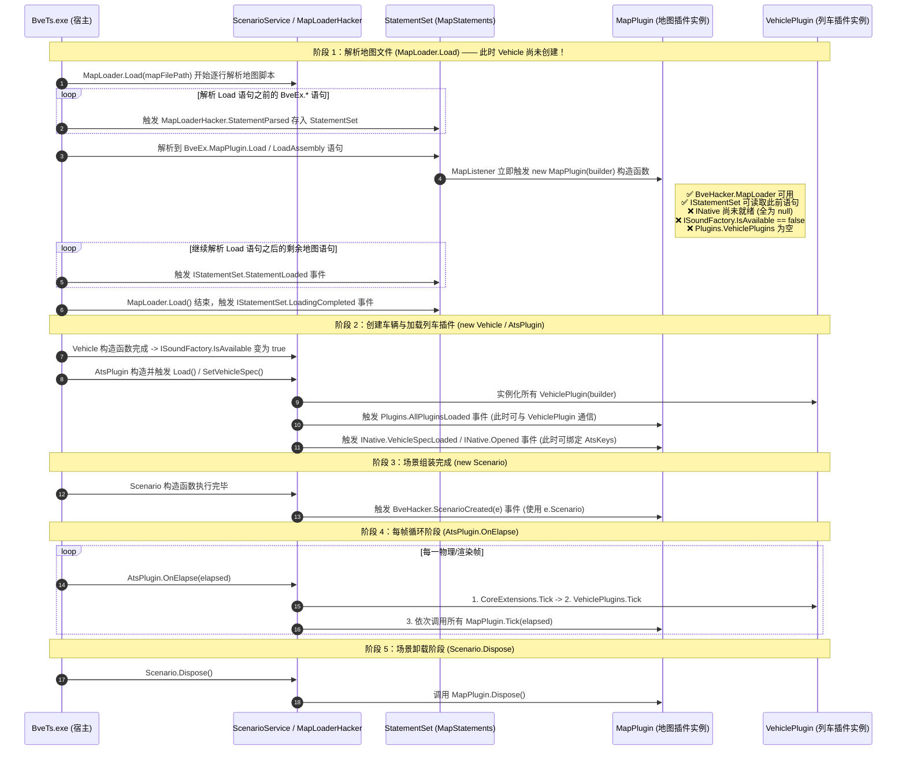
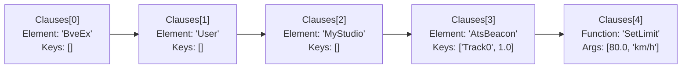

# 地图插件开发指南与 API 详解

在 BveEX 框架中，**地图插件（Map Plugin，`PluginType.MapPlugin`）**是绑定在特定路线地图脚本（Map 文件）上的场景级扩展组件。传统的 BVE Trainsim 地图脚本（`.txt`）仅是一套静态的里程描述语言——一旦场景加载完成，地面信号机的闭塞规则、先行列车的运行轨迹、对向及并列他车的移动路径、车站时刻表以及地面 3D 模型的贴图便基本固定，难以在运行期根据实时条件动态改变。

BveEX 的地图插件彻底打破了这一静态限制。通过在地图脚本中嵌入插件加载指令与自定义扩展语句，路线作者与插件开发者可以使用 C#（或脚本语言）直接介入地图解析过程，并在行驶期间实时操控**闭塞信号机、先行列车位置、他车 3D 自由运动、车站时刻表、地面动态电子屏（GDI+/Direct3D 动态贴图）以及车地联动逻辑**。

本文将基于 `BveEx.PluginHost`、`BveEx.CoreExtensions`、`BveTypes` 与 `SamplePlugins/MapPlugins/` 的真实源码，系统性讲解地图插件的加载机制、扩展地图语法、核心控制 API 及常见避坑要点。

> [!TIP]
> 在阅读本文前，建议先完成以下前置文档的阅读：
> - 环境搭建与编译配置：[插件开发快速入门](./getting-started.md)
> - 生命周期与执行时序：[插件生命周期与执行时机](./architecture-lifecycle.md)
> - 列车插件开发对照：[列车插件开发指南与 API 详解](./vehicle-plugins.md)

---

## 一、 地图插件概览与加载机制

### 1.1 `PluginType.MapPlugin` 的核心定位与典型场景

与随特定车辆加载的列车插件（`PluginType.VehiclePlugin`）不同，地图插件随特定路线场景（Scenario）中的地图文件加载，不论玩家选择驾驶哪一款列车都会生效。其核心应用场景包括：

- **自定义地图语法扩展**：在地图 `.txt` 文件中定义形如 `BveEx.User.AuthorName.MyFeature(...);` 的专属指令，为地图脚本赋予自定义参数配置能力。
- **地面信号与特殊闭塞控制**：动态接管特定闭塞分区（`Section`）的信号显示索引（如进路开通延迟、场内特殊信号机、道口防护信号联动）。
- **先行列车（`PreTrain`）与他车（`Train`）动态调度**：根据时刻、道岔状态或玩家位置实时计算先行列车所在里程，或控制其他列车动态切换轨道（`TrackKey`）、按任意 3D 轨迹运动（如汽车过道口、飞机起降、场内调车）。
- **车站与时刻表实时编辑**：在场景运行中途动态修改车站发车时刻、通过/停车属性、增删停靠站，并实时刷新驾驶室时刻表与运行图窗口。
- **地面 3D 模型动态贴图与环境交互**：结合 `DXDynamicTexture` 在车站发车标（LED 揭示牌）、信号机号码牌、地面显示器上实时绘制文字与图像。
- **车地双向通信**：与当前驾驶车辆搭载的 BveEX 列车插件直接交换强类型数据（如无线 CBTC 移动闭塞、地面电分相自动断电指令、站台屏蔽门联动）。

---

### 1.2 地图脚本加载指令详解

根据 `BveEx/Plugins/MapListener.cs` 与 `BveEx/Plugins/MapPluginFactory.cs` 的源码实现，地图插件并非在车辆配置文件中指定，而是由 BVE 的地图加载器（`MapLoader`）在解析地图脚本（`BveTs Map`）时，通过特定的 `BveEx.MapPlugin` 语句即时加载。

BveEX 支持以下两种地图插件加载语句：

#### 方式一：通过 `MapPluginUsing.xml` 清单文件加载（支持多插件组合）
```bve
BveTs Map 2.02:utf-8

BveEx.MapPlugin.Load('MapPluginUsing.xml');
```
- **适用场景**：一张地图需要同时加载多个 C# 插件或脚本插件，或者需要通过 XML 统一管理插件列表。

#### 方式二：直接加载单个 C# 插件程序集（无需 XML 清单）
```bve
BveTs Map 2.02:utf-8

# 1. 单参数重载：直接指定相对路径
BveEx.MapPlugin.LoadAssembly('Plugins\MyMapPlugin.dll');

# 2. 双参数重载：指定相对路径 + 自定义插件标识符（Identifier）
BveEx.MapPlugin.LoadAssembly('Plugins\MyMapPlugin.dll', 'CustomPluginId');
```
- **适用场景**：地图仅使用单个 `.dll` 插件，希望省去编写 `.xml` 清单文件的步骤（全部 9 个官方 `SamplePlugins/MapPlugins/` 示例均采用此方式）。
- **标识符规则**：若使用单参数重载，该插件在 `Plugins[PluginType.MapPlugin]` 字典中的键名（Key）默认为**不含 `.dll` 后缀的文件名**（如 `"MyMapPlugin"`）；若使用双参数重载，则使用第 2 个字符串参数作为键名（不得包含空白字符，否则抛出 `FormatException`）。

> [!NOTE]
> **路径解析基准与重复加载去重机制**：
> 1. **相对路径基准**：无论是 `Load` 还是 `LoadAssembly`，传入的相对路径均以**书写该语句的地图文件自身所在的目录**（`Path.GetDirectoryName(e.Statement.Source.FileName)`）为基准进行解析。如果该语句写在通过 `include` 引入的子地图文件中，路径也是相对于该子地图文件所在目录，而非主地图目录。
> 2. **单场景只允许调用一次 `Load('<xml>')`**：同一场景（包括所有 `include` 子文件）中最多只能执行一次 `BveEx.MapPlugin.Load(...)`。若多次调用 `Load`，BveEX 会在加载错误管理器中报告错误并忽略后续调用；而 `LoadAssembly` 则允许在地图中多次调用以加载不同的 `.dll`。
> 3. **同名文件自动忽略**：`MapListener` 内部维护了已加载插件的绝对路径集合（`LoadedPluginPaths`）。若不同子文件对同一个 `.dll` 重复调用 `LoadAssembly`，后续调用会被静默跳过，不会重复实例化。

---

### 1.3 `MapPluginUsing.xml` 清单规范及与列车插件的差异

当使用 `BveEx.MapPlugin.Load('MapPluginUsing.xml');` 时，XML 清单文件的结构如下：

```xml
<?xml version="1.0" encoding="utf-8"?>
<BveExPluginUsing xmlns:xsi="http://www.w3.org/2001/XMLSchema-instance"
                  xmlns:xsd="http://www.w3.org/2001/XMLSchema">
  <!-- 加载 C# 编译型地图插件 (.dll) -->
  <Assembly Path="Plugins\SignalController.dll" />
  <Assembly Path="Plugins\StationController.dll" Identifier="MyStationCtrl" />

  <!-- 加载动态脚本插件 -->
  <CSharpScript Path="Scripts\MapLogic.csx" />
  <IronPython2Script Path="Scripts\Setup.py" />
</BveExPluginUsing>
```

> [!WARNING]
> **`MapPluginUsing.xml` 与 `VehiclePluginUsing.xml` 的两项关键差异**：
> 根据 `BveEx/Plugins/MapListener.cs` 第 71 行的调用 `PluginSourceSet.FromPluginUsing(PluginType.MapPlugin, false, path)`：
> 1. **严禁在 `<Assembly>` 中声明非插件的普通依赖 DLL**：列车插件清单的 `allowNonPluginAssembly` 为 `true`，允许把第三方类库写入 `<Assembly>` 预加载；但地图插件清单的 `allowNonPluginAssembly` 为 **`false`**。若将未继承 `AssemblyPluginBase` 的普通类库写入 `MapPluginUsing.xml` 的 `<Assembly>` 节点，加载时会直接报错！普通依赖 DLL 只需与地图插件 `.dll` 放在同一目录下由 CLR 自动解析即可。
> 2. **不支持 `<Native>` 节点**：地图插件清单不支持挂载原生 ATS 32/64 位非托管 DLL（`<Native>` 仅限列车插件使用）。

---

### 1.4 `include '[[bveex::nompi]]';` 防呆兼容头

在翻阅官方示例（如 `SamplePlugins/MapPlugins/` 下的各个 `.txt` 地图文件）时，经常会在文件开头看到如下语句：

```bve
BveTs Map 2.02:utf-8

include '[[bveex::nompi]]';
BveEx.MapPlugin.LoadAssembly('SignalController.dll');
```

其运作原理（见 `BveEx/BveHacker/Services/MapLoaderHacker.cs`）非常巧妙：
- **当玩家未启用 BveEX（裸跑原版 BVE）时**：原版 BVE 会把 `BveEx.MapPlugin.LoadAssembly(...)` 当作未知地图语法报错，且报错信息往往令普通玩家摸不着头脑；而如果在前面加上 `include '[[bveex::nompi]]';`，原版 BVE 会提示找不到文件 `[[bveex::nompi]]`，让玩家一眼看出该地图需要 BveEX 环境支持。
- **当玩家正常启用 BveEX 时**：`MapLoaderHacker.OnInclude` 补丁会拦截所有目标文本为 `"[[bveex::nompi]]"` 的 `include` 语句并将其**直接静默忽略**，不会产生任何文件读取或报错开销。

> [!TIP]
> **旧版 AtsEX 兼容模式自动切换**：
> 如果地图文件头部包含旧版 AtsEX 标记（如 `[[atsex::...]]`）或地图中出现了以 `AtsEx.` 开头的语句（如 `AtsEx.MapPlugin.Load`），`MapLoaderHacker` 会主动抛出 `LaunchModeException`，触发 BveEX 启动器自动重启并以 **Legacy AtsEX 兼容模式**重新加载该场景。编写新版 BveEX 地图与插件时，请统一使用 `BveEx.` 前缀。

---

## 二、 地图插件标准骨架与生命周期要点

### 2.1 地图插件最小完整代码模板

所有编译型 C# 地图插件均需继承自 `BveEx.PluginHost.Plugins.AssemblyPluginBase`，并在类上标注 `[Plugin(PluginType.MapPlugin)]` 特性：

```csharp
using System;
using BveEx.PluginHost;
using BveEx.PluginHost.Plugins;
using BveTypes.ClassWrappers;

namespace MyMapPlugin
{
    [Plugin(PluginType.MapPlugin)]
    public class PluginMain : AssemblyPluginBase
    {
        public PluginMain(PluginBuilder builder) : base(builder)
        {
            // 1. 构造函数：在 MapLoader 解析到 BveEx.MapPlugin.Load / LoadAssembly 语句时立即执行
            // 此时可以读取写在该加载语句之前的自定义地图语句，并订阅后续生命周期事件
            BveHacker.ScenarioCreated += OnScenarioCreated;
        }

        public override void Dispose()
        {
            // 4. 卸载阶段：场景重开、退出或切换路线时调用
            // 务必在此取消事件订阅、释放 SignalPatch / PreTrainPatch / TrainDrawPatch 等补丁及窗体资源
            BveHacker.ScenarioCreated -= OnScenarioCreated;
        }

        private void OnScenarioCreated(ScenarioCreatedEventArgs e)
        {
            // 2. 场景构建完毕阶段：地图、车辆、车站、闭塞分区、他车均已实例化完成
            // 【注意】在此回调内访问 Scenario 必须使用 e.Scenario，切勿使用 BveHacker.Scenario！
            Map map = e.Scenario.Map;
        }

        public override void Tick(TimeSpan elapsed)
        {
            // 3. 每帧更新阶段：按照 Extension -> VehiclePlugin -> MapPlugin 的顺序每帧调用
            // 在此可通过 BveHacker.Scenario 安全访问整个运行时场景对象树
            Scenario scenario = BveHacker.Scenario;
        }
    }
}
```

---

### 2.2 地图插件完整生命周期时序图

理解地图插件与列车插件在**构造时机**上的差异，是避免 `NullReferenceException` 和 `InvalidOperationException` 的关键。根据 `BveEx/Main/ScenarioService.cs` 与 `BveEx/Plugins/MapPluginFactory.cs`，地图插件从地图脚本解析到销毁的完整时序如下：



---

### 2.3 地图插件与列车插件在构造函数阶段的关键差异

由于地图插件是在 `MapLoader.Load()` **解析地图文件期间**被实例化的，而此时 BVE 尚未开始创建车辆（`Vehicle`）和 ATS 插件宿主（`AtsPlugin`），因此在**地图插件的构造函数（`<init>`）**中，许多在列车插件构造函数里可以直接使用的接口**尚未就绪**！

请务必对照下表安排初始化代码的执行位置：

| 依赖模块 / 属性 | 在**列车插件**构造函数中 | 在**地图插件**构造函数中 | 地图插件中的正确调用时机 |
| :--- | :---: | :---: | :--- |
| `BveHacker.MapLoader` | ❌ 已销毁（为 `null`） | **✅ 可用**（正在解析地图） | 仅在构造函数或 `IStatementSet` 解析期可用 |
| `IStatementSet`（读取自定义地图语句） | ✅ 全部语句均已加载完毕 | **⚠️ 仅含 `Load` 之前的语句** | `Load` 之前的语句可在构造函数直接查；之后的语句需订阅 `StatementLoaded` / `LoadingCompleted` 或在 `ScenarioCreated` 中查询 |
| `INative.AtsKeys` / `VehicleSpec` | ✅ 可用 | **❌ 不可用（为 `null`）** | 必须订阅 `INative.Opened` 或 `INative.VehicleSpecLoaded` 事件后再访问（见官方示例 `SignalController`） |
| `ISoundFactory.LoadFrom(...)` | ✅ 可用（`IsAvailable == true`） | **❌ 抛出 `InvalidOperationException`** | `ISoundFactory` 在 `Vehicle` 构造完成后才就绪，必须在 `Plugins.AllPluginsLoaded`、`INative.Opened` 或 `BveHacker.ScenarioCreated` 中加载音源（见官方示例 `SoundFactoryTest`） |
| `Plugins.VehiclePlugins` | ✅/⚠️ 视加载顺序而定 | **❌ 不可用（集合为空）** | 必须订阅 `Plugins.AllPluginsLoaded` 事件或在 `ScenarioCreated` 中访问（见官方示例 `CooperatingWithVehiclePlugin`） |
| `BveHacker.Scenario` | ❌ 抛出异常 | **❌ 抛出异常** | 在 `ScenarioCreated` 中使用 **`e.Scenario`**；在 `Tick()` 中使用 `BveHacker.Scenario` |

> [!WARNING]
> **切勿在地图插件构造函数中直接绑定 `Native.AtsKeys` 或调用 `ISoundFactory.LoadFrom`！**
> 1. 地图插件实例化时 `AtsPlugin` 尚未创建，`Native.AtsKeys` 为 `null`，直接写 `Native.AtsKeys.AnyKeyPressed += ...` 会立即抛出 `NullReferenceException`。正确做法是先订阅 `Native.Opened += OnOpened;`，在 `OnOpened` 回调中再去订阅 `Native.AtsKeys` 事件。
> 2. 同理，`ISoundFactory` 的内部 Harmony 补丁在 `Vehicle` 构造函数 Postfix 中才会完成初始化。在地图插件构造函数中调用 `ISoundFactory.LoadFrom(...)` 会因为 `!IsAvailable` 而直接抛出 `InvalidOperationException`。

---

### 2.4 `ScenarioCreated` 事件中的 `e.Scenario` 访问铁律

与列车插件相同，当 `BveHacker.ScenarioCreated` 事件触发时，BVE 宿主仍处于 `new Scenario()` 构造函数的收尾阶段，主窗体 `MainForm.currentScenario_` 字段尚未被赋值。

因此，在 `OnScenarioCreated(ScenarioCreatedEventArgs e)` 事件处理函数内部：
- **必须使用事件参数 `e.Scenario`** 访问场景对象（如 `e.Scenario.Map`、`e.Scenario.SectionManager`、`e.Scenario.Trains`）。
- **严禁访问 `BveHacker.Scenario` 属性**，否则会触发底层空值防御并抛出 `InvalidOperationException`。
- 若在此阶段调用 `IDiagramUpdater.UpdateDiagram` 刷新运行图，也必须调用传入 `Scenario` 参数的重载：`diagramUpdater.UpdateDiagram(e.Scenario);`，而不能调用无参的 `UpdateDiagram()`（无参重载内部会访问 `BveHacker.Scenario` 导致崩溃）。

---

## 三、 自定义地图语法与内置扩展语法详解 (`MapStatements`)

BveEX 核心扩展库中的 `BveEx.Extensions.MapStatements` 模块对 BVE 原生的地图解析器（`MapLoader`）进行了深度增强。它不仅提供了条件判断、循环、带参子文件引用、命名空间别名等**内置扩展地图语法**，还允许开发者定义并读取任意复杂的**自定义地图语句**。

---

### 3.1 BveEX 内置扩展地图语法速查

在编写配合地图插件使用的地图文件（`.txt`）时，可以直接使用以下由 `BveEx.Extensions.MapStatements`（`BuiltinRawParserSet` 与 `BuiltinStatementSet`）提供的增强语法：

#### 1. 命名空间别名（`ex_using`）
当自定义语句的前缀较长（如 `BveEx.User.BveExSample.StatementTest`）时，可以使用 `ex_using` 定义简短的别名：

```bve
# 定义别名（注意：别名标识符必须以下划线 '_' 开头！）
ex_using _test = BveEx.User.BveExSample.StatementTest;

# 使用别名调用语句：
_test.Func1();
# 等价展开为：BveEx.User.BveExSample.StatementTest.Func1();

# 别名后同样支持附加索引键（Key）：
_test['keyA'].Func2('arg1', 100);
# 等价展开为：BveEx.User.BveExSample.StatementTest['keyA'].Func2('arg1', 100);
```

> [!IMPORTANT]
> **`ex_using` 的两项语法约束（源码见 `Builtin/Raw/Using.cs`）**：
> 1. **必须以 `_` 开头**：别名名称（如 `_test`）第 1 个字符必须是半角下划线 `_`，否则会抛出 `FormatException("The alias must start with '_'.")`。
> 2. **单文件作用域**：`ex_using` 注册的别名仅在**当前地图文件**（按文件 URI 隔离）内有效，不会跨 `include` 泄漏到其他地图文件中；在同一文件内可以再次使用 `ex_using` 覆盖同名别名。

#### 2. 关系运算符与逻辑运算符扩展
原版 BVE 地图脚本仅支持基础算术运算（`+`、`-`、`*`、`/`、`%`）。BveEX（见 `Builtin/Raw/Operators.cs`）为地图表达式新增了完整的关系与逻辑运算符（计算结果为真时返回 `1`，为假时返回 `0`；非零数值或非空字符串视为真）：
- **相等与比较运算符**：`==`、`!=`、`<`、`>`、`<=`、`>=`
- **逻辑与/或/非运算符**：`&&`、`||`、`!`（一元逻辑非）

#### 3. 条件分支（`ex_if` / `ex_elif` / `ex_else`）与循环（`ex_while`）
支持在地图脚本中编写块级流程控制语句（大括号 `{ ... }` 内可包含任意地图语句及距离变量 `distance`）：

```bve
$mode = 1;

ex_if ($mode == 1) {
    100;
    Structure['SignalA'].Put('0', 0, 0, 0, 0, 0, 0, 0, 1);
} ex_elif ($mode == 2) {
    100;
    Structure['SignalB'].Put('0', 0, 0, 0, 0, 0, 0, 0, 1);
} ex_else {
    BveEx.Dialog.Show('未知模式');
}

# 循环生成等间距地图要素
$i = 0;
ex_while ($i < 5) {
    100 + $i * 25;
    Beacon.Put(10, 0, $i);
    $i = $i + 1;
}
```

#### 4. 带参数的子地图引用（`ex_include`）
原版 `include 'sub.txt';` 无法向子文件传递局部参数。BveEX 提供了支持任意个数附加参数的 `ex_include` 指令（源码见 `Builtin/Raw/Include.cs`）：

```bve
1250;
ex_include 'SubMaps\StationTemplate.txt', '东京', 200, -1;
```

在被引入的 `StationTemplate.txt` 内部，BveEX 会自动注入以下局部系统变量（引入结束后自动恢复外层同名变量，支持嵌套调用）：

| 自动注入的地图变量 | 类型 | 含义说明 |
| :--- | :--- | :--- |
| `$ex_argdistance` | `double` | 调用 `ex_include` 时的主地图当前里程（如上例中的 `1250`） |
| `$ex_arg0` | `string` | 被引入子地图文件的本地解析路径 |
| `$ex_arg1`, `$ex_arg2`, ... | `double` / `string` | 调用 `ex_include` 时传入的第 1、第 2... 个实参（未传入的序号默认置为 `0`） |
| `$ex_relativedir` | `string` | 子地图文件所在目录相对于主地图根目录的相对路径（末尾含 `\`，若在同一目录则为空字符串 `""`），便于在子地图中拼接资源路径 |

#### 5. 内置调试弹窗与报错语句（`BveEx.Dialog` / `BveEx.Error`）
- `BveEx.Dialog.Show('提示文本');`：在解析到该行时弹出系统 `MessageBox` 消息框（支持传入数字或字符串）。
- `BveEx.Error.Throw('错误原因');`：向 BveEX 的 `ILoadErrorManager` 登记一条定位到当前文件与行号的加载错误提示。

---

### 3.2 自定义用户语句格式规范（`BveEx.User.<UserName>...`）

在 BveEX 中，任何以 `BveEx.` 开头、具有三段及以上子句（Clause）的地图语句都会被 `IStatementSet` 捕获并解析为 `Statement` 对象（而不会交给原版 BVE 引发“未知地图元素”报错）。

为了防止不同开发者编写的地图插件发生语法命名冲突，BveEX 划分了两类命名空间：
1. **官方保留命名空间**：`BveEx.<ModuleName>...`（第 2 段不为 `User`，仅供 BveEX 核心与官方扩展内部使用，如 `BveEx.MapPlugin.Load`、`BveEx.Dialog.Show`）。
2. **开发者自定义用户命名空间**：**`BveEx.User.<UserName>.<自定义子句链>;`**

一条标准的自定义用户地图语句由若干个**元素子句（`ClauseType.Element`）**和末尾的一个**函数子句（`ClauseType.Function`）**组成。其中：
- 每个**元素子句**后面可以带中括号 `[key1, key2, ...]` 传入 0 个或多个**键（Keys）**；
- 末尾的**函数子句**在小括号 `(arg1, arg2, ...)` 中传入 0 个或多个**参数（Args）**。

例如：
```bve
1500;
BveEx.User.MyStudio.AtsBeacon['Track0', 1].SetLimit(80, 'km/h');
```
上述语句在 `Statement` 中的解析结构如下：



> [!NOTE]
> **地图语句参数的数据类型**：
> BVE 的地图语法解析器会将语句中的字面量或表达式求值结果存储为 `object`：
> - **字符串**（单引号 `'...'`）解析为 C# 的 `string`；
> - **数值**（无论在地图中写的是整数 `80` 还是小数 `80.5`）在底层通常解析为 **`double`**（部分内置计算可能产生 `int`，因此在 C# 中将其转换为数值时，建议使用 `Convert.ToDouble(arg)` 或 `Convert.ToInt32(arg)`，或者同时匹配 `double` / `int`）。
> - 语句出现时的地图里程可通过 `statement.Location`（`double`，单位：$\text{m}$）直接获取！

---

### 3.3 使用 `IStatementSet` 与 `ClauseFilter` 检索并校验语句

在地图插件中，通过 `Extensions.GetExtension<IStatementSet>()` 即可获取语句集服务（需引用 `BveEx.CoreExtensions.dll` 并 `using BveEx.Extensions.MapStatements;`）。

#### 1. `IStatementSet` 核心成员速查

| 属性 / 方法 / 事件 | 签名 | 功能说明 |
| :--- | :--- | :--- |
| `StatementLoaded` | `event EventHandler<StatementLoadedEventArgs>` | 每当 `MapLoader` 新解析到一条 `BveEx.*` 语句时实时触发 |
| `LoadingCompleted` | `event EventHandler` | 当整个地图文件（含所有 `include` 子文件）解析完毕时触发 |
| `FindUserStatements` | `IEnumerable<Statement> FindUserStatements(string userName, params ClauseFilter[] clauses)` | 检索匹配 `BveEx.User.<userName>.<clauses...>` 的**所有**自定义语句（`clauses` 参数从 `<userName>` 的**下一级**子句开始写起！） |
| `FindUserStatement` | `Statement FindUserStatement(string userName, params ClauseFilter[] clauses)` | 检索匹配的**唯一一条**自定义语句（若未找到返回 `null`；若存在多条匹配语句则自动向 `ILoadErrorManager` 报告错误并返回第 1 条） |
| `FindOfficialStatements` | `IEnumerable<Statement> FindOfficialStatements(params ClauseFilter[] clauses)` | 检索匹配 `BveEx.<clauses...>` 的官方命名空间语句 |

#### 2. `ClauseFilter` 的构造与自动语法校验机制

`ClauseFilter` 不仅用于按名称筛选语句，还内置了极为实用的**参数个数与类型自动校验功能**（见 `MapStatements/ClauseFilter.cs`）：

- **`ClauseFilter.Element(string name, params int[] keyCount)`**：
  匹配名为 `name` 的非末尾元素子句（`ClauseType.Element`）。
  - 若不传 `keyCount`（即空数组），则不限制中括号 `[...]` 内的键数量；
  - 若传入一个或多个允许的键数量（例如 `ClauseFilter.Element("Train", 0)` 表示不允许带 `[...]`，或 `ClauseFilter.Element("Train", 1, 2)` 表示允许带 1 个或 2 个键），一旦地图作者写错了键数量，`ClauseFilter` 会在匹配时**自动抛出包含准确文件名、行号与列号的 `SyntaxException`**（继承自 `BveFileLoadException`，直接显示在 BVE 的错误列表中）！
- **`ClauseFilter.Function(string name, params int[] argCount)`**：
  匹配名为 `name` 的末尾函数子句（`ClauseType.Function`）。
  - 若不传 `argCount`，则不限制小括号 `(...)` 内的参数数量；
  - 若传入允许的参数数量（例如 `ClauseFilter.Function("Put", 1)` 或 `ClauseFilter.Function("Reset", 0)`），当参数个数不符时同样会自动抛出 `SyntaxException` 提示语法错误。

> [!WARNING]
> **BVE 原生解析器对无参函数 `Func()` 的特殊行为**：
> 在 BVE 底层解析器中，当解析不带任何参数的函数子句 `Func()` 时，生成的 `MapStatementClause.Args` 列表长度并非 `0`，而是 **`Args.Count == 1` 且 `Args[0] == null`**！
> - 如果你使用 `ClauseFilter.Function("Func", 0)` 进行筛选，BveEX 内部已专门针对 `Args.Count == 1 && Args[0] is null` 做了兼容识别。
> - 但如果你使用不限参数个数的 `ClauseFilter.Function("Func")` 筛选后，**自己在 C# 代码中检查 `function.Args.Count`**（例如重载分发），请务必注意：当 `function.Args.Count == 1` 时，必须先判断 `function.Args[0] is null` 才能区分究竟是调用了无参的 `Func()` 还是单参数的 `Func(arg1)`！

#### 3. `Statement` 对象的常用属性

获取到匹配的 `Statement` 实例后，可通过以下属性提取数据：

- **`statement.Location`** (`double`)：该语句在地图中所处的距离程（单位：$\text{m}$）。
- **`statement.Source`** (`MapStatement`)：经过 `ex_using` 别名展开后的底层 BVE 语句包装对象：
  - `statement.Source.FileName` (`string`)：该语句所在的地图文件完整路径。
  - `statement.Source.LineIndex` / `CharIndex` (`int`)：该语句在文件中的行号与列号。
  - `statement.Source.Clauses` (`IList<MapStatementClause>`)：展开后的全部子句列表。
    - 索引 `0` 固定为 `"BveEx"`，索引 `1` 固定为 `"User"`，索引 `2` 为 `userName`，**索引 `3` 起为你传入 `FindUserStatements` 的第 1 个子句**。
    - 末尾函数子句可通过 `statement.Source.Clauses[statement.Source.Clauses.Count - 1]` 获取，其参数列表为 `.Args`（`IList<object>`），元素子句的键列表为 `.Keys`（`IList<object>`）。
- **`statement.OriginalSource`** (`MapStatement`)：在 `ex_using` 别名展开之前的原始语句对象。
- **`statement.AdditionalDeclaration`** (`MapStatement`)：若该语句在语法树转换期间附带了额外声明，存放于此（通常为 `null`）。

---

### 3.4 语句书写位置与读取时机（`Load` 之前 vs `Load` 之后）

在地图文件中，自定义语句与 `BveEx.MapPlugin.LoadAssembly(...)` 的相对位置决定了插件读取它们的方式：

```bve
BveTs Map 2.02:utf-8

# 【位置 A】写在 LoadAssembly 之前的语句
BveEx.User.MyPlugin.Config.SetInitialSignal(2);

BveEx.MapPlugin.LoadAssembly('MyPlugin.dll');

# 【位置 B】写在 LoadAssembly 之后的语句（常见于随里程分布的语句）
500;
BveEx.User.MyPlugin.Beacon.Put(100);
```

1. **读取【位置 A】（`LoadAssembly` 之前）的语句**：
   当 `MyPlugin` 的构造函数执行时，【位置 A】的语句已经被解析并存入 `IStatementSet`，因此**可以直接在插件构造函数中调用 `FindUserStatements` 获取**。
2. **读取【位置 B】（`LoadAssembly` 之后）的语句**：
   当 `MyPlugin` 的构造函数执行时，`MapLoader` 刚刚读到 `LoadAssembly` 这一行，**【位置 B】的语句尚未被解析**！若在构造函数中调用 `FindUserStatements`，将找不到【位置 B】的语句。
   针对写在 `LoadAssembly` 之后的语句，有两种推荐读取方式：
   - **方式一（推荐，统一批量读取）**：在 **`BveHacker.ScenarioCreated`** 事件或 **`IStatementSet.LoadingCompleted`** 事件回调中调用 `FindUserStatements`——此时整张地图已全部解析完毕，无论是位置 A 还是位置 B 的语句都能一次性查出。
   - **方式二（流式实时读取）**：在构造函数中先读取已加载语句，同时订阅 **`IStatementSet.StatementLoaded`** 事件以捕获后续逐行解析到的语句。

---

### 3.5 官方示例拆解：`MapStatementTest` 完整实战

官方示例 `SamplePlugins/MapPlugins/MapStatementTest/` 演示了如何定义并解析多种形式的自定义地图语句（包括无参函数、带键与带参函数、同名单参/双参函数重载以及语法错误捕获）。

#### 地图文件写法（节选自示例地图）：
```bve
BveTs Map 2.02:utf-8
include '[[bveex::nompi]]';

ex_using _test = BveEx.User.BveExSample.StatementTest;

# 1. 无键无参语句
_test.IdentifierTest1();

# 2. 带有元素键 ['key'] 与 2 个函数参数的语句
_test['my_key'].SubElem.IdentifierTest2('hello', 42);

# 3. 同名函数重载（1 个参数 vs 2 个参数）
_test.OverloadTest('single_arg');
_test.OverloadTest('first_arg', 'second_arg');

BveEx.MapPlugin.LoadAssembly('MapStatementTest.dll');
```

#### C# 插件读取与类型校验实现（参照 `SamplePlugins/MapPlugins/MapStatementTest/Statements.cs`）：
```csharp
using System;
using System.Collections.Generic;
using System.Windows.Forms;
using BveEx.Extensions.MapStatements;
using BveEx.PluginHost;
using BveEx.PluginHost.Plugins;
using BveTypes.ClassWrappers;

namespace BveEx.Sample.MapStatementTest
{
    [Plugin(PluginType.MapPlugin)]
    public class PluginMain : AssemblyPluginBase
    {
        public PluginMain(PluginBuilder builder) : base(builder)
        {
            IStatementSet statements = Extensions.GetExtension<IStatementSet>();

            // 1. 匹配 BveEx.User.BveExSample.StatementTest.IdentifierTest1();
            // Clauses: [0]BveEx -> [1]User -> [2]BveExSample -> [3]StatementTest -> [4]IdentifierTest1
            IEnumerable<Statement> test1List = statements.FindUserStatements(
                "BveExSample",
                ClauseFilter.Element("StatementTest", 0),
                ClauseFilter.Function("IdentifierTest1", 0));

            foreach (Statement statement in test1List)
            {
                MessageBox.Show($"在里程 {statement.Location}m 处触发了 IdentifierTest1！");
            }

            // 2. 匹配 BveEx.User.BveExSample.StatementTest[key].SubElem.IdentifierTest2(arg1, arg2);
            IEnumerable<Statement> test2List = statements.FindUserStatements(
                "BveExSample",
                ClauseFilter.Element("StatementTest", 1), // 要求带 1 个 Key
                ClauseFilter.Element("SubElem", 0),       // 要求带 0 个 Key
                ClauseFilter.Function("IdentifierTest2", 2)); // 要求带 2 个 Arg

            foreach (Statement statement in test2List)
            {
                // 提取索引 3 (StatementTest) 的第 0 个 Key，并校验类型是否为 string
                MapStatementClause rootClause = statement.Source.Clauses[3];
                if (!(rootClause.Keys[0] is string key))
                {
                    throw new SyntaxException(statement.Source, "StatementTest 的键必须为字符串类型。");
                }

                // 提取索引 5 (IdentifierTest2) 的函数参数
                MapStatementClause funcClause = statement.Source.Clauses[5];
                if (!(funcClause.Args[0] is string textArg))
                {
                    throw new SyntaxException(statement.Source, "第 1 个参数必须为字符串类型。");
                }

                // 注意：地图中的数字字面量通常解析为 double
                double numArg = funcClause.Args[1] switch
                {
                    int i => i,
                    double d => d,
                    _ => throw new SyntaxException(statement.Source, "第 2 个参数必须为数值类型。"),
                };

                MessageBox.Show($"Key: {key}, Arg1: {textArg}, Arg2: {numArg}");
            }

            // 3. 匹配允许 1 个或 2 个参数的重载函数 OverloadTest
            IEnumerable<Statement> overloadList = statements.FindUserStatements(
                "BveExSample",
                ClauseFilter.Element("StatementTest", 0),
                ClauseFilter.Function("OverloadTest", 1, 2)); // 同时允许 1 或 2 个参数

            foreach (Statement statement in overloadList)
            {
                MapStatementClause func = statement.Source.Clauses[4];
                switch (func.Args.Count)
                {
                    case 1:
                        // 【重要】防范无参调用 OverloadTest() 混入 Args.Count == 1 分支
                        if (func.Args[0] is null)
                        {
                            throw new SyntaxException(statement.Source, "OverloadTest 至少需要 1 个参数。");
                        }
                        MessageBox.Show($"单参数重载: {func.Args[0]}");
                        break;

                    case 2:
                        MessageBox.Show($"双参数重载: {func.Args[0]}, {func.Args[1]}");
                        break;
                }
            }
        }

        public override void Dispose() { }
        public override void Tick(TimeSpan elapsed) { }
    }
}
```

---

## 四、 闭塞分区与地面信号机动态控制 (`SignalPatch`)

在 BVE 中，地面信号机的显示以及发送给车载保安装置的信号索引（Signal Index）由 `SectionManager` 及其管理的 `Section`（闭塞分区）列表决定。通过 `BveEx.CoreExtensions` 提供的 `ISignalPatchFactory` 扩展，地图插件可以无侵入地接管任意一个或多个闭塞分区的信号显示逻辑。

---

### 4.1 BVE 闭塞分区（`SectionManager` / `Section`）与信号索引机制

在 `e.Scenario.SectionManager`（或 `BveHacker.Scenario.SectionManager`）中：
- **`SectionManager.Sections`** (`MapObjectList` / 可按索引转为 `Section`)：当前地图中通过 `Section.BeginNew` 定义的所有闭塞分区列表。
  - 每个 `Section` 对象拥有 `Location`（闭塞分界点里程，$\text{m}$）、`SignalIndexes`（`int[]`，对应 `Section.BeginNew(sig0, sig1, sig2, ...)` 定义的信号阶梯数组）、`CurrentSignalIndex`（`int`，当前该分区实际显示的信号索引）等属性。
- **`SectionManager.CurrentSectionIndex`** (`int`)：自车（玩家列车）当前所处的闭塞分区序号。
  - `SectionManager.Sections[sectionManager.CurrentSectionIndex]`：自车当前所在的闭塞分区。
  - `SectionManager.Sections[sectionManager.CurrentSectionIndex + 1]`：**自车正前方即将进入的下一个闭塞分区**（即玩家在视野前方看到的下一架地面信号机所属分区）。

---

### 4.2 `ISignalPatchFactory` 与 `SignalPatch` API 详解

`ISignalPatchFactory`（位于命名空间 `BveEx.Extensions.SignalPatch`）通过拦截指定 `Section` 实例的 `CurrentSignalIndex` 属性 Getter，允许你在原版闭塞计算结果（`source`）的基础上返回自定义的信号索引。

| 类型 / 方法 | 签名 | 说明 |
| :--- | :--- | :--- |
| `ISignalPatchFactory.Patch` | `SignalPatch Patch(string name, Section target, Converter<int, int> factory)` | 为指定的闭塞分区 `target` 注册信号覆盖补丁。`factory` 接收原版闭塞逻辑算出的默认信号索引 `source`，返回最终生效的信号索引 `int`。 |
| `SignalPatch.Dispose` | `void Dispose()` | 注销该闭塞分区的信号补丁，恢复原版信号逻辑。**必须在插件 `Dispose()` 中调用！** |

> [!TIP]
> **自动实时刷新地面 3D 信号机与车载信号**：
> 根据 `Extensions/BveEx.CoreExtensions/SignalPatch/SignalPatchFactory.cs` 第 61–64 行的实现，只要 `ISignalPatchFactory` 被加载，它会在每一帧的 `Tick` 中自动调用 `BveHacker.Scenario.SectionManager.OnSignalChanged()`。因此，当你的 `Converter<int, int>` 委托返回值发生变化时，地面 3D 信号机模型和车载信号接收器会在**当前帧立即更新**，无需手动调用刷新方法！

> [!WARNING]
> **上游 XML 注释笔误提醒（`ISignalPatchFactory.cs`）**：
> 在上游源码 `ISignalPatchFactory.cs` 的 XML 注释中写有 *"元の値をそのまま使用する場合は null を返してください"*（若要原样使用原值请返回 `null`），但实际上委托类型 `Converter<int, int>` 的返回值是不可空的值类型 `int`，无法返回 `null`。
> 查看 `SignalPatch.cs` 第 40 行的真实逻辑 `int converted = Factory(signalIndex);`，**若希望恢复/保持原版闭塞计算的信号显示，只需在委托中直接返回入参 `source` 即可**（例如 `source => isForcedStop ? 0 : source`）。

---

### 4.3 官方示例拆解：`SignalController`（实时控制前方信号机）

官方示例 `SamplePlugins/MapPlugins/SignalController/SignalController.cs` 展示了如何为一个闭塞分区挂载 `SignalPatch`，并通过按下 ATS 按键（`B1` 键，即键盘 <kbd>Home</kbd> 键）在“强制红灯（索引 `0`）”、“强制绿灯（索引 `4`）”与“自动闭塞原值（`source`）”之间循环切换：

```csharp
using System;
using BveEx.Extensions.SignalPatch;
using BveEx.PluginHost.Input;
using BveEx.PluginHost;
using BveEx.PluginHost.Plugins;
using BveTypes.ClassWrappers;

namespace BveEx.Sample.SignalController
{
    [Plugin(PluginType.MapPlugin)]
    public class SignalController : AssemblyPluginBase
    {
        private SignalPatch SignalPatch = null;
        private int SignalState = 0; // 0: 强制红灯(0), 1: 强制绿灯(4), 2: 恢复原版自动闭塞

        public SignalController(PluginBuilder builder) : base(builder)
        {
            // 【注意】地图插件构造时 INative 尚未就绪，必须在 Native.Opened 事件中绑定按键！
            Native.Opened += OnOpened;
            BveHacker.ScenarioCreated += OnScenarioCreated;
        }

        public override void Dispose()
        {
            // 释放信号补丁并取消所有事件订阅
            SignalPatch?.Dispose();

            if (Native.AtsKeys != null)
            {
                Native.AtsKeys[AtsKeyName.B1].Pressed -= OnB1Pressed;
            }
            Native.Opened -= OnOpened;
            BveHacker.ScenarioCreated -= OnScenarioCreated;
        }

        private void OnOpened(object sender, EventArgs e)
        {
            // 当 ATS 接口打开后，安全绑定 B1 (Home) 按键按下事件
            Native.AtsKeys[AtsKeyName.B1].Pressed += OnB1Pressed;
        }

        private void OnB1Pressed(object sender, EventArgs e)
        {
            SignalState = (SignalState + 1) % 3;
        }

        private void OnScenarioCreated(ScenarioCreatedEventArgs e)
        {
            // 获取地图上的第 2 个闭塞分区（索引 1）
            Section targetSection = e.Scenario.SectionManager.Sections[1] as Section;

            // 注册信号补丁：source 为原版根据先行列车计算出的默认信号索引
            SignalPatch = Extensions.GetExtension<ISignalPatchFactory>().Patch(
                nameof(SignalController),
                targetSection,
                source => SignalState == 0 ? 0 : SignalState == 1 ? 4 : source);
        }

        public override void Tick(TimeSpan elapsed)
        {
            SectionManager sectionManager = BveHacker.Scenario.SectionManager;
            // 若玩家列车尚未驶过第 2 个闭塞分区，在右上角状态栏显示当前信号状态提示
            if (sectionManager.CurrentSectionIndex + 1 <= 1)
            {
                Section nextSection = sectionManager.Sections[sectionManager.CurrentSectionIndex + 1] as Section;
                AssistantText.Text = $"下一闭塞信号索引: {nextSection.CurrentSignalIndex} (按 Home 键切换)";
            }
            else
            {
                AssistantText.Text = "已驶过受控信号机";
            }
        }
    }
}
```

---

## 五、 先行列车（`PreTrain`）与他车（`Train`）控制

在 BVE 的场景设计中，“前方的列车”在底层分为两个完全独立的系统。在编写插件前，必须先厘清两者的区别：

| 概念维度 | 先行列车（`PreTrain`） | 他车（`Train` / Other Train） |
| :--- | :--- | :--- |
| **核心作用** | **纯逻辑闭塞占用体**（无 3D 模型、不可见），唯一作用是占用前方的闭塞分区（`Section`），使后方信号机显示红灯/黄灯等减速信号。 | **可见的 3D 列车与走行音实体**（由 `Train.Add` / `Train.Load` 定义），拥有车体 3D 结构（`Structures`）、轨道绑定（`TrackKey`）与运行音效，但**默认不占用闭塞分区**（除非在 `Train.Add` 中关联或由插件同步）。 |
| **原版地图语句** | `PreTrain.Pass(time);` | `Train['key'].Load(...);`、`Train['key'].Enable(time);` 等 |
| **BveEX 控制接口** | `IPreTrainPatchFactory`（`BveEx.Extensions.PreTrainPatch`） | 直接操作 `Scenario.Trains["key"]`，或使用 `ITrainDrawPatchFactory`（`BveEx.Extensions.TrainDrawPatch`）接管 3D 渲染矩阵 |

---

### 5.1 先行列车动态控制（`IPreTrainPatchFactory`）

原版 BVE 的先行列车只能按照 `PreTrain.Pass` 语句预设的时间-里程表死板插值移动。通过 `BveEx.Extensions.PreTrainPatch` 命名空间下的 `IPreTrainPatchFactory`，你可以实时接管先行列车的所在位置与闭塞分区索引。

#### 1. 核心类型与接口速查

- **`IPreTrainLocationConverter` 接口**：
  定义唯一方法 `PreTrainLocation Convert(PreTrainLocation source)`。其中 `source` 是原版 BVE 根据 `PreTrain.Pass` 插值算出的位置。
- **`PreTrainLocation` 结构体**：
  - `PreTrainLocation.FromLocation(double location, SectionManager sectionManager)`：**最常用的静态工厂方法**。只需传入先行列车的目标里程 `location`（单位：$\text{m}$）与当前的 `SectionManager`，它会自动查找并计算出该里程对应的闭塞分区序号 `SectionIndex`！
  - `new PreTrainLocation(double location, int sectionIndex)`：显式指定里程与闭塞分区序号。
- **`IPreTrainPatchFactory.Patch` 方法**：
  `PreTrainPatch Patch(string name, SectionManager sectionManager, IPreTrainLocationConverter converter)`。注册补丁后，每当先行列车跨越闭塞分区边界时，`PreTrainPatch` 会自动更新 `sectionManager.PreTrainSectionIndex` 并调用 `sectionManager.OnSectionChanged()` 刷新全线信号机。

> [!WARNING]
> **上游代码细节提示（`PreTrainPatch.cs`）**：
> 与 `SignalPatch` 和 `TrainDrawPatch` 不同，`PreTrainPatch` 类虽然定义了 `public void Dispose()` 方法来注销内部的 Harmony 补丁，但上游在声明类签名 `public sealed class PreTrainPatch` 时**漏写了 `: IDisposable` 接口声明**。
> 因此，请在插件的 `Dispose()` 方法中直接调用 `preTrainPatch?.Dispose();`，切勿将其向上转型为 `IDisposable` 或放入 `using` 块中。

#### 2. 官方示例拆解：`PreTrainController`（将先行列车闭塞位置绑定到 3D 他车）

官方示例 `SamplePlugins/MapPlugins/PreTrainController/PreTrainController.cs` 展示了如何让逻辑先行列车（`PreTrain`）始终跟随一辆名为 `"test"` 的 3D 他车（`Train`）后面 $1\text{ m}$ 处移动，从而实现“看得到前车、且前车真实占用闭塞分区触发信号变化”的效果：

```csharp
using System;
using BveEx.Extensions.PreTrainPatch;
using BveEx.PluginHost;
using BveEx.PluginHost.Plugins;
using BveTypes.ClassWrappers;

namespace BveEx.Sample.PreTrainController
{
    [Plugin(PluginType.MapPlugin)]
    public class PreTrainController : AssemblyPluginBase
    {
        private PreTrainPatch PreTrainPatch;

        public PreTrainController(PluginBuilder builder) : base(builder)
        {
            BveHacker.ScenarioCreated += OnScenarioCreated;
        }

        public override void Dispose()
        {
            PreTrainPatch?.Dispose();
            BveHacker.ScenarioCreated -= OnScenarioCreated;
        }

        private void OnScenarioCreated(ScenarioCreatedEventArgs e)
        {
            Train targetTrain = e.Scenario.Trains["test"];
            SectionManager sectionManager = e.Scenario.SectionManager;

            // 注册先行列车位置转换器
            PreTrainPatch = Extensions.GetExtension<IPreTrainPatchFactory>().Patch(
                nameof(PreTrainController),
                sectionManager,
                new Converter(targetTrain, sectionManager));
        }

        public override void Tick(TimeSpan elapsed) { }

        private class Converter : IPreTrainLocationConverter
        {
            private readonly Train TargetTrain;
            private readonly SectionManager SectionManager;

            public Converter(Train targetTrain, SectionManager sectionManager)
            {
                TargetTrain = targetTrain;
                SectionManager = sectionManager;
            }

            public PreTrainLocation Convert(PreTrainLocation source)
            {
                // 将先行列车的闭塞判定点设在目标他车所在里程后方 1 米处
                return PreTrainLocation.FromLocation(TargetTrain.Location - 1.0, SectionManager);
            }
        }
    }
}
```

---

### 5.2 轨道约束下的他车控制与跨轨道切换（`Scenario.Trains`）

在场景中通过 `Train.Add` 或 `Train.Load` 定义的所有他车，均保存在 `Scenario.Trains`（类型为 `WrappedSortedList<string, Train>`，键名为地图中定义的列车 Key）中。

#### 1. `Train` 与 `TrainInfo` 核心属性速查

| 属性路径 | 类型 | 单位 / 格式 | 读写权限与核心行为说明 |
| :--- | :--- | :--- | :--- |
| `train.Location` | `double` | 米（$\text{m}$） | **可读可写**。直接决定他车在轨道上的物理位置及各节车厢模型的动画旋转。若该他车未定义 `Train.Stop` 等时刻点（`Schedules` 为空），只需在 `Tick` 中每帧修改 `train.Location` 即可完全由插件接管其移动！ |
| `train.Speed` | `double` | **米/秒（$\text{m/s}$）** | **可读可写**。注意单位是 **$\text{m/s}$**（等于 $\text{km/h} \div 3.6$）。根据 `Libs/BveTypes/ClassWrappers/Public/Train.cs` 的源码注释，修改 `train.Speed` **仅用于控制他车走行音的音高（Pitch）变化**，BVE 不会根据 `Speed` 自动积分移动无时刻表的他车，因此插件需在 `Tick` 中自行计算 `train.Location += train.Speed * elapsed.TotalSeconds;`。 |
| `train.TrainInfo.TrackKey` | `string` | 轨道键名 | **可读可写**。决定该他车当前行驶在哪条轨道（`Track`）上！设为 `"0"` 表示行驶在自车本线（`MyTrack`）上；设为其他字符串（如 `"sub"`、`"up"`）则立即切换到 `Map.OtherTracks` 中对应的他线轨道。可用于在道岔处根据开通方向动态让前车拐入侧线！ |
| `train.TrainInfo.Structures` | `StructureList` | 模型列表 | 包含组成该他车的各节车厢 3D 结构对象（`Structure`）。 |

#### 2. 官方示例拆解：`TrainController`（手动驾驶他车并动态切换渡线轨道）

官方示例 `SamplePlugins/MapPlugins/TrainController/TrainController.cs` 展示了如何用小键盘按键控制一辆名为 `"test"` 的他车加速、减速、换向，并在其经过 $130\text{ m}$ 道岔处时根据状态自动在主线（`"0"`）与侧线（`"sub"`）之间切换轨道：

```csharp
using System;
using BveEx.PluginHost;
using BveEx.PluginHost.Input;
using BveEx.PluginHost.Plugins;
using BveTypes.ClassWrappers;

namespace BveEx.Sample.TrainController
{
    [Plugin(PluginType.MapPlugin)]
    public class TrainController : AssemblyPluginBase
    {
        private Train TargetTrain;
        private double Acceleration = 0; // 加速度 [km/h/s]
        private bool PointsToMainTrack = false; // 道岔是否开通本线 ("0")

        public TrainController(PluginBuilder builder) : base(builder)
        {
            Native.Opened += OnOpened;
            BveHacker.ScenarioCreated += OnScenarioCreated;
        }

        public override void Dispose()
        {
            if (Native.AtsKeys != null)
            {
                Native.AtsKeys[AtsKeyName.B2].Pressed -= OnB2Pressed;
            }
            Native.Opened -= OnOpened;
            BveHacker.ScenarioCreated -= OnScenarioCreated;
        }

        private void OnOpened(object sender, EventArgs e)
        {
            // 按下 B2 (End 键) 切换道岔开通方向
            Native.AtsKeys[AtsKeyName.B2].Pressed += OnB2Pressed;
        }

        private void OnB2Pressed(object sender, EventArgs e)
        {
            PointsToMainTrack = !PointsToMainTrack;
        }

        private void OnScenarioCreated(ScenarioCreatedEventArgs e)
        {
            if (!e.Scenario.Trains.ContainsKey("test"))
            {
                throw new InvalidOperationException("地图中未找到名为 'test' 的他车 (Train['test'])。");
            }
            TargetTrain = e.Scenario.Trains["test"];
        }

        public override void Tick(TimeSpan elapsed)
        {
            double prevLocation = TargetTrain.Location;

            // 1. 更新他车速度 (注意 TargetTrain.Speed 单位为 m/s)
            TargetTrain.Speed += Acceleration / 3.6 * elapsed.TotalSeconds;

            // 2. 积分更新他车里程 [m]
            TargetTrain.Location += TargetTrain.Speed * elapsed.TotalSeconds;

            // 3. 当他车正向跨越 130m 道岔分界点时，动态切换其所属的轨道 TrackKey！
            if (prevLocation <= 130.0 && 130.0 < TargetTrain.Location)
            {
                TargetTrain.TrainInfo.TrackKey = PointsToMainTrack ? "0" : "sub";
            }
        }
    }
}
```

---

### 5.3 脱离轨道的 3D 自由运动与自定义渲染（`ITrainDrawPatchFactory`）

原版 BVE 的他车必须严格沿着某条轨道（`Track`）的一维里程移动。如果你希望在场景中实现**完全脱离轨道约束的三维自由运动物体**（例如：公路上转弯的汽车、天空中飞行的飞机、调车场内横移的设备，甚至将玩家可自由操控的 3D 模型放入场景），可以使用 `BveEx.Extensions.TrainDrawPatch` 模块提供的 `ITrainDrawPatchFactory`。

#### 1. `ITrainDrawPatchFactory.Patch` 的三种重载模式

`ITrainDrawPatchFactory` 通过拦截目标 `Train` 的 `DrawCars(Direct3DProvider, Matrix)` 方法，提供了三个层级的介入方式：

| 重载签名 | 介入方式与适用场景 |
| :--- | :--- |
| `Patch(string name, Train target, IMatrixConverter worldMatrixConverter)` | **保留轨道跟随与视距裁剪，仅对各车厢世界矩阵做附加变换**（如让列车在轨道基础上产生左右摇摆、悬浮或偏移）。 |
| `Patch(string name, Train target, IMatrixConverter worldMatrixConverter, IMatrixConverter viewMatrixConverter)` | 在上一重载基础上，额外转换视图矩阵 `viewMatrix`。 |
| `Patch(string name, Train target, Action<Direct3DProvider, Matrix> overrideAction)` | **完全接管 3D 渲染（最强大）**。跳过原版沿着轨道计算车厢位置与视距裁剪的全部逻辑，由你的 `overrideAction(direct3DProvider, viewMatrix)` 委托全权负责设置 Direct3D 世界变换矩阵并绘制模型（官方示例 `TrainControllerEx.Automatic` 与 `Manual` 均采用此重载）。 |

#### 2. 完全接管渲染时的 Direct3D 坐标系与 $25\text{ m}$ 区块原点补偿

在编写 `overrideAction(Direct3DProvider direct3DProvider, Matrix viewMatrix)` 时，有两项底层 Direct3D 渲染机制必须遵循（见 `SamplePlugins/MapPlugins/TrainControllerEx.Automatic/PluginMain.cs`）：

1. **$25\text{ m}$ 区块原点偏移补偿（`MyTrack.GetTransform`）**：
   为了避免长距离行驶时单精度浮点数（`float`）精度丢失，BVE 的 3D 渲染引擎每行驶 $25\text{ m}$（即每 1 个 `BlockIndex`）就会将世界坐标系原点重置一次。
   因此，如果你想将物体放置在以**地图 $0\text{ m}$ 处本线轨道（`MyTrack`）为绝对原点**的三维空间坐标 $(X, Y, Z)$ 上，必须先通过以下代码获取地图 $0\text{ m}$ 原点相对于当前渲染区块的变换矩阵 `originLocation`：
   ```csharp
   Scenario scenario = BveHacker.Scenario;
   Matrix originLocation = scenario.Map.MyTrack.GetTransform(0, scenario.VehicleLocation.BlockIndex * 25);
   ```
   随后，将你的物体局部变换矩阵 `localTransform`（包含自转 `Rotation` 与平移 `Translation`）、`originLocation` 与传入的 `viewMatrix` 依次相乘，并设置给 Direct3D 设备：
   ```csharp
   direct3DProvider.Device.SetTransform(TransformState.World, localTransform * originLocation * viewMatrix);
   ```
2. **两遍绘制法（Two-Pass Alpha Rendering）**：
   BVE 的 `Model.Draw(Direct3DProvider, bool skipZWrite)` 需要连续调用两次以正确渲染带半透明贴图的模型：
   - 第 1 遍：`structure.Model.Draw(direct3DProvider, false);`（绘制不透明部分并写入深度缓冲 Z-Buffer）
   - 第 2 遍：`structure.Model.Draw(direct3DProvider, true);`（绘制半透明部分，跳过深度写入 `skipZWrite = true`）

#### 3. 官方示例拆解：`TrainControllerEx.Automatic`（让模型在 3D 空间沿圆形轨迹自由运动）

参照 `SamplePlugins/MapPlugins/TrainControllerEx.Automatic/PluginMain.cs`（需引用 `SlimDX` 或通过 `BveTypes` 使用 `SlimDX.Matrix` 与 `SlimDX.Direct3D9.TransformState`）：

```csharp
using System;
using SlimDX;
using SlimDX.Direct3D9;
using BveEx.Extensions.TrainDrawPatch;
using BveEx.PluginHost;
using BveEx.PluginHost.Plugins;
using BveTypes.ClassWrappers;

namespace BveEx.Sample.TrainControllerEx.Automatic
{
    [Plugin(PluginType.MapPlugin)]
    public class PluginMain : AssemblyPluginBase
    {
        private Train TargetTrain;
        private TrainDrawPatch Patch;

        public PluginMain(PluginBuilder builder) : base(builder)
        {
            BveHacker.ScenarioCreated += OnScenarioCreated;
        }

        public override void Dispose()
        {
            Patch?.Dispose();
            BveHacker.ScenarioCreated -= OnScenarioCreated;
        }

        private void OnScenarioCreated(ScenarioCreatedEventArgs e)
        {
            TargetTrain = e.Scenario.Trains["test"];

            // 完全接管 "test" 他车的 3D 绘制逻辑
            Patch = Extensions.GetExtension<ITrainDrawPatchFactory>().Patch(
                nameof(PluginMain),
                TargetTrain,
                DrawTrain);
        }

        private void DrawTrain(Direct3DProvider direct3DProvider, Matrix viewMatrix)
        {
            Scenario scenario = BveHacker.Scenario;

            // 1. 获取地图 0m 原点相对于当前 25m 渲染区块的基准矩阵
            Matrix originLocation = scenario.Map.MyTrack.GetTransform(
                0,
                scenario.VehicleLocation.BlockIndex * 25);

            // 2. 根据当前时间计算圆周运动角度（每 10 秒转一圈，半径 20 米）
            double radian = (scenario.TimeManager.TimeMilliseconds % 10000) / 10000.0 * (2.0 * Math.PI);

            // 3. 构造局部变换矩阵：先绕 Y 轴旋转朝向切线方向，再平移到圆周坐标 (X, Y=0, Z)
            Matrix localTransform = Matrix.RotationY((float)radian)
                * Matrix.Translation(
                    (float)(20.0 * Math.Cos(radian) - 20.0),
                    0f,
                    (float)(-20.0 * Math.Sin(radian)));

            // 4. 设置 Direct3D 世界变换矩阵
            direct3DProvider.Device.SetTransform(
                TransformState.World,
                localTransform * originLocation * viewMatrix);

            // 5. 遍历车厢模型并执行两遍绘制（处理不透明与半透明图元）
            foreach (Structure structure in TargetTrain.TrainInfo.Structures)
            {
                if (structure.Model is null) continue;

                structure.Model.Draw(direct3DProvider, false);
                structure.Model.Draw(direct3DProvider, true);
            }
        }

        public override void Tick(TimeSpan elapsed) { }
    }
}
```

---

## 六、 车站、时刻表与运行图动态编辑（`StationList` & `IDiagramUpdater`）

在 BVE 中，整条路线的车站信息存储在 `Scenario.Map.Stations`（类型为 `StationList`，继承自 `MapObjectList`）中。地图插件可以在场景加载完成时或行驶途中动态修改现有车站的属性、插入新车站或删除车站，并通过 `IDiagramUpdater` 实时刷新驾驶室内的时刻表贴图与“时刻与位置（`TimePosForm`）”窗口中的运行图。

---

### 6.1 `Station` 核心属性速查

每个 `Station` 对象（可从 `Scenario.Map.Stations[i] as Station` 获取，或通过 `new Station(string name)` 新建）包含以下核心属性（源码见 `Libs/BveTypes/ClassWrappers/Public/Station.cs`）：

| 属性名 | 类型 | 含义与注意事项 |
| :--- | :--- | :--- |
| `Name` | `string` | 站名文本（显示在时刻表与状态栏中） |
| `Location` | `double` | 车站停车标基准里程（单位：$\text{m}$） |
| `MarginMin` / `MarginMax` | `double` | 允许停车误差范围下限（通常为**负数**，如 `-5.0`）与上限（通常为**正数**，如 `+5.0`），单位：$\text{m}$ |
| `Pass` | `bool` | 是否为通过站（`true` 为通过，`false` 为停靠） |
| `IsTerminal` | `bool` | 是否为终点站（到达后触发场景结束判定） |
| `DoorSide` / `DoorSideNumber` | `DoorSide` / `int` | 开门侧方向：`DoorSide.Left`（`-1`，左侧）、`DoorSide.None`（`0`，不开门）、`DoorSide.Right`（`1`，右侧） |
| `DefaultTimeMilliseconds` / `DefaultTime` | `int` / `TimeSpan` | 在“选择开车地点”列表跳站启动时的默认设定时刻 |
| `ArrivalTimeMilliseconds` / `ArrivalTime` | `int` / `TimeSpan` | 图定到达时刻（若未设定或不知到达时刻，通常与发车时刻相同或设为 `-1`） |
| `DepartureTimeMilliseconds` / `DepartureTime` | `int` / `TimeSpan` | 图定发车时刻（**注意**：对于 `Pass == true` 的通过站，官方示例将其设为 `int.MaxValue` 以避免在时刻表发车栏显示时刻） |
| `StoppageTimeMilliseconds` / `StoppageTime` | `int` / `TimeSpan` | 最短停站时间（例如 `TimeSpan.FromSeconds(20)`） |
| `SignalFlag` | `bool` | 出发信号机是否在发车时刻前保持红灯定位（`true` 表示发车时刻前锁闭为红灯） |
| `StuckInDoorMilliseconds` | `int` | 车门夹人发生概率参数（千分比等内部数值）。**切勿使用 `StuckInDoor`（`TimeSpan`）属性，见下方警告！** |
| `AlightingRatio` / `RidingEfficiency` | `double` | 乘客下车比例与乘降效率系数 |
| `ArrivalSound` / `DepartureSound` | `Sound` | 进站广播音源与发车铃/发车广播音源 |

> [!WARNING]
> **上游已知缺陷：`Station.StuckInDoor` 属性读写了错误的底层字段！**
> 在 `Libs/BveTypes/ClassWrappers/Public/Station.cs` 第 435–440 行中，`StuckInDoor`（`TimeSpan` 类型）的 Getter 和 Setter 误将底层字段写成了 `StoppageTimeMilliseconds`（最短停站时间）：
> ```csharp
> public TimeSpan StuckInDoor
> {
>     get => TimeSpan.FromMilliseconds(StoppageTimeMilliseconds); // Bug: 读成了 StoppageTimeMilliseconds
>     set => StoppageTimeMilliseconds = (int)value.TotalMilliseconds; // Bug: 覆盖了最短停站时间！
> }
> ```
> **避坑方法**：在插件中读取或修改车门夹人参数时，**请务必直接读写整型属性 `station.StuckInDoorMilliseconds`**，切勿访问 `station.StuckInDoor`，否则会意外篡改车站的最短停站时间！

---

### 6.2 动态增删改车站与 `IDiagramUpdater` 界面同步

1. **修改现有车站**：直接修改 `StationList` 中某个 `Station` 实例的属性即可。
2. **新增或按里程插入车站**：
   - `stations.Add(newStation)`：追加到车站列表末尾。
   - `stations.Insert(newStation)`：根据 `newStation.Location` 的大小，自动二分查找并插入到按里程升序排列的正确位置。
   - `stations.RemoveAt(index)`：移除指定索引处的车站。
3. **同步刷新时刻表与运行图 UI（`IDiagramUpdater`）**：
   BVE 的驾驶室时刻表文字数组（`Scenario.TimeTable`）以及“时刻与位置”窗口中的运行图折线是在场景初始化时静态生成的。当你修改了 `Scenario.Map.Stations` 后，**必须调用 `IDiagramUpdater` 扩展**才能让界面上的时刻表和运行图同步更新：

```csharp
using BveEx.Extensions.DiagramUpdater;

// 情况 A：在 Tick() 或窗体交互事件中（此时 BveHacker.Scenario 已就绪）
Extensions.GetExtension<IDiagramUpdater>().UpdateDiagram();

// 情况 B：在 BveHacker.ScenarioCreated 事件回调中（此时必须传入 e.Scenario！）
Extensions.GetExtension<IDiagramUpdater>().UpdateDiagram(e.Scenario);
```

> [!IMPORTANT]
> **`StationList.Insert` 的首尾同里程限制**：
> 根据 `Libs/BveTypes/ClassWrappers/Public/StationList.cs` 第 88–91 行的防御检查，如果当前车站列表非空，且新插入车站的里程与第 1 个车站的里程完全相同（`this[0].Location == item.Location`），使得首站与末站处于同一里程，BVE 的运行图绘制器将发生除零错误。因此 `StationList.Insert` 在此情况下会主动抛出 `NotSupportedException`。

---

### 6.3 官方示例拆解：`StationController`（实时编辑车站与时刻表）

官方示例 `SamplePlugins/MapPlugins/StationController/` 展示了如何通过 `IContextMenuHacker` 在 BVE 右键菜单中添加“打开发车表编辑器”选项，并在运行期动态修改或新增车站后调用 `IDiagramUpdater.UpdateDiagram()` 同步刷新时刻表：

```csharp
using System;
using System.Windows.Forms;
using BveEx.Extensions.ContextMenuHacker;
using BveEx.Extensions.DiagramUpdater;
using BveEx.PluginHost;
using BveEx.PluginHost.Plugins;
using BveTypes.ClassWrappers;
using FastMember;

namespace BveEx.Sample.StationController
{
    [Plugin(PluginType.MapPlugin)]
    public class StationController : AssemblyPluginBase
    {
        public StationController(PluginBuilder builder) : base(builder)
        {
            // 在 BVE 右键菜单中注入菜单项
            IContextMenuHacker contextMenuHacker = Extensions.GetExtension<IContextMenuHacker>();
            ToolStripMenuItem item = contextMenuHacker.AddCheckableMenuItem(
                "动态增加临时停靠站",
                OnMenuItemCheckedChanged,
                ContextMenuItemType.Plugins);
        }

        private void OnMenuItemCheckedChanged(object sender, EventArgs e)
        {
            if (!BveHacker.IsScenarioCreated) return;

            StationList stations = BveHacker.Scenario.Map.Stations;

            // 创建一个新的 Station 实例并配置属性
            Station newStation = new Station("临时加开站")
            {
                Location = 850.0,
                DefaultTime = TimeSpan.FromHours(10),
                ArrivalTime = new TimeSpan(10, 1, 30),
                DepartureTime = new TimeSpan(10, 2, 0),
                StoppageTime = TimeSpan.FromSeconds(20),
                Pass = false,
                IsTerminal = false,
                DoorSide = DoorSide.Left,
                MarginMin = -5.0,
                MarginMax = 5.0,
                SignalFlag = false,
                AlightingRatio = 0.2,
                RidingEfficiency = 1.0,
                // 使用 FastMember 创建空音源包装（或填入已加载的 Sound）
                ArrivalSound = FastMethod.Create(typeof(Sound).GetConstructor(Type.EmptyTypes)).Invoke(null, new object[0]) as Sound,
                DepartureSound = FastMethod.Create(typeof(Sound).GetConstructor(Type.EmptyTypes)).Invoke(null, new object[0]) as Sound,
            };

            // 按里程自动插入 StationList
            stations.Insert(newStation);

            // 立即刷新驾驶室时刻表贴图与运行图窗口！
            Extensions.GetExtension<IDiagramUpdater>().UpdateDiagram();
        }

        public override void Dispose() { }
        public override void Tick(TimeSpan elapsed) { }
    }
}
```

---

## 七、 地图 3D 模型、动态贴图、音效与跨插件通信

### 7.1 `Map` 核心对象集合与 `IStructureModelFinder`

在 `Scenario.Map`（类型为 `BveTypes.ClassWrappers.Map`）中，你可以访问整张地图的所有空间与轨道要素：

| `Map` 属性名 | 类型 | 内容说明 |
| :--- | :--- | :--- |
| `MyTrack` | `MyTrack` | 玩家列车行驶的本线轨道（支持计算曲线、坡度、超高及通过 `GetTransform` 计算 3D 空间矩阵） |
| `OtherTracks` | `OtherTrackList` | 地图中定义的全部他线轨道集合（按轨道键名索引） |
| `StructureModels` | `WrappedSortedList<string, Model>` | 通过 `Structure.Load` 加载的全部地面 3D 模型字典（键为模型 `StructureKey`，值为 `Model`） |
| `Structures` | `StructureSet` | 地图中通过 `Put`、`PutBetween`、`Repeated` 等语句布置的静态结构物集合 |
| `Stations` | `StationList` | 车站列表 |
| `Beacons` | `MapObjectList` | 地上子（`Beacon.Put`）列表（元素为 `Beacon`） |
| `SpeedLimits` | `SpeedLimitList` | 限速标（`SpeedLimit.Begin`）列表 |
| `PreTrainObjects` | `PreTrainObjectList` | 先行列车通过点（`PreTrain.Pass`）列表 |
| `Sounds` / `Sounds3D` | `SoundObjectList` / `Sound3DObjectList` | 地面 2D 音源与 3D 空间音源列表 |

> [!TIP]
> **使用 `IStructureModelFinder` 双向反查模型与键名**：
> 除了直接查字典 `map.StructureModels["key"]` 外，`BveEx.CoreExtensions` 还提供了 `IStructureModelFinder`（命名空间 `BveEx.Extensions.StructureModelFinder`），支持通过 `GetModel(string structureKey)` 获取模型，以及**反向通过 `Model` 实例查找其在地图中的键名 `GetStructureKey(Model model)`**。

> [!WARNING]
> **关于 `Map.Structures` 与 `LocatableMapObject` 的两项重要限制**：
> 1. **静态布置的 `Map.Structures` 在场景构建后无法动态移动**：
>    虽然 BveEX 内部通过 `StructureSetLifeProlonger` 阻止了 BVE 在 `ObjectDrawer.Build` 后清空 `Map.Structures`，但正如 `Libs/BveTypes/ClassWrappers/Public/Map.cs` 第 88 行的源码注释所强调：BVE 的 3D 场景渲染器在 `ObjectDrawer.Build` 阶段已将静态地面景物烘焙进区块缓存，**在运行期修改 `Map.Structures` 中元素的坐标不会改变画面中静态景物的位置**。若需要动态移动 3D 模型，请将其定义为他车（`Train`）并配合第 5.3 节的 `ITrainDrawPatchFactory` 控制。
> 2. **上游已知缺陷：`LocatableMapObject.TiltOptions` 的 Setter 无效**：
>    在 `Libs/BveTypes/ClassWrappers/Public/LocatableMapObject.cs` 第 162–166 行中，`TiltOptions` 属性的 Setter 误将右侧写成了自身属性 `TiltOptions.HasFlag(...)` 而非入参 `value.HasFlag(...)`：
>    ```csharp
>    set
>    {
>        TiltsAlongGradient = TiltOptions.HasFlag(TiltOptions.TiltAlongGradient); // Bug: 未使用 value
>        TiltsAlongCant = TiltOptions.HasFlag(TiltOptions.TiltAlongCant);         // Bug: 未使用 value
>    }
>    ```
>    因此直接给 `TiltOptions` 赋值不会产生任何效果。若需修改倾斜选项，请直接设置布尔属性 **`obj.TiltsAlongGradient = true;`** 和 **`obj.TiltsAlongCant = true;`**。

---

### 7.2 结合 `DXDynamicTexture` 动态重绘地面 3D 模型贴图

在车站发车信息屏（LED 揭示牌）、倒计时器、月台时钟等场景中，我们希望在运行期实时重绘地面 3D 模型上的某张贴图。通过 `Zbx1425.DXDynamicTexture` 扩展库（详见 [DXDynamicTexture 动态贴图与绘图上下文](./extensions/dynamic-texture.md)），只需在 `ScenarioCreated` 中从 `e.Scenario.Map.StructureModels` 取出目标 `Model` 并调用 `.Register("贴图相对路径")` 即可！

以下为官方示例 `SamplePlugins/MapPlugins/DXDynamicTextureTest/DXDynamicTextureTest.cs` 的完整实现逻辑（在站台发车牌模型 `"board"` 的 `"tex.png"` 贴图上实时绘制当前时刻与下一班车时间）：

```csharp
using System;
using System.Drawing;
using Zbx1425.DXDynamicTexture;
using BveEx.PluginHost;
using BveEx.PluginHost.Plugins;
using BveTypes.ClassWrappers;

namespace BveEx.Sample.DXDynamicTextureTest
{
    [Plugin(PluginType.MapPlugin)]
    public class DXDynamicTextureTest : AssemblyPluginBase
    {
        private TextureHandle Handle;
        private GDIHelper GDIHelper;

        private static readonly Font TextFont = new Font("MS Gothic", 32);
        private static readonly Font SubTextFont = new Font("MS Gothic", 24);

        public DXDynamicTextureTest(PluginBuilder builder) : base(builder)
        {
            BveHacker.ScenarioCreated += OnScenarioCreated;
        }

        public override void Dispose()
        {
            Handle?.Dispose();
            GDIHelper?.Dispose();
            BveHacker.ScenarioCreated -= OnScenarioCreated;
        }

        private void OnScenarioCreated(ScenarioCreatedEventArgs e)
        {
            // 1. 从地图模型字典中获取键名为 "board" 的 3D 模型
            Model targetModel = e.Scenario.Map.StructureModels["board"];

            // 2. 将该模型中的 "tex.png" 贴图注册为动态可替换贴图（宽高需为 2 的幂）
            Handle = targetModel.Register("tex.png");
            GDIHelper = new GDIHelper(Handle.Width, Handle.Height);
        }

        public override void Tick(TimeSpan elapsed)
        {
            // 仅当距上次重绘超过一定间隔或贴图处于视野可见范围内时才更新（节省性能）
            if (!Handle.HasEnoughTimePassed(5)) return;

            TimeSpan time = BveHacker.Scenario.TimeManager.Time;

            GDIHelper.BeginGDI();
            GDIHelper.Graphics.Clear(Color.Black);

            // 使用 GDI+ 绘制文字与图形
            GDIHelper.Graphics.FillRectangle(Brushes.Green, 110, 96, 80, 36);
            GDIHelper.Graphics.DrawString(
                $"当前时刻  {time.Hours:D2}:{time.Minutes:D2}:{time.Seconds:D2}",
                SubTextFont, Brushes.White, 60, 200);
            GDIHelper.Graphics.DrawString(
                "普通  10:00",
                TextFont, Brushes.Orange, 200, 96);

            GDIHelper.EndGDI();

            // 将 GDI 位图提交到 Direct3D 贴图表面
            Handle.Update(GDIHelper);
        }
    }
}
```

---

### 7.3 使用 `ISoundFactory` 加载自定义音效

当你的地图插件需要播放独立的 `.wav` 音频文件（如道口警报声、站台特殊提示音、车载无线电语音）时，可使用 `BveEx.Extensions.SoundFactory` 提供的 `ISoundFactory` 服务。

> [!IMPORTANT]
> 再次提醒：**切勿在地图插件的构造函数中调用 `ISoundFactory.LoadFrom`**（此时 `ISoundFactory.IsAvailable` 为 `false`，会抛出 `InvalidOperationException`）。请务必在 `BveHacker.ScenarioCreated`、`Plugins.AllPluginsLoaded` 或 `INative.Opened` 事件中加载音源！

参照官方示例 `SamplePlugins/MapPlugins/SoundFactoryTest/PluginMain.cs`：

```csharp
using System;
using System.IO;
using BveEx.Extensions.SoundFactory;
using BveEx.PluginHost;
using BveEx.PluginHost.Plugins;
using BveTypes.ClassWrappers;

namespace BveEx.Sample.SoundFactoryTest
{
    [Plugin(PluginType.MapPlugin)]
    public class PluginMain : AssemblyPluginBase
    {
        private Sound CustomSound;

        public PluginMain(PluginBuilder builder) : base(builder)
        {
            BveHacker.ScenarioCreated += OnScenarioCreated;
        }

        public override void Dispose()
        {
            BveHacker.ScenarioCreated -= OnScenarioCreated;
            CustomSound?.Dispose();
        }

        private void OnScenarioCreated(ScenarioCreatedEventArgs e)
        {
            ISoundFactory soundFactory = Extensions.GetExtension<ISoundFactory>();

            // 使用 Location 获取当前地图插件 DLL 所在目录，拼接同目录下的音频路径
            string wavPath = Path.Combine(Path.GetDirectoryName(Location), "crossing_bell.wav");

            // 加载音源（SoundPosition.Cab 表示车内不衰减音源，SoundPosition.Ground 表示地面空间音源）
            CustomSound = soundFactory.LoadFrom(wavPath, 1.0, Sound.SoundPosition.Cab, 1);

            // 循环播放（音量 1.0，音高 1.0）
            CustomSound.PlayLooping(1.0, 1.0);
        }

        public override void Tick(TimeSpan elapsed) { }
    }
}
```

---

### 7.4 地图插件与列车插件双向协同通信（`CooperatingWithVehiclePlugin`）

在开发高级路线与车辆联动功能（例如：当地图进入地下隧道或特殊供电区间时，地图插件直接通知列车插件切换受电弓/信号模式；或者地图插件实时读取列车插件的内部状态）时，可以通过 `Plugins` 属性（`IPluginSet`）在运行期直接获取对方的插件实例。

根据官方示例 `SamplePlugins/MapPlugins/CooperatingWithVehiclePlugin/PluginMain.cs`，跨插件通信的标准范式如下：

1. **在构造函数中订阅 `Plugins.AllPluginsLoaded` 事件**（因为地图插件构造时，列车插件尚未加载）。
2. 在 `OnAllPluginsLoaded` 回调中，通过 `Plugins.VehiclePlugins["列车插件Identifier"]`（或遍历 `Plugins[PluginType.VehiclePlugin]`）获取目标列车插件实例，并将其强转为共享接口或具体插件类型，即可直接读写其公开属性、调用方法或订阅其自定义 C# 事件！

```csharp
using System;
using BveEx.PluginHost;
using BveEx.PluginHost.Plugins;

namespace BveEx.Sample.CooperatingWithVehiclePlugin
{
    [Plugin(PluginType.MapPlugin)]
    public class PluginMain : AssemblyPluginBase
    {
        public PluginMain(PluginBuilder builder) : base(builder)
        {
            // 等待所有插件（含列车插件）加载完毕
            Plugins.AllPluginsLoaded += OnAllPluginsLoaded;
        }

        public override void Dispose()
        {
            Plugins.AllPluginsLoaded -= OnAllPluginsLoaded;
        }

        private void OnAllPluginsLoaded(object sender, EventArgs e)
        {
            // 检查当前驾驶的车辆是否搭载了指定标识符的列车插件
            if (Plugins.VehiclePlugins.TryGetValue("MyTargetVehiclePlugin", out PluginBase plugin))
            {
                // 若双方共享同一个接口程序集，可直接强转为接口进行强类型交互
                // var vehiclePlugin = (IMySharedVehicleInterface)plugin;
            }
        }

        public override void Tick(TimeSpan elapsed) { }
    }
}
```

---

## 八、 常见缺陷、已知限制与避坑速查表

在开发与调试地图插件时，请务必留意以下经过上游源码核实的边界条件与已知缺陷：

| 序号 | 涉及模块 / API | 现象描述与源码根因 | 正确避坑做法 |
| :---: | :--- | :--- | :--- |
| **1** | **构造函数中的 `INative` 与 `ISoundFactory`** | 地图插件在 `MapLoader.Load` 解析地图脚本中途被实例化，此时 `Vehicle` 与 `AtsPlugin` 尚未创建，`Native.AtsKeys` 等属性全为 `null`，`ISoundFactory.IsAvailable` 为 `false`。 | 绑定 `AtsKeys` 必须放在 `Native.Opened` 事件回调中；加载 `ISoundFactory` 音源必须放在 `ScenarioCreated`、`AllPluginsLoaded` 或 `Native.Opened` 回调中。 |
| **2** | **`ScenarioCreated` 中的 `BveHacker.Scenario`** | 在 `BveHacker.ScenarioCreated` 事件触发瞬间，宿主 `MainForm.currentScenario_` 字段尚未完成赋值，访问 `BveHacker.Scenario` 会直接抛出 `InvalidOperationException`。 | 在 `ScenarioCreated` 回调内访问场景对象，或调用 `IDiagramUpdater.UpdateDiagram(e.Scenario)` 时，**必须显式传入 `e.Scenario`**。 |
| **3** | **`MapPluginUsing.xml` 的 `<Assembly>` 节点** | `MapListener` 调用 `FromPluginUsing` 时传入了 `allowNonPluginAssembly: false`。若将未含 `[Plugin]` 类的普通依赖库写入 `<Assembly>`，会直接报加载错误。 | `MapPluginUsing.xml` 中只写地图插件主程序集；第三方依赖库放在同级目录下由 CLR 自动加载即可。 |
| **4** | **`Station.StuckInDoor`（上游 Bug）** | `Libs/BveTypes/ClassWrappers/Public/Station.cs` 中 `StuckInDoor`（`TimeSpan`）属性错误地读写了 `StoppageTimeMilliseconds` 字段，赋值会覆盖最短停站时间。 | 读写车门夹人参数时，**一律使用整型属性 `station.StuckInDoorMilliseconds`**。 |
| **5** | **`LocatableMapObject.TiltOptions`（上游 Bug）** | `Libs/BveTypes/ClassWrappers/Public/LocatableMapObject.cs` 中 `TiltOptions` 的 Setter 误写了 `TiltOptions.HasFlag(...)` 而非 `value.HasFlag(...)`，导致赋值完全无效。 | 直接修改布尔属性 **`obj.TiltsAlongGradient`** 与 **`obj.TiltsAlongCant`**。 |
| **6** | **`MapLoader.Stations`（上游 Bug）** | `Libs/BveTypes/ClassWrappers/Public/MapLoader.cs` 第 148 行中，`MapLoader.Stations` 的 Setter 误将底层字段写成了 `VariablesField.SetValue` 而非 `StationsField.SetValue`。 | 请通过 `Scenario.Map.Stations` 操作车站列表，切勿给 `MapLoader.Stations` 属性赋值。 |
| **7** | **`PreTrainPatch` 未实现 `IDisposable`** | `PreTrainPatch` 类提供了 `public void Dispose()` 方法，但类声明漏写了 `: IDisposable` 接口。 | 在插件 `Dispose()` 中直接调用 `preTrainPatch?.Dispose();`，不要将其转型为 `IDisposable`。 |
| **8** | **`ISignalPatchFactory` 保持原信号值** | `ISignalPatchFactory.cs` 的 XML 注释误称返回 `null` 可保持原值，但 `Converter<int, int>` 返回类型为 `int`。 | 若要恢复或保持原版自动闭塞计算的信号索引，在委托中直接**返回入参 `source`**。 |
| **9** | **无参自定义语句 `Func()` 的 `Args.Count`** | BVE 解析无参函数 `Func()` 时，生成的 `Args.Count` 为 `1` 且 `Args[0] == null`。 | 筛选无参语句时优先使用 `ClauseFilter.Function("Func", 0)`；若手动判断 `Args.Count == 1`，务必先检查 `Args[0] != null`。 |
| **10** | **`ex_using` 别名命名规则** | `Builtin/Raw/Using.cs` 强制校验别名首字符必须为 `_`。 | 在地图脚本中定义 `ex_using` 别名时，名称必须以下划线开头（如 `ex_using _myAlias = ...;`）。 |
