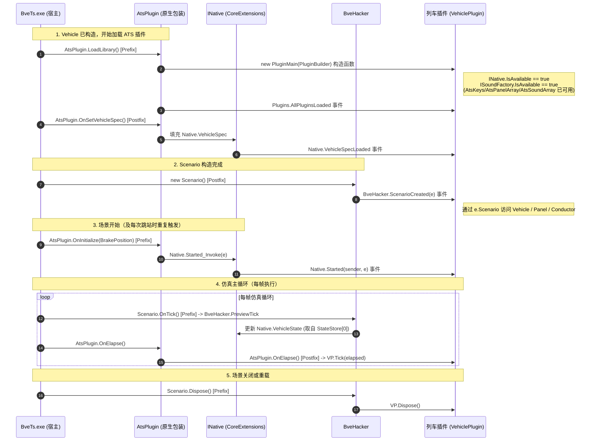
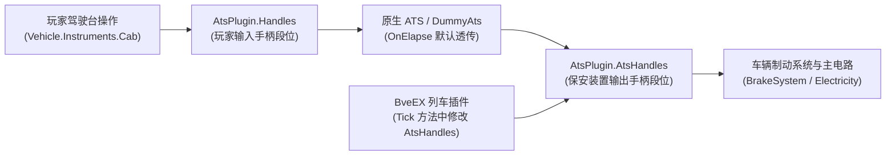
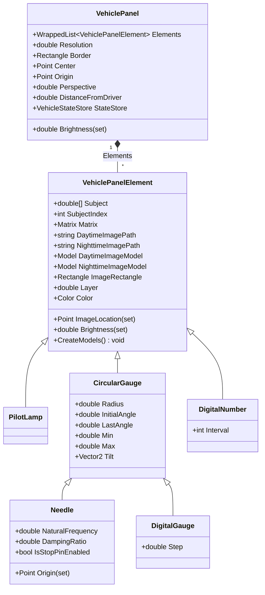

# 列车插件开发指南与 API 详解

列车插件（`PluginType.VehiclePlugin`）是依附于特定车辆（`Vehicle.txt`）运行的 BveEX 扩展程序集或脚本。它不仅完整覆盖了传统 BVE 原生 Win32 ATS 插件（`Ats32` / `Ats64`）的全部保安装置接口，还能直接通过 `BveHacker` 与核心扩展库深入读写车辆机电系统、2D/3D 驾驶台面板、车门与车掌逻辑，以及与路线上的地图插件进行双向通信。

> [!TIP]
> 在阅读本文档前，建议先阅读《[插件开发快速入门](getting-started.md)》了解项目创建与 NuGet 包引用，并结合《[插件生命周期与执行时机](architecture-lifecycle.md)》掌握 BveEX 插件在加载、每帧循环与卸载时的底层时序。

---

## 1. 列车插件概览与加载机制

### 1.1 什么是列车插件（`PluginType.VehiclePlugin`）

在 BveEX 中，标记了 `[Plugin(PluginType.VehiclePlugin)]` 特性的插件属于**列车插件**。其典型应用场景包括：

- **车载保安装置与自动驾驶**：实现 ATS、ATC、ATO、TASC、EB 装置、定速控制及防溜控制，读取 지상子（信标）、信号与车速并自动干预电门/常用/非常制动。
- **驾驶台仪表与液晶屏（TIMS / MON）控制**：驱动 `Panel.txt` 中的指示灯、指针与数字表，或直接在内存中变换仪表元素的 3D 矩阵、利用 `DXDynamicTexture` 绘制高帧率车载显示器界面。
- **自定义车掌与车门逻辑**：通过 `IConductorPatchFactory` 接管 BVE 原生车掌行为，实现司机手动独立操作左右车门、自定义停站判定、出发铃播放与广播联动。
- **车载辅助工具与跨插件联动**：创建 WinForms 调试/控制窗口（如实时修改列车位置、车速、时间）、播放车内环境音效，或与地图插件（`PluginType.MapPlugin`）共享车载数据。

### 1.2 BveEX 列车插件 vs 传统 Win32 ATS 插件

| 对比维度 | 传统 Win32 ATS 插件（`.dll`） | BveEX 列车插件（`PluginType.VehiclePlugin`） |
| :--- | :--- | :--- |
| **开发语言与运行环境** | C / C++（或需配置非托管导出的 C#），需区分 32 位 / 64 位编译 | .NET Framework 4.8（`AnyCPU`），自动适配 32 位与 64 位 BVE 宿主 |
| **多插件支持** | BVE 原生仅支持单个 DLL，多插件需借助第三方 `DetailManager.dll` 转发 | 原生支持在 `VehiclePluginUsing.xml` 中挂载任意数量的程序集、传统原生 ATS DLL 与脚本 |
| **传统 ATS 接口（面板/音效/地上子/按键）** | 通过 `Elapse`、`SetBeaconData`、`KeyDown` 等导出函数被动接收 | 通过核心扩展 `INative`（`BveEx.Extensions.Native`）以面向对象属性与事件方式访问，且默认支持 `AtsArrayExtender` 扩容至 1024 项 |
| **车辆与场景内部对象访问** | 无法访问，仅能读写受限的 `ATS_VEHICLESTATE` 与 `ATS_HANDLES` | 可通过 `BveHacker` 直接读写 `Scenario`、`Vehicle`（风缸气路、主电路、动力学、车门、车掌、2D 面板元素等） |
| **地图插件通信** | 仅能依靠地上子（Beacon）单向传值 | 可在 `Plugins.AllPluginsLoaded` 后直接获取地图插件实例，调用公开属性、方法与事件 |

#### 无原生 ATS 车辆的自动兜底机制（`BveEx.DummyAts`）

在底层实现中，BveEX 将列车插件的加载钩子（`AtsPlugin.LoadLibrary` 的 Prefix 补丁）、`INative` 状态同步以及每帧 `Tick`（`AtsPlugin.OnElapse` 的 Postfix 补丁）均挂载在 BVE 内部的 `AtsPlugin` 对象上。

为了使原本**未配置任何原生 ATS 插件**的车辆也能直接运行 BveEX 列车插件，核心框架中的 `AtsPluginOverrider` 实现了自动回退机制：
1. 当 `Vehicle.txt` 未指定 `Ats32` / `Ats64` 路径（`vehicleFile.AtsPluginPath is null`），或者指定的原生 ATS DLL 加载失败时；
2. BveEX 会自动将原生 ATS 插件路径重定向至框架内置的虚拟插件 `BveEx.DummyAts.x86.dll`（32 位进程）或 `BveEx.DummyAts.x64.dll`（64 位进程）；
3. `BveEx.DummyAts` 会将玩家输入的电门（`Power`）、制动（`Brake`）、方向（`Reverser`）原样透传，并将定速控制保持为 `Continue`（`ATS_CONSTANTSPEED_CONTINUE`），从而在不干扰车辆操控的前提下，完整激活 BveEX 列车插件的生命周期与事件管线。

### 1.3 清单配置与多插件挂载（`VehiclePluginUsing.xml`）

列车插件无需修改 `Vehicle.txt` 中的 `Ats32` / `Ats64` 字段，而是通过车辆文件同目录下的 XML 清单文件进行声明。

#### 清单文件查找优先级
假设当前场景加载的车辆文件名为 `Basic_Vehicle.txt`，BveEX 会按以下顺序查找清单文件（找到第一个存在的文件即停止）：
1. **车辆专属清单**：`<车辆文件所在目录>\<车辆文件名不含扩展名>.VehiclePluginUsing.xml`（例如 `Basic_Vehicle.VehiclePluginUsing.xml`）——适合同一目录下存在多个不同配置的 `Vehicle.txt` 时分别指定插件。
2. **目录通用清单**：`<车辆文件所在目录>\VehiclePluginUsing.xml`——适合该车辆目录下所有车辆文件共用同一套列车插件。

#### 清单节点类型与混合挂载示例
在 `VehiclePluginUsing.xml` 中，所有路径均**相对于当前 `Vehicle.txt` 所在的文件夹**解析。你可以同时挂载 BveEX 程序集插件（`<Assembly>`）、传统 Win32 原生 ATS 插件（`<Native>`，可直接替代 `DetailManager.dll`）以及动态脚本插件（`<CSharpScript>` / `<IronPython2>`）：

```xml
<?xml version="1.0" encoding="utf-8"?>
<BveExPluginUsing xmlns:xsi="http://www.w3.org/2001/XMLSchema-instance"
                  xmlns:xsd="http://www.w3.org/2001/XMLSchema">
  <!-- 1. 加载 BveEX 托管列车插件 (.dll) -->
  <Assembly Path="BveExPlugins\SimpleAts.dll" />
  <Assembly Name="PanelController" Path="BveExPlugins\PanelController.dll" />

  <!-- 2. 串联加载传统 Win32 原生 ATS 插件 (.dll)，无需 DetailManager -->
  <Native Path="Ats\AtsSn.dll" />
  <Native Path="Ats\AtsP.dll" />

  <!-- 3. 加载 C# 脚本列车插件 -->
  <CSharpScript Name="DoorScript">
    <PluginInitialized Path="Scripts\Init.csx" />
    <Tick Path="Scripts\Tick.csx" />
  </CSharpScript>
</BveExPluginUsing>
```

> [!NOTE]
> 各节点均支持可选的 `Name` 属性，用于指定该插件在 `Plugins.VehiclePlugins[name]` 集合中的检索键名。若省略 `Name`：
> - `<Assembly>` 默认使用程序集文件名（不含 `.dll`，即 `Assembly.GetName().Name`）；
> - `<Native>` 与脚本插件默认使用 `1` 起始的 16 进制递增序号（如 `"1"`、`"2"`）。

---

## 2. 列车插件标准骨架与生命周期要点

### 2.1 最小完整代码模板

编写列车插件时，需继承 `BveEx.PluginHost.Plugins.AssemblyPluginBase`，并标注 `[Plugin(PluginType.VehiclePlugin)]` 特性：

```csharp
using System;
using BveTypes.ClassWrappers;
using BveEx.Extensions.Native;
using BveEx.PluginHost;
using BveEx.PluginHost.Plugins;

namespace MyFirstVehiclePlugin
{
    [Plugin(PluginType.VehiclePlugin)]
    public class PluginMain : AssemblyPluginBase
    {
        private readonly INative Native;

        public PluginMain(PluginBuilder builder) : base(builder)
        {
            // 获取核心扩展 INative（用于访问传统 ATS 面板、音效、按键、地上子等接口）
            Native = Extensions.GetExtension<INative>();

            // 订阅生命周期与车载事件
            Native.VehicleSpecLoaded += OnVehicleSpecLoaded;
            Native.Started += OnStarted;
            BveHacker.ScenarioCreated += OnScenarioCreated;
        }

        public override void Dispose()
        {
            // 务必在卸载时解绑所有事件，防止内存泄漏或重载场景时残留引用
            Native.VehicleSpecLoaded -= OnVehicleSpecLoaded;
            Native.Started -= OnStarted;
            BveHacker.ScenarioCreated -= OnScenarioCreated;
        }

        private void OnVehicleSpecLoaded(object sender, EventArgs e)
        {
            // 此时可安全读取 Native.VehicleSpec（段位数、编组辆数等）
            VehicleSpec spec = Native.VehicleSpec;
        }

        private void OnScenarioCreated(ScenarioCreatedEventArgs e)
        {
            // 此时 Scenario 实例刚刚构造完成（注意：必须使用 e.Scenario 访问！）
            Vehicle vehicle = e.Scenario.Vehicle;
        }

        private void OnStarted(object sender, StartedEventArgs e)
        {
            // 场景初始化完成或玩家执行“跳站（駅ジャンプ）”时触发
            BrakePosition defaultBrake = e.DefaultBrakePosition;
            Native.AtsPanelArray[0] = 1; // 初始化面板状态量
        }

        public override void Tick(TimeSpan elapsed)
        {
            // 每帧在原生 AtsPlugin.OnElapse 执行完毕后调用
            float speedKmph = Native.VehicleState.Speed;
        }
    }
}
```

### 2.2 列车插件专属生命周期时序与阶段分工

列车插件的加载时机位于 `Scenario` 构造期间、BVE 调用 `AtsPlugin.LoadLibrary()` 的 Harmony Prefix 阶段。下图展示了列车插件从实例化到每帧运行再到卸载的完整时序：



#### 各阶段对象可用性与职责速查表

> [!IMPORTANT]
> **列车插件与地图插件在构造函数中的关键差异**：
> 地图插件在解析路线文件（Map Loader）阶段即被实例化，当时 `Vehicle` 尚未创建；而**列车插件在 `AtsPlugin.LoadLibrary` 阶段才被实例化**，此时 `Vehicle` 与 `AtsPlugin` 对象均已构造完毕。因此在列车插件的**构造函数**中，`INative.IsAvailable` 与 `ISoundFactory.IsAvailable` **已经为 `true`**！

| 生命周期阶段 / 事件 | `INative.AtsKeys` / `AtsPanelArray` / `AtsSoundArray` | `ISoundFactory` | `INative.VehicleSpec` | `Scenario` 实例 | 推荐在此阶段执行的初始化工作 |
| :--- | :---: | :---: | :---: | :---: | :--- |
| **1. 构造函数 `<init>`** | ✅ 可用 | ✅ 可用 | ❌ 为 `null` | ❌ 不可用 | 获取扩展接口（`GetExtension<T>()`）、直接绑定 `Native.AtsKeys` 按键事件、通过 `ISoundFactory` 加载车载音频、预创建 `VehiclePanelElement` 模型、订阅后续生命周期事件。 |
| **2. `Plugins.AllPluginsLoaded`** | ✅ 可用 | ✅ 可用 | ❌ 为 `null` | ❌ 不可用 | 通过 `Plugins.VehiclePlugins` 或 `Plugins.MapPlugins` 查找其他插件实例并建立跨插件引用。 |
| **3. `Native.VehicleSpecLoaded`** | ✅ 可用 | ✅ 可用 | ✅ 可用 | ❌ 不可用 | 读取 `Native.VehicleSpec`（制动段位数、电门段位数、ATS 确认段位、B67 段位、编组辆数）。 |
| **4. `BveHacker.ScenarioCreated`** | ✅ 可用 | ✅ 可用 | ✅ 可用 | ✅ **仅限 `e.Scenario`** | 访问 `e.Scenario.Vehicle`（如替换 `Panel.Elements` 的 `Subject`、注册 `IConductorPatchFactory.Patch`）。**切勿在此处使用 `BveHacker.Scenario`（仍会抛异常），必须使用事件参数 `e.Scenario`。** |
| **5. `Native.Started`** | ✅ 可用 | ✅ 可用 | ✅ 可用 | ✅ `BveHacker.Scenario` | **在场景首次开始以及每次玩家“跳站（駅ジャンプ）”时均会触发**。适合在此重置保安装置状态机、设置 `AtsPanelArray` 初始值，或根据 `e.DefaultBrakePosition` 初始化手柄。 |
| **6. `Tick(TimeSpan elapsed)`** | ✅ 可用 | ✅ 可用 | ✅ 可用 | ✅ `BveHacker.Scenario` | 每帧读取 `Native.VehicleState` 或 `BveHacker.Scenario`，计算保安装置逻辑，输出 `AtsHandles`、`AtsPanelArray`、`AtsSoundArray` 或更新仪表矩阵。 |

---

## 3. `INative` 扩展 API 详解：传统 ATS 兼容功能集

`INative` 接口（位于命名空间 `BveEx.Extensions.Native`，定义在核心扩展库 `BveEx.CoreExtensions.dll` 中）将传统 Win32 ATS 插件的全部输入输出能力封装为了易用的 C# 属性与事件。

### 3.1 获取 `INative` 实例与接口总览

在插件构造函数中调用 `Extensions.GetExtension<INative>()` 即可获取其实例：

```csharp
using BveEx.Extensions.Native;

// 在构造函数中：
INative native = Extensions.GetExtension<INative>();
```

`INative` 提供的核心属性与事件如下表所示：

| 成员名称 | 类型 | 说明 |
| :--- | :--- | :--- |
| `IsAvailable` | `bool` | 指示当前 `INative` 的各项属性是否可用（在列车插件构造函数至 `Dispose` 期间恒为 `true`）。 |
| `VehicleSpec` | `VehicleSpec` | 车辆规格参数（需在 `VehicleSpecLoaded` 事件触发后读取）。 |
| `VehicleState` | `VehicleState` | 当前帧的列车运行状态快照（位置、速度、时刻、各风缸压力、电流）。 |
| `AtsPanelArray` | `IList<int>` | 驾驶台 ATS 面板状态量数组（对应 `Panel.txt` 中的 `ats0`～`ats255` 或扩容后的 `ats1023`）。 |
| `AtsSoundArray` | `IList<int>` | 车载 ATS 音效控制数组（对应 `Sound.txt` / `Sound.cfg` 中 `[Ats]` 节的各索引）。 |
| `AtsKeys` | `AtsKeySet` | 全部 16 个 ATS 按键（`S`、`A1`、`A2`、`B1`、`B2`、`C1`、`C2`、`D`～`L`）的状态与事件集合。 |
| `Opened` / `Closed` | `EventHandler` | 当 `INative` 变为可用（`LoadLibrary` 前）或不可用（`Scenario` 卸载前）时触发。 |
| `VehicleSpecLoaded` | `EventHandler` | 当 `VehicleSpec` 规格数据加载完成时触发（对应原生 `SetVehicleSpec`）。 |
| `Started` | `EventHandler<StartedEventArgs>` | 当场景开始或跳站重置时触发（对应原生 `Initialize`）。 |
| `HornBlown` | `EventHandler<HornBlownEventArgs>` | 当吹响警笛（电笛、空笛、音乐笛）时触发（对应原生 `HornBlow`）。 |
| `DoorOpened` / `DoorClosed` | `EventHandler` | 当全列所有车门不再全关（第一扇门打开）或全列所有车门恢复全关时触发。 |
| `SignalUpdated` | `EventHandler<SignalUpdatedEventArgs>` | 当列车当前所在闭塞分区的信号现示索引发生变化时触发（对应原生 `SetSignal`）。 |
| `BeaconPassed` | `EventHandler<BeaconPassedEventArgs>` | 当列车通过地上子（信标）时触发（对应原生 `SetBeaconData`）。 |

### 3.2 车辆规格（`VehicleSpec`）与每帧状态快照（`VehicleState`）

#### 1. `VehicleSpec`（对应原生 `ATS_VEHICLESPEC`）
在 `Native.VehicleSpecLoaded` 事件触发后（包括 `ScenarioCreated`、`Started` 与 `Tick` 期间），可通过 `Native.VehicleSpec` 读取车辆参数：

| 属性名 | 类型 | 说明 |
| :--- | :--- | :--- |
| `BrakeNotches` | `int` | 常用制动总段位数（包含抑速制动段位，不含非常制动）。非常制动段位号为 `BrakeNotches + 1`。 |
| `PowerNotches` | `int` | 电门（牵引）总段位数。 |
| `AtsNotch` | `int` | ATS 确认段位（ATS 动作解除所需的最小制动段位号）。 |
| `B67Notch` | `int` | 相当于制动曲率 $67^\circ$（直通管压力或常用中段）的制动段位号。 |
| `Cars` | `int` | 列车编组总辆数。 |

#### 2. `VehicleState`（对应原生 `ATS_VEHICLESTATE`）
在每帧 `BveHacker.PreviewTick` 阶段，BveEX 会自动从 `AtsPlugin.StateStore` 提取最新状态并更新 `Native.VehicleState`：

| 属性名 | 类型 | 单位 | 说明 |
| :--- | :--- | :--- | :--- |
| `Location` | `double` | $\text{m}$ | 列车当前距离程（位置）。 |
| `Speed` | `float` | **$\text{km/h}$** | 列车当前速度（千米/小时）。 |
| `Time` | `TimeSpan` | - | 场景内当前时刻（底层由毫秒数 `TimeSpan.FromMilliseconds` 转换而来）。 |
| `BcPressure` | `float` | $\text{kPa}$ | 制动缸压力（Brake Cylinder Pressure）。 |
| `MrPressure` | `float` | $\text{kPa}$ | 总风缸压力（Main Reservoir Pressure）。 |
| `ErPressure` | `float` | $\text{kPa}$ | 均衡风缸压力（Equalizing Reservoir Pressure）。 |
| `BpPressure` | `float` | $\text{kPa}$ | 列车管（制动管）压力（Brake Pipe Pressure）。 |
| `SapPressure` | `float` | $\text{kPa}$ | 直通管压力（Straight Air Pipe Pressure）。 |
| `Current` | `float` | $\text{A}$ | 主电路电流（牵引为正，再生制动为负）。 |

> [!WARNING]
> **切勿混淆两套速度属性的单位！**
> - `Native.VehicleState.Speed`（类型为 `float`）源自原生 ATS 状态表，单位是 **千米/小时（$\text{km/h}$）**。
> - `BveHacker.Scenario.VehicleLocation.Speed`（类型为 `double`）源自 BVE 内部物理引擎，单位是 **米/秒（$\text{m/s}$）**。
>
> 两者相差 $3.6$ 倍（$1\text{ m/s} = 3.6\text{ km/h}$）。如果使用 `VehicleLocation.Speed` 进行限速比较，请务必除以或乘以 `3.6`（可参考官方示例 `SimpleAts` 中的 `UnitConverter`）。

### 3.3 驾驶台 ATS 面板状态量控制（`AtsPanelArray`）

在车辆的 `Panel.txt`（或 `Panel.cfg`）中，仪表元素（如 `[PilotLamp]`、`[Needle]`、`[DigitalNumber]`）通常将 `Subject` 设置为 `ats0`、`ats1`、`ats2` 等变量。在列车插件中，只需读写 `Native.AtsPanelArray[index]`（类型为 `IList<int>`）即可实时控制对应的仪表显示。

#### 为什么必须使用 `Native.AtsPanelArray` 而不是 `AtsPlugin.PanelArray`？
在 BVE 原生流程中，`AtsPlugin.OnElapse()` 内部会先调用原生 DLL 的 `Elapse`，随即将 `AtsPlugin.PanelArray`（`int[]`）中的值拷贝到用于渲染驾驶台的 `AtsPlugin.StateStore.PanelArray`（`double[]`）中。
由于 BveEX 插件的 `Tick()` 是在 `AtsPlugin.OnElapse()` 的 **Postfix（后置补丁）** 中执行的，此时 BVE 原生的数组拷贝动作已经结束。如果你直接修改 `BveHacker.Scenario.Vehicle.Instruments.AtsPlugin.PanelArray[i]`，修改后的值要等到下一帧（甚至被原生 DLL 覆盖）才能反映到 `StateStore`。
而 `Native.AtsPanelArray` 的底层包装类 `PanelArray` 在索引器 `set` 中实现了**双写同步**：

```csharp
// BveEx.CoreExtensions 内部实现原理：
AtsPlugin.PanelArray[index] = value;
AtsPlugin.StateStore.PanelArray[index] = value;
```

因此，通过 `Native.AtsPanelArray[index] = value` 赋值会在**当前帧立即生效**。

#### 面板数组容量与 `AtsArrayExtender` 扩容
- **BVE 原生默认上限**：长度为 `256`（有效索引为 `0`～`255`，对应 `ats0`～`ats255`）。
- **BveEX 默认扩容上限**：BveEX 默认随附并启用了官方核心扩展 `BveEx.Extensions.AtsArrayExtender.dll`，它会自动将 `PanelArray`、`StateStore.PanelArray`、`SoundArray` 与 `OldSoundArray` 统一扩容为 **`1024`**（有效索引为 `0`～`1023`，对应 `ats0`～`ats1023`）。详细机制可参阅《[AtsArrayExtender (ATS 变量数组扩展)](extensions/ats-array-extender.md)》。

#### 实战示例：控制驾驶台指示灯与指针（源自官方示例 `AtsPanelValueTest`）

```csharp
using System;
using BveEx.Extensions.Native;
using BveEx.PluginHost.Plugins;

namespace BveEx.Samples.VehiclePlugins.AtsPanelValueTest
{
    [Plugin(PluginType.VehiclePlugin)]
    public class PluginMain : AssemblyPluginBase
    {
        private readonly INative Native;

        public PluginMain(PluginBuilder builder) : base(builder)
        {
            Native = Extensions.GetExtension<INative>();
            Native.Started += OnStarted;
        }

        public override void Dispose()
        {
            Native.Started -= OnStarted;
        }

        private void OnStarted(object sender, StartedEventArgs e)
        {
            // 在场景开始及每次跳站时，将 ats1 初始化为 50
            Native.AtsPanelArray[1] = 50;
        }

        public override void Tick(TimeSpan elapsed)
        {
            int timeMilliseconds = BveHacker.Scenario.TimeManager.TimeMilliseconds;

            // ats0：每 0.5 秒（500ms）交替输出 1 和 0，实现指示灯闪烁
            Native.AtsPanelArray[0] = timeMilliseconds / 500 % 2 == 0 ? 1 : 0;

            // ats1：每帧递增 1，达到 200 时归零
            Native.AtsPanelArray[1] += 1;
            if (Native.AtsPanelArray[1] == 200) Native.AtsPanelArray[1] = 0;

            // ats2：按正弦波在 -100 到 +100 之间平滑摆动
            Native.AtsPanelArray[2] = (int)(Math.Sin(timeMilliseconds / 400d) * 100);
        }
    }
}
```

### 3.4 ATS 音效数组与播放指令控制（`AtsSoundArray`）

在车辆音效配置文件（`Sound.txt` 或 `Sound.cfg`）的 `[Ats]` 节中定义的编号音效（如 `0 = bell.wav`），可通过 `Native.AtsSoundArray[index]` 进行播放控制。

#### `SoundPlayMode` 枚举与 `SoundPlayCommands` 辅助类

BveEX 在 `BveEx.Extensions.Native` 命名空间下提供了强类型的 `SoundPlayMode` 枚举与 `SoundPlayCommands` 静态扩展类，无需手动硬编码 `-10000` 等魔术数字：

| `SoundPlayMode` 枚举值 | 底层整数指令值 | 对应原生常量 | 行为说明 |
| :--- | :---: | :--- | :--- |
| `SoundPlayMode.Stop` | `-10000` | `ATS_SOUND_STOP` | 停止播放该音效。 |
| `SoundPlayMode.PlayLooping` | `0` | `ATS_SOUND_PLAYLOOPING` | 以原始音量（$0\text{ dB}$ 衰减）循环播放该音效。 |
| `SoundPlayMode.Play` | `1` | `ATS_SOUND_PLAY` | 单次播放该音效（写入后底层会自动触发播放并将数组值复位为 `2`）。 |
| `SoundPlayMode.Continue` | `2` | `ATS_SOUND_CONTINUE` | 保持上一帧的播放状态不变。 |

`SoundPlayCommands` 提供了以下 3 个静态/扩展方法：
1. **`mode.ToCommand()`**：将 `SoundPlayMode` 枚举转换为对应的 `int` 指令值（如 `SoundPlayMode.Play.ToCommand()` 返回 `1`）。
2. **`SoundPlayCommands.PlayLooping(int volume)`**：生成**带音量衰减的循环播放指令**。参数 `volume` 必须满足 `-10000 <= volume <= 0`（单位为 $1/100\text{ dB}$，即毫贝尔 $\text{mB}$；`0` 表示最大音量，`-10000` 等同于停止播放，若传入 `> 0` 的值会抛出 `ArgumentOutOfRangeException`）。
3. **`SoundPlayCommands.GetMode(int command)`**：将当前 `Native.AtsSoundArray[index]` 中的整数值反向解析为 `SoundPlayMode` 枚举（其中 `<= -10000` 解析为 `Stop`，`-9999`～`0` 均解析为 `PlayLooping`，`1` 为 `Play`，`2` 为 `Continue`）。

```csharp
// 1. 单次播放 2 号 ATS 音效（如确认按钮音）
Native.AtsSoundArray[2] = SoundPlayMode.Play.ToCommand();

// 2. 以 -12dB (-1200) 的衰减音量循环播放 0 号 ATS 警报音
Native.AtsSoundArray[0] = SoundPlayCommands.PlayLooping(-1200);

// 3. 检查 0 号音效是否正在循环播放，若是则停止
if (SoundPlayCommands.GetMode(Native.AtsSoundArray[0]) == SoundPlayMode.PlayLooping)
{
    Native.AtsSoundArray[0] = SoundPlayMode.Stop.ToCommand();
}
```

> [!WARNING]
> **上游代码已知行为特性（`SoundArray` 引用缓存与加载顺序）**：
> 在 [`SoundArray.cs`](file:///e:/github/BveEX/Extensions/BveEx.CoreExtensions/Native/SoundArray.cs#L42-L46) 中，`SoundArray` 在构造时将 `AtsPlugin.SoundArray` 的引用缓存到了 `readonly int[] Array` 字段中（而 `PanelArray` 则是每次通过属性动态读取 `AtsPlugin.PanelArray`）。
> 默认情况下，因为 `Extensions\` 目录下的 `BveEx.Extensions.AtsArrayExtender.dll` 按文件名字母序排在 `BveEx.CoreExtensions.dll` 之前，扩容补丁先执行，`Native.AtsSoundArray` 能正常获得扩容后的 `1024` 长度数组。但如果你在 `Extensions\PluginUsing.xml` 中手动调整了扩展加载顺序，使 `BveEx.CoreExtensions` 先于 `AtsArrayExtender` 加载，则 `Native.AtsSoundArray` 内部缓存的 `Array` 仍会指向扩容前长度为 `256` 的旧数组，访问 `256` 以上的索引会抛出 `IndexOutOfRangeException`。因此**切勿修改 `Extensions` 目录下这两个核心扩展的默认加载顺序**。

### 3.5 ATS 按键输入监听（`AtsKeySet` 与 `AtsKey`）

`Native.AtsKeys`（类型为 `BveEx.Extensions.Native.Input.AtsKeySet`）提供了比传统 `KeyDown` / `KeyUp` 更加强大的按键状态查询、按压计时与事件监听能力。

#### `AtsKeyName` 枚举与默认键盘映射表（位于 `BveEx.PluginHost.Input`）

| `AtsKeyName` 枚举值 | 整数值 | 原生常量 | BVE 默认键盘按键 | 常见保安装置用途 |
| :--- | :---: | :--- | :--- | :--- |
| `AtsKeyName.S` | `0` | `ATS_KEY_S` | `Space`（空格） | ATS 确认 / 警惕按钮（EB 复位） |
| `AtsKeyName.A1` | `1` | `ATS_KEY_A1` | `Insert` | 警报持续（警報持続） |
| `AtsKeyName.A2` | `2` | `ATS_KEY_A2` | `Delete` | 东武/私铁确认或特殊复位 |
| `AtsKeyName.B1` | `3` | `ATS_KEY_B1` | `Home` | 复归（復帰 / 常用缓解答） |
| `AtsKeyName.B2` | `4` | `ATS_KEY_B2` | `End` | 特殊保安装置切换 |
| `AtsKeyName.C1` | `5` | `ATS_KEY_C1` | `PageUp` | 列车无线 / 画面翻页 |
| `AtsKeyName.C2` | `6` | `ATS_KEY_C2` | `PageDown` | 列车无线 / 画面翻页 |
| `AtsKeyName.D` ～ `L` | `7` ～ `15` | `ATS_KEY_D` ～ `L` | 数字键 `2` ～ `0` | 保安装置切换、TASC/ATO 启动、手动开关车门等 |

#### 按键事件订阅与按压时长读取

你既可以通过 `Native.AtsKeys.GetKey(AtsKeyName)` 获取单个按键对象（`AtsKey`）进行针对性监听，也可以通过 `Native.AtsKeys.AnyKeyPressed` / `AnyKeyReleased` 监听任意 ATS 按键：

| `AtsKey` 成员 | 类型 | 说明 |
| :--- | :--- | :--- |
| `IsPressed` | `bool` | 当前按键是否处于按下状态。 |
| `SincePressed` | `TimeSpan` | 当前按键自按下以来经过的时长（若未按下则为 `TimeSpan.Zero`）。 |
| `SincePressedMilliseconds` | `long` | 当前按键自按下以来经过的毫秒数（基于 `Stopwatch` 计时）。 |
| `Pressed` | `EventHandler` | 当按键刚刚按下时触发。 |
| `PreviewReleased` | `EventHandler` | 当按键松开、计时器刚刚停止，但 **`IsPressed` 尚未置为 `false` 之前**触发。 |
| `Released` | `EventHandler` | 当按键松开且 `IsPressed` 已置为 `false`（计时器清零）之后触发。 |
| `LockAndInvoke(Action)` | `void` | 在线程锁保护下安全执行依赖按键状态的操作。 |

> [!TIP]
> **如何在松开按键时获取“刚才一共按住了多久”？**
> 在 [`AtsKey.NotifyReleased()`](file:///e:/github/BveEX/Extensions/BveEx.CoreExtensions/Native/Input/AtsKey.cs#L61-L67) 的源码实现中，当玩家松开按键时：
> 1. 先执行 `SincePressedWatch.Stop()` 并触发 **`PreviewReleased`** 事件（此时 `IsPressed` 仍为 `true`，读取 `SincePressed` 可以拿到完整的按压持续时间）；
> 2. 紧接着将 `IsPressed = false`，此时读取 `SincePressed` 会直接返回 `TimeSpan.Zero`；
> 3. 最后触发 **`Released`** 事件。
>
> 因此，若要实现“长按 2 秒以上松开才生效”等判定，应在 **`PreviewReleased`** 事件中读取 `SincePressed`！

```csharp
using System;
using BveEx.Extensions.Native;
using BveEx.Extensions.Native.Input;
using BveEx.PluginHost.Input;

// 在构造函数或初始化方法中：
AtsKey keyS = Native.AtsKeys.GetKey(AtsKeyName.S);
keyS.Pressed += OnKeySPressed;
keyS.PreviewReleased += OnKeySPreviewReleased;

// 也可以监听任意 ATS 按键按下：
Native.AtsKeys.AnyKeyPressed += OnAnyKeyPressed;

private void OnKeySPressed(object sender, EventArgs e)
{
    // 空格键按下
}

private void OnKeySPreviewReleased(object sender, EventArgs e)
{
    AtsKey key = (AtsKey)sender;
    if (key.SincePressed.TotalSeconds >= 2.0)
    {
        // 玩家长按 S 键超过 2 秒后松开
    }
}

private void OnAnyKeyPressed(object sender, AtsKeyEventArgs e)
{
    AtsKeyName name = e.KeyName; // 按下的键名枚举
    AtsKey keyObj = e.Key;       // 对应的 AtsKey 实例
}
```

### 3.6 车载运行事件监听（地上子、信号、车门、警笛）

#### 1. 地上子（信标）通过事件：`Native.BeaconPassed`
当列车越过路线中设置的 `Beacon.Put` 地上子时触发，事件参数为 `BeaconPassedEventArgs`（对应原生 `ATS_BEACONDATA`）：

| 属性名 | 类型 | 说明 |
| :--- | :--- | :--- |
| `Type` | `int` | 地上子编号（对应路线语法 `Beacon.Put(type, section, sendData)` 中的 `type`）。 |
| `SignalIndex` | `int` | 该地上子所关联的目标闭塞分区当前的信号现示索引（Signal Aspect）。 |
| `Distance` | `float` | 列车当前位置到该地上子所关联的目标闭塞分区起点的距离（单位：$\text{m}$）。 |
| `Optional` | `int` | 地上子发送的附加整型数据（`sendData`）。 |

> [!NOTE]
> 根据 [`Native.cs`](file:///e:/github/BveEX/Extensions/BveEx.CoreExtensions/Native/Native.cs#L118-L128) 的源码实现，如果路线作者在 `Beacon.Put` 中关联的目标闭塞索引超出了当前路线实际存在的闭塞分区范围（`targetSectionIndex < 0` 或 `>= sections.Count`），BveEX 不会抛出越界异常，而是将 `SignalIndex` 与 `Distance` 静默回退为 `0`。

#### 2. 闭塞信号更新事件：`Native.SignalUpdated`
当列车驶入新闭塞或前方列车出清导致当前闭塞信号现示改变时触发，参数 `SignalUpdatedEventArgs` 包含属性：
- `SignalIndex`（`int`）：更新后的当前闭塞信号现示索引。

> [!WARNING]
> **上游代码细节提示**：[`SignalUpdatedEventArgs`](file:///e:/github/BveEX/Extensions/BveEx.CoreExtensions/Native/SignalUpdatedEventArgs.cs#L12) 类在源码中声明为 `public class SignalUpdatedEventArgs`（**未继承 `System.EventArgs`**）。这不影响使用 `EventHandler<SignalUpdatedEventArgs>` 绑定事件，但在编写泛型或通用事件转发器时，不能将其实例隐式向上转型为 `EventArgs`。

#### 3. 车门与警笛事件：`DoorOpened` / `DoorClosed` / `HornBlown`
- **`Native.DoorOpened`**：当车门从“全列关闭”变为“至少有一扇门打开”时触发。
- **`Native.DoorClosed`**：当全列所有车门均完全关闭时触发。
- **`Native.HornBlown`**：当玩家吹鸣警笛时触发，事件参数 `HornBlownEventArgs.HornType` 为 `BveTypes.ClassWrappers.HornType` 枚举：
  - `HornType.Primary = 0`（主警笛 / 空笛 1）
  - `HornType.Secondary = 1`（副警笛 / 电笛 2）
  - `HornType.Music = 2`（音乐警笛）

---

## 4. 保安装置核心：手柄干预、输入模拟与车辆物理控制

除了 `INative` 提供的传统接口外，BveEX 允许列车插件通过 `BveHacker.Scenario.Vehicle` 直接读写车辆内部的手柄、控制器、位置、速度与机电系统。

### 4.1 干预电门、制动、方向与定速手柄（`AtsPlugin` 与 `HandleSet`）

在 `BveHacker.Scenario.Vehicle.Instruments.AtsPlugin`（类型为 `BveTypes.ClassWrappers.AtsPlugin`）中，包含两套 `HandleSet` 对象：



1. **`atsPlugin.Handles`（玩家输入手柄）**：反映玩家当前在驾驶台上实际扳动的手柄位置。
2. **`atsPlugin.AtsHandles`（保安装置输出手柄）**：最终送入车辆物理引擎（制动系统与主电路）生效的手柄位置。在列车插件的 `Tick()` 中修改 `atsPlugin.AtsHandles` 的属性，即可实现保安装置对列车的制动干预或牵引切除！

#### `HandleSet` 属性与事件一览

| 成员名称 | 类型 | 说明 |
| :--- | :--- | :--- |
| `PowerNotch` | `int` | 电门段位（`0` 为惰行，正数为牵引，负数为抑速制动）。 |
| `BrakeNotch` | `int` | 制动段位（`0` 为缓解，`1`～`BrakeNotchCount` 为常用制动，`EmergencyBrakeNotch` 为非常制动）。 |
| `ReverserPosition` | `ReverserPosition` | 方向手柄位置枚举：`B = -1`（后退）、`N = 0`（中立）、`F = 1`（前进）。 |
| `ConstantSpeedMode` | `ConstantSpeedMode` | 定速控制指令枚举：`Continue = 0`（保持）、`Enable = 1`（启动）、`Disable = 2`（切除）。 |
| `NotchInfo` | `NotchInfo` | 当前车辆的手柄段位配置信息对象（见下表）。 |
| `PowerChanged` | `EventHandler<ValueEventArgs<int>>` | 当 `PowerNotch` 发生变化时触发（`e.Value` 为新段位值）。 |
| `BrakeChanged` | `EventHandler<ValueEventArgs<int>>` | 当 `BrakeNotch` 发生变化时触发（`e.Value` 为新段位值）。 |
| `ReverserChanged` | `EventHandler<ValueEventArgs<int>>` | 当 `ReverserPosition` 发生变化时触发。 |
| `ConstantSpeedChanged` | `EventHandler` | 当 `ConstantSpeedMode` 发生变化时触发。 |
| `Sync(HandleSet)` | `void` | 将当前 `HandleSet` 的所有手柄值同步复制给目标 `HandleSet`。 |

#### `NotchInfo` 段位信息属性表

| 属性名 | 类型 | 可写 | 说明 |
| :--- | :--- | :---: | :--- |
| `PowerNotchCount` | `int` | ✅ | 正向牵引电门总段位数。 |
| `HoldingSpeedNotchCount` | `int` | ✅ | 抑速制动总段位数（注意：在 BVE 内部该值为**负数或 0**）。 |
| `BrakeNotchCount` | `int` | ✅ | 常用制动总段位数（不含非常制动）。 |
| `EmergencyBrakeNotch` | `int` | ❌（只读） | **非常制动（EB）段位号**。因此**常用最大制动（Bmax）段位号为 `EmergencyBrakeNotch - 1`**。 |
| `AtsCancelNotch` | `int` | ✅ | ATS 确认段位号。 |
| `B67Notch` | `int` | ✅ | $67^\circ$ 制动段位号。 |
| `MotorBrakeNotch` | `int` | ✅ | 电制动起始段位号。 |
| `HasHoldingSpeedBrake` | `bool` | ✅ | 是否具备抑速制动段位。 |
| `PrioritizeBrake` | `bool` | ✅ | 当电门与制动同时输入时是否优先执行制动。 |

#### 实战示例：超速自动施加常用最大制动（源自官方示例 `SimpleAts`）

```csharp
using System;
using BveTypes.ClassWrappers;
using BveEx.Extensions.Native;
using BveEx.PluginHost.Plugins;

namespace BveEx.Samples.VehiclePlugins.SimpleAts
{
    [Plugin(PluginType.VehiclePlugin)]
    public class SimpleAts : AssemblyPluginBase
    {
        private readonly INative Native;

        public SimpleAts(PluginBuilder builder) : base(builder)
        {
            Native = Extensions.GetExtension<INative>();
        }

        public override void Dispose()
        {
        }

        public override void Tick(TimeSpan elapsed)
        {
            // VehicleLocation.Speed 单位为 m/s，100 / 3.6 即 100 km/h
            double speedMps = BveHacker.Scenario.VehicleLocation.Speed;
            SoundPlayMode soundPlayMode = SoundPlayCommands.GetMode(Native.AtsSoundArray[0]);

            if (speedMps > 100 / 3.6) // 当车速超过 100 km/h 时：
            {
                // 1. 循环播放 0 号 ATS 超速警报音
                if (soundPlayMode == SoundPlayMode.Stop)
                {
                    Native.AtsSoundArray[0] = SoundPlayMode.PlayLooping.ToCommand();
                }

                // 2. 切除牵引与定速，并输出常用最大制动（若玩家已打到 EB 则保留玩家的 EB）
                AtsPlugin atsPlugin = BveHacker.Scenario.Vehicle.Instruments.AtsPlugin;
                atsPlugin.AtsHandles.PowerNotch = 0;
                atsPlugin.AtsHandles.BrakeNotch = Math.Max(
                    atsPlugin.AtsHandles.NotchInfo.EmergencyBrakeNotch - 1,
                    atsPlugin.Handles.BrakeNotch);
                atsPlugin.AtsHandles.ConstantSpeedMode = ConstantSpeedMode.Disable;
            }
            else
            {
                // 车速恢复至 100 km/h 以下时停止警报音
                // （由于每帧 DummyAts/原生插件会将 Handles 同步到 AtsHandles，松开干预后会自动恢复玩家手柄控制）
                if (soundPlayMode == SoundPlayMode.PlayLooping)
                {
                    Native.AtsSoundArray[0] = SoundPlayMode.Stop.ToCommand();
                }
            }
        }
    }
}
```

### 4.2 操作玩家驾驶台物理手柄与模拟按键输入（`CabBase` 与 `InputEventArgsFactory`）

修改 `atsPlugin.AtsHandles` 只会在保安装置层面干预输出，而**不会扳动玩家在驾驶台上看到的物理手柄**。如果你希望直接替玩家扳动驾驶台手柄（例如实现自动归位），或者动态修改屏幕左上角显示的手柄段位名称，可以通过以下两个 API 实现：

#### 1. 访问驾驶台控制器（`Vehicle.Instruments.Cab`）
`CabBase`（及其派生类单手柄 `OneLeverCab`、双手柄 `TwoLeverCab`）包含了屏幕左上角手柄提示文字数组，可在运行时直接修改：
- `Cab.ReverserTexts`（`string[]`）：方向手柄各位置显示文本（如 `["後", "切", "前"]`）。
- `Cab.PowerTexts`（`string[]`）：电门各段位显示文本（如 `["N", "P1", "P2", ...]`）。
- `Cab.BrakeTexts`（`string[]`）：制动各段位显示文本（如 `["N", "B1", "B2", ..., "EB"]`）。
- `Cab.HoldingSpeedTexts`（`string[]`）：抑速各段位显示文本。
- `Cab.GetDescriptionText()`（`string`）：获取当前拼合后的左上角手柄提示文本。

#### 2. 使用 `InputEventArgsFactory` 模拟手柄扳动与按键输入
`BveEx.PluginHost.Input.InputEventArgsFactory` 可以构造标准的输入事件参数，并交由 `BveHacker.InputManager` 注入到 BVE 宿主中，其效果与玩家真实操作键盘或外设完全一致：

| 工厂方法 | 适用的 `InputManager` 调用方法 | 作用说明 |
| :--- | :--- | :--- |
| `OneLeverNotch(int notch)` | `LeverMoved_Invoke(e)` | 将单手柄（主干控制器）扳至指定综合段位（正为牵引，负为制动）。 |
| `OneLeverPower(int power)` | `LeverMoved_Invoke(e)` | 将单手柄扳至指定电门段位。 |
| `OneLeverBrake(int brake)` | `LeverMoved_Invoke(e)` | 将单手柄扳至指定制动段位。 |
| `OneLeverNeutral()` | `LeverMoved_Invoke(e)` | 将单手柄归位至中立（`N`）段。 |
| `TwoLeverPower(int power)` | `LeverMoved_Invoke(e)` | 将双手柄车辆的电门手柄扳至指定段位。 |
| `TwoLeverBrake(int brake)` | `LeverMoved_Invoke(e)` | 将双手柄车辆的制动手柄扳至指定段位。 |
| `Reverser(ReverserPosition pos)` | `LeverMoved_Invoke(e)` | 将方向手柄扳至指定位置（`B` / `N` / `F`）。 |
| `Horn(HornType type)` | `KeyDown_Invoke(e)` / `KeyUp_Invoke(e)` | 按下或松开指定类型的警笛键。 |
| `ConstantSpeed()` | `KeyDown_Invoke(e)` / `KeyUp_Invoke(e)` | 按下或松开定速控制键。 |
| `AtsKey(AtsKeyName keyName)` | `KeyDown_Invoke(e)` / `KeyUp_Invoke(e)` | 模拟按下或松开指定的 ATS 按键（`S`～`L`）。 |
| `SystemKey(SystemKeyName key)` | `KeyDown_Invoke(e)` / `KeyUp_Invoke(e)` | 模拟触发 BVE 系统功能键（视角移动、时刻表显示、倍速、暂停等）。 |

> [!NOTE]
> `SystemKeyName`（位于 `BveEx.PluginHost.Input`）支持的系统功能键包括：`ViewUp`、`ViewDown`、`ViewLeft`、`ViewRight`、`ViewDefault`、`ViewZoomIn`、`ViewZoomOut`、`ViewChange`、`TimeTable`、`ReloadScenario`、`Stop`、`FastForward`、`Pause`。

```csharp
using BveTypes.ClassWrappers;
using BveEx.PluginHost.Input;

// 示例 1：判断当前车辆是单手柄还是双手柄，并将玩家物理手柄强制推到非常制动（EB）
CabBase cab = BveHacker.Scenario.Vehicle.Instruments.Cab;
int ebNotch = cab.Handles.NotchInfo.EmergencyBrakeNotch;

if (cab is OneLeverCab)
{
    BveHacker.InputManager.LeverMoved_Invoke(InputEventArgsFactory.OneLeverBrake(ebNotch));
}
else if (cab is TwoLeverCab)
{
    BveHacker.InputManager.LeverMoved_Invoke(InputEventArgsFactory.TwoLeverPower(0));
    BveHacker.InputManager.LeverMoved_Invoke(InputEventArgsFactory.TwoLeverBrake(ebNotch));
}

// 示例 2：在代码中模拟按下并松开“切换时刻表显示”系统键
var timetableKey = InputEventArgsFactory.SystemKey(SystemKeyName.TimeTable);
BveHacker.InputManager.KeyDown_Invoke(timetableKey);
BveHacker.InputManager.KeyUp_Invoke(timetableKey);
```

### 4.3 读写列车位置、速度、时间与机电/动力学参数

#### 1. 修改列车位置、车速与场景时间（源自官方示例 `StateViewer`）
在制作列车调试工具或特殊跳转逻辑时，可通过 `Scenario` 下的 `VehicleLocation` 与 `TimeManager` 实时改写运行状态：

```csharp
Scenario scenario = BveHacker.Scenario;

// 1. 修改场景当前时刻（传入总毫秒数）
TimeSpan targetTime = new TimeSpan(12, 30, 0);
scenario.TimeManager.SetTime((int)targetTime.TotalMilliseconds);

// 2. 传送/修改列车距离程（单位：m）
// 注意：请调用 SetLocation(location, true) 而不是直接给 Location 属性赋值，
// 以确保 BVE 内部同步更新当前所在的 MapBlock 索引并触发跳站/位置变更处理！
scenario.VehicleLocation.SetLocation(1500.0, true);

// 3. 强制设置列车当前速度（注意：SetSpeed 参数单位为 m/s！）
double targetSpeedKmph = 80.0;
scenario.VehicleLocation.SetSpeed(targetSpeedKmph / 3.6);
```

#### 2. `Vehicle` 机电与动力学子系统速查表
通过 `BveHacker.Scenario.Vehicle`，插件可以深入访问车辆的各个物理计算模块：

| 访问路径（相对于 `BveHacker.Scenario.Vehicle`） | 包装类型 | 核心属性与功能说明 |
| :--- | :--- | :--- |
| `.Instruments.BrakeSystem` | `BrakeSystem` | **制动系统总成**：包含 `MotorBrake`（电制动）、`AirBrake`（空气制动：`StraightAirBrake` / `ElectroPneumaticBrake` / `AutomaticAirBrake`）、`AirSupplement`（复式风缸/空重车补气）、`BrakeController`、`LockoutValve`、`CarBrake`（头车制动缸）。 |
| `.Instruments.BrakeSystem.CarBrake.BasicBrake` | `PressureGauge` | **制动缸（BC）压力表**（可读取 `.Value` 等压力参数）。 |
| `.Instruments.BrakeSystem.AirBrake.MainReservoir` | `MainReservoir` | **总风缸（MR）** 与压缩机状态。 |
| `.Instruments.BrakeSystem.AirBrake.EqualizingReservoir` | `PressureGauge` | **均衡风缸（ER）** 压力。 |
| `.Instruments.BrakeSystem.AirBrake.BrakePipe` | `BrakePipe` | **列车管（BP）** 压力。 |
| `.Instruments.Electricity` | `Electricity` | **主电路与粘着系统**：`PowerReverser`、`SlipVelocityCoefficient`（空转滑行系数）、`RegenerativeBrake`（再生制动）、`MainCircuit`（主电路，其 `.Current` 为电流值）。 |
| `.Instruments.ConstantSpeedRelay` | `ConstantSpeedRelay` | **定速控制继电器**状态。 |
| `.Instruments.LoadCompensator` | `LoadCompensator` | **应荷重装置（空重车调整器）**。 |
| `.Dynamics` | `VehicleDynamics` | **车辆动力学参数**：包含 `Cars`（各车厢列表）、`MotorMass`（动车质量）、`TrailerMass`（拖车质量）、`InertiaFactor`（惯性系数）、`RunningResistanceFactorA` / `B` / `C`（出发与运行阻力系数）。 |
| `.Passenger` | `Passenger` | **乘客载荷模块**。 |
| `.Vibration` | `VehicleVibration` | **车体振动与摇晃计算模块**。 |
| `.CameraLocation` | `CameraLocation` | **司机室摄像机视角位置与朝向**。 |

> [!WARNING]
> **关于运行阻力系数 `RunningResistanceFactorA` 与 `B` 的单位换算特性**：
> 在 [`VehicleDynamics.cs`](file:///e:/github/BveEX/Libs/BveTypes/ClassWrappers/Public/VehicleDynamics.cs#L58-L78) 的 XML 注释中明确指出：由于 BVE 内部物理引擎统一使用 $\text{m/s}$ 而非 $\text{km/h}$ 进行力学计算，因此：
> - `Dynamics.RunningResistanceFactorA` 的内部数值是车辆参数文件（`Parameters.txt`）设定值的 **$3.6^2 = 12.96$ 倍**；
> - `Dynamics.RunningResistanceFactorB` 的内部数值是车辆参数文件设定值的 **$3.6$ 倍**；
> - `Dynamics.RunningResistanceFactorC` 与车辆参数文件设定值一致。

---

## 5. 驾驶台仪表与 2D/3D 面板元素动态控制（`VehiclePanel`）

传统的 `Native.AtsPanelArray` 只能向 `Panel.txt` 中预先写死的元素传递**整数（`int`）**，且无法突破 `Panel.txt` 静态定义的图层与坐标限制。
通过 `BveHacker.Scenario.Vehicle.Panel`（类型为 `BveTypes.ClassWrappers.VehiclePanel`），列车插件可以直接在内存中操纵每一个面板元素，甚至无中生有地创建新图层！

### 5.1 驾驶台面板对象结构（`VehiclePanel` 与 `VehiclePanelElement`）



#### `Panel.Elements` 的索引规则
`BveHacker.Scenario.Vehicle.Panel.Elements` 是一个 `WrappedList<VehiclePanelElement>` 列表，其元素顺序严格对应 `Panel.txt`（或 `Panel.cfg`）中的节（Section）声明顺序：
- **`Elements[0]`**：固定对应 `[This]` 节（驾驶台背景底图）。
- **`Elements[1]`、`Elements[2]` ...**：依次对应 `Panel.txt` 中后续声明的每一个 `[PilotLamp]`、`[Needle]`、`[DigitalNumber]`、`[DigitalGauge]` 等节。

### 5.2 三大实战范式（源自官方示例 `PanelController`）

在官方示例 [`PanelController/PluginMain.cs`](file:///e:/github/BveEX/SamplePlugins/VehiclePlugins/PanelController/PluginMain.cs) 中，展示了三种强大的驾驶台面板操控手法：

#### 手法一：接管 `Subject` 数组（突破整数限制，直接输入高精度浮点数）
每个 `VehiclePanelElement` 内部都是通过读取 `element.Subject[element.SubjectIndex]`（类型为 `double`）来决定当前帧显示状态的。
如果你在 `ScenarioCreated` 中将某个指针元素的 `Subject` 替换为你自己的 `double[1]` 数组（默认 `SubjectIndex` 为 `0`），就可以完全绕过 `ats` 整数数组，直接向指针输入平滑的 `double` 浮点数！

#### 手法二：实时修改 `Matrix` 变换矩阵（实现平滑平移、缩放与旋转动画）
每个 `VehiclePanelElement` 都拥有一个 `SlimDX.Matrix` 类型的 `Matrix` 属性。在 `ScenarioCreated` 中备份其初始矩阵（`Element5Location = panel.Elements[5].Matrix`），然后在每帧 `Tick` 中结合 `Matrix.Scaling`、`Matrix.RotationZ`、`Matrix.Translation` 矩阵相乘，即可让任意仪表元素产生丝滑的 2D/3D 动画。

#### 手法三：纯代码动态创建并追加新面板元素
无需在 `Panel.txt` 中声明，你只需：
1. 在构造函数中实例化 `new VehiclePanelElement()`（或其子类如 `PilotLamp`、`Needle`），设置 `DaytimeImagePath`（及可选的 `NighttimeImagePath`、`Layer` 等）；
2. 调用 **`element.CreateModels()`** 生成底层 Direct3D 渲染模型；
3. 在 `ScenarioCreated` 事件中调用 **`e.Scenario.Vehicle.Panel.Elements.Add(element)`** 将其挂载到当前驾驶台。

#### 完整代码示例（`PanelController`）

```csharp
using System;
using System.IO;
using SlimDX;
using BveTypes.ClassWrappers;
using BveEx.PluginHost;
using BveEx.PluginHost.Plugins;

namespace BveEx.Samples.VehiclePlugins.PanelController
{
    [Plugin(PluginType.VehiclePlugin)]
    public class PluginMain : AssemblyPluginBase
    {
        // 手法一：自定义长度为 1 的浮点状态源数组
        private readonly double[] Element4Subject = new double[1];

        // 手法三：纯代码新建的面板元素
        private readonly VehiclePanelElement Element6;

        // 手法二：用于保存第 5 号元素的初始变换矩阵
        private Matrix Element5Location;

        public PluginMain(PluginBuilder builder) : base(builder)
        {
            // 获取当前车辆文件夹下的 Panel 目录路径
            string vehicleDir = Path.GetDirectoryName(BveHacker.ScenarioInfo.VehicleFiles.SelectedFile.Path);
            string panelDirectory = Path.Combine(vehicleDir, "Panel");

            // 创建新面板元素并生成 3D 贴图模型
            Element6 = new VehiclePanelElement()
            {
                DaytimeImagePath = Path.Combine(panelDirectory, "control2.png"),
            };
            Element6.CreateModels();

            BveHacker.ScenarioCreated += OnScenarioCreated;
        }

        public override void Dispose()
        {
            BveHacker.ScenarioCreated -= OnScenarioCreated;
        }

        private void OnScenarioCreated(ScenarioCreatedEventArgs e)
        {
            VehiclePanel panel = e.Scenario.Vehicle.Panel;

            // 1. 将第 4 号元素的状态源重定向至我们的 double[1] 数组
            panel.Elements[4].Subject = Element4Subject;

            // 2. 备份第 5 号元素的初始位置矩阵
            Element5Location = panel.Elements[5].Matrix;

            // 3. 将代码创建的 Element6 追加到驾驶台面板列表中
            panel.Elements.Add(Element6);
        }

        public override void Tick(TimeSpan elapsed)
        {
            TimeSpan now = BveHacker.Scenario.TimeManager.Time;
            float amount = (float)Math.Sin(now.TotalSeconds * 2);

            VehiclePanel panel = BveHacker.Scenario.Vehicle.Panel;

            // 更新第 4 号元素的浮点状态值
            Element4Subject[0] = now.TotalMilliseconds / 10 % 200;

            // 对第 5 号元素应用动态缩放与水平平移动画
            panel.Elements[5].Matrix =
                Matrix.Scaling((amount + 2) / 3, (amount + 1.5f) / 2.5f, 0)
                * Element5Location
                * Matrix.Translation(amount * 100, 0, 0);

            // 更新动态追加元素的坐标位置
            Element6.Matrix = Matrix.Translation(200, 300 + amount * 50, 0);
        }
    }
}
```

### 5.3 进阶指引：使用 `DXDynamicTexture` 绘制车载液晶屏（TIMS / MON）

如果仅靠图层移动和指针旋转无法满足需求（例如你需要绘制显示实时站名、限速曲线、车厢状态的现代列车 **TIMS / MON 车载液晶显示屏**），可以结合官方扩展 `BveEx.Extensions.DXDynamicTexture`：
- 通过 `ITextureManager.Register(texFilePath, width, height)` 接管驾驶台面板上的某张贴图（如 `Element.DaytimeImageModel` 所使用的贴图文件）；
- 利用 `GdiHelper` 或 `System.Drawing.Graphics`（GDI+）在内存中直接绘制文字、线条与图像，并实时提交至 Direct3D 显存。

有关 `DXDynamicTexture` 的完整 API 与绘图优化技巧，请查阅专项文档《[DXDynamicTexture (动态贴图与绘图上下文)](extensions/dynamic-texture.md)》。

---

## 6. 自定义车掌与车门控制逻辑（`DoorSet` 与 `ConductorPatch`）

在默认情况下，BVE 的车门开关、停站判定、出发铃播放与下一站索引推进均由宿主内部的车掌类（`Conductor`）全自动控制。BveEX 不仅允许插件直接读写车门状态，还提供了 `IConductorPatchFactory` 扩展，让你能够彻底重写车掌逻辑（例如实现司机手动操作左右车门开关、一人乘务「ワンマン」广播与联锁控制）。

### 6.1 直接读取与控制车门状态（`DoorSet`、`SideDoorSet`、`CarDoor`）

通过 `BveHacker.Scenario.Vehicle.Doors`（类型为 `BveTypes.ClassWrappers.DoorSet`），可以随时查询或操纵左右两侧车门：

| 成员 / 方法路径 | 类型 / 签名 | 说明 |
| :--- | :--- | :--- |
| `Doors.AreAllClosed` | `bool` | 全列左右两侧所有车门是否均已完全关闭（对应驾驶台“戸閉”指示灯状态）。 |
| `Doors.StandardCloseTime` | `int` | 车门标准关闭耗时（毫秒）。 |
| `Doors.SetState(DoorState left, DoorState right)` | `void` | **无动画、无音效地瞬间强制设置**左右车门的开（`DoorState.Open`）或关（`DoorState.Close`）状态（常用于跳站初始化）。 |
| `Doors.GetSide(DoorSide side)` | `SideDoorSet` | 获取左侧（`DoorSide.Left = 0`）或右侧（`DoorSide.Right = 1`）的车门集合。 |
| `sideDoorSet.IsOpen` | `bool` | 该侧车门是否处于打开状态（哪怕尚未关严也视为 `true`）。 |
| `sideDoorSet.CarDoors` | `WrappedList<CarDoor>` | 该侧各节车厢的具体车门对象列表。 |
| `sideDoorSet.OpenDoors()` | `void` | **带动画与开门音效地正常打开**该侧车门。 |
| `sideDoorSet.CloseDoors(int maxStuckTime)` | `void` | **带动画与关门音效地正常关闭**该侧车门。参数 `maxStuckTime` 为夹人重开的最大延迟时间（通常传入 `station.StuckInDoorMilliseconds` 或 `0`）。 |

### 6.2 使用 `IConductorPatchFactory` 与 `ConductorBase` 接管车掌逻辑

若你直接调用 `Doors.GetSide(DoorSide.Left).OpenDoors()`，虽然车门会打开，但 BVE 原生车掌并不知道这次开门是否属于合法停站，也可能会在到站时抢先自动开门。为了彻底掌控车掌行为，应使用位于 `BveEx.Extensions.ConductorPatch` 命名空间下的车掌补丁机制。

#### 1. 继承抽象基类 `ConductorBase`
自定义车掌类需要继承 `BveEx.Extensions.ConductorPatch.ConductorBase`，并在构造函数中将原生的 `Conductor` 对象（`e.Scenario.Vehicle.Conductor`）传递给 `base(original)`。在子类内部，可通过受保护字段 **`Original`** 访问原生 `Conductor` 的所有成员（如 `Original.Stations`、`Original.Doors`、`Original.Location`）。

`ConductorBase` 包含 **3 个可重写的生命周期虚方法** 与 **6 个必须重写的受保护事件**：

##### （1）3 个虚方法与返回值 `MethodOverrideMode`
每个虚方法返回一个 `BveEx.Extensions.MethodOverrideMode` 枚举值：
- 返回 **`MethodOverrideMode.SkipOriginal`（`0`）**：**拦截并跳过** BVE 原生车掌的同名方法逻辑（由你的自定义代码全权接管）。
- 返回 **`MethodOverrideMode.RunOriginal`（`1`）**：在你的方法执行完毕后，**继续执行** BVE 原生车掌的默认逻辑。

| 虚方法签名 | 触发时机 | 典型重写职责（返回 `SkipOriginal` 时） |
| :--- | :--- | :--- |
| `OnJumped(int stationIndex, bool isDoorClosed)` | 玩家执行跳站（或场景初始化定位到起始站）时 | 调用 `Original.Stations.GoToByIndex(...)` 同步当前站索引，并根据 `isDoorClosed` 及车站 `Pass` / `DoorSideNumber` 初始化车门开闭状态。 |
| `OnDoorStateChanged()` | 车门开闭状态发生变化（如车门完全关妥）时 | 当检测到 `Original.Doors.AreAllClosed` 且已完成停站检查时，将车站索引推进至下一站（`GoToByIndex(CurrentIndex + 1)`），并触发 `DoorClosed` 事件。 |
| `OnTick()` | 每帧仿真更新时 | 检查下一站是否为通过站（`nextStation.Pass`）或不开门停车站（`DoorSideNumber == 0`），当列车通过或停稳越过 `MinStopPosition` / `MaxStopPosition` 时自动推进车站索引。 |

##### （2）6 个受保护抽象事件的底层联动机制
在继承 `ConductorBase` 时，编译器会要求重写以下 6 个 `protected override event EventHandler` 事件。
为什么它们是抽象事件？查看 [`ConductorBase.cs`](file:///e:/github/BveEX/Extensions/BveEx.CoreExtensions/ConductorPatch/ConductorBase.cs#L43-L48) 的构造函数源码可以发现，`ConductorBase` 在构造时自动向这 2 个核心事件绑定了原生宿主回调：
- 当你在子类中触发 **`FixStopPositionRequested(this, EventArgs.Empty)`** 时，基类会自动调用 **`Original.FixStopPositionRequested_Invoke()`**（即请求 BVE 在画面上显示“停止位置修正”提示或执行修正）；
- 当你在子类中触发 **`DoorClosed(this, EventArgs.Empty)`** 时，基类会自动调用 **`Original.DepartureRequested_Invoke()`**（即通知 BVE 宿主“车门已关妥可以发车”，驱动時刻表勾选与发车判定）！

| 受保护事件名称 | 基类默认绑定的原生动作 | 其余插件可通过 `ConductorPatch` 监听的公开事件 | 触发时机说明 |
| :--- | :--- | :--- | :--- |
| `FixStopPositionRequested` | 调用 `Original.FixStopPositionRequested_Invoke()` | `patch.FixStopPositionRequested` | 当列车停车超标/欠标，请求修正停止位置时触发。 |
| `StopPositionChecked` | 无默认动作（供外部插件监听） | `patch.StopPositionChecked` | 当列车在车站停稳、首次执行开门/关门前确认停止位置合格时触发。 |
| `DoorOpening` | 无默认动作（供外部插件监听） | `patch.DoorOpening` | 当在车站正常打开车门时触发。 |
| `DepartureSoundPlaying` | 无默认动作（供外部插件监听） | `patch.DepartureSoundPlaying` | 当播放车站发车铃（発車ベル）/发车旋律时触发。 |
| `DoorClosing` | 无默认动作（供外部插件监听） | `patch.DoorClosing` | 当在车站开始关闭车门时触发。 |
| `DoorClosed` | **调用 `Original.DepartureRequested_Invoke()`** | `patch.DoorClosed` | 当车站停靠结束、全列车门关妥准备发车时触发。 |

#### 2. 注册（`Patch` / `BeginPatch`）与注销（`Unpatch`）
通过 `Extensions.GetExtension<IConductorPatchFactory>()` 获取工厂实例后，可根据调用时机选择注册方式：
- **`factory.Patch(conductor, priority)`**：在 `BveHacker.ScenarioCreated` 事件（或之后）调用，直接传入已实例化的 `ConductorBase` 子类对象。
- **`factory.BeginPatch(conductorFactoryFunc, priority)`**：在构造函数（即 `Scenario` 尚未创建前）调用，传入委托 `Func<Conductor, ConductorBase>`，BveEX 会在 `ScenarioCreated` 时自动调用该委托完成实例化与挂载。
- **`DeclarationPriority` 优先级枚举**：
  - `DeclarationPriority.Sequentially`（默认）：按正常顺序追加，后注册的补丁覆盖先注册的补丁。
  - `DeclarationPriority.AsDefault`：作为低优先级默认补丁（仅当没有任何 `Sequentially` 或 `TopMost` 补丁时才生效）。
  - `DeclarationPriority.TopMost`：最高独占优先级（若已有其他插件注册了 `TopMost`，再次以 `TopMost` 注册会抛出 `InvalidOperationException`）。

> [!WARNING]
> **上游代码已知缺陷（务必在 `Dispose()` 中调用 `Unpatch`！）**：
> 在 [`ConductorPatchFactory.cs`](file:///e:/github/BveEX/Extensions/BveEx.CoreExtensions/ConductorPatch/ConductorPatchFactory.cs#L40-L43) 的源码中，当场景关闭（`OnScenarioClosed`）时，BveEX 仅执行了 `PatchInvoker.ActivePatch = null;`，**却没有清空内部的 `Patches` 列表（`List<ConductorPatch>`）**！
> 如果你的列车插件未在 `Dispose()` 中显式调用 `conductorPatchFactory.Unpatch(Patch)`：
> 1. 当玩家重载场景（Reload）或切换场景时，上一局残留的 `ConductorPatch` 实例仍会留在 `Patches` 列表中；
> 2. 若你使用了 `DeclarationPriority.TopMost`，第二次加载场景时甚至会因为旧的 `TopMost` 补丁未移除而直接抛出 `InvalidOperationException` 崩溃！
>
> **避坑铁律**：保存 `Patch(...)` 返回的 `ConductorPatch` 引用，并在插件的 `Dispose()` 方法中无条件调用 `Unpatch(Patch)`！

#### 3. 实战示例：实现手动左右独立开关门车掌（源自官方示例 `ConductorPatchTest`）

下面展示官方示例 [`ConductorPatchTest`](file:///e:/github/BveEX/SamplePlugins/VehiclePlugins/ConductorPatchTest/PluginMain.cs) 的核心实现，通过按键盘 `D` / `E` 控制左门开闭、`F` / `G` 控制右门开闭、`H` 请求修正停车位置：

```csharp
// 1. 插件主类 (PluginMain.cs)
using System;
using BveTypes.ClassWrappers;
using BveEx.Extensions.ConductorPatch;
using BveEx.Extensions.Native;
using BveEx.PluginHost;
using BveEx.PluginHost.Input;
using BveEx.PluginHost.Plugins;

namespace BveEx.Samples.VehiclePlugins.ConductorPatchTest
{
    [Plugin(PluginType.VehiclePlugin)]
    public class PluginMain : AssemblyPluginBase
    {
        private TestConductor Conductor = null;
        private ConductorPatch Patch = null;

        public PluginMain(PluginBuilder builder) : base(builder)
        {
            BveHacker.ScenarioCreated += OnScenarioCreated;

            // 在列车插件构造函数中可直接绑定 INative.AtsKeys 事件
            INative native = Extensions.GetExtension<INative>();
            native.AtsKeys.GetKey(AtsKeyName.D).Pressed += OnDPressed;
            native.AtsKeys.GetKey(AtsKeyName.E).Pressed += OnEPressed;
            native.AtsKeys.GetKey(AtsKeyName.F).Pressed += OnFPressed;
            native.AtsKeys.GetKey(AtsKeyName.G).Pressed += OnGPressed;
            native.AtsKeys.GetKey(AtsKeyName.H).Pressed += OnHPressed;
        }

        public override void Dispose()
        {
            // 【关键】卸载插件时必须调用 Unpatch 移除补丁！
            if (!(Patch is null))
            {
                IConductorPatchFactory conductorPatchFactory = Extensions.GetExtension<IConductorPatchFactory>();
                conductorPatchFactory.Unpatch(Patch);
            }

            BveHacker.ScenarioCreated -= OnScenarioCreated;
        }

        private void OnScenarioCreated(ScenarioCreatedEventArgs e)
        {
            Conductor originalConductor = e.Scenario.Vehicle.Conductor;

            IConductorPatchFactory conductorPatchFactory = Extensions.GetExtension<IConductorPatchFactory>();
            Conductor = new TestConductor(originalConductor);
            Patch = conductorPatchFactory.Patch(Conductor, DeclarationPriority.Sequentially);
        }

        private void OnDPressed(object sender, EventArgs e) => Conductor.OpenDoors(DoorSide.Left);
        private void OnEPressed(object sender, EventArgs e) => Conductor.CloseDoors(DoorSide.Left);
        private void OnFPressed(object sender, EventArgs e) => Conductor.OpenDoors(DoorSide.Right);
        private void OnGPressed(object sender, EventArgs e) => Conductor.CloseDoors(DoorSide.Right);
        private void OnHPressed(object sender, EventArgs e) => Conductor.RequestFixStopPosition();

        public override void Tick(TimeSpan elapsed)
        {
        }
    }
}
```

自定义车掌类 `TestConductor.cs` 的完整实现：

```csharp
// 2. 自定义车掌类 (TestConductor.cs)
using System;
using BveTypes.ClassWrappers;
using BveEx.Extensions;
using BveEx.Extensions.ConductorPatch;

namespace BveEx.Samples.VehiclePlugins.ConductorPatchTest
{
    internal class TestConductor : ConductorBase
    {
        private bool HasStopPositionChecked = false;

        protected override event EventHandler FixStopPositionRequested;
        protected override event EventHandler StopPositionChecked;
        protected override event EventHandler DoorOpening;
        protected override event EventHandler DepartureSoundPlaying;
        protected override event EventHandler DoorClosing;
        protected override event EventHandler DoorClosed;

        public TestConductor(Conductor original) : base(original)
        {
        }

        protected override MethodOverrideMode OnJumped(int stationIndex, bool isDoorClosed)
        {
            HasStopPositionChecked = false;

            Original.Stations.GoToByIndex(stationIndex - 1);
            Original.Doors.SetState(DoorState.Close, DoorState.Close);

            Station currentStation = Original.Stations.Count <= stationIndex
                ? null
                : Original.Stations[stationIndex] as Station;
            int doorSide = currentStation is null || currentStation.Pass || isDoorClosed
                ? 0
                : currentStation.DoorSideNumber;
            if (doorSide == 0) Original.Stations.GoToByIndex(stationIndex);

            return MethodOverrideMode.SkipOriginal;
        }

        protected override MethodOverrideMode OnDoorStateChanged()
        {
            // 当车门全部关妥且已检查过停站位置时，推进至下一站并通知发车
            if (Original.Doors.AreAllClosed && HasStopPositionChecked)
            {
                HasStopPositionChecked = false;
                Original.Stations.GoToByIndex(Original.Stations.CurrentIndex + 1);
                DoorClosed(this, EventArgs.Empty); // 触发基类绑定的 Original.DepartureRequested_Invoke()
            }

            return MethodOverrideMode.SkipOriginal;
        }

        protected override MethodOverrideMode OnTick()
        {
            Station nextStation = GetNextStation();
            if (!(nextStation is null))
            {
                // 若下一站为通过站（Pass）或无需开门的停车站（DoorSideNumber == 0），满足条件时自动进站/过站
                if (nextStation.Pass || nextStation.DoorSideNumber == 0)
                {
                    double location = Original.Location.Location;
                    if ((Math.Abs(Original.Location.Speed) < 0.01f && location >= nextStation.MinStopPosition)
                        || location >= nextStation.MaxStopPosition)
                    {
                        Original.Stations.GoToByIndex(Original.Stations.CurrentIndex + 1);
                    }
                }
            }

            return MethodOverrideMode.SkipOriginal;
        }

        public void RequestFixStopPosition()
        {
            FixStopPositionRequested(this, EventArgs.Empty);
        }

        public void OpenDoors(DoorSide doorSide)
        {
            Station nextStation = GetNextStation();
            if (!(nextStation is null) && nextStation.DoorSideNumber == ToDoorSideNumber(doorSide))
            {
                if (!HasStopPositionChecked)
                {
                    HasStopPositionChecked = true;
                    StopPositionChecked(this, EventArgs.Empty);
                }

                Original.Doors.GetSide(doorSide).OpenDoors();
                DoorOpening(this, EventArgs.Empty);
            }
            else
            {
                Original.Doors.GetSide(doorSide).OpenDoors();
            }
        }

        public void CloseDoors(DoorSide doorSide)
        {
            Station nextStation = GetNextStation();
            if (!(nextStation is null) && nextStation.DoorSideNumber == ToDoorSideNumber(doorSide))
            {
                if (!HasStopPositionChecked)
                {
                    HasStopPositionChecked = true;
                    StopPositionChecked(this, EventArgs.Empty);
                }

                Original.Doors.GetSide(doorSide).CloseDoors(nextStation.StuckInDoorMilliseconds);
                DoorClosing(this, EventArgs.Empty);
            }
            else
            {
                Original.Doors.GetSide(doorSide).CloseDoors(
                    nextStation is null ? 0 : nextStation.StuckInDoorMilliseconds);
            }
        }

        private Station GetNextStation()
            => Original.Stations.Count <= Original.Stations.CurrentIndex + 1
                ? null
                : Original.Stations[Original.Stations.CurrentIndex + 1] as Station;

        // 将 DoorSide (Left=0, Right=1) 转换为 Station.DoorSideNumber (左=-1, 右=1)
        private int ToDoorSideNumber(DoorSide doorSide) => (int)doorSide * 2 - 1;
    }
}
```

---

## 7. 车载周边扩展能力与多插件协同

### 7.1 使用 `ISoundFactory` 加载独立车载音频

如果你不想占用 `Sound.txt` 中的 `[Ats]` 数组槽位，或者你的列车插件是独立分发的通用组件，可以使用 `BveEx.Extensions.SoundFactory.ISoundFactory` 直接从插件目录加载 `.wav` 文件生成 `BveTypes.ClassWrappers.Sound` 对象：

```csharp
using System.IO;
using BveTypes.ClassWrappers;
using BveEx.Extensions.SoundFactory;

// 在列车插件的构造函数中，ISoundFactory.IsAvailable 已经为 true：
ISoundFactory soundFactory = Extensions.GetExtension<ISoundFactory>();

// Location 属性返回当前插件 DLL 所在文件夹的完整路径
string wavPath = Path.Combine(Location, "Sounds", "eb_buzzer.wav");

// 加载为司机室（Cab）音源，最小衰减半径设为 1.0 米
Sound buzzerSound = soundFactory.LoadFrom(wavPath, 1.0, Sound.SoundPosition.Cab);

// 常用控制方法：
// 1. 单次播放（音量比例 1.0，音高比例 1.0）
buzzerSound.Play(1.0, 1.0, 0);

// 2. 循环播放（音高随车速动态变化等场景也可实时调用 SetVolumeAndPitch）
buzzerSound.PlayLooping(1.0, 1.0, 0, 0);

// 3. 停止播放
buzzerSound.Stop(0);

// 4. 在插件 Dispose() 中释放音频缓冲资源
buzzerSound.Dispose();
```

### 7.2 使用 `IContextMenuHacker` 与 WinForms 创建车载调试/控制窗口

在官方示例 [`StateViewer`](file:///e:/github/BveEX/SamplePlugins/VehiclePlugins/StateViewer/StateViewer.cs) 中，展示了如何利用 `BveEx.Extensions.ContextMenuHacker.IContextMenuHacker` 在 BVE 主窗口的右键菜单（“插件”分组）中添加一个可勾选的菜单项，并弹出一个非模态 WinForms 窗口：

```csharp
using System;
using System.Windows.Forms;
using BveEx.Extensions.ContextMenuHacker;
using BveEx.PluginHost.Plugins;

[Plugin(PluginType.VehiclePlugin)]
public class StateViewer : AssemblyPluginBase
{
    private readonly Form MyWindow;
    private readonly ToolStripMenuItem MenuItem;

    public StateViewer(PluginBuilder services) : base(services)
    {
        // 1. 在 BVE 右键菜单的 Plugins 分组中添加可勾选菜单项
        var menuHacker = Extensions.GetExtension<IContextMenuHacker>();
        MenuItem = menuHacker.AddCheckableMenuItem(
            "显示车载状态窗口",
            MenuItemCheckedChanged,
            ContextMenuItemType.Plugins);

        MenuItem.Checked = false;

        // 2. 初始化自定义 WinForms 窗体
        MyWindow = new Form { Text = "车载状态监控", Width = 320, Height = 240 };
        MyWindow.FormClosing += OnFormClosing;
        MyWindow.WindowState = FormWindowState.Normal;

        // 3. 默认勾选并弹出窗口，随后立刻将键盘焦点交还给 BVE 主窗口！
        MenuItem.Checked = true;
        BveHacker.MainFormSource.Focus();
    }

    public override void Dispose()
    {
        // 卸载插件时必须先解绑拦截事件或销毁窗体与菜单项
        MyWindow.FormClosing -= OnFormClosing;
        MyWindow.Close();
        MyWindow.Dispose();
        MenuItem.Dispose();
    }

    private void MenuItemCheckedChanged(object sender, EventArgs e)
    {
        if (MenuItem.Checked)
        {
            // 传入 BveHacker.MainFormSource 作为 Owner，使子窗口始终悬浮在 BVE 主窗口之上
            MyWindow.Show(BveHacker.MainFormSource);
            BveHacker.MainFormSource.Focus();
        }
        else
        {
            MyWindow.Hide();
        }
    }

    private void OnFormClosing(object sender, FormClosingEventArgs e)
    {
        // 当用户点击子窗口右上角的“×”时，取消真正的销毁，改为取消菜单勾选并隐藏窗口
        e.Cancel = true;
        MenuItem.Checked = false;
    }

    public override void Tick(TimeSpan elapsed)
    {
        // 每帧更新窗口 UI 控件
    }
}
```

> [!TIP]
> **WinForms 窗口开发的两个关键细节**：
> 1. 调用 `MyWindow.Show(BveHacker.MainFormSource)` 弹出窗口后，操作系统会将输入焦点转移到新窗口上，导致玩家无法用键盘开火车。因此弹出窗口后请务必调用 **`BveHacker.MainFormSource.Focus()`** 将焦点还给 BVE 主窗口。
> 2. 拦截 `FormClosing` 并设置 `e.Cancel = true` 后，如果不在 `Dispose()` 中先移除 `FormClosing` 事件处理函数（或直接调用 `MyWindow.Dispose()`），那么在插件卸载时调用 `MyWindow.Close()` 也会被你自己的 `e.Cancel = true` 拦截，导致窗口残留无法关闭！

### 7.3 与地图插件或其他列车插件通信（`Plugins.AllPluginsLoaded`）

当列车插件需要向路线上的地图插件暴露车载状态，或者需要调用同一车辆挂载的另一个列车插件时，应在 **`Plugins.AllPluginsLoaded`** 事件触发后通过 `Plugins.VehiclePlugins` 或 `Plugins.MapPlugins` 获取目标插件实例。

下面展示官方示例 [`CooperatingWithMapPlugin`](file:///e:/github/BveEX/SamplePlugins/VehiclePlugins/CooperatingWithMapPlugin/PluginMain.cs) 与对应地图插件 [`CooperatingWithVehiclePlugin`](file:///e:/github/BveEX/SamplePlugins/MapPlugins/CooperatingWithVehiclePlugin/PluginMain.cs) 的配合方式：

```csharp
// 1. 列车插件端：公开需要共享的属性或方法
namespace BveEx.Samples.VehiclePlugins.CooperatingWithMapPlugin
{
    [Plugin(PluginType.VehiclePlugin)]
    public class PluginMain : AssemblyPluginBase
    {
        public int SharedValue { get; set; } = 123;

        public PluginMain(PluginBuilder builder) : base(builder) { }
        public override void Dispose() { }
        public override void Tick(TimeSpan elapsed) { }
    }
}

// 2. 地图插件（或另一列车插件）端：在 AllPluginsLoaded 事件中按名称检索并强转
// （假设在 VehiclePluginUsing.xml 中配置了 <Assembly Name="TestPlugin" Path="..." />）
private void OnAllPluginsLoaded(object sender, EventArgs e)
{
    if (Plugins.VehiclePlugins["TestPlugin"] is BveEx.Samples.VehiclePlugins.CooperatingWithMapPlugin.PluginMain vehiclePlugin)
    {
        int value = vehiclePlugin.SharedValue;
    }
}
```

### 7.4 传统原生 ATS 插件（`<Native>`）的混用与手柄串联原理

在 `VehiclePluginUsing.xml` 中，你可以通过 `<Native Path="..." />` 挂载一个或多个传统的 Win32 ATS 插件（C/C++ `.dll`），并与其他 `<Assembly>` 托管列车插件协同工作。了解 [`NativePlugin.cs`](file:///e:/github/BveEX/BveEx/Plugins/Native/NativePlugin.cs) 的底层机制有助于合理编排 XML 中的声明顺序：

1. **多个 `<Native>` 插件的手柄串联机制（内置 `DetailManager` 逻辑）**：
   - 每个 `<Native>` 插件在构造时都会订阅 `AtsPlugin.AtsHandles` 的 `PowerChanged`、`BrakeChanged`、`ReverserChanged` 事件；
   - 当排在前面的插件修改了 `AtsHandles` 的电门、制动或方向时，会立即触发后续 `<Native>` 插件调用各自的 `SetPower`、`SetBrake`、`SetReverser` 导出函数；
   - 在每帧 `Tick` 中，`<Native>` 插件调用自身 DLL 的 `Elapse` 函数，并将返回的 `ATS_HANDLES` 写回 `AtsPlugin.AtsHandles`，从而自然传递到下一个插件。
2. **所有列车插件的 `Tick` 执行顺序**：
   - BveEX 会严格按照 **`VehiclePluginUsing.xml` 中从上到下的声明顺序** 依次调用各个插件的 `Tick` 方法；
   - **关于手柄（`AtsHandles`）**：若你的 C# `<Assembly>` 插件需要根据传统 `<Native>` 插件输出的制动段位做二次判断，请将 `<Assembly>` 放在 `<Native>` **之后**；反之，若 `<Assembly>` 直接修改 `AtsHandles`，排在它后面的 `<Native>` 插件也会收到 `SetBrake` / `SetPower` 通知；
   - **关于面板与音效（`AtsPanelArray` / `AtsSoundArray`）**：每个 `<Native>` 插件在每帧 `Tick` 时会将完整的 256 项 `PanelBuffer` 与 `SoundBuffer` 写入 `INative.AtsPanelArray` 和 `INative.AtsSoundArray`。因此，如果你的 C# `<Assembly>` 插件需要覆盖前序 `<Native>` 插件写入的某个 `ats` 面板索引值，**必须将 `<Assembly>` 声明在 `<Native>` 节点的下方**！

---

## 8. 常见缺陷、已知限制与避坑速查表

在开发与调试列车插件时，请随时对照以下核查表以规避常见错误与上游代码已知缺陷：

| 序号 | 问题场景 / 现象 | 根本原因（源码溯源） | 正确做法 / 避坑方案 |
| :---: | :--- | :--- | :--- |
| **1** | 在 `BveHacker.ScenarioCreated` 事件处理函数中访问 `BveHacker.Scenario` 抛出异常 | `ScenarioCreated` 触发时 `BveHacker` 内部的 `scenario` 字段尚未完成最终赋值或受状态检查保护。 | 在 `ScenarioCreated(ScenarioCreatedEventArgs e)` 中，**必须始终通过事件参数 `e.Scenario` 访问场景与车辆对象**。 |
| **2** | 玩家执行“跳站（駅ジャンプ）”后，保安装置状态或面板初始值错乱 | 跳站不会重新实例化插件，也不会触发 `ScenarioCreated`，但 BVE 会重新调用 `AtsPlugin.OnInitialize`。 | 将状态机重置、面板初始值赋值逻辑放在 **`Native.Started`** 事件中（该事件在场景首次开始和每次跳站时都会触发）。 |
| **3** | 限速判定速度总是差 $3.6$ 倍（如设限速 $100$ 却在 $360\text{ km/h}$ 或 $27.7\text{ km/h}$ 触发） | 混淆了 `Native.VehicleState.Speed`（单位 **$\text{km/h}$**）与 `Scenario.VehicleLocation.Speed`（单位 **$\text{m/s}$**）。 | 读取速度时明确区分来源；调用 `VehicleLocation.SetSpeed(mps)` 时务必将 $\text{km/h}$ 除以 `3.6`。 |
| **4** | 直接修改 `AtsPlugin.PanelArray[i]` 或 `SoundArray[i]` 在当前帧不生效 | 插件 `Tick()` 运行在 `AtsPlugin.OnElapse` 的 Postfix 中，此时原生数组的帧内同步已结束。 | 始终通过 **`Native.AtsPanelArray[i]`** 与 **`Native.AtsSoundArray[i]`** 读写 ATS 面板与音效。 |
| **5** | 使用 `IConductorPatchFactory` 后，重载场景报错崩溃或旧车掌逻辑幽灵般残留 | **上游已知缺陷**：[`ConductorPatchFactory.OnScenarioClosed`](file:///e:/github/BveEX/Extensions/BveEx.CoreExtensions/ConductorPatch/ConductorPatchFactory.cs#L40-L43) 未清空内部 `Patches` 列表。 | 在插件的 **`Dispose()`** 方法中，务必调用 **`conductorPatchFactory.Unpatch(Patch)`** 显式移除补丁。 |
| **6** | 在 `AtsKey.Released` 事件中读取 `key.SincePressed` 永远是 `0` | [`AtsKey.NotifyReleased()`](file:///e:/github/BveEX/Extensions/BveEx.CoreExtensions/Native/Input/AtsKey.cs#L61-L67) 在触发 `Released` 前已将 `IsPressed` 设为 `false`，此时 `SincePressed` 直接返回 `TimeSpan.Zero`。 | 若需在松开按键时读取刚才按住了多久，请订阅 **`key.PreviewReleased`** 事件。 |
| **7** | 使用脚本编写列车插件并配置了 `<OnScenarioCreated>`，重载场景后事件重复执行多次 | **上游已知缺陷**：[`ScriptPluginBase.Dispose()`](file:///e:/github/BveEX/BveEx/Plugins/Scripting/ScriptPluginBase.cs#L73-L77) 未解绑 `BveHacker.ScenarioCreated -= OnScenarioCreated;`。 | 复杂列车插件优先采用编译型 `<Assembly>`（C# `.dll`）开发，并在 `Dispose()` 中手动解绑所有事件。 |
| **8** | 弹出自定义 WinForms 窗口后，键盘无法操作列车手柄；或卸载插件时窗口关不掉 | 弹出窗口抢占了主窗体焦点；`FormClosing` 中的 `e.Cancel = true` 拦截了 `Dispose()` 时的 `Close()`。 | `Show()` 之后立即调用 `BveHacker.MainFormSource.Focus()`；在 `Dispose()` 中先解绑 `FormClosing` 或直接调用 `Form.Dispose()`。 |

---

## 下一步阅读推荐

- **开发路线侧插件**：阅读《[地图插件开发指南与 API 详解](map-plugins.md)》，了解如何控制信号、先行列车、车站、他车（Other Trains）以及读取自定义地图语法。
- **深入探索 `BveHacker`**：阅读《[BveHacker 深入解析](bve-hacker.md)》，全面掌握 `BveTypes` 反射包装层与底层宿主交互技巧。
- **绘制车载显示屏与扩容数组**：
  - 《[AtsArrayExtender (ATS 变量数组扩展)](extensions/ats-array-extender.md)》
  - 《[DXDynamicTexture (动态贴图与绘图上下文)](extensions/dynamic-texture.md)》
- **逐行学习官方范例**：阅读《[官方示例项目 (SamplePlugins) 深度逐行拆解](samples-walkthrough.md)》。
