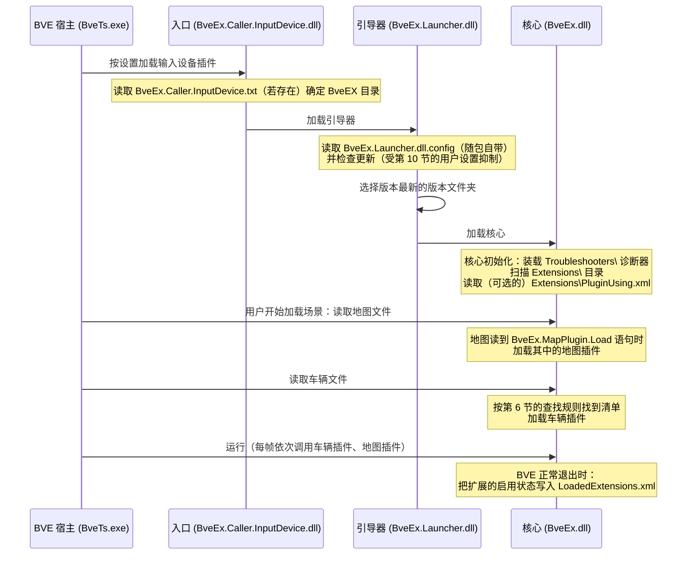
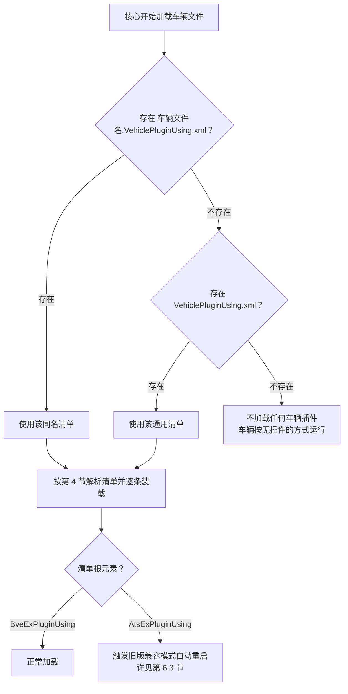

# 配置说明与插件加载

本文面向 BveEX 的普通使用者（玩家、路线与车辆配置作者），讲解 BveEX 有哪些配置文件与目录约定、各自如何书写，以及各种插件（扩展 / 车辆插件 / 地图插件）是在什么时机被加载的。

> [!NOTE]
> BveEX 没有传统意义上的图形设置窗口。点击 BVE 设置界面里的“设置”按钮打开的是“版本信息与已加载插件”窗体，主要用来查看版本与已装载的插件，其中仅扩展页签提供“启用 / 停用”右键菜单。除此之外，BveEX 的全部“配置”都通过**目录约定与 XML 清单文件**完成，不需要为它安装额外的配置编辑器。

---

## 1. 配置一览

先建立整体印象：下表列出 BveEX 涉及的所有文件与机制。带 ★ 的是**需要你手动编写**的内容，其余要么由安装包自带，要么由 BveEX 自动维护。

| 名称 | 位置 | 谁来提供 | 何时生效 | 详见 |
| :--- | :--- | :--- | :--- | :--- |
| 输入设备插件选择 | BVE 自己的设置界面 | 用户 | BVE 启动读取输入设备时 | 第 3.1 节 |
| `BveEx.Caller.InputDevice.txt` | `Input Devices\` | ★ 可选手动创建 | 入口程序启动时 | 第 3.2 节 |
| `BveEx.Launcher.dll.config` | `Input Devices\BveEx\` | 随安装包提供 | 引导器运行期间 | 第 3.3 节 |
| `Extensions\` 目录 | 版本文件夹（内含 `BveEx.dll` 的 `2.0\` 等）下 | 用户放置扩展 DLL | 核心初始化时 | 第 5 节 |
| `Extensions\PluginUsing.xml` | 同上 | ★ 可选手动创建 | 核心初始化时 | 第 5 节 |
| `<车辆文件名>.VehiclePluginUsing.xml` 或 `VehiclePluginUsing.xml` | 车辆文件同目录 | ★ 场景作者 | 车辆加载时 | 第 6 节 |
| `BveEx.MapPlugin.Load` / `LoadAssembly` 语句 | 地图文件（含被 include 的文件）内 | ★ 地图作者 | 读取地图文件时 | 第 7 节 |
| 脚本插件包清单（`BveExScriptPluginPackageManifest`） | 任意位置（由清单引用时指定） | ★ 插件作者 | 被上述清单引用时 | 第 8 节 |
| `Troubleshooters\` 目录 | 版本文件夹下 | 可选（第三方诊断器 DLL） | 核心初始化时 | 第 9 节 |
| `LoadedExtensions.xml` | 版本文件夹下 | BveEX 自动生成 | 每次核心初始化时读取 | 第 10 节 |
| 更新提醒的用户设置 | Windows 用户目录（`%LOCALAPPDATA%` 下） | BveEX 自动维护 | 启动器检查更新时 | 第 10 节 |

其中，版本文件夹、`Legacy\`、`Resources\` 等目录结构本身属于安装范畴，请先阅读《[安装与部署](installation.md)》第 5 节。

---

## 2. 加载时序总览

把“哪个配置文件在哪个环节被读取”放进启动链里看，概念会更清楚（细节见下文各节）：



---

## 3. 入口与引导器配置

### 3.1 输入设备插件选择（BVE 宿主管理）

让 BveEX 首先被加载，靠的是在 BVE 的 **设置 → 输入设备** 中选择 `BveEx.Caller.InputDevice.dll`。这项操作完全由 BVE 自己的设置界面管理，BveEX 不提供、也不代写其保存的文件。若尚未操作，请按《安装与部署》第 4 节执行。

### 3.2 `BveEx.Caller.InputDevice.txt`（可选，高级）

入口程序读取自己旁边的 `BveEx.Caller.InputDevice.txt`：若该文件存在，其**第一行**被解释为 `Input Devices\` 之下的一个**文件夹名**，BveEX 将改从该文件夹加载 `BveEx.Launcher.dll`；文件不存在时默认使用 `BveEx`。

```text
Input Devices\
├── BveEx.Caller.InputDevice.dll      ← 入口
├── BveEx.Caller.InputDevice.txt      ← 内容示例：BveEx（可换成其他文件夹名）
├── BveEx\                            ← 缺省的 BveEX 目录
└── BveEx-Test\                       ← 例如想临时改用此目录，
                                        就在 txt 第一行写 BveEx-Test
```

注意：

- 只填写文件夹名，不要写完整路径（路径由入口程序自动拼接）。
- 只识别第一行，多余的行会被忽略。
- 重定向后若目标文件夹里没有 `BveEx.Launcher.dll`，会弹错误 `CI-1`。
- 典型用途（多版本并存、备用目录）、卸载时的清理提醒见《安装与部署》第 5、9 节。

### 3.3 `BveEx.Launcher.dll.config`（随包自带，请勿删除）

引导器旁边随安装包提供 `BveEx.Launcher.dll.config`，内容是一组 .NET **程序集绑定重定向**（`<runtime>` → `<assemblyBinding>`，面向 `System.Memory`、`Microsoft.CodeAnalysis` 等运行依赖），另含“更新提醒”设置的出厂默认值。

使用者只需记住一条：**保持原样，不要删除或手改**。BveEX 对核心依赖库的定位主要靠引导器注册的程序集解析兜底（运行时从版本文件夹按文件名查找缺失的程序集），因此正常使用中不会也不需要编辑此文件。

---

## 4. 插件清单文件（`BveExPluginUsing`）公共语法

扩展、车辆插件、地图插件三类清单共用同一套语法（根元素 `BveExPluginUsing`）。地图插件清单里个别元素受限之外，本节的规则对三类全部适用。

### 4.1 基本规则

清单是一个 XML 文件，全部规则来自内嵌的 XML 架构（`BveExPluginUsingXmlSchema.xsd`）校验与解析逻辑：

```xml
<?xml version="1.0" encoding="utf-8" ?>
<BveExPluginUsing>
    <Assembly Identifier="TestPlugin" Path="BveExPlugins\CooperatingWithMapPlugin.dll" />
    <Assembly Path="BveExPlugins\SimpleAts.dll" />
    <IronPython2 PackageManifestPath="Scripts\MyPlugin\Package.xml" />
</BveExPluginUsing>
```

| 规则 | 说明 |
| :--- | :--- |
| 根元素 | 必须是 `BveExPluginUsing`。**写成旧版 AtsEX 的 `AtsExPluginUsing` 会触发旧版兼容模式自动重启**（见第 6.3 节） |
| 子元素 | 只能是 `Assembly`、`CSharpScript`、`IronPython2`、`Native`，个数不限、顺序不限（`Native` 仅限车辆清单，见第 4.3 节） |
| 路径属性 | `Path`、`PackageManifestPath` 均为相对于**清单文件所在目录**的路径（绝对路径也可用，但不推荐） |
| 大小写 | 元素名、属性名区分大小写，需与上表完全一致 |
| 编码 | 解析按 XML 声明自动识别；建议像示例一样使用 UTF-8 并写明声明 |
| 未提供清单 | 扩展可仅通过 `Extensions\` 目录自动装载；车辆 / 地图可以在没有清单的情况下按无 BveEX 插件的原样加载 |

### 4.2 元素详解

每个子元素声明“装载一件东西”。`Identifier` 属性在四种元素上均可用且可省略：

| 元素 | 必需属性 | 含义 |
| :--- | :--- | :--- |
| `Assembly` | `Path` | 加载一个 .NET 程序集（.dll），其中需包含继承 `BveEx.PluginHost.Plugins.PluginBase` 的插件类。程序集形式插件的载体，三类清单中最常用 |
| `CSharpScript` | `PackageManifestPath` | 加载一个 **C# 脚本插件包**，路径指向其脚本包清单（见第 8 节） |
| `IronPython2` | `PackageManifestPath` | 加载一个 **IronPython 2 脚本插件包**，格式与 C# 脚本包清单相同，语言由该元素决定 |
| `Native` | `Path64`、`Path32` | 加载一个**遵循传统 ATS 接口（导出 `GetPluginVersion` 的 Win32 DLL）**的原生插件，仅车辆清单可用，主要用于兼容旧版 ATS 插件 DLL |

`Identifier` 属性的用途与限制：

- 省略时自动分配随机 GUID。
- 该值会成为插件在框架内的**唯一标识**（`PluginBase.Identifier`），简单来说就是插件之间互相引用时的“名字”，其他插件可按它找到你的插件实例。因此自定义时请确保在本次加载中不与其他插件重复。
- 无报错风险点：重复标识符不会导致加载失败，而是**后装载的插件覆盖先装载的**（键相同的项被替换）。若看到“只加载了一份”，可先检查是否原本写出了重名 `Identifier`。
- 一个程序集里定义了**多个**插件类时不能再显式指定 `Identifier`（会报“程序集包含多个插件类，无法设定 Identifier”），此时应省略它让框架自动分配。

### 4.3 `Native` 元素细节（仅车辆清单）

- 架构要求 `Path64`、`Path32` 两个属性**都必须写**（即使其中一个暂无对应文件）；实际只按当前 BVE 进程位数加载其中一个（64 位进程用 `Path64`）。
- 原生 DLL 必须导出 `GetPluginVersion` 函数且返回值恰为 `0x20000`（传统 BVE ATS 插件 API 版本），否则加载失败并弹窗显示原因。其余标准导出函数（`Load`、`Elapse`、`SetPower` 等）可有可无，缺失的函数对应的行为会被跳过。
- 旧版 ATS 插件 DLL 通常已按位数分文件夹存放（如 `Ats\x64\`、`Ats\x86\`），与此属性格式天然吻合，参考官方示例（第 6.4 节）。

---

## 5. 扩展的部署与配置

“扩展”是随 BveEX 本体一起提供的功能部件（如内置的场景诊断等，官方核心扩展已随安装包附带）。使用者侧要做的事情最少：

1. 把扩展 DLL 放进版本文件夹下的 `Extensions\`（`<版本文件夹>\Extensions\`）。目录若不存在，核心启动时会自动创建。
2. 启动时核心会**递归扫描** `Extensions\` 下所有 `.dll` 并尝试装载，因此支持按子目录分类存放。

装载一个 `Extensions\` 里的 DLL 时的判别顺序（由此衍生出几种常见现象）：

| 情形 | 行为 |
| :--- | :--- |
| DLL 完全不引用 `BveEx.PluginHost.dll` | **静默跳过**（普通依赖库可以顺手放进 `Extensions\`，不会报错） |
| 引用了 `BveEx.PluginHost.dll`，但里面没有插件类 | 弹出错误“找不到继承 `PluginBase` 的类” |
| 里面的插件类声明的类型不是“扩展” | 弹出错误“试图把 车辆插件 作为 扩展 加载”之类的类型不匹配信息（即 DLL 放错了归属地） |

### `Extensions\PluginUsing.xml`（可选清单）

`Extensions\` 的自动扫描只覆盖程序集形式的扩展。若要在扩展目录中放置脚本插件包，或需要显式控制装载条目，可手动创建 `Extensions\PluginUsing.xml`，语法完全遵循第 4 节——但注意此清单**不能**包含 `Native` 元素（原生插件只能作为车辆插件使用）：

```xml
<?xml version="1.0" encoding="utf-8" ?>
<BveExPluginUsing>
    <Assembly Path="BveEx.Extensions.Something.dll" />
    <CSharpScript PackageManifestPath="Scripts\ExtensionScripts\Package.xml" />
</BveExPluginUsing>
```

核心初始化时，目录扫描结果与该清单的条目会一起装载；已加载的扩展可在“版本信息与已加载插件”窗体的扩展页签中查看。该页签支持右键“启用 / 停用”一个个别扩展（仅当扩展声明了可停用能力 `ITogglableExtension`），停用状态会由第 10 节的状态文件在 BVE 退出时保存、下次启动恢复。

> [!WARNING]
> 不要把车辆插件、地图插件 DLL 放进 `Extensions\`。它们的核心代码属于别的插件类型，会被按“扩展”解析并以类型不匹配错误弹窗。

---

## 6. 车辆插件的加载配置

### 6.1 清单文件的查找规则

核心在加载车辆时会到**车辆文件所在目录**按以下顺序查找清单，**用第一个存在的，其余忽略**（不会两份合并）：



实用结论：

- 场景里有多辆车、各自需要不同插件时，给每份车辆文件配一份同名清单最稳妥。
- 整个目录共用一套插件时，写一份 `VehiclePluginUsing.xml` 即可。
- 车辆清单允许列出**不引用 `BveEx.PluginHost.dll` 的普通程序集**（会被静默跳过），所以把插件依赖的公共库也写进清单是允许的；但把车辆清单部分地当“目录扫描”用会降低可读性，建议只为插件本体开列。

### 6.2 车辆清单示例

来自官方示例场景（`Scenarios\BveEx.Samples\Vehicles\Basic\Vehicle_Simple.VehiclePluginUsing.xml`）：

```xml
<?xml version="1.0" encoding="utf-8" ?>
<BveExPluginUsing>
	<Assembly Path="BveExPlugins\SimpleAts.dll" />
	<Assembly Path="BveExPlugins\StateViewer.dll" />
</BveExPluginUsing>
```

### 6.3 旧版（AtsEX）清单的自动兼容

若根元素写成旧版 AtsEX 的 `AtsExPluginUsing`（还有旧版脚本包清单形态，见第 8 节提示），BveEX 不会报错，而是**自动以旧版兼容模式重启 BVE**，把场景交给旧版 AtsEX 兼容环境处理。该机制的完整说明（含 `/legacy` 手动启动方式）见《安装与部署》第 8 节。

如果一遍遍地看到 BVE 意外重启，通常说明场景里混有旧版清单文件，可对照第 4 节检查根元素。

### 6.4 原生插件（旧版 ATS DLL）的清单示例

官方示例场景 `Scenarios\BveEx.Samples\Vehicles\E217r\` 中的清单大量使用了 `Native` 元素，为旧版 ATS 插件留出接口：

```xml
<?xml version="1.0" encoding="utf-8" ?>
<BveExPluginUsing>
	<Native Path64="Ats\x64\EB.dll" Path32="Ats\x86\EB.dll" />
	<Native Path64="Ats\x64\E217_ATC_ATS.dll" Path32="Ats\x86\E217_ATC_ATS.dll" />
</BveExPluginUsing>
```

> [!NOTE]
> 车辆文件本身不需要任何配置改动。清单只负责“额外加上哪些 BveEX 车辆插件”：旧版 ATS 插件 DLL 保持原位，在清单里引用即可。

---

## 7. 地图插件的加载配置

地图插件不是靠独立的配置文件自动装载，而是**由地图文件中的语句**触发。核心在读取地图文件的过程中拦截以下语句：

| 语句 | 作用 |
| :--- | :--- |
| `BveEx.MapPlugin.Load('<清单文件名>');` | 读取指定位置的一张 `BveExPluginUsing` 清单，装载其中除 `Native` 外的全部条目 |
| `BveEx.MapPlugin.LoadAssembly('<程序集路径>');` | 直接装载一个程序集形式（.dll）的地图插件，跳过清单 |
| `BveEx.MapPlugin.LoadAssembly('<程序集路径>', '<Identifier>');` | 同上，并显式指定插件 `Identifier` |

关键点：

- **路径相对于“写这道语句的那个地图文件”**，而不一定是主地图文件：清单路径在语句中给出，清单内条目的路径又相对于清单文件，两者都以包含该语句的地图文件所在目录为基准往下展开（经 `include` 引入的子地图文件里的语句也一样）。
- 清单语法与第 4 节完全相同，但有两点差异提醒：
  - **不允许 `Native` 元素**（原生插件只能作为车辆插件，出现即报错）；
  - 清单里列出的每个程序集**必须是真正的 BveEX 地图插件**（引用 `BveEx.PluginHost.dll` 且含地图插件类），否则报“找不到继承 `PluginBase` 的类”——没有第 6.1 节车辆清单那种静默跳过。
- 语句于地图读取中**按出现顺序即时生效**；地图读取结束后（`LoadingCompleted`）监听即解除，因此请把语句写在正常的地图正文（含 include）中。
- 与旧版 AtsEX 相同的根元素兼容规则同样适用（第 6.3 节）。加载失败会在 BVE 的加载进度窗体显示清单文件名与行号。

官方示例场景 `Scenarios\BveEx.Samples\Maps\Basic\Samples\MapStatements\` 的最小对照（地图文件片段）：

```text
BveTs Map 2.02:utf-8

BveEx.MapPlugin.Load('MapPluginUsing.xml');
// -- 或者 --
// BveEx.MapPlugin.LoadAssembly('MapPlugins\MapStatementTest.dll');
```

配套的 `MapPluginUsing.xml`：

```xml
<?xml version="1.0" encoding="utf-8" ?>
<BveExPluginUsing>
	<Assembly Path="MapPlugins\MapStatementTest.dll" />
</BveExPluginUsing>
```

场景文件的典型组织由此一目了然：

```text
Scenarios\<场景文件夹>\
├── 地图.txt
│   └── 内含 BveEx.MapPlugin.Load('MapPluginUsing.xml');
├── MapPluginUsing.xml          ← 清单可以任意命名，在语句中引用即可
├── MapPlugins\
│   └── MapStatementTest.dll    ← 清单中引用的插件 DLL
└── Vehicles\
    ├── 我的车辆.txt
    └── 我的车辆.VehiclePluginUsing.xml
```

---

## 8. 脚本插件包清单（`BveExScriptPluginPackageManifest`）

`CSharpScript`、`IronPython2` 两种清单元素都指向一个**脚本插件包清单**，描述包信息与各生命周期脚本的位置。文件名任意，常用 `Package.xml`。语法如下（示例按内嵌架构 `BveExScriptPluginPackageManifestXmlSchema` 语法撰写）：

```xml
<?xml version="1.0" encoding="utf-8" ?>
<BveExScriptPluginPackageManifest>
    <Info>
        <Title>我的脚本插件</Title>
        <Version>1.0</Version>
        <Description>一句话说明</Description>
        <Copyright>版权信息</Copyright>
    </Info>
    <Scripts>
        <Constructor Path="Constructor.cs" />
        <Dispose Path="Dispose.cs" />
        <OnScenarioCreated Path="OnScenarioCreated.cs" />
        <OnStarted Path="OnStarted.cs" />
        <Tick Path="OnTick.cs" />
    </Scripts>
</BveExScriptPluginPackageManifest>
```

规则要点：

| 部分 | 规则 |
| :--- | :--- |
| `Info` | 必有；`Title` 必填，`Version` / `Description` / `Copyright` 可省略。这些文字会出现在“版本信息与已加载插件”窗体中 |
| `Scripts` | 必有，其子元素**全部可省略**；若全部省略，该脚本包装载得到的是一个“什么也不做”的插件 |
| 子元素顺序 | XSD 要求按 `Constructor`、`Dispose`、`OnScenarioCreated`、`OnStarted`、`Tick` 的固定顺序排列，不用的直接省略即可，**不要随意调换顺序** |
| `Path` 属性 | 每个脚本子元素的 `Path` 必填，相对于**本清单文件所在目录** |
| `Scripts` 的 `UseBveExExtensions` 属性 | XSD 中存在该布尔属性（默认 `true`），但当前版本源码未读取、无实际效果（见下方提示） |

> [!NOTE]
> `UseBveExExtensions` 目前是一个“只在架构校验时被接受”的属性：内嵌 XSD 中定义了它（默认值 `true`），但当前版本源码并没有读取该值。按默认写法（不写）即可，效果与写 `true` 相同。

> [!WARNING]
> 若脚本包清单根元素写成旧版 AtsEX 的 `AtsExScriptPluginPackageManifest`，与第 6.3 节一样会触发旧版兼容模式自动重启。

---

## 9. 诊断器目录（`Troubleshooters\`）

诊断器（Troubleshooter）是实现了 `BveEx.PluginHost.Troubleshooting.ITroubleshooter` 接口的 DLL，部署在版本文件夹下的 `Troubleshooters\`（目录由核心启动时自动创建，缺省为空）。核心启动时装载该目录**顶层的**全部 `.dll`，在以后每次发生异常时调用其分析逻辑，把“常见异常的原因与对策”补充进错误对话框。

使用者注意两点：

1. 该目录不递归扫描，子目录中的 DLL 不会装载；
2. 装载失败（例如 DLL 损坏、缺少依赖）会被**静默忽略**，不影响 BveEX 启动——如果怀疑某个诊断器没生效，多半是它自身装载失败了。

---

## 10. 自动生成的状态文件

以下文件不需要手写，但了解它们有助于排错与干净卸载。

### 10.1 `LoadedExtensions.xml`

版本文件夹下由 BveEX 自主维护的扩展状态文件：

```xml
<?xml version="1.0" encoding="utf-8"?>
<LoadedExtensions>
    <Extensions>
        <Extension Path="BveEx.Extensions.Something.dll" Class="BveEx.Extensions.Something.SomethingExtension" IsEnabled="true" />
    </Extensions>
</LoadedExtensions>
```

- **何时写入**：BVE 正常退出（核心按正常流程销毁）时。
- **内容**：仅记录实现了**可停用**能力（`ITogglableExtension`）的扩展的启用状态，其开关就是版本信息窗体扩展页签的右键“启用 / 停用”菜单（见第 5 节）。文件按“DLL 相对路径 + 类全名”匹配。缺省安装的官方扩展多数不提供停用开关，此时文件内容为空列表。
- **何时读取**：每次核心初始化装载扩展之后，把保存的启用值套回各扩展。
- **可以删除**：文件读取失败或不存在时按“全部默认启用”处理，下次退出时重新生成。

### 10.2 更新提醒的用户设置

启动器每次启动会向 GitHub 检查 BveEX 新版本（联网失败时静默跳过）。当你在更新提示窗体中勾选了“暂时不再提示”时，BveEX 会把当前时间写入一个**仅限当前 Windows 用户的设置文件**（.NET 标准的 `user.config`，位于 `%LOCALAPPDATA%` 下由发布者/程序集名字命名的多级子目录中，与你安装 BveEX 的 BVE 目录无关）：

- 该记录的作用是**12 小时内**不再联网检查更新；超过 12 小时后恢复正常检查。
- 若系统时钟被回拨导致时间倒流，下次启动时会自动重置记录，不影响使用。
- 卸载 BveEX 时可顺手删除相关的用户设置文件夹（见《安装与部署》第 9 节第 5 步）。

---

## 11. 常见配置错误速查

各错误一般在 BVE 的加载进度窗体或独立对话框中显示，并给出清单文件（或 DLL）名与出错位置。下表按“现象 → 原因 → 处理”归纳（错误文案为意译，以实际弹窗为准）：

| 现象（文案关键词） | 常见原因 | 处理 |
| :--- | :--- | :--- |
| “插件列表 XML 的架构格式错误” | 元素 / 属性名拼写、区分大小写错误；脚本包清单中 `Scripts` 子元素顺序不符合 XSD 定序 | 对照第 4、8 节的示例逐项核对 |
| BVE 未开始加载场景就重启（旧版兼容模式） | 清单根元素写成了 `AtsExPluginUsing`（或脚本包清单根为 `AtsExScriptPluginPackageManifest`） | 需走 BveEX 本体的，将根元素改回 `BveExPluginUsing` |
| “目标平台不正确，或者它不是 .NET 程序集……”（清单中的 `Assembly` 条目） | DLL 位数与 BVE 进程不一致；或 DLL 是面向另一个 BVE 大版本（5 / 6）的构建产物 | 换用与 BVE 位数、版本匹配的 DLL（该弹窗会同时提示另一种位数的可能性） |
| “原生插件只能作为车辆插件使用” | 在扩展清单或地图清单中写了 `Native` 元素 | 把 `Native` 条目移到车辆清单 |
| 加载原生插件时报缺少 `GetPluginVersion` 或版本不受支持 | 原生 DLL 不是传统 ATS 接口 DLL，或版本号不是 `0x20000` | 确认该 DLL 确为旧版 ATS 插件（BVE 官方标准接口） |
| “找不到继承 `PluginBase` 的类”（地图清单） | 清单里列的 DLL 不是 BveEX 地图插件（如普通库） | 只列插件本体；普通依赖库放在插件同目录由 .NET 自动解析 |
| “程序集包含多个插件类，无法设定 Identifier” | 同一 DLL 含多个插件类，却在清单里给它指定了 `Identifier` | 删除该 `Identifier` 属性 |
| “试图把 ×××作为 ×××加载” | 插件类型与清单所属类型不符（如车辆插件放进 `Extensions\`） | 把 DLL 挪到与其类型匹配的清单 |
| “以车 Xxx 版本为准的旧版本组件不支持” | 插件引用的 `BveEx.PluginHost.dll` 版本过低（当前最低要求 0.17） | 向插件作者索取适配当前 BveEX 的版本 |
| 某插件“不见了”且无报错 | 清单条目间 `Identifier` 重名，后装载的覆盖了前者；同名车辆清单互相竞争（同目录同名优先） | 检查 `Identifier` 与清单文件命名（第 4.2、6.1 节） |
| 清单文件完全没生效 | 文件放错目录；车辆清单文件名与车辆文件不一致；地图语句路径相对基准搞错 | 回顾第 5、6、7 节的位置要求 |

进一步的症状与错误代码（`CI-` / `L-` / `E-` 系列）见《[安装与部署](installation.md)》第 10 节与《[故障排除](troubleshooting.md)》。

---

## 相关文档

- 《[安装与部署](installation.md)》——目录结构、安装与卸载、旧版兼容模式
- 《[故障排除](troubleshooting.md)》——日志与诊断方法
- 《[插件开发快速入门](../plugin-development/getting-started.md)》——如何编写自己的 BveEX 插件
- 《[官方示例项目深度解析](../plugin-development/samples-walkthrough.md)》——本文所引官方示例的逐行拆解
