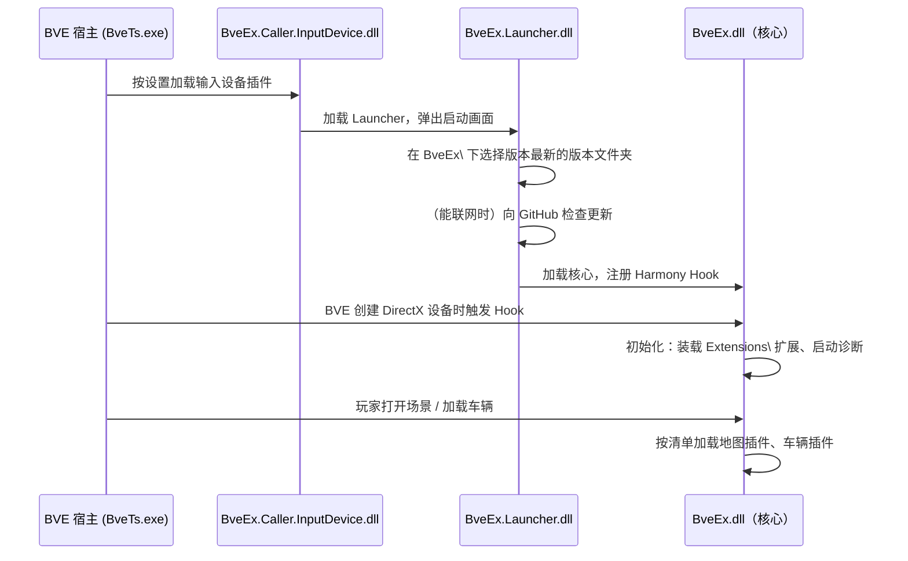
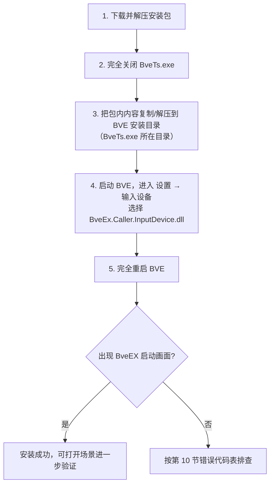

# 安装与部署

本文面向 BveEX 的普通使用者（玩家、路线与车辆配置作者），讲解如何把 BveEX 安装到 BVE Trainsim 中、需要哪些前置环境，以及如何验证安装是否成功。

> [!NOTE]
> BveEX（旧名 AtsEX）是一个以**输入设备插件**形式进入 BVE 的扩展框架。它不修改 `BveTs.exe` 本体：只需把文件放进 BVE 的插件目录，再让 BVE 选中它即可。

---

## 1. 安装原理速览

先认识这条“启动链”，排查安装问题时会更有的放矢。BveEX 由三段程序逐级加载：

| 程序集 | 安装后位置 | 角色 |
| :--- | :--- | :--- |
| `BveEx.Caller.InputDevice.dll` | `Input Devices\` | 入口。BVE 把它当作**输入设备插件**加载 |
| `BveEx.Launcher.dll` | `Input Devices\BveEx\` | 引导器：显示启动画面、检查更新、选择核心版本、向 BVE 注入 Hook |
| `BveEx.dll` 等 | `Input Devices\BveEx\2.0\`（版本文件夹） | 核心本体：挂接 BVE 内部，加载扩展与各类插件 |

各阶段的发生时机如下（依据 `BveEx.Caller.InputDevice`、`BveEx.Launcher`、`BveEx` 三个项目的源码）：



因此，安装可归纳为三件事：**放对文件 → 让 BVE 选中 `BveEx.Caller.InputDevice.dll` → 完全重启 BVE**。

---

## 2. 前置环境

| 项目 | 要求 | 说明 |
| :--- | :--- | :--- |
| BVE Trainsim | 5.8 / 6.0 正式版 | BveEX 依靠内置的“类型解析配置”读取 BVE 内部类型。当前源码（`Libs/BveTypes/WrapTypes/`）仅内置 `5.8.7554.391` 与 `6.0.7554.619` 两个版本，且默认不允许用相邻版本的配置代用 |
| 操作系统 | Windows | 与 BVE 官方要求一致即可 |
| 运行时 | .NET Framework 4.8 | 本仓库所有程序集均以 net48 为目标框架；较新的 Windows 一般已预装，未安装时可在微软官网免费获取 |
| 程序位数 | 32 / 64 位 BVE 均可 | BveEX 随 BVE 进程的位数运行（例如无 ATS 插件时使用的占位组件，会按位数选用 `BveEx.DummyAts.x86.dll` 或 `BveEx.DummyAts.x64.dll`） |
| 网络 | 可选 | 仅用于启动时的更新检查（访问 GitHub Releases）；断网时检查会静默失败，不影响启动 |

> [!WARNING]
> 若 BVE 的版本不在上表所列两个内部版本之列（如 5.8 之前的旧 5.x 版本、6.0 之后的更新版等），启动时会因找不到匹配的类型解析配置而无法启用 BveEX，请改用受支持的正式版。

---

## 3. 下载

- 官方发布页：[GitHub Releases](https://github.com/automatic9045/BveEX/releases)
- 项目主页与在线说明：<https://bveex.okaoka-depot.com>

发布资产分为两种包，任选其一下载解压：

| 包 | 内容 |
| :--- | :--- |
| **本体包**（`BveEX_…`） | 仅 `Input Devices\` 下的 BveEX 文件结构 |
| **附带示例场景包**（`BveEX_WithScenarios_…`） | 本体包内容 + `Scenarios\BveEx.Samples\` 官方示例场景（内含可直接体验的车辆插件、地图插件样品） |

> [!NOTE]
> BveEX 本体采用 [PolyForm Noncommercial License 1.0.0](https://github.com/automatic9045/BveEX/blob/main/LICENSE.md)（非商业许可）。旧版兼容模式使用的旧版 AtsEX 组件按其自身条款另案处理（项目 README 注明“另案处理”，详见官网）。许可与说明文档会随安装包一同提供。

---

## 4. 安装步骤



执行要点：

1. **解压目标是 BVE 根目录**（`BveTs.exe` 所在文件夹），让包里的 `Input Devices\` 与 BVE 原有的 `Input Devices\` 目录合并。不要把整个包解压到 `Input Devices\` 内部，否则层级会差一级。
2. 若 BVE 安装在 `C:\Program Files` 之下，复制文件可能需要管理员权限（这是 Windows 的常规文件操作要求，与 BveEX 无关）。
3. 安装不会改动 BVE 本体文件；`Input Devices\` 下原有的其他输入设备插件可以继续保留。

### 启用与重启

在 BVE 的设置界面中，把“输入设备”插件选择为 `BveEx.Caller.InputDevice.dll` 并保存。该操作在 BVE 自己的设置界面完成，BveEX 不会代写或替代这个界面。

> [!NOTE]
> 若 BveEX 在 BVE 窗体已经打开的状态下才被实例化（例如刚在设置页切换了输入设备插件），会弹出提示“需要重启 BVE 才能生效”：选“是”会立即关闭 BVE，重启后即可生效；选“否”则当前会话中 BveEX 不启用（提示中含错误代码 `E-4`）。

### 验证安装的两个标志

1. **启动画面**：BVE 读取输入设备插件时，屏幕上出现 BveEX 启动画面（由 `BveEx.Launcher.SplashScreen.exe` 进程显示），依次提示“查找本体”“检查更新”“启动中”等进度。启动画面一闪而过属正常现象。
2. **版本信息窗体**：在 BVE 设置里点击输入设备插件对应的“设置”按钮（该按钮由 BVE 宿主提供），BveEX 会打开“Version Information and Loaded Plugins”（版本信息与已加载插件）窗体，显示 BveEX 版本号，并按 扩展 / 车辆插件 / 地图插件 分类列出当前已加载的插件。能看到该窗体，即说明核心已成功注入。

---

## 5. 安装后的目录结构

以下是本体包解压到 BVE 根目录后的典型结构（依据 `package.bat` 与各项目的构建后复制脚本还原；具体文件清单以你下载的版本为准）：

```text
<BVE 安装目录>\
├── Input Devices\
│   ├── BveEx.Caller.InputDevice.dll          ← 入口（输入设备插件）
│   └── BveEx\
│       ├── BveEx.Launcher.dll                ← 引导器
│       ├── BveEx.Launcher.dll.config         ← 程序集绑定重定向配置（请勿删除）
│       ├── BveEx.Launcher.SplashScreen.exe   ← 启动画面进程
│       ├── BveEx.Diagnostics.dll             ← 错误 / 诊断对话框
│       ├── AtsEx.Launcher.dll                ← 旧版 (AtsEX) 兼容引导器
│       ├── Legacy\                           ← 旧版兼容核心程序集（legacy 模式使用）
│       └── 2.0\                              ★ 版本文件夹（名称含 "."，内含 BveEx.dll）
│           ├── BveEx.dll                     ← 核心
│           ├── BveEx.PluginHost.dll          ← 插件宿主契约（插件开发者引用）
│           ├── BveEx.Scripting.dll           ← 脚本插件运行时
│           ├── BveTypes.dll 等               ← BVE 类型解析等运行依赖
│           ├── BveEx.DummyAts.x86 / x64.dll  ← 无 ATS 插件车辆的占位组件
│           ├── Resources\                    ← 本地化资源
│           ├── Extensions\                   ← 扩展目录（官方核心扩展已随包附带）
│           └── Troubleshooters\              ← 诊断器装载目录（首次启动自动创建，可为空）
└── Scenarios\                                ← 附带示例场景包才有
    └── BveEx.Samples\ ...
```

补充说明：

- 版本文件夹中未列出的其余文件，均为 .NET 运行依赖库与本地化资源，请保持原样，不要随意删改。
- `Extensions\`、`Troubleshooters\` 若被删除，BveEX 下次启动时会自动重建空目录，不会报错。

### （高级）用重定向文件自定义 BveEX 目录

入口程序启动时会读取自己旁边的 `BveEx.Caller.InputDevice.txt`：若该文件存在，其**第一行**被解释为位于 `Input Devices\` 下、存放 BveEX 的**文件夹名**（缺省相当于 `BveEx`）。利用它可实现新旧版本并存、备用目录等特殊布局。若重定向后找不到 `BveEx.Launcher.dll`，会报错误 `CI-1`（见第 10 节）。

---

## 6. 升级与多版本并存

版本文件夹的挑选规则（源码 `BveEx.Launcher` 的 `VersionSelector`）：

- 候选 = `Input Devices\BveEx\` 下**名称含 `.`** 且**内部含 `BveEx.dll`** 的子文件夹；
- 自动选用程序集版本号**最高**的一个；当前版本没有手动挑选入口。

由此得到几个实用结论：

- **正常升级**：用新包覆盖安装即可。旧版本文件夹留下也无妨（不会被使用，介意体积可手动删除）。
- **回退旧版**：需要手动删除（或移走）较新的版本文件夹——现行代码总是自动选最新的。
- **不要混装**：不要把不同发布批次的 `BveEx.Launcher.dll` 与版本文件夹拼凑在一起。核心程序集标有其支持的引导器互版本号（当前为 4），不匹配时会报“被加载的 BveEX Launcher 不受当前 BveEX 支持”。因此，升级时请**整包覆盖**，不要只替换一半文件。

> [!WARNING]
> 若怀疑旧安装中已有文件损坏或被不当改动，覆盖升级不一定能恢复。最稳妥的做法是：先删除（或改名备份）`Input Devices\BveEx\` 整个文件夹，再解压新包。

---

## 7. 各类插件的部署方式（概览）

安装好 BveEX 之后，不同类型的内容放置位置不同（语法细节见各专篇文档）：

| 内容类型 | 部署方式 |
| :--- | :--- |
| BveEX 扩展 | 放入版本文件夹旁的 `Extensions\`（启动时递归扫描其中所有 `.dll`），或在 `Extensions\PluginUsing.xml` 中声明 |
| 车辆插件 | 在**车辆文件（vehicle 文件）同目录**放置 `<车辆文件名>.VehiclePluginUsing.xml`（或通用的 `VehiclePluginUsing.xml`），根元素为 `BveExPluginUsing`，内可声明程序集、C# 脚本、IronPython2 脚本与原生（Native）插件 |
| 地图插件 | 在地图文件中使用 `BveEx.MapPlugin.Load('MapPluginUsing.xml');` 或 `BveEx.MapPlugin.LoadAssembly('...');` 语句；清单文件 / 程序集与地图文件放在同一目录 |
| 诊断器 | 实现了 `ITroubleshooter` 接口的 `.dll` 放入版本文件夹下的 `Troubleshooters\` |

> [!NOTE]
> 清单根元素若写作 `AtsExPluginUsing`（旧版 AtsEX 清单格式），BveEX 不会按普通清单处理，而是自动以旧版兼容模式重启 BVE（见第 8 节）。

---

## 8. 旧版兼容模式（Legacy / AtsEX）

BveEX 为旧版 **AtsEX** 插件提供兼容层：

- 以命令行参数 `/legacy` 启动 BVE 时（或 BveEX 检测到场景 / 车辆使用旧版 AtsEX 清单而自动重启时），BveTs.exe 会重启并从 `Input Devices\BveEx\Legacy\` 载入旧版核心；该模式不做升级检查。
- 旧版兼容所需的程序集已随官方发布包提供。从旧 AtsEX 环境迁移过来的场景 / 车辆一般**无需额外操作**即可运行。
- 旧版模式的授权与更新政策与本体不同（项目 README 注明“另案处理”），详见官网说明。

该模式属于自动兜底机制；建议作者逐步将插件迁移到 BveEX 本体，以获得完整的功能支持。

---

## 9. 卸载

1. 完全关闭 BVE；
2. 删除 `Input Devices\BveEx\` 文件夹与 `Input Devices\BveEx.Caller.InputDevice.dll`（若做过重定向，还包括 `BveEx.Caller.InputDevice.txt`）；
3. 若安装过示例场景包，删除 BVE 目录下的 `Scenarios\BveEx.Samples\`；
4. 在 BVE 设置中把输入设备插件改回原先使用的设备或留空；
5. （可选）删除当前 Windows 用户 `%LOCALAPPDATA%` 下“BveEX Launcher”的用户设置（其中仅保存“更新提醒暂不再弹出”的一次性记录）。

---

## 10. 安装期常见错误代码速查

错误代码来自源码中的错误对话框：`CI-` 前缀来自入口程序，`L-` 前缀来自引导器（`BveEx.Launcher`），`E-` 前缀来自核心（`BveEx`）。

| 代码 | 出现环节 | 含义与处理建议 |
| :--- | :--- | :--- |
| `CI-1` | 入口加载 | 找不到 `BveEx.Launcher.dll`。检查 `Input Devices\BveEx\` 是否完整；若配置了重定向文件（第 5 节），核对其中路径 |
| `L-1` | 引导器 | BveEX 没有在 BVE 进程内运行（入口程序集为空）。请务必通过 BVE 启动，不要直接双击、独立运行 BveEX 的任何 DLL |
| `L-2` | 引导器 | 当前进程内检测不到 BVE 本体（原因同上，如被非 BVE 程序加载）。以输入设备插件形式由 BveTs.exe 正常加载即可 |
| `L-3` | 引导器 | 启动链指定的本体文件夹不存在（正常安装不会出现）。请重新完整安装 |
| `L-4` | 引导器 | `BveEx\` 下找不到任何候选版本文件夹（内含 `BveEx.dll` 且名称含 `.`）。多为解压层级放错，按第 4 节重新解压 |
| `E-3` | 核心启动 | 检测到进程内存在同名重复的程序集（常见于其他插件自带的旧版本库混进 BVE 进程）。官方提示为“安装似乎未完成，请重新安装”；也可移除冲突方或向插件作者反馈 |
| `E-4` | 核心启动 | BveEX 未能在本会话启用（见第 4 节“启用与重启”）。完全重启 BVE 即可 |
| —（无代码）| 核心启动 | “被加载的 BveEX Launcher 不受当前 BveEX 支持”：引导器与版本文件夹互版本号不匹配。整包覆盖安装（第 6 节） |
| —（无代码）| 核心启动 | BVE 版本与类型解析配置不匹配（见第 2 节警告）。更换为受支持的 BVE 5.8 / 6.0 正式版 |

更多运行期问题（含日志与诊断方法）见《[故障排除](troubleshooting.md)》。

---

## 相关文档

- 《[配置说明与插件加载](configuration.md)》——扩展 / 插件清单文件（`PluginUsing.xml`）的完整语法
- 《[插件开发快速入门](../plugin-development/getting-started.md)》——开发与调试 BveEX 插件
- 《[框架整体设计与分层架构](../core-development/architecture-overview.md)》——第 1 节启动链的深度解析
