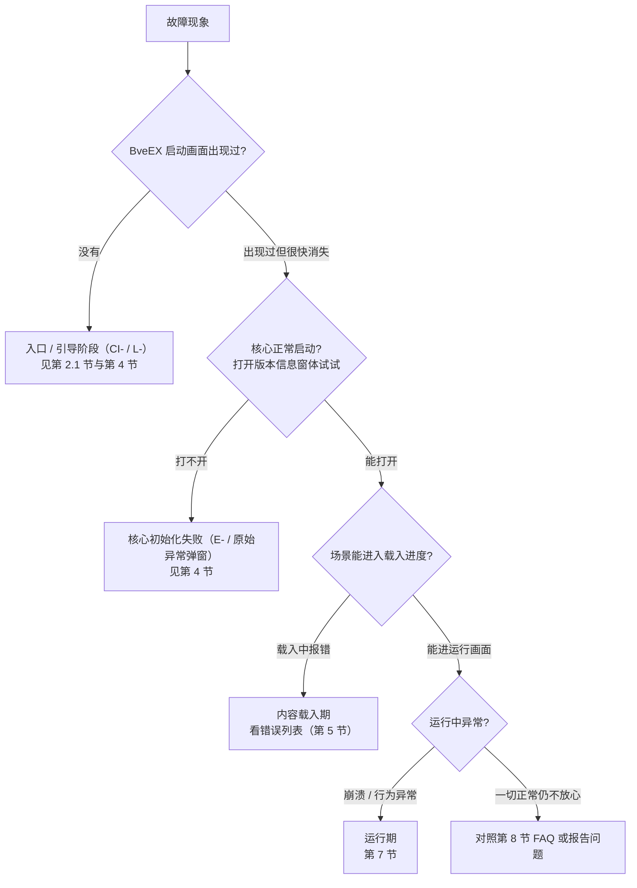

# 故障排除

本文面向 BveEX 的普通使用者（玩家、路线与车辆配置作者），讲解 BveEX 出问题时如何定位与处理：错误信息会出现在哪里、错误代码各代表什么、内容装载与运行阶段的常见错误怎么解法。

> [!NOTE]
> BveEX **不生成日志文件**。当前版本源码中没有任何日志写出逻辑，所有诊断信息都通过**屏幕上的弹窗与列表**呈现。因此本文讲的“日志查看”，实际上是教你从 BveEX 的各个错误提示窗口里读出有效信息。

前置知识：本文与《[安装与部署](installation.md)》《[配置说明与插件加载](configuration.md)》互相衔接——前两篇各有一处“常见错误速查”（安装期、配置期），本文第 4、5 节是它们的汇总与展开，建议手边备着。

---

## 1. 故障信息从哪里来

排查前先认识 BveEX 报告故障的几条“通道”。它们分别由不同阶段的程序产生，含义完全不同：

| 通道 | 长相 | 产生者 | 什么情况下出现 |
| :--- | :--- | :--- | :--- |
| 带错误代码的提示 | 引导器（`L-`）与核心（`E-`）使用同一个结构化错误对话框：左上角有大字标题，下方依次为**場所**、**内容**、**対処方法**（日英混排）三栏文本框，右下角有 **中断 / Abort**、**無視 / Ignore**、可选的 **(?) ヘルプ** 按钮；入口（`CI-`）则用系统级 MessageBox | 引导、核心初始化 | 启动与初始化失败等致命问题（详见第 4 节） |
| 载入进度窗体中的**错误列表** | BVE 自带的“シナリオを読み込んでいます…”窗体展开为约 800×500 大小的错误清单，按行显示：序号、内容、文件名、行号、列号 | BVE 宿主界面，内容由 BveEX 写入 | 读取场景、车辆、地图、插件清单或脚本期间出错但不必立刻中断时（详见第 5 节） |
| 原始异常文本弹窗 | 标题“読込エラー - BveEX Caller”或“未处理的异常”之类，正文是一整段异常类名 + 消息 + 调用堆栈 | 入口程序兜底捕错、插件装载的兜底捕错 | 更底层的失败，如按 CI-1 处理后又加载失败、BVE 版本不受支持、单个插件抛出非包装异常等 |
| 启动画面的进度文字 | `BveEx.Launcher.SplashScreen.exe` 小窗，依次显示“查找 BveEX”“检查更新”“启动中”等 | 引导器 | 每次正常启动都会出现；进度文字变化异常也是排查线索（详见第 2 节） |
| “版本信息・插件一览”窗体 | 分类列出已装载的扩展 / 车辆插件 / 地图插件，含文件名、名称、版本、描述 | 核心 | 何时打开都可用：确认 BveEX 版本号、插件是否真的被装上了（详见第 6 节） |

错误代码与官网帮助页是一一对应的：结构化错误对话框底部会预告“`[(?) ヘルプ]` 会打开 `https://bveex.okaoka-depot.com/support/errors#<错误代码>`”。点按钮前会先弹确认框（防止误点），选“是”才打开浏览器。

---

## 2. 通用排查流程

BveEX 的故障，按发生时段大致分为四个阶段，先判断卡在哪一段，再对症下药：

### 2.1 连启动画面都没出现时

1. 确认 BVE 的“输入设备”设置仍选中 `BveEx.Caller.InputDevice.dll`（升级或动过文件后可能丢失）；
2. 确认改动过文件后**完全重启了 BVE**（BveEX 只在 BVE 读取输入设备插件的瞬间被加载，已在运行中的 BVE 不会中途生效）；
3. 若改动过目录结构或 `BveEx.Caller.InputDevice.txt`，先按《安装与部署》第 5 节恢复默认布局再试。

### 2.2 启动画面卡住 / 消失

启动画面是个独立小进程，其进度文字由引导器远程更新。两个行为细节（均可在源码中核实）：

- 进度文字超过 6 秒没有更新，画面会自动改显示“启动比通常更花时间”之类的提示；
- 超过 15 秒完全无进度更新，启动画面会**自行退出**，但引导器仍在后台运行——因此“画面消失但 BVE 卡住不能载入场景”不代表 BveEX 退出，只说明引导器长时间没有报告新进度。

正确的判断方法：等 BVE 主窗体出现后，打开“版本信息・插件一览”（第 6 节）。能打开就说明核心已成功注入；打不开则属启动失败。

> [!NOTE]
> 引导器的更新检查在联网失败时会**静默跳过**，不会报错，也不阻塞启动。所以“检查更新”一步卡住更可能是引导器本体出了问题，与网络关系不大。

---

## 3. 关于“日志查看”

再次强调：当前版本 BveEX **不写任何日志文件**。硬盘上与 BveEX 有关的文件仅有两类状态数据，请勿把它们当日志看：

| 文件 | 内容 | 说明 |
| :--- | :--- | :--- |
| `<版本文件夹>\LoadedExtensions.xml` | 仅记录“可停用扩展”的启用状态，BVE 正常退出时写入 | 排查“扩展设置被记住/重置”问题时才有用，见《配置说明与插件加载》第 10 节 |
| Windows 用户目录下的 `user.config`（更新提醒设置） | 只存“暂不弹更新提醒（12 小时）”的时间戳 | 无需手动维护；卸载 BveEX 时可删除 |

> [!WARNING]
> 若需要向开发者提供“BVE 无报错而退出了”之类的证据，当前版本下最可靠的做法是**在弹窗出现时完整截屏**（含“原始异常文本弹窗”里的全部堆栈文字），而不是翻找并不存在的日志文件。

---

## 4. 错误代码速查（启动与初始化阶段）

带代码的对话框都遵循同一格式：**場所**栏显示发生方，**内容**栏第一行为错误代码，**対処方法**给出建议动作。下表代码与源码一一对应（文案为中译，实际显示为日 / 英文）：

| 代码 | 发生方与时机 | 原因 | 建议动作 |
| :--- | :--- | :--- | :--- |
| `CI-1` | 入口程序加载引导器时 | 自身旁找不到 `BveEx.Launcher.dll`。目录不完整，或 `BveEx.Caller.InputDevice.txt` 重定向指向了错误文件夹 | 按《安装与部署》第 4、5 节重新核对文件布局 |
| `L-1` | 引导器启动 | `Assembly.GetEntryAssembly()` 返回空——BveEX 没有被 BVE 进程加载 | 通过 BVE 正常启动，不要直接双击 / 独立运行 BveEX 的任何 DLL |
| `L-2` | 引导器启动 | 当前进程里搜不到 BVE 本体（检查方式：进程入口程序集中须含 `Mackoy.Bvets` 命名空间） | 同上 |
| `L-3` | 引导器选择本体目录 | 目标本体文件夹不存在（旧版兼容模式的 `Legacy\` 缺失，或安装时文件夹被移走） | 整包重新安装 |
| `L-4` | 引导器选择本体目录 | `BveEx\` 下找不到任何候选版本文件夹（名称含 `.` 且内有 `BveEx.dll`） | 多为解压层级错误，按《安装与部署》第 4 节重新解压 |
| `E-3` | 核心加载 BVE 类型集成 | 当前 BVE 进程内存在**同名但不同版本**的重复程序集（`DuplicatedLibraryException`），常见于其他插件自带旧版依赖混入。官方处理建议为“安装似乎未完成，请重新安装” | 优先整包重装；若重装后依旧，逐个移除其他插件的“自带库”试错 |
| `E-4` | 核心启动入口 | 在 BVE 窗体已经打开的状态下才被实例化，而你在重启询问框里选了“否” | 完全重启 BVE 即可，框架不会在本次会话中启用 |
| 无代码，但含错误代码页链接 | 核心被卸载时 | 助手性提示“BveEX 有给你添麻烦吗？”：当 BveEX 在 BVE 设置窗口仍开着的状态下被卸载 / 重载（例如在设置中把输入设备换成了其它设备）时弹出，请求把“必须禁用 BveEX 才能玩的场景”报告给开发者 | **这不是故障**，是反馈引导；点 `[(?) ヘルプ]` 打开报告页 |

两个深入的边界现象，来自源码走查：

> [!WARNING]
> **`CI-1` 之后还会再弹一个堆栈弹窗。** 入口程序作出 `CI-1` 提示后并不停止启动流程，仍会尝试加载 `BveEx.Launcher.dll`，失败后弹出标题为“読込エラー - BveEX Caller”的原始异常弹窗。看到一前一后两个弹窗属正常现象，第一个只是提醒，判断原因以第二个弹窗的内容为准。

> [!WARNING]
> **BVE 版本不受支持时，得到的不是代码弹窗，而是原始异常文本弹窗。** 当前核心在检测到 BVE 版本没有匹配的类型解析配置时，会直接抛出 `NotSupportedException`（内容形如“BVE バージョン X.X.XXXX には対応していません”，并注明“可否用相邻版本的配置代用”的选项当前固定为不允许）。该异常一路传到入口程序兜底，弹出的正文带完整调用堆栈、无 `E-` 代码。处理：更换为受支持的 BVE 5.8 / 6.0 正式版（《安装与部署》第 2 节）。

同理，另一类“无代码”错误是引导器互版本号不匹配：近些版本的引导器与核心有兼容版本号约定（当前为 4），不匹配时抛出“被加载的 BveEX Launcher（版本 x.x）不受当前 BveEX 支持”，同样以原始异常弹窗呈现。整包覆盖安装可解。

---

## 5. 内容载入期错误（读图、读车、装插件）

从“BVE 显示载入进度窗体”到“进入运行画面”之间发生的错误，大都在错误列表中呈现，**一般不会带来弹出的代码对话框**。

### 5.1 错误列表怎么读

- 每行含 5 列：**序号、错误内容、出错文件名、行号、列号**。行 / 列为 0 时（该错误不针对具体文件行）对应格显示为空。
- C# 脚本编译错误会逐条列出：文件名列显示脚本文件名，行、列指向出错位置，可直接回到对应 `.cs` 文件处理；
- 车辆插件的清单与地图插件的清单出错时，出错文件、行、列同样会有（这在《配置说明与插件加载》第 11 节已列出典型文案）。
- 列表条目只是“报告”而非“证明崩溃”：载入会带着这些错误继续推进（是否中止由 BVE 宿主决定，BveEX 复用同一机制）。**列表非空但场景还是开起来了**属常见形态，典型例子见第 5.3 节。

### 5.2 插件装载错误一览（清单 / DLL 问题）

装载每个插件时的失败都会进入队列、统一在载入进度窗体逐条列出。常见条目含义与处理（文案为意译）：

| 列表 / 弹窗文案关键词 | 意思 | 建议动作 |
| :--- | :--- | :--- |
| “找不到继承 `PluginBase` 的类。可能不是 ××插件” | 反引用 `BveEx.PluginHost.dll` 但没有插件类 | 确认改 DLL 为正确的插件本体 |
| “完全没引用 `BveEx.PluginHost.dll`” 相关提示 | 视清单类型而定：车辆清单会静默跳过，地图清单会报“找不到插件类” | 地图清单中删去普通类库条目 |
| “以旧版本（バージョン x）为准……”之类 | 插件依据的是 `BveEx.PluginHost` 旧版（0.17 之前），当前版本不支持装载此类插件 | 向插件作者索取适配当前 BveEX 的新版（判定门槛由源码常量 `SupportedMinPluginHostVersion` = 0.17 决定） |
| “初始化失败。可能因 BveEX 本体与插件所准对的版本不同” | 插件引用的 `BveEx.PluginHost.dll` 版本号与当前不同 | 排查混装，重新整包安装并另取配套插件版本 |
| “目标平台不对 / 不是 .NET 程序集”（清单位置带行列） | DLL 位数与 BVE 进程不符，或是另一个 BVE 大版本（5/6）的构建产物 | 改配对应位数 / 大版本的 DLL |
| “扩展功能'×××'没有实现×××接口” 等 | 扩展声明的功能显示类型与其实际接口不符 | 更换 / 移除该扩展 DLL |
| “作为×××加载了×××” | 插件类型与清单归属不匹配（如把车辆插件装成扩展） | 移动 DLL 到正确清单 |
| 不能设置 Identifier / “程序集含多个插件类” | 同一 DLL 多个插件类时显式指定了 `Identifier` | 删除清单里的 `Identifier` 属性 |

### 5.3 车辆 ATS 兼容错误

BveEX 会替代 BVE，为“没有 ATS 插件”的车辆自动加载一个占位虚拟 ATS（`BveEx.DummyAts.x86/x64.dll`，按进程位数选择），使这类车辆能在 BveEX 场景中正常运行。因此：

- 没有 ATS 插件的车辆装进 BveEX 场景，属**正常**情况，不应报错；
- 若在错误列表中看到错误源文件正好是 `BveEx.DummyAts.x86.dll` 或 `BveEx.DummyAts.x64.dll`，说明连占位 ATS 都没装载成功——多因版本文件夹中该 DLL 缺失 / 损坏，或与 BVE 位数不符，整包重装一般可解。

地图相关语句（`BveEx.MapPlugin.Load`）和地图插件本身的错误也走错误列表，其错误文案与位置规则已在《配置说明与插件加载》第 7、11 节覆盖，此处不重复。

---

## 6. “版本信息・插件一览”窗体（你的第一个诊断工具）

打开方式（任选其一）：

- 在 BVE 主界面空白处**右键**，菜单里点“BveEX バージョン情報・プラグイン一覧...”（版本信息・插件一览）；
- 在 BVE 的设置 → 输入设备里，对 `BveEx.Caller.InputDevice.dll` 点“设置”。

窗体主要分两块：

1. **上部**：BveEX 版本号（`Version x.x.xxxx.x`）、版权 / 许可 / 官网 / 仓库链接。报告问题前先截这一块；
2. **下部**：“読み込まれたプラグインの詳細（已装载插件的详细）”选项卡，分**扩展 / 车辆插件 / 地图插件**三页。每页列出：文件名、名称、版本、描述；扩展页多一列“状态”，可右键启 / 停用少数支持开关的扩展。

诊断上的价值：

- **判断核心是否注入**：能打开本窗体 = 核心已成功启动；反之启动失败；
- **判断插件是否装载**：场景载入后，车辆 / 地图页应出现对应条目。条目缺失且错误列表无记录，多半是清单没被找到（回看《配置说明与插件加载》第 6.1、7 节的查找规则）；
- **逐项排除扩展冲突**：扩展页可一键禁 / 启用，配合“LoadedExtensions.xml 会保存禁用状态”的机制，重启可复现设置。

---

## 7. 运行期故障（场景进行中）

### 7.1 插件每帧 Tick 的异常不会被 BveEX 捕获

插件逐帧执行时：`ScenarioService.Tick()` 依次调用所有车辆 / 地图插件的 `Tick`，**没有 try/catch 包裹**。任何一个插件在 Tick 里抛出的异常，都会沿 Harmony 挂钩一路传给 BVE 宿主：

> [!WARNING]
> BveEX **不接管**运行期异常。插件 Tick 内的异常最终如何表现（BVE 弹错、卡住还是直接退出）由 BVE 宿主的未处理异常机制决定，属“依赖 BVE 宿主实现、待实机测试验证”。因此，一个质量不佳的插件足以拖垮整个 BVE，**不要把责任默认归到 BveEX**——先按 7.3 节做二分排除。

在异常抛出的那一刻，框架会先通知诊断器（下一节）做针对性的提示或分析，这是 BveEX 唯一在这条链路上插手的地方。

### 7.2 诊断器（`Troubleshooters`）如何工作

诊断器是可选的第三方 DLL，放在版本文件夹下的 `Troubleshooters\`。它的工作机制（源码 `TroubleshooterSet`）值得注意：

| 要点 | 说明 |
| :--- | :--- |
| 装载时机 | 核心初始化的最早期——甚至比 BVE 类型集成的加载还早 |
| 挂接方式 | 注册到 `AppDomain.CurrentDomain.FirstChanceException`，即**每次异常在任何一个程序集中被抛出的瞬间**都会调用一次（包括随后会被吞掉的异常） |
| 触发 | 依次调用各诊断器的 `Resolve(Exception)`，某个返回 `true` 即停止 |
| 失败表现 | 装载或执行失败**静默吞掉**，无任何弹窗提示 |

对使用者的实用结论：

- 你**无法从任何界面判断**诊断器是否装上了（它不出现在版本信息窗体中）。怀疑某个诊断器没生效，卸下重装或另寻替代；
- 一次已被插件自己 `catch` 掉的异常，同样会消耗一次诊断器的运行。诊断器质量差反而会拖慢运行——排查“无端变卡”时不妨清空 `Troubleshooters\` 试试。

### 7.3 通用的故障定位法（二分排除）

按从简到繁的次序做，每步之间**完全重启 BVE**：

1. **最小环境**：临时移走 `Input Devices\BveEx\` 之外你能回放的第三方内容和其它输入设备插件，用一个官方示例场景（如 `BveEx.Samples`）验证 BveEX 本体正常；
2. **分离插件类型**：若同时怀疑地图插件与车辆插件，先只保留清单 / 地图语句中的一类，看问题是否消失；
3. **逐个加回插件**：可疑插件逐个加，直到问题复现。利用版本信息窗体扩展页的停用开关，可免去反复删拷文件；
4. **对照错误列表**：每次复现后截屏错误列表（不止看弹窗）。

官方示例场景自带可直接运行的插件与地图样本，非常适合作为 1、2 步的基准，见《官方示例项目深度解析》。

---

## 8. FAQ（现象 → 处理）

按最常见到较少见排列。“处理”一栏给出首选动作，详细分析见对应章节。

| 现象 | 首选处理 |
| :--- | :--- |
| BVE 启动后无启动画面、无任何报错 | 输入设备插件选择被重置，重新选取；《安装与部署》第 4 节 |
| `CI-1` / `L-1..4` / `E-3..4` / 无代码错误弹窗 | 查第 4 节表 |
| 启动画面卡住 / 自行消失，BVE 正常开启但插件不工作 | 等 BVE 主界面出现后开“版本信息・插件一览”：能开 → 核心正常，看第 5 节；不能开 → 核心启动失败，查第 4 节无代码部分 |
| “版本信息・插件一览”里的版本与发布页说明对不上 | 版本文件夹混装，整包覆盖升级（《安装与部署》第 6 节） |
| 载入到一半卡住 / 报错，错误列表有条目 | 按第 5 节逐条读；列表显示的文件名 / 行列即出错位置 |
| 每次选中某车辆 / 场景 BVE 就重启一遍 | 清单根元素写成了旧版 `AtsExPluginUsing`，触发旧版兼容模式重启（《配置说明与插件加载》第 6.3 节）；或该插件要求回到旧版环境，按《安装与部署》第 8 节手动 `/legacy` 验证 |
| 运行中 BVE 无报错退出 / 卡死 | 二分排除（第 7.3 节），重点怀疑第三方插件本身 |
| 打完更新提醒窗体后再也不出现 / 总是频繁出现 | 提醒时序由“12 小时暂不提醒”设置与联网检查共同决定，属正常；可删除该用户设置恢复默认（《配置说明与插件加载》第 10 节） |
| 场景里空车（无 ATS 插件的车辆）报错 | 见第 5.3 节，占位 ATS 亦失败才需处理 |

---

## 9. 向开发者报告问题前

按这个清单把信息收集齐全，能省去大量来回：

1. **BveEX 版本**：版本信息窗体上部截屏；
2. **BVE 版本**：BVE 关于窗口或设置页显示的版本号；
3. **错误代码与完整弹窗截图**：代码型弹窗截全三个文本栏；原始异常弹窗连堆栈一起截全；
4. **错误列表截图**：若出现在载入期，列表内容与条目一并列出；
5. **最小复现步骤**：从全新环境（第 7.3 节第 1 步）开始能触发问题的最短步骤；
6. 其它环境要素：Windows 版本、BVE 位数（32 / 64）、是否叠加其它输入设备 / 视效插件；
7. 若为特定场景触发，附上该场景的地图与车辆清单文件（`*PluginUsing.xml`、地图相关片段等，注意版权与未发布的内容，自行取舍）。

问题反馈入口：

- <https://bveex.okaoka-depot.com/support/errors>（各错误代码的官方说明，即弹窗“帮助”按钮指向的页面）
- <https://bveex.okaoka-depot.com/support/report>（报告问题的页面，即第 4 节末“反馈引导窗”的链接）

> [!NOTE]
> 报告时务必附上你实际看到的错误代码。官网错误代码页对应的是最新版本，若你使用旧版，页面说明与弹窗口径可能略有出入——报告以弹窗实际显示的代码为准。

---

## 相关文档

- 《[安装与部署](installation.md)》——安装期错误代码 `CI-` / `L-` 系列的精确定位
- 《[配置说明与插件加载](configuration.md)》——清单文件语法错误与插件装载文件摆放问题
- 《[插件开发快速入门](../plugin-development/getting-started.md)》——从开发者角度调试插件（日志与断点）
- 《[框架整体设计与分层架构](../core-development/architecture-overview.md)》——启动链与注入机制原理
